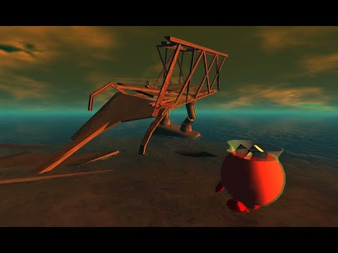
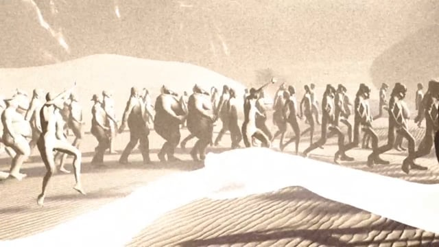
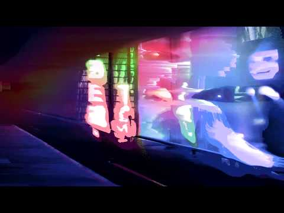
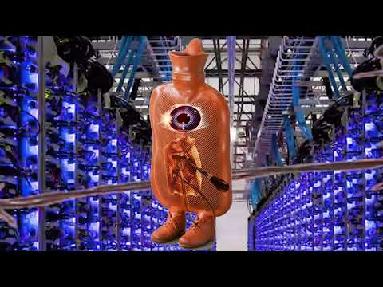
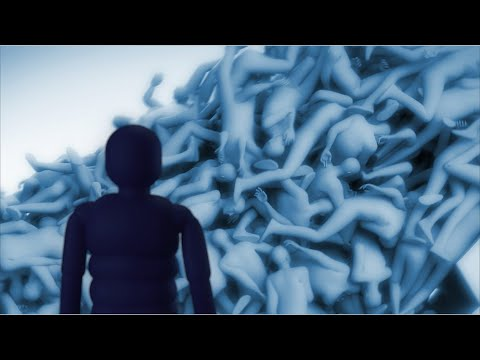

# Jon Rafman

**Tag tecnica/formato:** `video` `vr-ar` `net-art-sito-web`
**Tag tema:** `economia-attenzione` `mondi-virtuali-simulazione` `performance-nei-mondi-virtuali`
**Tag corso:** `TAD-DCV` `TAD-AVM` `M3D`

## Biografia
Artista canadese (Montréal).

## Poetica e ricerca
Rafman lavora su tecnologia e media digitali, spesso usando la narrazione per riconnettere gli utenti alla società e alla storia. Gran parte del suo lavoro si concentra sulla malinconia delle interazioni sociali contemporanee, delle community online e delle realtà virtuali (soprattutto Google Earth, Google Street View, Second Life), portando alla luce la loro bellezza con toni talvolta debitori del Romanticismo. Nei lavori più recenti il registro si fa più cupo: dystopie post-umane popolate da avatar senza volto, in cui l'alienazione contemporanea viene esasperata fino al collasso.

## Opere principali
### Kool-Aid Man in Second Life (2008-2011)
**Corso:** `TAD-AVM`
**Temi:** `avatar-e-corpo-virtuale` `performance-nei-mondi-virtuali`
**Descrizione:** l'artista performa dentro *Second Life* nei panni del Kool-Aid Man, generando conversazioni e situazioni kitsch con altri utenti.
**Lettura critica:** collassa il registro celebrativo e quello della critica ironica, mostrando come i due si siano confusi nella cultura visiva della sua generazione.
**Video:** [sito dedicato del progetto, con conversazione tra Jon Rafman e Nicholas O'Brien](http://koolaidmaninsecondlife.com/)

**Approfondimento:** [koolaidmaninsecondlife.com](http://koolaidmaninsecondlife.com/)

### Dream Journal (2016/2019)
**Corso:** `M3D` `TAD-AVM`
**Temi:** `sogno-e-inconscio` `realismo-sintetico`
**Descrizione:** film CGI surrealista che intreccia il lessico visivo del deep web con fantasie subconsce; due protagoniste attraversano una serie di inferni digitali, con echi danteschi.
**Lettura critica:** riflette il sovraccarico informativo della psiche contemporanea e la struttura associativa/erratica della navigazione tra pagine e hyperlink.

### Transdimensional Serpent (2016)
**Corso:** `M3D`
**Temi:** `sogno-e-inconscio`
**Descrizione:** esperienza Oculus Rift di 4 minuti, ambientata in uno spazio soprannaturale popolato da creature fantastiche.
**Lettura critica:** porta la riflessione sulla tecnologia da metafora a esperienza fisica/immersiva concreta.
**Video:** [documentazione (Vimeo)](https://vimeo.com/273354315)

### Legendary Reality (2017)
**Corso:** `TAD-AVM` `TAD-DCV`
**Temi:** `sogno-e-inconscio`
**Descrizione:** film-saggio di fantascienza, struttura non lineare che intreccia sogno e memoria, fotografie trovate elaborate digitalmente e paesaggi 3D tratti da videogiochi.
**Lettura critica:** meditazione in stream-of-consciousness su arte, identità e tempo.

### Poor Magic (2017) / Shadowbanned (2018) / Disasters Under the Sun (2019)
**Corso:** `M3D` `TAD-AVM`
**Temi:** `corpo-post-umano` `propaganda-e-media`
**Descrizione:** avatar 3D senza volto, torturati in spazi digitali astratti tramite crowd-simulation software; estetica delle teorie del complotto online, ricostruzioni CG di luoghi storici (giardino di Bomarzo).
**Lettura critica:** immagine di una distopia post-umana in cui l'umanità è caricata in un purgatorio virtuale — o forse ritratto brutale del presente, dove il mondo dominato dagli algoritmi agisce già sulla carne e la psiche. Come dichiara l'artista: "ciò che mi preoccupa è il senso generale di intrappolamento e isolamento provato da molti, mentre la vita sociale e politica diventa sempre più astratta e l'esperienza smaterializzata."
**Video:** [Poor Magic (YouTube, da 5:56)](https://www.youtube.com/watch?v=RRFl0dQh-HI&t=356s) · [Shadowbanned (YouTube)](https://www.youtube.com/watch?v=wv8McljqcGA&t=6s) · [Disasters Under the Sun (YouTube)](https://www.youtube.com/watch?v=vnTO-1w8oaQ)

### Punctured Sky (2021)
**Descrizione:** video 4K di circa 21 minuti. Un narratore mai visto ritrova un vecchio amico nel retro di un negozio di fumetti e giochi in un centro commerciale abbandonato; l'amico gli chiede se ricorda il videogioco preferito della loro infanzia, di cui è sparita ogni traccia dalla storia. Il narratore attraversa allora un universo parallelo di ibridi animale-umano per scoprire che cosa gli sia successo. Intreccia foto trovate rielaborate digitalmente e paesaggi 3D presi da videogiochi, in uno stile di collage fotografico animato.
**Lettura critica:** tra i lavori video di Rafman, quello strutturato più come un film narrativo convenzionale; riprende i temi della memoria, dell'isolamento e della nostalgia per il web e i giochi dell'infanzia. Da non confondere con il rotolo illustrato *Punctured Sky* (2019), realizzato con il fumettista Connor Willumsen per la Biennale di Sharjah.

## Interviste e talk
- _Nessuna ancora: da aggiungere._

## Fonti
- [Leiden Shorts — Punctured Sky](https://leidenshorts.nl/film/punctured-sky/)
- [Sharjah Art Foundation — Jon Rafman, various works, 2017-2019](https://v1.sharjahart.org/sharjah-art-foundation/projects/jon-rafman-various-works-20172019)
- [jonrafman.com](https://jonrafman.com/)
- [Dream Journal (Vimeo)](https://vimeo.com/349313505)
- [Legendary Reality](https://www.youtube.com/watch?v=i7cia6AUyvE)

## Crediti delle immagini
Immagine per ciascuna delle sette opere, inclusa sotto la relativa descrizione in "Opere principali", da YouTube e Vimeo.
- [jonrafman.com](https://jonrafman.com/)
