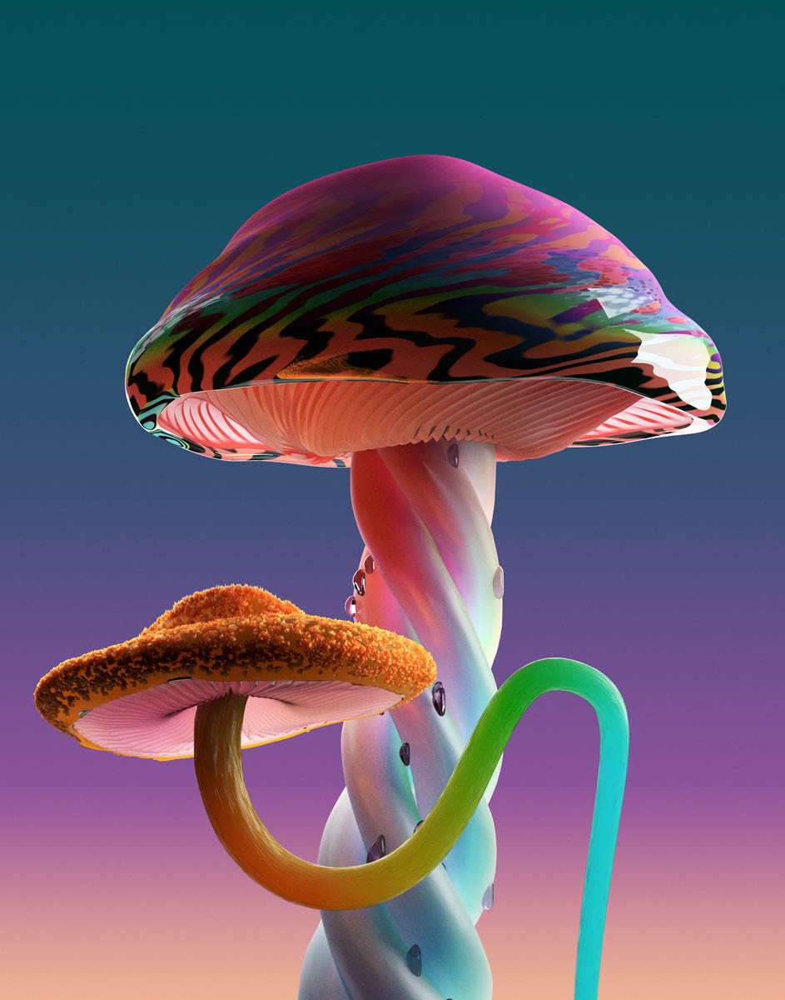
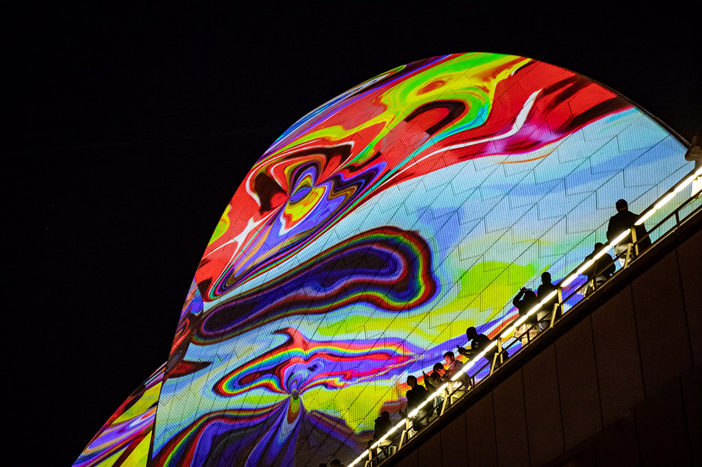
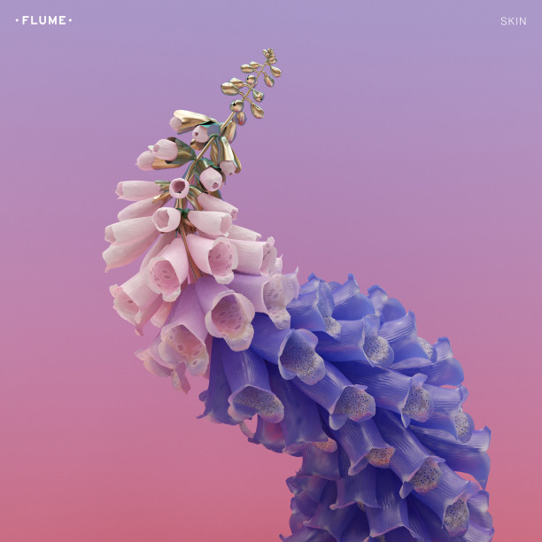
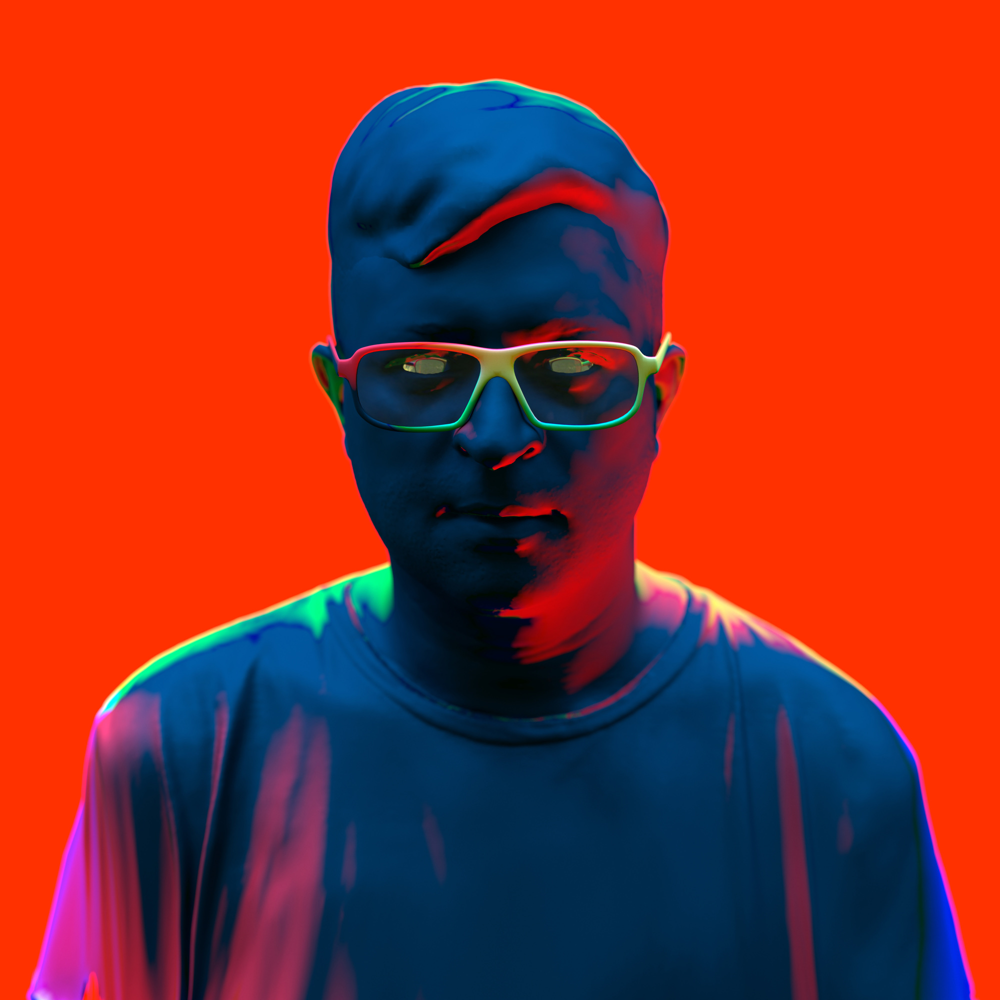

# Jonathan Zawada (zawada.art)

**Tag tecnica/formato:** `modellazione-3d` `procedurale-generativo` `ai-generativa`
**Tag tema:** `ecologia-ambiente` `economia-attenzione`
**Stato:** artista australiano, nato a Perth nel 1981 (non polacco, come suggerirebbe il cognome) · non reperiti i video della proiezione Metamathemagical e del film per Tall Tales

## Biografia
Nato nel 1981 a Perth, Australia Occidentale. Artista, designer e regista musicale multidisciplinare, con pratica che spazia da pittura, immagine digitale, installazione a design di prodotto; oggi con base a Los Angeles. La carriera iniziale come designer web e grafico commerciale gli ha fornito le competenze tecniche alla base della sua produzione digitale attuale. Ha realizzato copertine e immagini per musicisti quali Dua Lipa, Flume, Baauer, The Presets — vincendo ARIA Award (il principale premio musicale australiano) per la copertina di *Apocalypso* dei The Presets e per *Skin* di Flume. Nel 2018 realizza la proiezione "Metamathemagical" sulle vele dell'Opera House di Sydney nell'ambito di Vivid Sydney. Nel 2025 firma opere d'arte, videoclip e un film di accompagnamento per l'album *Tall Tales* di Mark Pritchard e Thom Yorke.

## Poetica e ricerca
Zawada crea scene e design "perturbanti" ricorrendo a un ampio ventaglio di strumenti di modellazione 3D — la maggior parte del suo lavoro nasce in **Blender**, programma che gli consente texture realistiche capaci di produrre lo stile perturbante/uncanny per cui è noto. Il suo lavoro incorpora spesso metodi generativi: la serie *Rare Mushrooms* (2017) combina immagini create in Blender con software di machine learning, così da randomizzare ogni iterazione del design dei funghi, generando un insieme virtualmente illimitato di formazioni uniche. Ha inoltre sviluppato strumenti generativi personalizzati e incorporato l'IA per visualizzare dati come suono e atmosfera. Il suo lavoro è spesso fortemente texturizzato, conferendogli una qualità onirica e surreale. *Highsnobiety*, coprendo il progetto NFT realizzato con Flume, sottolinea come Zawada dimostri che gli NFT "non esistono solo online" — un'attenzione costante nella sua pratica al rapporto fra artefatto digitale e sua manifestazione fisica/materiale.

## Opere principali
### Rare Mushrooms (2017)
**Descrizione:** serie di immagini che combina modellazione in Blender con software di machine learning per randomizzare ogni iterazione del design dei funghi, generando un insieme virtualmente illimitato di formazioni uniche.
**Lettura critica:** primo esempio maturo dell'ibridazione fra modellazione 3D tradizionale e processi generativi/IA nella pratica dell'artista, applicata a un soggetto naturale (i funghi) reso perturbante dalla ripetizione algoritmica.

**Approfondimento:** [Big Active — Rare Mushrooms](https://bigactive.com/artists/jonathan-zawada/personal-work/rare-mushrooms/)

### Metamathemagical (2018, Vivid Sydney / Sydney Opera House)
**Descrizione:** proiezione site-specific sulle vele della Sydney Opera House, realizzata nell'ambito del festival Vivid Sydney.
**Lettura critica:** applicazione su scala monumentale e in un contesto istituzionale di primo piano (l'Opera House) del linguaggio visivo digitale dell'artista, segno del suo consolidamento nel circuito pubblico australiano.

**Approfondimento:** [Big Active — Metamathemagical](https://bigactive.com/artists/jonathan-zawada/commercial-projects/vivid/)

### Skin, artwork per Flume (copertina album, ARIA Award)
**Descrizione:** artwork di copertina per l'album *Skin* di Flume, vincitore di un ARIA Award.
**Lettura critica:** parte di un sodalizio pluriennale con il musicista australiano Flume, che ha portato anche alla collezione NFT *Tiddalik* (animazioni 3D ispirate alla flora nativa australiana, con paesaggi sonori firmati dallo stesso Flume).

### Tall Tales (2025, con Mark Pritchard e Thom Yorke)
**Descrizione:** artwork, videoclip musicali e film di accompagnamento realizzati per l'album *Tall Tales* di Mark Pritchard e Thom Yorke (Radiohead).
**Lettura critica:** *Creative Review* dedica un articolo al "twisted AI spin" che Zawada imprime alla copertina dell'album — segno dell'ulteriore integrazione di strumenti di IA generativa nella sua pratica più recente.

**Approfondimento:** [warp.net — Tall Tales](https://warp.net/talltales)

## Interviste e talk
- [Highsnobiety — "Flume & Zawada Prove That NFTs Don't Just Exist Online"](https://www.highsnobiety.com/p/flume-zawada-nft-interview/)
- [Yellowtrace — intervista](https://www.yellowtrace.com.au/jonathan-zawada-interview/)

## Fonti
- [Wikipedia — Jonathan Zawada](https://en.wikipedia.org/wiki/Jonathan_Zawada)
- [Creative Review — "Jonathan Zawada puts a twisted AI spin on Mark Pritchard cover art"](https://www.creativereview.co.uk/mark-pritchard-art-jonathan-zawada/)
- [Digital Arts at Sydney — "Giving Movement to Still Life – Jonathan Zawada"](https://digitalartsatsydney.wordpress.com/2021/08/24/giving-movement-to-still-life-jonathan-zawada/)
- [RED•EYE Magazine — "In Between Natural and Artificial: Jonathan Zawada's Creative Universe"](https://red-eye.world/c/in-between-natural-and-artificial-jonathan-zawada-s-creative-universe)
- [Cool Hunting — "Flume + Jonathan Zawada Pop-Up in LA"](https://coolhunting.com/culture/flume-jonathan-zawada-pop-up-la/)

## Crediti delle immagini
Immagine per ciascuna delle quattro opere, inclusa sotto la relativa descrizione in "Opere principali", da Big Active e Warp Records.
- [Wikipedia — Jonathan Zawada](https://en.wikipedia.org/wiki/Jonathan_Zawada)
- [Highsnobiety — "Flume & Zawada Prove That NFTs Don't Just Exist Online"](https://www.highsnobiety.com/p/flume-zawada-nft-interview/)
- [Creative Review — "Jonathan Zawada puts a twisted AI spin on Mark Pritchard cover art"](https://www.creativereview.co.uk/mark-pritchard-art-jonathan-zawada/)
