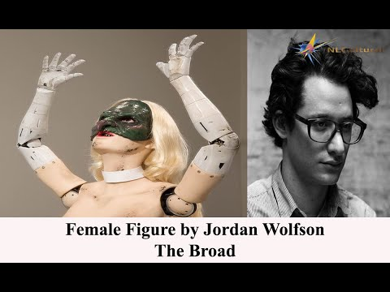
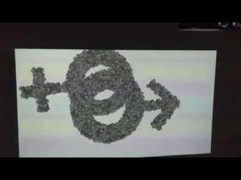
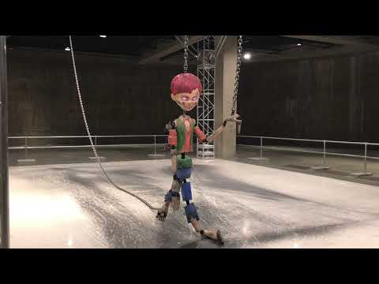
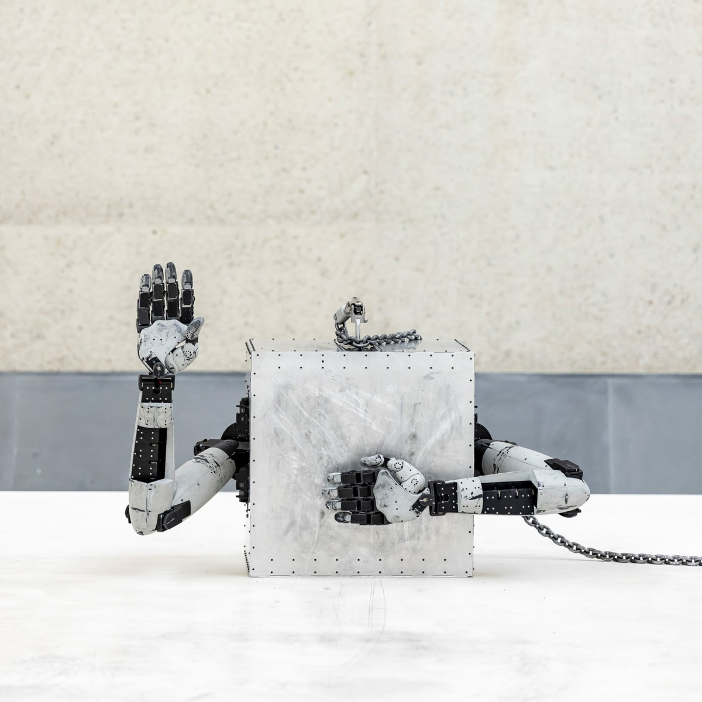

# Jordan Wolfson

**Tag tecnica/formato:** `modellazione-3d` `vr-ar` `installazione`
**Tag tema:** `corpo-identita` `economia-attenzione`

⚠️ **Avviso di contenuto:** l'opera *Real Violence* (2017) raffigura una scena sostenuta di violenza interpersonale estrema in realtà virtuale. La descrizione in questa scheda resta volutamente non grafica — si limita ai fatti essenziali necessari alla comprensione critica dell'opera, senza dettagli ulteriori.
**Stato:** Real Violence richiede un avviso di contenuto esplicito in qualunque uso didattico: la descrizione è volutamente non grafica

## Biografia
Nato il 9 ottobre 1980 a New York. BFA in scultura alla Rhode Island School of Design (2003). Rappresentato da David Zwirner dal 2013, contemporaneamente da Sadie Coles HQ (Londra); dal 2022 rappresentazione condivisa/ampliata con l'ingresso di Gagosian. Partecipa più volte al Whitney Biennial (2006, 2017). Presentazioni istituzionali principali: David Zwirner New York (personale d'esordio, 2014); Stedelijk Museum Amsterdam ("manic / love / truth / love"); Tate Modern (Tanks, *Colored sculpture*, 2018-19); LUMA Foundation Arles; National Gallery of Australia (*Body Sculpture*, prima mondiale, dicembre 2023).

## Poetica e ricerca
Wolfson lavora fra CGI, animatronica, video e scultura per mettere in scena scenari di desiderio, aggressione e spettatorialità che coinvolgono la posizione stessa dello spettatore come consumatore di immagini. Sulla violenza come soggetto, l'artista ha dichiarato: "La violenza è ovunque. È inevitabile. Basta andare online, accendere la TV, o osservare il proprio sé sveglio, poi osservare il proprio sé inconscio e registrare i propri sogni." Sul registro etico del proprio lavoro ha detto di essere "personalmente... disgustato dalla violenza" ma di usarla "come materia prima" per esplorare "la nostra risposta primaria ad essa", definendo la posizione dello spettatore un "testimone passivo" analogo al consumo mediatico quotidiano. Riguardo a *Real Violence* nello specifico, Wolfson ha dichiarato che la violenza raffigurata è pensata per registrarsi come "reale" dal punto di vista esperienziale piuttosto che "simulata", con un effetto corporeo descritto come "euforico" dato dalle qualità immersive/aptiche della VR. Wolfson ha respinto ripetutamente letture politiche/allegoriche del proprio lavoro, dichiarando: "Il mio lavoro non ha un'agenda." La critica Diana Hamilton, su *Frieze*, offre una lettura dissenziente di *(Female figure)*, sostenendo che l'opera "non riguarda la misoginia, né le donne, ma la composizione in sé". Il Whitney Biennial 2017 (curatori Christopher Y. Lew e Mia Locks) è stato ampiamente descritto dal critico Jerry Saltz come "la [biennale] più politicamente carica da decenni" — un'inquadratura applicata spesso all'inclusione di *Real Violence*.

## Opere principali
### (Female figure) (2014)
**Descrizione:** scultura animatronica a grandezza naturale: una donna robotica in négligé, stivali in vinile fino alla coscia e maschera verde da strega, sporca di macchie di terra, che balla musica pop per un ciclo di circa 7 minuti davanti a uno specchio, con un monologo doppiato dallo stesso Wolfson. Tecnologia di riconoscimento facciale/tracking le permette di stabilire contatto visivo con gli spettatori tramite lo specchio; visione per due persone alla volta. Debutta da David Zwirner, New York, marzo-aprile 2014, e a "14 Rooms", Art Basel 2014.
**Lettura critica:** ampiamente discussa come opera che solleva "lo spettro della misoginia", intensificando le dinamiche dello sguardo e del consumo dell'immagine femminile, sebbene la critica sia divisa sul fatto che l'opera critichi o riproduca tale dinamica.
**Video:** [The Broad, documentazione (YouTube)](https://www.youtube.com/watch?v=_FI99pdNgeg) · [VernissageTV, "(Female Figure) 2014 / 14 Rooms" (YouTube)](https://www.youtube.com/watch?v=mVTDypgmFCM) · [MOCAtv, conversazione in studio (YouTube)](https://www.youtube.com/watch?v=auix-QLJwSo)

**Approfondimento:** [The Broad — (Female figure)](https://www.thebroad.org/art/jordan-wolfson/female-figure)

### Raspberry Poser (2012)
**Descrizione:** video digitale che mescola CGI e animazione disegnata a mano, colore/sonoro, 13:55 minuti; terzo di una trilogia animata con *Animation, Masks* (2011) e *(Con Leche)* (2009). Wolfson stesso appare come un punk rasato che vaga per Parigi; il video raffigura anche preservativi a forma di cuore, cellule ematiche mutanti e un virus HIV antropomorfo. Prima al REDCAT, Los Angeles.
**Lettura critica:** descritto (materiali David Zwirner/Whitney) come la sintesi più ambiziosa di Wolfson fra CGI e strategie del cartone animato classico (indirizzo diretto, ripetizione/mutazione della forma), che affronta l'ansia dell'era AIDS, la sessualità e l'iconografia pop/di consumo.

**Approfondimento:** [Chisenhale Gallery — Raspberry Poser](https://chisenhale.org.uk/project/jordan-wolfson/)

### Colored sculpture (2016)
**Descrizione:** installazione animatronica: un pupazzo minaccioso di oltre 2 metri con occhi a schermo digitale e tratti da "ragazzo" da cultura pop (che evoca Huckleberry Finn, Howdy Doody, Alfred E. Neuman di Mad magazine), sospeso e sollevato, trascinato e lasciato cadere violentemente da catene meccanizzate in un ciclo di 15 minuti, con colonna sonora che alterna "When a Man Loves a Woman" a un testo parlato minaccioso di Wolfson. Prima da David Zwirner NY (2016); poi Tate Modern (Tanks, 2018-19), LUMA Foundation Arles, Stedelijk Amsterdam.
**Lettura critica:** letta come aggiornamento in chiave Jeff Koons dell'iconografia pop dell'infanzia maschile, resa violenta, mettendo in scena crudeltà verso un oggetto apparentemente senziente.
**Video:** [YouTube — "Colored Sculpture by Jordan Wolfson at The Tate Modern"](https://www.youtube.com/watch?v=g6ysJP_mu5Q)

**Approfondimento:** [Tate — Colored sculpture](https://www.tate.org.uk/art/artworks/wolfson-colored-sculpture-t15218)

### Real Violence (2017, Whitney Biennial 2017)
⚠️ **Avviso di contenuto** — vedi nota in testa alla scheda.
**Descrizione:** video HD in VR, colore/sonoro, 2:25 minuti, mostrato in un'installazione con visori a accesso limitato al Whitney Biennial 2017. Lo spettatore, indossando il visore, assiste a una scena sostenuta di violenza interpersonale estrema fra due uomini, con una colonna sonora di una benedizione ebraica/di Hanukkah eseguita prima e dopo la sequenza. L'opera non fornisce alcun contesto narrativo o spiegazione. Un avviso di trigger warning era esposto all'ingresso della galleria, con accesso ai visori limitato tramite sistema a coda.
**Lettura critica:** l'opera ha generato un dibattito critico sostenuto sull'uso delle capacità immersive/aptiche della VR per produrre nausea "empatica" viscerale e corporea piuttosto che significato narrativo, e sull'etica di una violenza esteticizzata priva di inquadramento politico; alcuni critici hanno inoltre segnalato disagio per la violenza raffigurata "fra bianchi" e per l'inquadratura liturgica ebraica, leggendovi possibili (contestati) sottotesti legati all'Olocausto. Wolfson ha respinto letture politiche ("Il mio lavoro non ha un'agenda").

⚠️ Nessuna immagine inclusa per quest'opera, in coerenza con l'avviso di contenuto in testa alla scheda: qualunque fotogramma reale del video ne mostrerebbe la scena di violenza esplicita.

### Body Sculpture (2023, National Gallery of Australia, Canberra)
**Descrizione:** grande scultura robotica sviluppata con il roboticista/compositore/coreografo Mark Setrakian e, per l'installazione australiana, con il co-fondatore di Wētā Workshop Richard Taylor. Prima mondiale alla National Gallery of Australia, dicembre 2023 — prima personale di Wolfson in Australia; acquisita dalla NGA per circa 6,67 milioni di dollari australiani (circa metà del budget annuale di acquisizioni del museo). L'opera affronterebbe, secondo la stampa, il tema del suicidio.
**Lettura critica:** presentata dalla stampa sia come spettacolo tecnico/robotico sia come continuazione dell'interesse di Wolfson per il corpo perturbante, animato ma non vivo; il prezzo elevato dell'acquisizione è diventato esso stesso parte della conversazione critica sul valore e sullo spettacolo di mercato attorno al suo lavoro.

**Approfondimento:** [National Gallery of Australia — Body Sculpture](https://nga.gov.au/exhibitions/jordan-wolfson-body-sculpture/)

## Interviste e talk
- [The Quietus — "Violence Is Everyone: An Interview With Jordan Wolfson"](https://thequietus.com/culture/art/jordan-wolfson-interview/)

## Fonti
- [David Zwirner — pagina artista](https://www.davidzwirner.com/artists/jordan-wolfson)
- [Whitney Museum — pagina artista](https://whitney.org/artists/10209)
- [Whitney Museum — Real Violence, Biennial 2017](https://whitney.org/exhibitions/2017-biennial/art?section=62)
- [Tate — Colored sculpture, pagina opera](https://www.tate.org.uk/art/artworks/wolfson-colored-sculpture-t15218)
- [The Broad — (Female figure)](https://www.thebroad.org/art/jordan-wolfson/female-figure)
- [National Gallery of Australia — Body Sculpture](https://nga.gov.au/exhibitions/jordan-wolfson-body-sculpture/)
- [Frieze — "Who Likes Jordan Wolfson?"](https://www.frieze.com/article/who-likes-jordan-wolfson)
- [Hyperallergic — "Jordan Wolfson Evades the Politics of His Violent Images"](https://hyperallergic.com/387090/jordan-wolfson-evades-the-politics-of-his-violent-images/)
- [SAGE Journals — Bollmer & Guinness, saggio accademico su Real Violence](https://journals.sagepub.com/doi/abs/10.1177/1470412920906261)

## Crediti delle immagini
Immagine per quattro delle cinque opere, inclusa sotto la relativa descrizione in "Opere principali", da fonti istituzionali/museali e YouTube. Nessuna immagine per *Real Violence* per l'avviso di contenuto in testa alla scheda.
