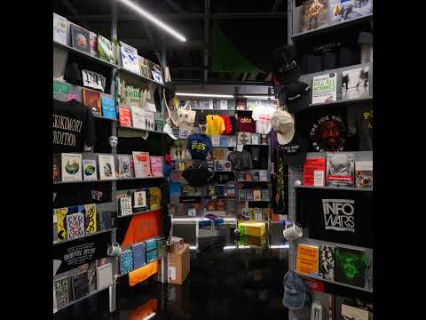

# Joshua Citarella (con New Models)

**Tag tecnica/formato:** `installazione` `net-art-sito-web`
**Tag tema:** `economia-attenzione` `game-culture`
**Tag corso:** `TAD` `M3D`

## Biografia
Artista e ricercatore statunitense, fondatore/collaboratore della piattaforma editoriale **New Models**. *(Biografia da approfondire.)*

## Poetica e ricerca
Citarella studia la frammentazione algoritmica di internet in comunità di nicchia ideologicamente polarizzate — quello che descrive come la "suburbanizzazione" dello spazio della rete: non più grandi piazze condivise, ma una costellazione di spazi chiusi con propria cultura ed estetica. Il suo lavoro raccoglie e analizza gli artefatti materiali che queste enclave digitali producono per il mondo fisico (merchandising, oggetti di consenso), leggendoli come "istantanee" dell'ideologia dei loro creatori.

## Opere principali

### Online Marketplace of Ideas (2026, con New Models, allestimento di sub)
**Descrizione:** installazione che raccoglie un campionario di merchandise da content creator — t-shirt, cappelli e altri capi drop-ship — insieme a opere di artisti che operano sul livello dei protocolli che regolano produzione e circolazione dei contenuti online.
**Lettura critica:** il merch come "tecnologia del consenso": una volta indossato, diventa prova di appartenenza a una comunità ideologica — la più antica forma analogica di comunicazione politica, oggi al servizio di ecosistemi social frammentati algoritmicamente. (Testo di sala, mostra "Strange Rules", Palazzo Diedo, Venezia.)

**Approfondimento:** [joshuacitarella.com](https://www.joshuacitarella.com)

## Immagini

Immagine per l'unica opera in scheda, da un video di presentazione su YouTube. Trovato anche il sito ufficiale dell'artista, non individuato nella ricerca originale: [joshuacitarella.com](https://www.joshuacitarella.com).

## Fonti
- Testo di sala, "Strange Rules", Palazzo Diedo, Venezia (foto scattata dal docente, 9 agosto 2026)
- [joshuacitarella.com — sito ufficiale](https://www.joshuacitarella.com)
- [New Models — "The Online Marketplace of Ideas w/ Joshua Citarella"](https://newmodels.substack.com/p/the-online-marketplace-of-ideas-w)

---

## Appunti da organizzare
- Fonte unica finora: testo di sala fotografato dal vivo. Biografia, altre opere e sito ufficiale ancora da ricercare.
