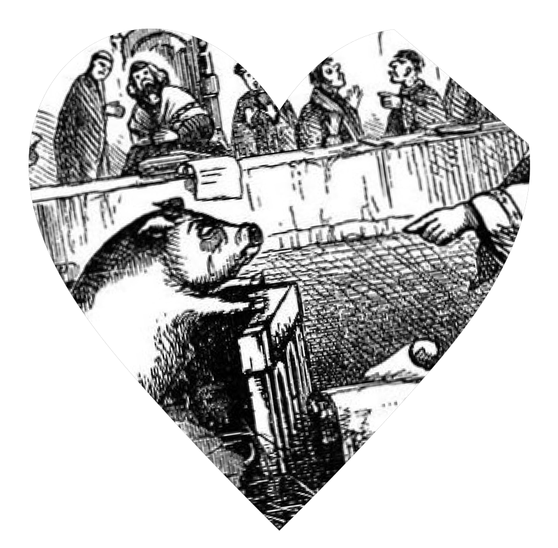

# Juliana Huxtable

**Tag tecnica/formato:** `performance-dal-vivo` `video`
**Tag tema:** `corpo-identita` `genere-queerness`
**Stato:** scheda parziale, scritta a partire da fonti web (Wikipedia, siti di festival e gallerie); non ancora assegnata a un corso · immagini controllate (diritti degli autori)

## Biografia
Artista, scrittrice, performer e DJ statunitense nata il 29 dicembre 1987, cresciuta in Texas. Cofondatrice del progetto di vita notturna newyorkese Shock Value e membro del collettivo House of Ladosha. Ha esposto in sedi come Reena Spaulings Fine Art; fa parte della Triennale del New Museum del 2015 (*Surround Audience*, come partecipante e musa) e della Biennale di Berlino del 2016 (KW Institute). Opere nelle collezioni del Guggenheim e dello Studio Museum in Harlem; nel 2019 è United States Artists Fellow.

## Poetica e ricerca
Lavora tra poesia, performance, musica, immagine e scrittura (tra i suoi libri, *Mucus in My Pineal Gland*).

## Opere principali

### Penumbra (2019)
**Descrizione:** Opera in collaborazione con Hannah Black (vedi la sua scheda): un pangolino viene processato in tribunale per «l'omicidio di ogni cosa», con Huxtable nel ruolo della difesa. Animazione 3D dello studio And/Or Forever.

### Pretty Canary (2025)
**Descrizione:** Mostra al Turun taidemuseo, Finlandia, dal 6 giugno al 14 settembre 2025.

⚠️ Nessuna immagine trovata.

## Fonti
- [Wikipedia — Juliana Huxtable](https://en.wikipedia.org/wiki/Juliana_Huxtable)
- [Studio Museum in Harlem — Juliana Huxtable](https://www.studiomuseum.org/artists/juliana-huxtable)
- [United States Artists — Juliana Huxtable](https://www.unitedstatesartists.org/fellow/juliana-huxtable)
- [Turun taidemuseo — Pretty Canary](https://turuntaidemuseo.fi/en/nayttelyt/juliana-huxtable)
- [Performance Space New York — Penumbra](https://performancespacenewyork.org/shows/penumbra/)

## Crediti delle immagini
Immagini controllate il 2026-11-01: provengono dalle pagine indicate (festival, gallerie, siti degli artisti, piattaforme) e restano di proprietà degli autori.
- Penumbra (1): [dis.art](https://dis.art/penumbra) · Immagine promozionale / fotogramma ufficiale, diritti degli autori; uso didattico
- Penumbra (2): [performancespacenewyork.org](https://performancespacenewyork.org/shows/penumbra/) · Immagine promozionale / fotogramma ufficiale, diritti degli autori; uso didattico
