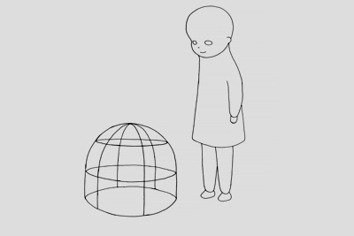
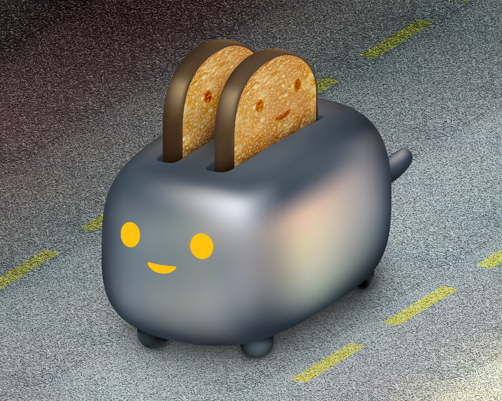
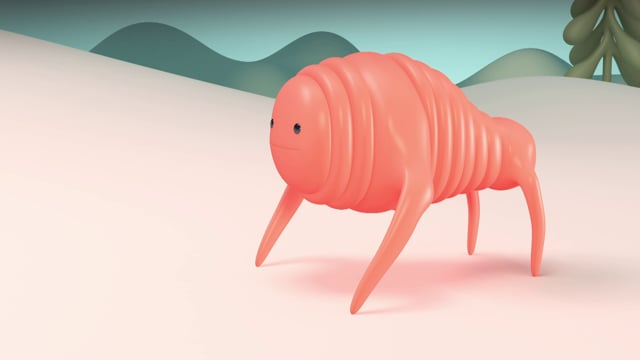
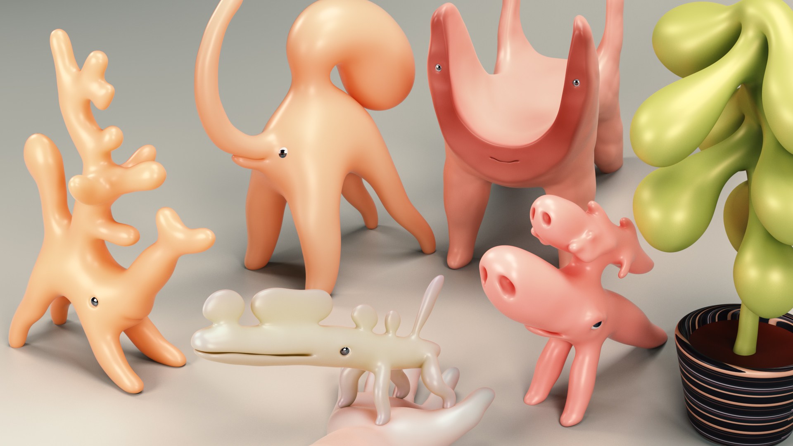

# Jun Seo Hahm

**Tag tecnica/formato:** `animazione-2d` `modellazione-3d`
**Tag tema:** `corpo-identita` `fantascienza-speculativa`

## Biografia
Jun Seo Hahm (함준서) è un regista di animazione, designer e artista media coreano, oggi con base fra Seoul e Honolulu. Secondo la sua stessa biografia, studia Art Science (teoria dell'arte) alla Hongik University in Corea e Animazione Sperimentale al California Institute of the Arts (CalArts), dove nel 2003 realizza il proprio lavoro finale da studente. Lavora come designer e regista presso lo studio d'animazione **Bent Image Lab** di Portland, Oregon, e come planner presso **Cheil Worldwide** a Seoul — impiego confermato indirettamente dal fatto che la sua serie *Karnival* riporta esplicitamente il credito "prodotta a Bent Image Lab, 2007–2009". Riporta inoltre un periodo come docente alla Konkuk University (Corea) e un dottorato in corso in Arte e Tecnologia alla Sogang University di Seoul, con ricerca sulla vita artificiale. Ha oggi una **posizione accademica confermata in modo indipendente** presso la **School of Cinematic Arts della University of Hawai'i at Mānoa**, dove risulta nella pagina docenti dell'area Animazione.

⚠️ Nota metodologica: gran parte dei dettagli biografici (formazione, impieghi precedenti, dottorato) provengono principalmente dalla biografia auto-redatta dall'artista (junseohahm.com), ripresa poi in modo pressoché identico da siti secondari (Pictoplasma, Clockenflap, citylikeyou, Booooooom) — non sono stati reperiti archivi istituzionali indipendenti (es. albo laureati CalArts/Hongik) a conferma diretta. La posizione alla University of Hawai'i è invece confermata da una fonte istituzionale indipendente (il sito dell'ateneo), il grado accademico esatto (assistant/associate professor) andrebbe però verificato direttamente sulla pagina.

## Poetica e ricerca
Il lavoro di Hahm è costantemente descritto — da lui stesso e dalla critica — come un'esplorazione di forme creaturali ibride di ispirazione biologica: frammenti di organismi, parti animali e anatomie immaginarie ricombinate in personaggi. L'artista definisce il proprio processo **"reverse-biology"** ("biologia inversa"): parte da disegni a matita di organismi e costruisce personaggi a partire da parti/forme che potrebbero plausibilmente muoversi in modo interessante. *It's Nice That* colloca il suo lavoro nella corrente estetica giapponese del **kimo-kawaii** ("carino-disgustoso"), descrivendo i suoi personaggi come collocati "all'intersezione fra dolce e strano, sexy e repellente", leggendoli attraverso la lente della uncanny valley — lettura ribadita indipendentemente anche dal sito Artist Run Website ("Uncanny Valley: Art by Jun Seo Hahm") e da *Booooooom*, che descrive le sue composizioni digitali come capaci di esprimere "componenti biologiche frammentate e forme organiche stranamente rimosse dal loro contesto abituale". Sul piano tecnico, *It's Nice That* riporta una dichiarazione diretta dell'artista sull'uso della resa a **sub-surface scattering (SSS)**: "Mi piace l'aspetto organico dell'SSS e uso molto questa tecnica, ma di solito non uso texture di pelle iper-realistiche e bitorzolute, in modo che le mie creature possano restare in un regno simbolico, piuttosto che reale" — un uso deliberato e distintivo di una tecnica di rendering esistente per mantenere le proprie creature in un registro simbolico anziché fotorealistico (non un'invenzione della tecnica stessa, che è un metodo di rendering consolidato).

## Opere principali
### Mosition (2003)
**Descrizione:** animazione a disegni (disegnata a mano), 4 minuti e 31 secondi, realizzata come lavoro finale da studente al CalArts. Secondo la pagina progetto dell'artista, raffigura "due oggetti che si incontrano in una successione di schermi incrociati", con un oggetto che si separa dall'altro — un lavoro di impianto formalista, incentrato sul meccanismo stesso del movimento animato.
**Lettura critica:** riportato come vincitore del secondo posto categoria Moving Image agli Adobe Design Achievement Award 2004; questa affermazione è auto-riportata dall'artista e non è stata rintracciata in modo indipendente in un archivio ufficiale dei vincitori — da trattare con cautela ("secondo l'artista") fino a verifica diretta.

**Approfondimento:** [junseohahm.com — Mosition](https://junseohahm.com/Mosition)

### Karnival (serie, 2007-2009)
**Descrizione:** serie di brevissimi episodi di animazione 2D (dieci episodi) incentrati sui "comportamenti imprevedibili di personaggi unici", prodotta presso Bent Image Lab.
**Lettura critica:** opera principale discussa da *It's Nice That* (2018) nell'ambito della lettura kimo-kawaii/uncanny valley — l'occasione in cui l'artista descrive il proprio metodo di "reverse-biology" nella costruzione dei personaggi.

**Approfondimento:** [junseohahm.com — Karnival](https://junseohahm.com/Karnival)

### Walking Follows Form (2014)
**Descrizione:** cortometraggio CGI 3D (circa 2 minuti e 45 secondi) che esplora come la struttura corporea di un personaggio ne determini lo stile/pattern di camminata.
**Lettura critica:** presentato al **DOT MOV Festival 2014** di Tokyo (fonte indipendente: l'archivio del festival su SHIFT, piattaforma giapponese di cultura digitale/media art) — la fonte terza più solida reperita per questo artista, indipendente dal suo stesso sito. L'artista è stato inoltre artista ospite a Pictoplasma Berlino 2016 (Contemporary Character Design Conference), anche se non è confermato che *Walking Follows Form* specificamente sia stata l'opera proiettata in quell'occasione.
**Video:** [Walking Follows Form (Vimeo)](https://vimeo.com/96460120)

### Fiction Fauna (progetto in corso)
**Descrizione:** progetto collaborativo (con un collaboratore/studio indicato come "LUV") che sviluppa un cast di "animali domestici biologici" — creature artificiali con personalità basate su IA e proprie storie individuali, estendendo la pratica di character design dell'artista dallo schermo a un contesto transmediale/di IP più ampio.
**Lettura critica:** rappresenta l'evoluzione più recente della ricerca dell'artista sulla "biologia inversa", applicata non più solo all'animazione ma alla costruzione di personaggi-prodotto con proprie narrazioni autonome.

**Approfondimento:** [fictionfauna.com](https://www.fictionfauna.com/)

## Interviste e talk
- _Nessuna ancora: da aggiungere._

## Fonti
- [junseohahm.com — sito ufficiale](https://junseohahm.com/)
- [junseohahm.com — pagina Mosition](https://junseohahm.com/Mosition)
- [junseohahm.com — pagina Karnival](https://junseohahm.com/Karnival)
- [University of Hawai'i at Mānoa, School of Cinematic Arts — pagina docente](https://manoa.hawaii.edu/cinema/staff-member/jun-seo-hahm/)
- [It's Nice That — "Jun Seo Hahm's animated characters straddle the terrifying line of cute and icky"](https://www.itsnicethat.com/articles/jun-seo-hahm-karnival-animation-090518)
- [Booooooom — "Artist Spotlight: Jun seo Hahm" (1 luglio 2016)](https://www.booooooom.com/2016/07/01/artist-spotlight-jun-seo-hahm/)
- [SHIFT — archivio DOT MOV Festival 2014](https://www.shift.jp.org/en/archives/2014/11/dotmov_festival_2014.html)
- [Pictoplasma Conference — pagina artista 2016](https://conference.pictoplasma.com/2016/jun-seo-hahm/)
- [Fiction Fauna — sito del progetto](https://www.fictionfauna.com/)
- [Vimeo — canale artista](https://vimeo.com/junseohahm)

## Crediti delle immagini
Immagine per ciascuna delle quattro opere, inclusa sotto la relativa descrizione in "Opere principali", dal sito dell'artista, Vimeo e fictionfauna.com.
- [junseohahm.com — sito ufficiale](https://junseohahm.com/)
- [junseohahm.com — pagina Mosition](https://junseohahm.com/Mosition)
- [junseohahm.com — pagina Karnival](https://junseohahm.com/Karnival)
