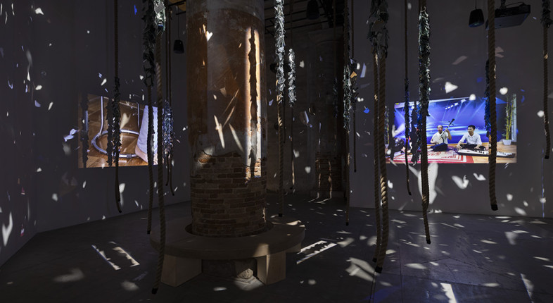
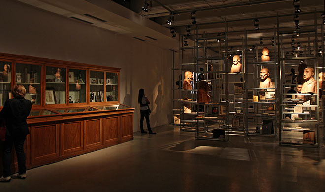
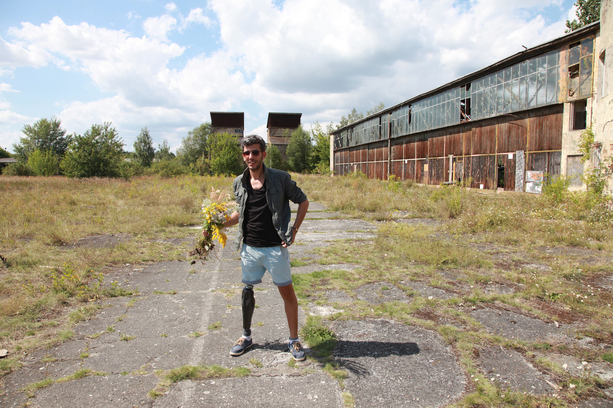

# Kader Attia

**Tag tecnica/formato:** `installazione`
**Tag tema:** `intelligenza-artificiale-critica` `colonialismo-decolonialita`

⚠️ **Nota di inquadramento**: Attia non è un artista "new media" — la sua pratica trentennale è scultorea/fotografica/installativa, incentrata sul concetto di "repair" (riparazione) e sul trauma coloniale, ortogonale al nucleo del database. Questa scheda è inclusa **in modo mirato** per un'unica opera, *Whisper of Traces* (2026), che offre un caso di studio utile e raro: una critica esplicita e articolata dell'intelligenza artificiale realizzata **senza usare media digitali** — schermi, codice o interfacce — utile in un modulo sul "posizionamento critico rispetto all'AI" proprio per contrasto con gli artisti "nativi digitali" del database (Ian Cheng, Lawrence Lek, Hito Steyerl). Non trattare come profilo generale dell'artista.
**Stato:** scheda mirata solo su Whisper of Traces, non è un profilo generale dell'artista · informazioni ricavate da risultati di ricerca, da riverificare

## Biografia
Nato nel 1970 a Dugny (Francia) da genitori algerini; cresciuto fra Parigi e Algeria, con periodi in Congo e Sud America prima degli studi d'arte. Formazione all'École Duperré di Parigi, alla Massana di Barcellona, diploma nel 1998 all'École Nationale Supérieure des Arts Décoratifs di Parigi. Vive fra Berlino e Parigi; professore di Time-Based Media alla Hochschule für bildende Künste (HFBK) di Amburgo. Vince il Prix Marcel Duchamp nel 2016, il più importante premio d'arte francese. Fonda a Parigi (2016-2018) La Colonie, spazio indipendente per discorsi decoloniali e transculturali. Espone a Documenta 13 (2012) e a precedenti edizioni della Biennale di Venezia (2017, 2019). Rappresentato da Galleria Continua, Lehmann Maupin, Regen Projects. Nel 2026 presente alla mostra centrale "In Minor Keys" della Biennale Arte, curata da Koyo Kouoh (Corderie dell'Arsenale) — occasione della visita che ha originato questa scheda.

## Poetica e ricerca

## Opere principali
### Whisper of Traces (2026, Biennale Arte, Corderie dell'Arsenale)
**Descrizione:** installazione labirintica — corridoio con statue rituali africane e arte moderna, contenitori in rete di erbe essiccate (tracce mnemoniche), corde ricoperte di frammenti di specchio che formano una "foresta". Vista dall'utente alla Biennale Arte 2026, 11 agosto 2026.
**Lettura critica:** testo curatoriale di Mohamed Amer Meziane; propone l'IA come daímön greco anziché come feticcio del capitale — critica antropologica/spirituale non occidentale della tecnologia digitale, realizzata senza usare media digitali.

**Approfondimento:** [Galleria Continua — Whisper of Traces](https://www.galleriacontinua.com/special-projects/whisper-of-traces-244/description)

### The Repair (from Occident to Extra-Occidental Cultures) (2012, Documenta 13)
**Descrizione:** installazione con sculture rituali africane accostate a foto di soldati della Prima guerra mondiale con ricostruzioni facciali chirurgiche.
**Lettura critica:** opera fondativa del concetto di "repair" nell'intero corpus dell'artista.

**Approfondimento:** [universes.art — The Repair, Documenta 13](https://universes.art/en/documenta/2012/photo-tour/fridericianum/22-kader-attia)

### Reflecting Memory (2016, Prix Marcel Duchamp; poi Block Museum, Northwestern, 2017)
**Descrizione:** video-documentario e sculture a specchio sulla sindrome dell'arto fantasma come metafora della memoria traumatica coloniale/genocidaria.

**Approfondimento:** [Northwestern University — Kader Attia: Reflecting Memory](https://www.blockmuseum.northwestern.edu/exhibitions/2017/kader-attia-reflecting-memory.html)

## Interviste e talk
- [Texte zur Kunst — "The Decolonizing Agency of Repair", conversazione con Nina Möntmann](https://www.textezurkunst.de/en/articles/kader-attia-nina-moentmann-decolonizing-agency-repair-objects-epistemologies-and-neoliberal-value-system/)

## Fonti
- [Lehmann Maupin — biografia](https://www.lehmannmaupin.com/artists/kader-attia/biography)
- [Galleria Continua — biografia](https://www.galleriacontinua.com/artists/kader-attia-7/biography)
- [Regen Projects — biografia](https://www.regenprojects.com/artists/kader-attia/biography)
- [Biennale Arte 2026 — pagina artista](https://www.labiennale.org/en/art/2026/kader-attia)
- [School of Visual Arts — "The Algorithmic State: Digital Repair with Kader Attia", 2023](https://sva.edu/events/the-algorithmic-state-digital-repair-with-kader-attia)
- [Artnet News — Prix Marcel Duchamp 2016](https://news.artnet.com/art-world/kader-attia-wins-2016-prix-marcel-duchamp-709298)
- [Universes in Universe — The Repair, Documenta 13](https://universes.art/en/nafas/articles/2012/kader-attia-documenta)

## Mostre viste
- *Biennale Arte 2026 — In Minor Keys*, Corderie dell'Arsenale, Venezia (2026) — visto da @danMa-hub

## Crediti delle immagini
Immagine per ciascuna delle tre opere, inclusa sotto la relativa descrizione in "Opere principali", da Galleria Continua, universes.art e contemporarylocus.it.
