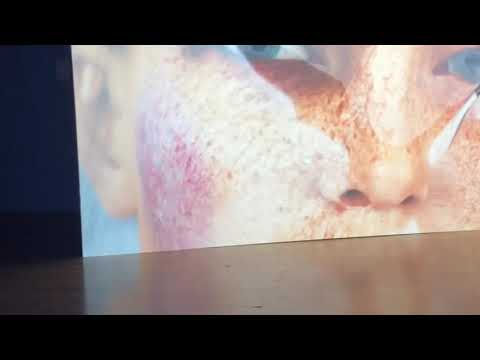

# Kate Cooper

**Tag tecnica/formato:** `modellazione-3d` `video`
**Tag tema:** `corpo-identita` `economia-attenzione` `capitalismo-lavoro`
**Stato:** non individuato un video completo di Rigged o We Need Sanctuary · da verificare formazione artistica e sito ufficiale

## Biografia
Nata nel 1984 a Liverpool. Vive e lavora fra Amsterdam e Londra. Dal 2007 è co-fondatrice (insieme ad Amanda Dennis e Rachel Pimm) e, fino al 2016, co-direttrice fondatrice di **Auto Italia** (originariamente Auto-Italia South East), organizzazione artist-run nata in un garage occupato a Peckham, Londra sud. Artista in residenza alla Rijksakademie van Beeldende Kunsten di Amsterdam (2017) e alla Saari Residence (Finlandia). Insegna alla KABK (Royal Academy of Art) dell'Aia. Riconoscimenti: BEN Prize for Emerging Talent, B3 Biennial of the Moving Image, Francoforte (2015); Schering Stiftung Art Award, Berlino (2014). Sedi espositive: KW Institute for Contemporary Art (Berlino), ICA Boston, Tate Modern (Londra), Museu de Serralves (Porto), Frankfurter Kunstverein, Palais de Tokyo (Parigi), Whitechapel Gallery (Londra), Museum of Modern Art (Varsavia), Stedelijk Museum (Amsterdam, 2019).

⚠️ Non è stato possibile confermare con certezza in questa ricerca se l'artista abbia una formazione accademica artistica formale (BFA/MFA) — da verificare direttamente prima di darlo per assodato in un senso o nell'altro. Non è stato inoltre possibile confermare con certezza l'URL del sito ufficiale dell'artista.

## Poetica e ricerca
Il metodo centrale di Cooper: acquista o costruisce corpi femminili in CG fotorealistici — la sua prima opera, *Rigged*, usa un personaggio animato acquistato da TurboSquid, un marketplace di modelli 3D stock — e li mette in scena nella grammatica visiva della pubblicità, dei media fitness/wellness e del marketing farmaceutico, per esporre il lavoro e l'ideologia incorporati nel corpo femminile digitale "impeccabile". La curatrice **Margot Norton**, in un saggio critico per *CURA.* magazine ("Second Skin"), inquadra l'immaginario di Cooper come funzionante "come una sorta di seconda pelle, uno strato di materia apparentemente banale ma pervasiva che potrebbe avere il potere di spostare gli atteggiamenti in modo quasi invisibile". *Elephant* magazine descrive la sua pratica come un "salvataggio" degli avatar femminili stock dai "destini violenti e banali" a cui sono assegnati in porno, gaming e pubblicità, rivoltandoli contro i sistemi che li hanno prodotti. Nelle opere video in CG (2014-2019) lo stesso avatar ricorre in stati di crescente disagio — malata, ammaccata, sotto sforzo — che la critica legge come sabotaggio dell'immagine femminile commerciale "sempre perfetta" dall'interno del proprio stesso registro estetico.

## Opere principali
### Rigged (2014, KW Institute for Contemporary Art, Berlino)
**Descrizione:** installazione video CG a due canali, prima opera dell'artista in CGI, con un avatar acquistato su TurboSquid. Prima al KW Institute for Contemporary Art di Berlino (mostra del premio Schering Stiftung Art Award, settembre 2014-gennaio 2015). Raffigura donne in CG impeccabili in abbigliamento sportivo che corrono in ambienti digitali sterili, con primi piani su apparecchi ortodontici/paradenti.
**Lettura critica:** interroga la posizione del corpo femminile nella storia della produzione dell'immagine digitale e del capitalismo dei consumatori.

**Approfondimento:** [KW Institute for Contemporary Art — Kate Cooper: RIGGED](https://www.kw-berlin.de/en/exhibitions/kate-cooper-rigged)

### We Need Sanctuary (2016)
**Descrizione:** video CG il cui titolo deriva da "sanctuary sites", aree del corpo nascoste che le terapie farmacologiche non possono raggiungere. Mostra una donna in CG apparentemente perfetta ma in evidente disagio (rossetto che sembra sanguinare) mentre compie atti di lavoro/cura.
**Lettura critica:** il corpo come sito conteso di sfruttamento e rappresentazione, secondo il testo curatoriale del Beursschouwburg di Bruxelles.

### Symptom Machine (2017, con Theo Cook, colonna sonora Bonaventure)
**Descrizione:** video a colori con sonoro, 10:11 minuti. Una figura in CG si dibatte lungo un nastro trasportatore blu brillante infinito, diventando sempre più ammaccata e insanguinata.
**Lettura critica:** il collasso della figura si legge come resistenza del corpo in CG contro le "forze invisibili" (lavoro, aspettativa di genere) che lo strutturano (descrizione dello SCAD Museum of Art).

**Approfondimento:** [SCAD Museum of Art — Symptom Machine](https://www.scadmoa.org/exhibitions/symptom-machine)

### Infection Drivers (2018/2019, Stedelijk Museum, Amsterdam)
**Descrizione:** video CG: una figura CG nuda indossa una tuta gonfiabile che si espande/si ritira, limitandone il movimento.
**Lettura critica:** "un corpo in conflitto con se stesso" — l'apparato di potenziamento diventa una gabbia letterale sul corpo genderizzato (descrizione dello Stedelijk).

**Approfondimento:** [Stedelijk Museum Amsterdam — Kate Cooper](https://www.stedelijk.nl/en/digdeeper/kate-cooper)

## Interviste e talk
- [FAD Magazine — intervista di Marcelle Joseph](https://fadmagazine.com/2017/05/15/marcelle-joseph-interviews-artist-kate-cooper/)

## Fonti
- [Stedelijk Museum — profilo artista](https://www.stedelijk.nl/en/digdeeper/kate-cooper)
- [Rijksakademie — profilo alumni](https://www.rijksakademie.nl/en/alumni/kate-cooper)
- [KABK — profilo docente](https://www.kabk.nl/en/teachers/kate-cooper)
- [CURA. — "Second Skin", Margot Norton](https://curamagazine.com/digital/second-skin-kate-cooper/)
- [DIS Magazine — "Kate Cooper: hypercapitalism and the digital body"](https://dismagazine.com/dysmorphia/66668/kate-cooper-hypercapitalism-and-the-digital-body/)
- [Elephant — "Kate Cooper: Sabotage & Sickness"](https://elephant.art/kate-coopers-unhinged-digital-bodies-2/)
- [e-flux Criticism — "Skins Within: On contamination and digital corporeality"](https://www.e-flux.com/criticism/331113/skins-within-on-contamination-and-digital-corporeality)
- [KW Institute for Contemporary Art — pagina mostra RIGGED](https://www.kw-berlin.de/en/exhibitions/kate-cooper-rigged)
- [SCAD Museum of Art — Symptom Machine](https://www.scadmoa.org/exhibitions/symptom-machine)

## Crediti delle immagini
Immagine per ciascuna delle quattro opere, inclusa sotto la relativa descrizione in "Opere principali", da KW Berlin, meer.com, YouTube ed elephant.art.
