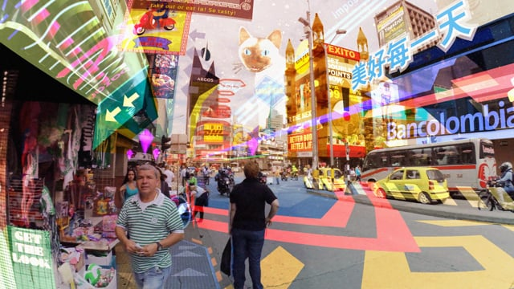
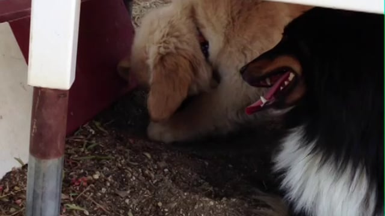

# Keiichi Matsuda

**Tag tecnica/formato:** `vr-ar` `video`
**Tag tema:** `sorveglianza-controllo` `economia-attenzione` `game-culture`

## Biografia
Designer e regista nippo-britannico. *(Anno di nascita indicato in una fonte non verificata come 1980 — da controllare.)*

## Poetica e ricerca
La pratica di Matsuda si colloca tra architettura speculativa, teoria dei media e cinema critico. Non propone profezie tecnologiche, ma una sintomatologia del presente: attraverso l'estetica della realtà aumentata, mostra la progressiva dissoluzione della realtà fenomenica dentro l'interfaccia, che da finestra sul mondo diventa il mondo stesso — territorio conteso per attenzione, identità e agenzia. Un filo conduttore è la critica della "convenienza" della smart home e della gamification come nuovo dispositivo di controllo sociale, dove punteggio e identità coincidono.

## Opere principali

### Hyper-Reality (2016)
**Descrizione:** cortometraggio di 6 minuti girato in soggettiva a Medellín, Colombia: segue Juliana, lavoratrice della gig economy, il cui campo visivo è saturato da un'interfaccia AR — pubblicità olografiche, icone religiose che offrono "punti salvezza", un assistente virtuale invadente.
**Lettura critica:** aggiorna la "società dello spettacolo" (Debord) all'era dell'interattività: l'interfaccia non è più fuga ma strumento di lavoro e controllo; la "realtà di base" (la povertà di Medellín) traspare solo quando il sistema va in crash.

**Approfondimento:** [keiichimatsuda.com](https://keiichimatsuda.com/)

### Prism (2013)
**Descrizione:** cortometraggio minimalista: una coppia vive in una smart home perfettamente integrata e apparentemente invisibile nell'interfaccia, che in realtà raccoglie costantemente dati su consumo, salute ed emozioni.
**Lettura critica:** espone l'inganno dell'interfaccia "frictionless" — la gestione della casa come forma di gestione (e ottimizzazione) della vita stessa.

### Domestic Robocop (2009)
**Descrizione:** film girato dal punto di vista di un piccolo robot domestico di sorveglianza, che alterna compiti banali (fare il tè) a compiti inquietanti (monitorare i proprietari).
**Lettura critica:** anticipa la tesi secondo cui gli strumenti non sono mai neutri: cura e controllo sono già confuse nello sguardo della macchina.
**Video:** [cortometraggio completo (Vimeo)](https://vimeo.com/7430198)

## Immagini

Immagine per ciascuna delle tre opere, inclusa sotto la relativa descrizione in "Opere principali", da Vimeo.
- [keiichimatsuda.com](https://keiichimatsuda.com/)

## Fonti
- [keiichimatsuda.com](https://keiichimatsuda.com/)
- [Hyper-Reality](https://vimeo.com/166807261)
- [Prism](https://vimeo.com/66014028)
- [Keiichi Matsuda spiega la sua visione della realtà aumentata (Dezeen, YouTube)](https://www.youtube.com/watch?v=91-gM-d6s3c)
- [Hyper-Reality: A New Vision of the Future (WIRED, YouTube)](https://www.youtube.com/watch?v=nE5U3vB3aGg)
- [The Future of Our Senses, talk OFFF (YouTube)](https://www.youtube.com/watch?v=p1n8SuxO_YA)

---

## Appunti da organizzare
- Fonte: unica scheda trovata, in cartella "new refs" (nessuna versione nella cartella REF principale, dove l'artista compariva solo come link nell'"Indice REFs"). Testo con caratteri di codifica anomali che suggeriscono origine da un output AI precedente — **anno di nascita da verificare**; apparato critico (riferimenti a Baudrillard, Virilio, Debord, Zuboff, Foucault) utile ma da controllare prima di un uso didattico definitivo.
- A differenza di Warburton/Evans/Lek/Cheng/Bahar Noorizadeh/Allahyari, qui il taglio rispetto alla fonte originale è stato minore: le 3 opere e la cornice teorica principale (saturazione, dromologia, gamification) sono già tutte riprese sopra. Se serve il testo integrale, va ripreso dal documento "new refs" su Drive.
