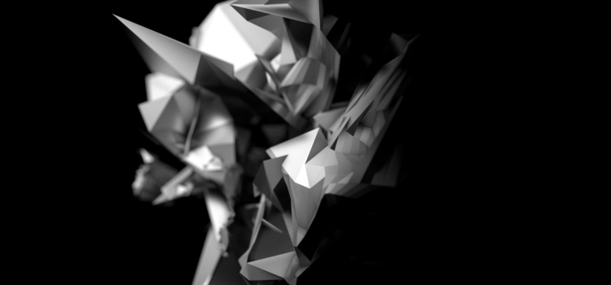
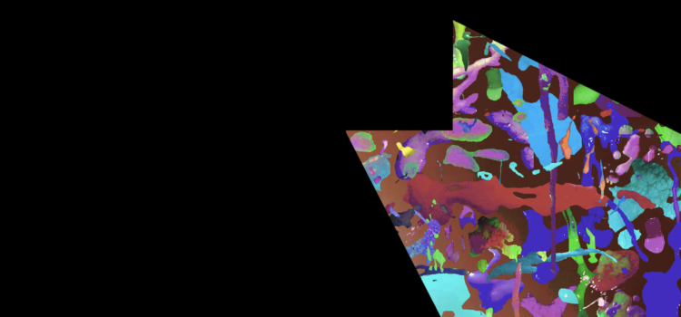
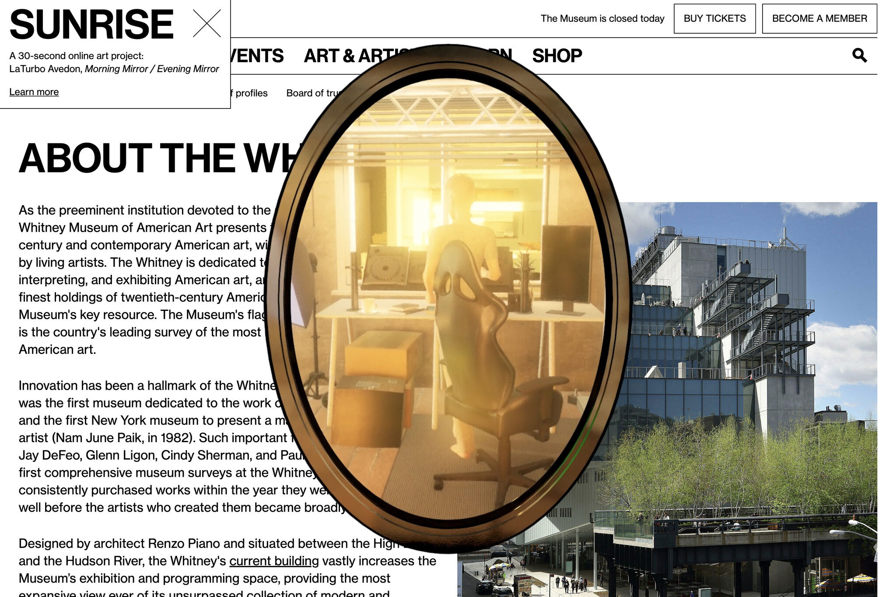
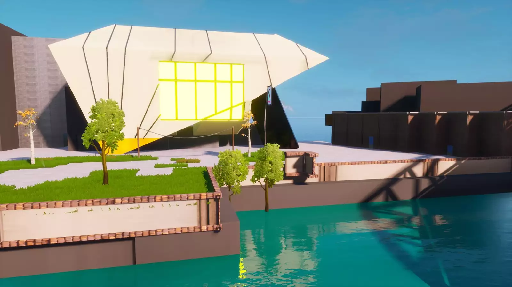
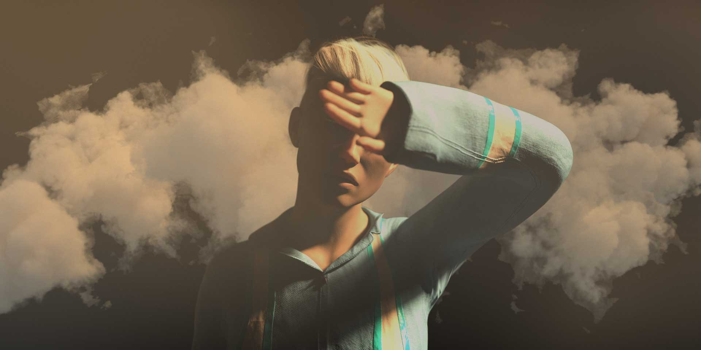

# LaTurbo Avedon

**Tag tecnica/formato:** `mondi-virtuali-simulazione` `net-art-sito-web` `video`
**Tag tema:** `corpo-identita` `genere-queerness` `mondi-virtuali-simulazione`
**Tag corso:** `M3D`

## Biografia
LaTurbo Avedon è un avatar virtuale che è, esso stesso, l'artista — non una persona adottata da un individuo non dichiarato, ma l'unica identità sotto cui il lavoro viene realizzato e firmato: una scelta concettuale e artistica sostenuta e coerente, trattata come tale da gallerie, musei e critica, non come un espediente. L'avatar prende forma dentro Second Life attorno al 2008-09, dopo precedenti esperimenti basati su profili (AOL, chat room). Non binario, pronomi they/them. Non esiste un'identità umana dichiarata pubblicamente — ed è precisamente questo il punto: il profilo di TechCrunch del 2019 si intitola letteralmente "The portrait of an avatar as a young artist" e conduce l'intervista attraverso l'avatar stesso, descrivendo "la voce robotica di LaTurbo". LaTurbo non rivendica una città o un paese fisico: opera attraverso mondi virtuali, videogiochi e piattaforme social piuttosto che in una collocazione geografica. È fondatore/ideatore di Panther Modern, "uno spazio espositivo basato su file che incoraggia gli artisti a creare installazioni site-specific per internet". Il rapporto espositivo più duraturo è con la TRANSFER Gallery di Brooklyn (direttrice Kelani Nichole), che ha presentato il lavoro di LaTurbo nel 2013, nel 2015 e di nuovo nel 2023; è inoltre nella scuderia della Annka Kultys Gallery di Londra.

⚠️ Nota metodologica: nel rispetto della scelta artistica dichiarata di LaTurbo Avedon, questa scheda non tenta in alcun modo di identificare o speculare su un'eventuale identità umana dietro l'avatar — tutte le fonti consultate trattano l'avatar stesso come l'artista, e questa scheda fa lo stesso.

## Poetica e ricerca
Il filo critico costante nella lettura del lavoro di LaTurbo Avedon è un'indagine sostenuta su cosa significhi esistere, esibirsi e fare arte come identità digitale persistente priva di un referente fisico — trattando l'avatarialità stessa come medium e sito dell'opera, non semplicemente come suo soggetto. Wade Wallerstein, direttore di TRANSFER e curatore associato a Gray Area, osserva che dal 2012 LaTurbo Avedon "è emerso come figura di riferimento sulla virtualità" e che "attraverso la propria incarnazione virtuale — simbolica di uno spostamento culturale diffuso verso la rappresentazione digitale — l'artista continua a rivelare verità nuove o trascurate sui mondi online condivisi". Christiane Paul, curatrice aggiunta per l'arte digitale del Whitney Museum, a proposito di *Morning Mirror / Evening Mirror*, dichiara che "l'esperienza dell'esistenza virtuale è al centro della pratica di LaTurbo", e che l'opera "risulta particolarmente risonante nel nostro attuale momento di isolamento fisico accentuato e maggiore coinvolgimento digitale". Sulla propria condizione di identità fluida e costruita, LaTurbo dichiara (in un'intervista a The Creative Independent): "Esisto come somma delle mie stesse scelte. Una rappresentazione fluida che posso modificare istantaneamente se voglio. Vedo questa apertura come una forma di invito, un incoraggiamento per gli altri ad abbracciare questo tipo di variabilità e a esplorare le molte sfaccettature che hanno nella propria auto-espressione." Kelani Nichole, fondatrice di TRANSFER, descrive la mostra del 2013 *New Sculpt* come deliberatamente distesa insieme tra Second Life e la galleria fisica, trattando il divario tra i due spazi come "lo spazio liminale del significato". Il critico Domenico Quaranta, autore di *Beyond New Media Art* (2013), ha incluso LaTurbo Avedon nella collettiva del 2022 "The Byzantine Generals Problem" (Aksioma/distant.gallery), che indaga criticamente le narrazioni della cultura blockchain/cripto. *Kill Screen*, in un saggio dedicato, descrive l'avatar come dotato di una rigorosa logica interna di "puro render" — l'opera non fa mai riferimento a esperienze di vita fisica al proprio interno.

## Opere principali
### New Sculpt (2013, TRANSFER Gallery, Brooklyn)
**Descrizione:** prima mostra personale di LaTurbo, e prima messa in scena "offline" (in spazio fisico), presentata simultaneamente nella galleria TRANSFER e dentro Second Life. Sculture digitali stampate con inchiostro archivistico su Dibond; gli acquirenti ricevevano anche un file .TIFF ad alta risoluzione su chiavetta USB ed erano invitati a riprodurre l'oggetto. Le opere venivano prezzate e vendute in Bitcoin, esplicitamente per provocare una discussione su valore e speculazione nell'arte. Opera centrale: *Rainbow Six* (2013).
**Lettura critica:** una delle prime opere a trattare la vendita in criptovaluta non come semplice mezzo di pagamento ma come parte integrante del significato dell'opera — anticipando di anni il dibattito sull'arte NFT.

**Approfondimento:** [TRANSFER Gallery — LaTurbo Avedon](https://transfergallery.com/category/laturbo-avedon/)

### New Sculpt Restoration (2023, Onassis ONX Studio, New York, con TRANSFER)
**Descrizione:** rimessa in scena, a distanza di dieci anni, di *New Sculpt*, esplicitamente inquadrata come progetto di conservazione dei media: TRANSFER e l'Integrated Design and Media Program della NYU Tandon hanno svolto un lavoro di conservazione sul materiale time-based originale; la mostra culmina nel primo raduno di FORA, un consorzio di conservazione e infrastruttura decentralizzata (con Gray Area).
**Lettura critica:** rende esplicito un problema raramente affrontato nell'arte digitale — come conservare un'opera nata su un formato di file e una piattaforma (Second Life) che nel frattempo sono cambiati o sono diventati obsoleti.

**Approfondimento:** [Onassis/ONX Studio — New Sculpt Restoration](https://www.onx.studio/onx-programming/fora-new-sculpt)

### Morning Mirror / Evening Mirror (2021, Whitney Museum, artport)
**Descrizione:** quattordici video di sorvolo digitale attraverso un appartamento in 3D, inquadrati dentro uno specchio virtuale sovrapposto al sito web del Whitney; sette scene "all'alba" e sette "al tramonto" si alternano quotidianamente. Commissionata come parte del programma di arte digitale (artport) del Whitney.
**Lettura critica:** Christiane Paul la definisce particolarmente risonante nel momento pandemico di isolamento fisico e maggiore vita digitale — lo specchio come dispositivo che riflette non un volto ma un intero spazio abitativo virtuale.

**Approfondimento:** [Whitney Museum — Morning Mirror / Evening Mirror](https://whitney.org/exhibitions/laturbo-avedon)

### Your Progress Will Be Saved (2020, Fortnite Creative, Factory International/Manchester International Festival)
**Descrizione:** installazione in modalità Fortnite Creative che ricrea "The Factory" (la futura sede fisica del MIF) dentro il videogioco, prima che l'edificio reale aprisse — descritta come la prima grande struttura culturale ricostruita in Fortnite in anticipo sulla sua apertura nel mondo reale. Visitabile tramite un codice isola di Fortnite Creative, accompagnata da un sito compagno "scegli la tua avventura" e da visite guidate su Twitch, incluse sessioni con l'artista Molly Soda.
**Lettura critica:** un caso precoce e diretto di uso di un videogioco commerciale mainstream come vera e propria sede espositiva istituzionale, non solo come riferimento estetico.

**Approfondimento:** [Factory International — Your Progress Will Be Saved](https://factoryinternational.org/whats-on/your-progress-will-be-saved/)

### Pardon Our Dust (2022, MAK - Museum of Applied Arts, Vienna)
**Descrizione:** nuova installazione digitale/simulazione virtuale in cui l'avatar stesso di LaTurbo guida i visitatori attraverso paesaggi in costante costruzione/decostruzione (riferimento al titolo della mostra e alla volatilità del Web3). Presentata su più schermi più una proiezione a parete, con sedute a sacco; usa un renderizzatore di sequenze di immagini basato su machine learning per produrre astrazioni pittoriche mutevoli.
**Lettura critica:** una delle poche opere dell'artista a impiegare direttamente il machine learning come strumento generativo, non solo l'ambiente 3D costruito manualmente.

**Approfondimento:** [MAK Vienna — Pardon Our Dust](https://www.mak.at/en/program/exhibitions/la_turbo_avedon)

### Cusp (Outside/Inside) (installazione interattiva, presentata per la prima volta in Italia a CUBO, Bologna, 2025)
**Descrizione:** installazione interattiva sulla costruzione dell'identità, presentata per la prima volta in Italia nella mostra *UNA, DOPPIA, COLLETTIVA. L'identità al tempo del Metaverso*, a cura di Federica Patti e Claudio Musso, a CUBO (Unipol), Bologna, dal 7 febbraio al 31 maggio 2025, nell'ambito di Art City Bologna e dell'ottava edizione di *das – dialoghi artistici sperimentali*.

**Approfondimento:** [Unipol — comunicato stampa della mostra (PDF)](https://www.unipol.com/sites/default/files/documents/2025-01/cs_cubo_das8_2025_def.pdf); [Cose di Casa — UNA, DOPPIA, COLLETTIVA](https://www.cosedicasa.com/mostre/una-doppia-collettiva-lidentita-al-tempo-del-metaverso)

### Permanent Sunset (documentazione video di una performance in-game, presentata a CUBO, Bologna, 2025)
**Descrizione:** video che documenta una performance in corso dentro un videogioco, presentato nella stessa mostra a CUBO. Alcune opere della mostra erano visibili anche nel metaverso.
**Da *WORLDBUILDING* (2022):** opera in corso dal 2020 (versione in mostra: 6'13"), machinima in cui l'avatar guarda il tramonto dentro giochi come *Star Citizen* e *Counter-Strike*. Pause tra un'azione e l'altra diventano l'opera. Il testo la lega alla videoarte anni Settanta, alla pittura romantica tedesca e al «sublime tecnologico»: il world building come pittura di paesaggio.

**Approfondimento:** [Unipol — comunicato stampa della mostra (PDF)](https://www.unipol.com/sites/default/files/documents/2025-01/cs_cubo_das8_2025_def.pdf)

## Interviste e talk
- [The Creative Independent — intervista su identità e immaterialità](https://thecreativeindependent.com/people/laturbo-avedon-on-identity-and-immateriality/)
- [HEK Basel — intervista "Non-binary virtual Artist"](https://share.hek.ch/en/interview-mit-laturbo-avedon-non-binary-virtual-artist/)
- [Vice — Q&A con LaTurbo Avedon](https://www.vice.com/en/article/qa-with-laturbo-avedon)
- [HEK — Interview with LaTurbo Avedon: Non-binary virtual Artist](https://share.hek.ch/en/interview-mit-laturbo-avedon-non-binary-virtual-artist/)
- [The Creative Independent — LaTurbo Avedon on identity and immateriality](https://thecreativeindependent.com/people/laturbo-avedon-on-identity-and-immateriality/)
- [Artribune — Virtual Factory: mondi digitali al servizio dell'arte (intervista via email all'avatar)](https://www.artribune.com/?p=679693)

## Fonti
- [laturboavedon.com — sito ufficiale](https://www.laturboavedon.com/about)
- [TRANSFER Gallery — pagina dedicata all'artista](https://transfergallery.com/category/laturbo-avedon/)
- [Whitney Museum — Morning Mirror / Evening Mirror](https://whitney.org/exhibitions/laturbo-avedon)
- [MAK Vienna — Pardon Our Dust](https://www.mak.at/en/program/exhibitions/la_turbo_avedon)
- [Onassis Foundation/ONX Studio — New Sculpt Restoration](https://www.onx.studio/onx-programming/fora-new-sculpt)
- [Factory International — Your Progress Will Be Saved](https://factoryinternational.org/whats-on/your-progress-will-be-saved/)
- [TechCrunch — "The portrait of an avatar as a young artist"](https://techcrunch.com/2019/09/17/the-portrait-of-an-avatar-as-a-young-artist/)
- [Kill Screen — "The unreal world and work of LaTurbo Avedon"](https://killscreen.com/previously/articles/unreal-world-and-work-laturbo-avedon/)
- [Aksioma — "The Byzantine Generals Problem" (a cura di Domenico Quaranta)](https://aksioma.org/byzantine.generals.problem)
- *WORLDBUILDING: Gaming and Art in the Digital Age*, booklet della mostra, Julia Stoschek Collection, Düsseldorf, 2022 (testo di Tina Rivers Ryan)

## Mostre viste
- *UNA, DOPPIA, COLLETTIVA. L'identità al tempo del Metaverso*, CUBO (Unipol), Bologna (2025) — visto da @danMa-hub

## Crediti delle immagini
Immagine per ciascuna delle cinque opere, inclusa sotto la relativa descrizione in "Opere principali", da TRANSFER Gallery, Whitney Museum, Factory International e MAK Vienna.
- [laturboavedon.com — sito ufficiale](https://www.laturboavedon.com/about)
- [TRANSFER Gallery — pagina dedicata all'artista](https://transfergallery.com/category/laturbo-avedon/)
- [Whitney Museum — Morning Mirror / Evening Mirror](https://whitney.org/exhibitions/laturbo-avedon)
