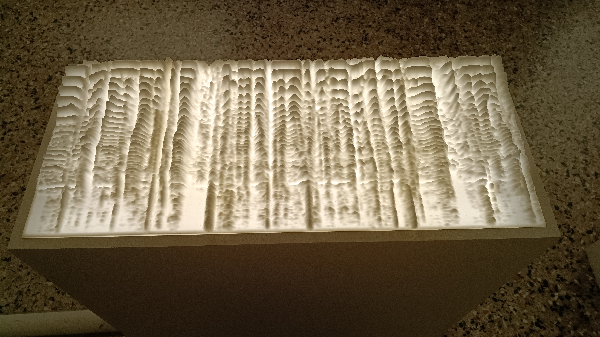

# Lawrence Abu Hamdan

**Tag tecnica/formato:** `data-visualization` `installazione`
**Tag tema:** `sorveglianza-controllo` `colonialismo-decolonialita`
**Stato:** fonte unica finora: il testo di sala della mostra «Strange Rules» (Palazzo Diedo, Venezia, 2026)

## Biografia
Artista giordano, nato nel 1985.

## Poetica e ricerca
Abu Hamdan lavora sul suono e sulla voce come prove forensi e come luogo di violenza politica — chi ha diritto a essere ascoltato, e con quale accento. Il suo lavoro decostruisce le tecnologie che intervengono sulla voce umana, rendendo visibile (spesso letteralmente, tramite spettrogrammi) ciò che l'automazione nasconde o cancella.

## Opere principali
### Waterfalls (2026, Strange Rules, Palazzo Diedo, Venezia)
**Descrizione:** rende tangibile una tecnologia IA usata dai call center per eliminare gli accenti degli operatori del Sud globale (India, Haiti, Filippine, Pakistan), sostituendoli con una voce neutra e priva di echi dialettali, per aggirare la "xenofonia" (il rifiuto irrazionale verso chi parla con un suono diverso dal proprio). L'installazione è composta da una parte sonora in cuffia (voci originali a sinistra, versioni modificate a destra) e una parte scultorea con quattro spettrogrammi tridimensionali ("waterfalls") che rappresentano i dialetti dei quattro paesi: la luce che attraversa la resina rivela la voce originale, le zone scure il suono generato artificialmente.
**Lettura critica:** in questo contesto l'automazione non sottrae lavoro agli esseri umani, ma li separa e li aliena dalla propria voce — l'opera decostruisce l'algoritmo portando alla luce le voci originali celate sotto la correzione artificiale, rendendo visibile la catena globale di produzione nascosta dietro ogni voce. (Testo di sala, mostra "Strange Rules", Palazzo Diedo, Venezia.)

## Interviste e talk
- _Nessuna ancora: da aggiungere._

## Fonti
- Testo di sala, "Strange Rules", Palazzo Diedo, Venezia (foto scattata dal docente, 9 agosto 2026)
- Sito ufficiale/portfolio: **non ancora cercato** — da fare.

## Mostre viste
- *Strange Rules*, Palazzo Diedo, Venezia (2026) — visto da @danMa-hub

## Crediti delle immagini
Immagine per l'unica opera in scheda, fotografata dal vivo alla mostra "Strange Rules".
