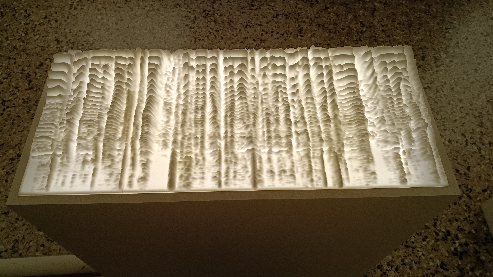

# Lawrence Abu Hamdan

**Tag tecnica/formato:** `data-visualization` `installazione`
**Tag tema:** `sorveglianza-controllo` `colonialismo-decolonialita`
**Stato:** fonti: il testo di sala della mostra «Strange Rules» (Palazzo Diedo, Venezia, 2026) e il libretto di *Canicula* (2026); sito ufficiale non ancora consultato

## Biografia
Nato nel 1985 in Giordania. Investigatore acustico indipendente libanese-britannico, con dottorato di ricerca presso Goldsmiths, University of London. Nel 2023 ha fondato Earshot, organizzazione senza scopo di lucro dedicata allo studio del suono per la difesa dei diritti umani e ambientali. Ha presentato il lavoro, in forma di relazioni forensi, testimonianze di esperto, conferenze e performance, film, pubblicazioni e mostre, presso Munch Museum (Oslo), MoMA (New York), Biennale Arte 2019 (Venezia), Sharjah Biennial 14 e 12ª Biennale di Berlino. Premi: Gran Premio all'Internationale Kurzfilmtage Winterthur (2022), Premio del Pubblico alla Biennale di Toronto (2020). Per il Turner Prize 2019 ha formato con gli altri candidati (Helen Cammock, Oscar Murillo, Tai Shani) un collettivo temporaneo, al fine di ricevere il premio congiuntamente. Nel 2026 è presente alla mostra collettiva **CANICULA** (Fondazione In Between Art Film, Complesso dell'Ospedaletto, Venezia, 6 maggio-22 novembre 2026).[^canicula]

## Poetica e ricerca
Abu Hamdan lavora sul suono e sulla voce come prove forensi e come luogo di violenza politica — chi ha diritto a essere ascoltato, e con quale accento. Il suo lavoro decostruisce le tecnologie che intervengono sulla voce umana, rendendo visibile (spesso letteralmente, tramite spettrogrammi) ciò che l'automazione nasconde o cancella.

## Opere principali
### Waterfalls (2026, Strange Rules, Palazzo Diedo, Venezia)
**Descrizione:** rende tangibile una tecnologia IA usata dai call center per eliminare gli accenti degli operatori del Sud globale (India, Haiti, Filippine, Pakistan), sostituendoli con una voce neutra e priva di echi dialettali, per aggirare la "xenofonia" (il rifiuto irrazionale verso chi parla con un suono diverso dal proprio). L'installazione è composta da una parte sonora in cuffia (voci originali a sinistra, versioni modificate a destra) e una parte scultorea con quattro spettrogrammi tridimensionali ("waterfalls") che rappresentano i dialetti dei quattro paesi: la luce che attraversa la resina rivela la voce originale, le zone scure il suono generato artificialmente.
**Lettura critica:** in questo contesto l'automazione non sottrae lavoro agli esseri umani, ma li separa e li aliena dalla propria voce — l'opera decostruisce l'algoritmo portando alla luce le voci originali celate sotto la correzione artificiale, rendendo visibile la catena globale di produzione nascosta dietro ogni voce. (Testo di sala, mostra "Strange Rules", Palazzo Diedo, Venezia.)

### 450XL: The Story of a Fugitive Sound (2026, CANICULA)
**Descrizione:** installazione video a quindici canali, colore e bianco/nero, suono stereo, 19'. Commissionata e prodotta da Fondazione In Between Art Film. Allestita al primo piano, nella sala 5, nell'antica Sala della Musica dell'ospedale. L'opera ricostruisce gli eventi della veglia silenziosa del 15 marzo 2025 a Belgrado, durante il movimento studentesco serbo: circa 300.000 partecipanti osservarono 15 minuti di silenzio, uno per ciascuna delle vittime del crollo della pensilina di una stazione avvenuto nel novembre 2024. Alcuni video mostrano che verso la fine la folla si disperse all'improvviso, come in fuga da una forza invisibile. Il giorno dopo Earshot, l'agenzia di ricerca audio fondata e diretta dall'artista, ricevette richieste di indagine dalle vittime. Il gruppo ricostruì il «suono fuggitivo» al centro dell'attacco: un suono negato dalle autorità serbe e russe, non rilevabile dai microfoni ma descritto con coerenza in oltre 3.000 testimonianze scritte. Dopo 15 interviste con testimoni auricolari, Earshot concluse che si trattava di uno dei primi utilizzi documentati di un'arma sonora nota come LRAD 450XL. Su quindici schermi compaiono intertitoli in bianco e nero con le testimonianze verbali, ma silenziose, dei testimoni, alternati a riprese aeree della giornata: la folla lungo il viale Kralja Milana e, durante la veglia, migliaia di torce sollevate in silenzio nella notte. L'unico suono diegetico è una ricostruzione audio di un secondo dell'arma, compiuta da Earshot; il resto della colonna sonora è composto da James Hoff.
**Lettura critica:** il catalogo osserva che l'opera segue la logica del cinema muto e restituisce ai manifestanti il silenzio che l'arma aveva sottratto. Il coro di testimonianze è letto come riflessione su un'arma concepita per minare solidarietà e collettività e sul silenzio come forma di resistenza.[^canicula]

## Interviste e talk
- _Nessuna ancora: da aggiungere._

## Fonti
- Fondazione In Between Art Film, *Canicula*, libretto e comunicato stampa, aprile 2026 (PDF)
- Testo di sala, "Strange Rules", Palazzo Diedo, Venezia (fotografia del 9 agosto 2026)
- Sito ufficiale/portfolio: non ancora cercato.

## Mostre viste
- *Strange Rules*, Palazzo Diedo, Venezia (2026) — visto da @danMa-hub
- *CANICULA*, Fondazione In Between Art Film, Complesso dell'Ospedaletto, Venezia (2026) — visitata il 22 novembre 2026 da @danMa-hub

## Crediti delle immagini
Immagine per l'unica opera in scheda, fotografata dal vivo alla mostra "Strange Rules".

[^canicula]: Fondazione In Between Art Film, libretto e comunicato stampa della mostra *Canicula* (Venezia, 6 maggio–22 novembre 2026), sinossi e profili degli artisti, sala 5.
