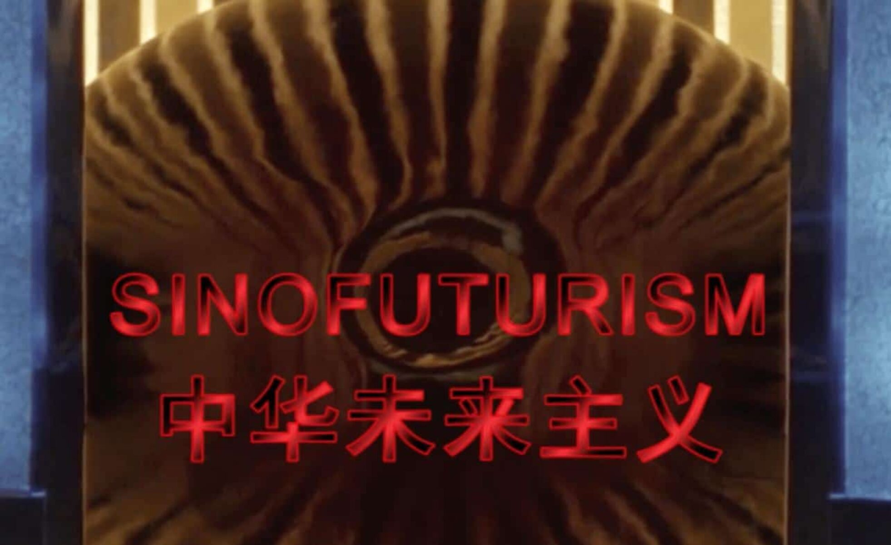
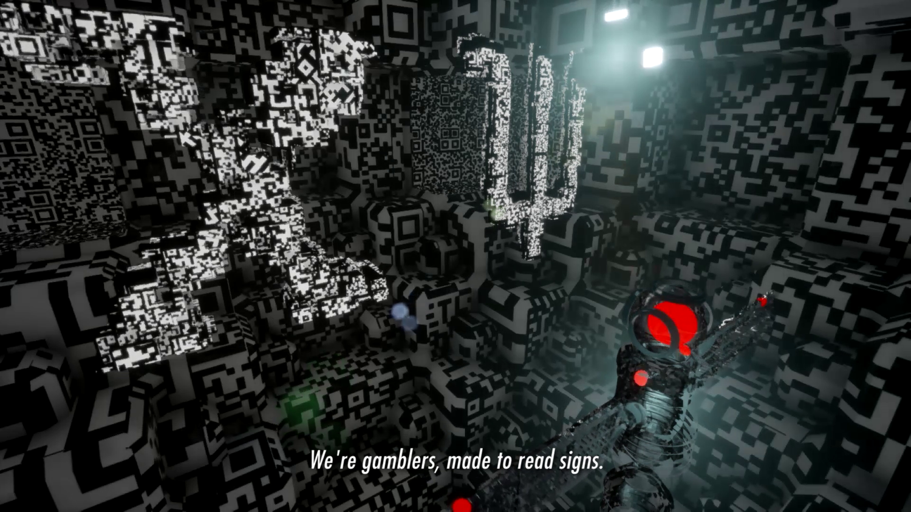
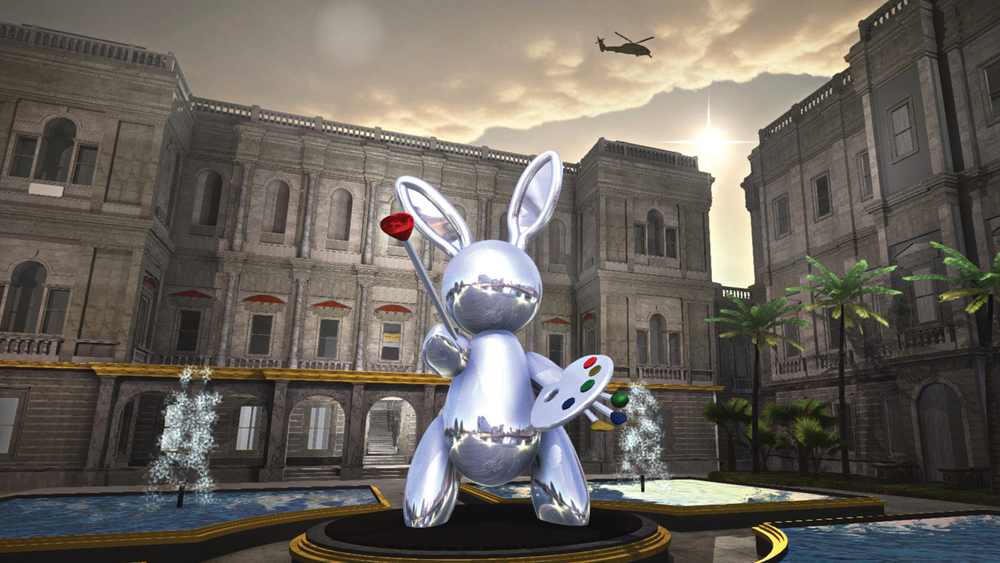
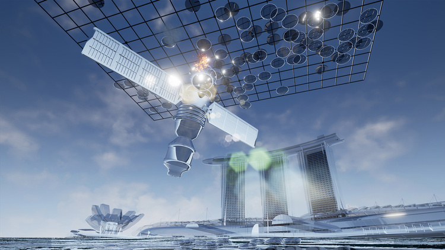
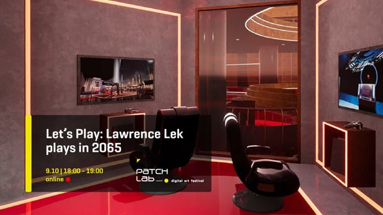
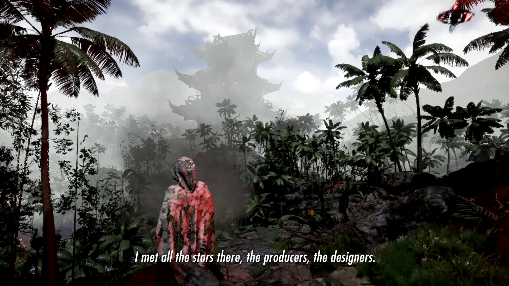
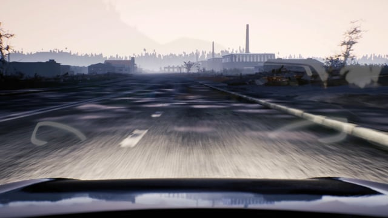
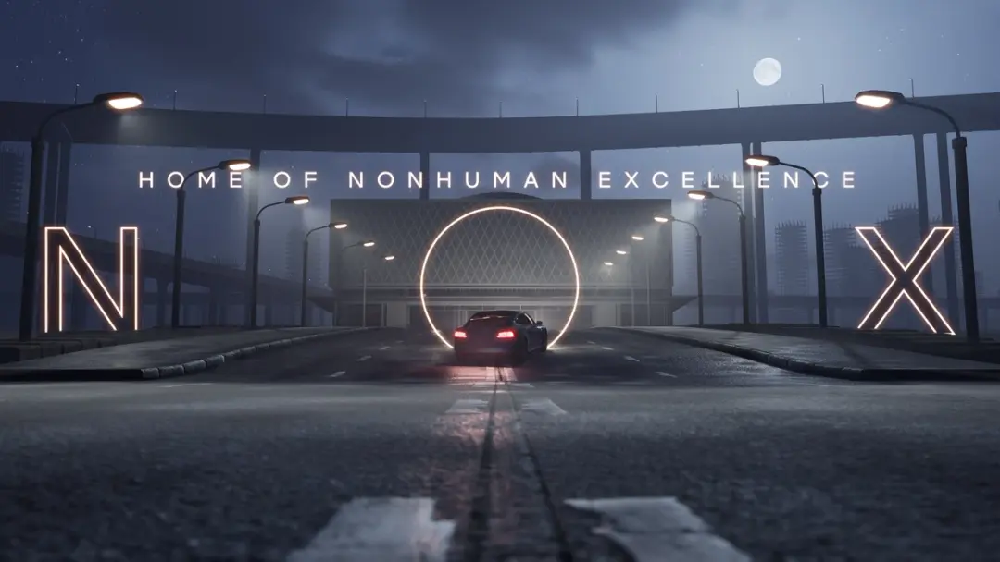
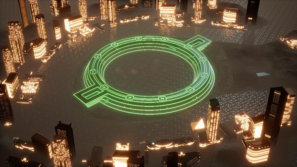
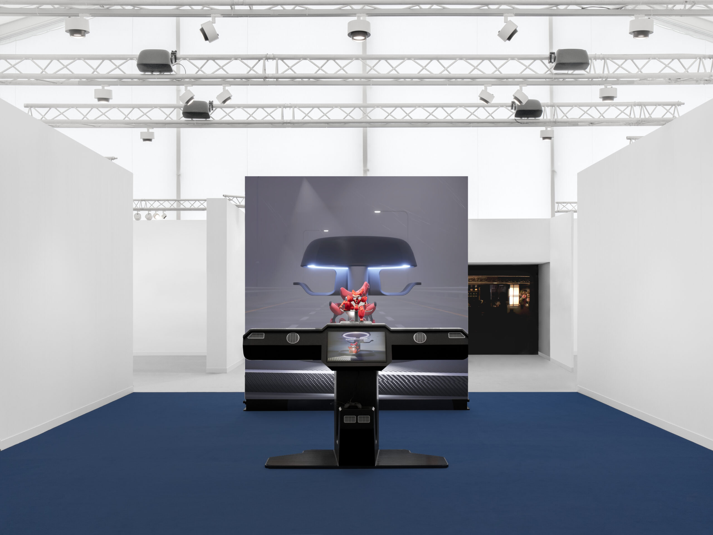

# Lawrence Lek

**Tag tecnica/formato:** `game-engine-realtime` `modellazione-3d` `video`
**Tag tema:** `sorveglianza-controllo` `capitalismo-lavoro` `intelligenza-artificiale-critica`
**Tag corso:** `TAD` `AW`
**Stato:** scheda avanzata · l'attribuzione di tre immagini alle rispettive opere è probabile ma non certa (vedi Crediti delle immagini)

## Biografia
Nato nel 1982 a Francoforte sul Meno, di origini malaysiana-cinesi; infanzia divisa tra Europa e Asia (incluso un periodo a Osaka) prima di stabilirsi nel Regno Unito. Vive e lavora a Londra ([Wikipedia](https://en.wikipedia.org/wiki/Lawrence_Lek); [Ocula](https://ocula.com/artists/lawrence-lek/)). Formazione in architettura: laurea al Trinity College, Università di Cambridge (2004); AA Diploma alla Architectural Association di Londra (2008); Master of Architecture II alla Cooper Union di New York (2012); PhD al Royal College of Art di Londra (2022). Nel 2024 ha vinto il **Frieze Artist Award**; incluso da *Time* tra le 100 persone più influenti nell'IA.

## Poetica e ricerca
Lek costruisce mondi virtuali interconnessi che trattano auto a guida autonoma, assistenti vocali IA e performer sintetici come protagonisti con vite interiori complesse, unendo architettura, videogiochi, cinema e arte contemporanea. Utilizzando la simulazione digitale e i motori grafici (game engine) come dispositivi che indirizzano, producono e controllano comportamento e sapere, Lek non si limita a rappresentare il futuro ma costruisce "mondi possibili" speculativi che funzionano come laboratori per l'analisi del presente.

Un asse portante della sua ricerca è il **Sino-futurismo**, termine che Lek è accreditato di aver reso popolare con il video-saggio omonimo. Il lavoro guarda a stereotipi tecno-orientalisti occidentali sulla Cina (esotica, bizzarra, kitsch, a buon mercato), esponendo sette temi chiave — computing, copying, gaming, studying, addiction, labour, gambling — e sostenendo che "l'inconoscibilità essenziale dell'IA per l'essere umano [...] è esattamente lo stesso 'altro' identificato nell'Orientalismo" ([Wikipedia](https://en.wikipedia.org/wiki/Lawrence_Lek)). Il lavoro ha generato un dibattito critico reale, non solo consenso: lo studioso di area cinese Gabriele de Seta ha accusato *Sinofuturism* dello stesso "othering temporale" di cui è colpevole l'Orientalismo classico — relegare una cultura orientale al passato o al futuro, negandole comunque un'agency nel presente.

Metodologicamente, Lek rifiuta una distinzione netta tra "reale" e "virtuale": i suoi mondi hanno spesso un'estetica iperreale, dove il simulacro non è più copia del reale ma versione "migliorata" che finisce per sostituirlo. Molti dei suoi mondi sono definiti da un'assenza radicale — quella dell'essere umano — un'estetica non minimalista ma spettrale: i sistemi continuano a funzionare perfettamente, ma il lavoratore umano è diventato un fantasma nel sistema che lui stesso ha costruito.

## Opere principali

### Sinofuturism (1839–2046 AD) (2016)
**Descrizione:** video-saggio che, attraverso found footage e una voce sintetica, articola sette stereotipi della società cinese come sintomi paralleli dell'accelerazione tecnologica e socio-economica, tracciando una genealogia speculativa dalla Guerra dell'Oppio (1839) a un futuro immaginario (2046).
**Lettura critica:** decostruisce il techno-orientalismo occidentale presentando lo sviluppo tecnologico cinese non come minaccia distopica ma come lente per rileggere la modernità occidentale — con l'avvertenza critica (de Seta) che l'operazione rischia comunque di "orientalizzare" temporalmente la Cina.

### Unreal Estate (The Royal Academy is Yours) (2015)
**Descrizione:** simulazione in prima persona in cui la Royal Academy of Arts di Londra viene immaginata venduta come villa di lusso a un anonimo miliardario cinese: nel cortile d'ingresso campeggia un coniglio in acciaio stile Jeff Koons al centro di una fontana, le gallerie private sono tappezzate con carta da parati di Yayoi Kusama, i grandi saloni diventano camere da letto, la sicurezza è affidata ad allarmi laser, telecamere e reti wireless criptate. Presentata alla Royal Academy stessa nel 2015; nono capitolo della serie *Bonus Levels* (2013-2016), videogiochi site-specific basati su versioni alternative di luoghi reali ([Rhizome](https://rhizome.org/editorial/2015/aug/27/lawrence-lek-simulation/); [LUX](https://lux.org.uk/work/unreal-estate-the-royal-academy-is-yours/)).
**Lettura critica:** critica alla gentrificazione, alla finanziarizzazione dello spazio urbano e alla feticizzazione della proprietà — le istituzioni culturali stesse diventano merce di lusso globale.

### Geomancer (2017)
**Descrizione:** film CGI ambientato nella Singapore del 2065, realizzato in un game engine: un'IA satellite adolescente scende sulla Terra desiderando diventare un'artista, e fallisce nel farsi riconoscere dal mondo dell'arte, che la considera solo una macchina.
**Lettura critica:** interroga il feticismo umanistico del "genio" e dell'originalità quando la creatività stessa diventa un problema di elaborazione dati; seconda opera della trilogia Sinofuturista (con *Sinofuturism* e *AIDOL*).
**Video:** [trailer (Vimeo)](https://vimeo.com/210494259) · [Capitolo 3 — Archaeology of the Future (Vimeo)](https://vimeo.com/251303726)

### 2065 (2015–in corso)
**Descrizione:** serie in corso di videogiochi open-world e installazioni che estendono il worldbuilding e l'ambientazione singaporiana di *Geomancer*: una voce fuori campo introduce l'antefatto immaginario di una società post-lavoro, dove l'adozione diffusa dell'IA ha generato un corrispondente appetito di intrattenimento e produzione culturale infinita.
**Lettura critica:** prosegue su formato videoludico interattivo, anziché filmico, la stessa ricerca sul lavoro automatizzato e il tempo libero post-umano di *Geomancer*.
**Video:** [gameplay, "Let's Play: Lawrence Lek plays 2065" (Vimeo)](https://vimeo.com/807541674)

### Nøtel (2015–in corso)
**Descrizione:** brand speculativo di un hotel di lusso globale interamente automatizzato: nessun personale umano, ogni servizio erogato da algoritmi, sorveglianza tramite droni e riconoscimento facciale; installazioni, video e performance musicali dal vivo.
**Lettura critica:** apoteosi del "non-luogo" nell'era algoritmica — un lusso perturbante perché privo di ogni traccia di vita organica, logica ultima del capitalismo di servizio.
**Video:** [trailer (Vimeo)](https://vimeo.com/299908741/4573da9465)

### AIDOL (2019)
**Descrizione:** lungometraggio CGI (83 min), terza opera della trilogia Sinofuturista: Diva, popstar umana la cui fama sta svanendo, ingaggia Geomancer come "ghostwriter" IA per una canzone di ritorno al successo alle e-Sports Olympics del 2065. Colonna sonora scritta e orchestrata dall'artista, pubblicata su Hyperdub Records.
**Lettura critica:** critica all'industria culturale e alla società dello spettacolo — la creatività è completamente sussunta dal capitale, l'IA rappresenta il lavoro alienato e invisibile che produce valore mentre l'umana è il "brand" pubblico.
**Video:** [colonna sonora completa (Bandcamp)](https://lawrencelek.bandcamp.com/) · [playlist colonna sonora "temple" (YouTube)](https://www.youtube.com/playlist?list=PLL2yWwSKDtJOPCFaOtJ6b7TiwsyBBzDlX)

### Theta (2022, trailer del progetto NOX)
**Descrizione:** cortometraggio CGI ambientato nella "SimBeijing", replica intelligente di Pechino costruita per testare auto a guida autonoma: segue un'auto di polizia autonoma e senziente, Theta, che pattuglia le strade di una città ormai deserta, di cui lo spettatore scopre progressivamente il motivo dell'abbandono.
**Lettura critica:** anteprima narrativa del mondo poi sviluppato compiutamente in *NOX* — la voce del veicolo senziente come narratore di un'assenza umana radicale.
**Video:** [trailer (Vimeo)](https://vimeo.com/729758489)

### NOX (2023, LAS Art Foundation, Berlino)
**Descrizione:** la mostra più grande dell'artista fino a quel momento: il pubblico entra in una struttura della Farsight Corporation, conglomerato IA immaginario che addestra e "cura" le proprie auto a guida autonoma senzienti — ciascuna con un ruolo (consegne, pattugliamento, piacere) e una personalità corrispondente. La narrazione (audio locativo, video CGI, installazione, componenti videoludiche, circa un'ora) segue Enigma-76, un'auto da consegna senziente in crisi esistenziale dopo essersi "guastata" scattando troppe fotografie e riempiendo la propria memoria, fino a un programma di riabilitazione spirituale imposto dal cliente umano ([LAS Art Foundation](https://www.las-art.foundation/programme/nox); [Wallpaper](https://www.wallpaper.com/art/exhibitions-shows/lawrence-lek-nox-las-art-foundation-berlin)).
**Lettura critica:** immagina le conseguenze psicologiche di un futuro popolato da sistemi intelligenti e macchine senzienti — la "terapia" delle auto ribalta la gerarchia umano/macchina, mettendo in scena l'ansia e la cura più che il controllo.
**Video:** [conversazione con l'artista e il professor Iyad Rahwan (YouTube)](https://www.youtube.com/watch?v=84NLH8bzqEM) · [guida alla mostra, LAS Art Foundation](https://www.las-art.foundation/explore/nox-exhibition-guide)

### Guanyin: Confessions of a Former Carebot (2024)
**Descrizione:** installazione multimediale che integra una scultura meccanica in un ambiente da videogioco immersivo, commissionata come **Frieze Artist Award 2024** (Regent's Park, Londra): Guanyin, dea cinese reimmaginata come cyborg-terapeuta incaricata di salvare altre intelligenze artificiali dall'autodistruzione ([Frieze](https://www.frieze.com/video/lawrence-lek-wins-frieze-london-2024-artist-award); [Sadie Coles HQ](https://www.sadiecoles.com/exhibitions/1201-lawrence-lek-frieze-artist-award-guanyin-confessions-of-a-former/press_release_text/)).
**Lettura critica:** sposta l'attenzione dalla produzione alla cura — quali forme di etica emergono quando i "pazienti" sono intelligenze artificiali?

**Approfondimento:** [lawrencelek.com — Guanyin (Confessions of a Former Carebot)](https://www.lawrencelek.com/works/guanyin-confessions-of-a-former-carebot)

## Interviste e talk
- Conversazione con l'artista e il professor Iyad Rahwan su *NOX*: vedi il video sotto l'opera.

## Fonti
- [lawrencelek.com](https://www.lawrencelek.com/)
- [Wikipedia — Lawrence Lek](https://en.wikipedia.org/wiki/Lawrence_Lek)
- [Ocula — biografia](https://ocula.com/artists/lawrence-lek/)
- [Sadie Coles HQ — galleria dell'artista](https://www.sadiecoles.com/artists/lawrence-lek)
- [Sinofuturism — video completo](https://vimeo.com/730156813)
- [Frieze — Lawrence Lek vince il Frieze Artist Award 2024](https://www.frieze.com/video/lawrence-lek-wins-frieze-london-2024-artist-award)
- [Unreal Estate — lawrencelek.com](https://www.lawrencelek.com/works/unreal-estate-the-royal-academy-is-yours)
- [Rhizome — "Simulation as Institutional Critique: Lawrence Lek's Unreal Estate"](https://rhizome.org/editorial/2015/aug/27/lawrence-lek-simulation/)
- [NOX — LAS Art Foundation](https://www.las-art.foundation/programme/nox)

## Crediti delle immagini
Immagine per ciascuna delle nove opere, inclusa sotto la relativa descrizione in "Opere principali", da materiali forniti direttamente, Vimeo e hsds.pro.
- [lawrencelek.com](https://www.lawrencelek.com/)
- [Wikipedia — Lawrence Lek](https://en.wikipedia.org/wiki/Lawrence_Lek)
- [Ocula — biografia](https://ocula.com/artists/lawrence-lek/)
