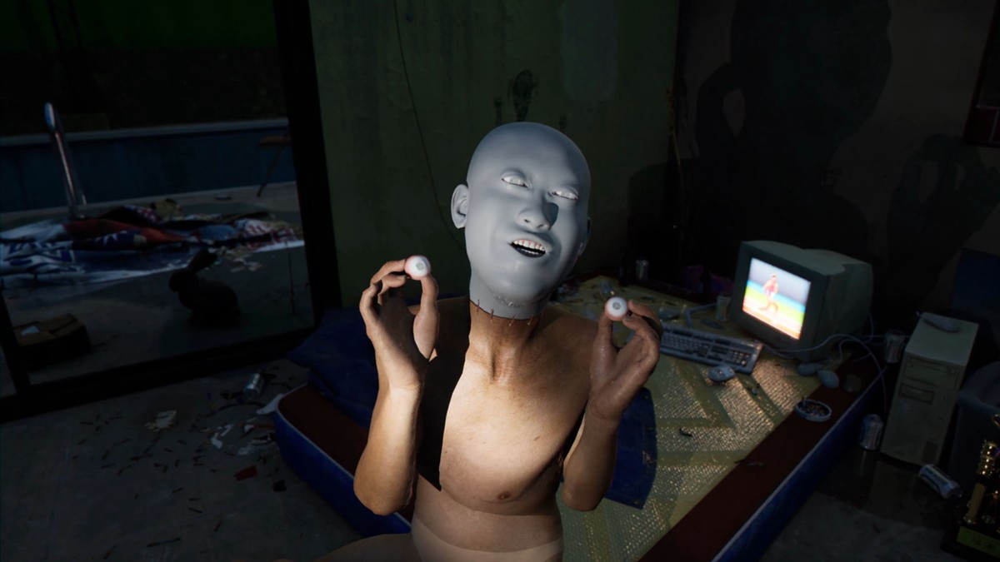
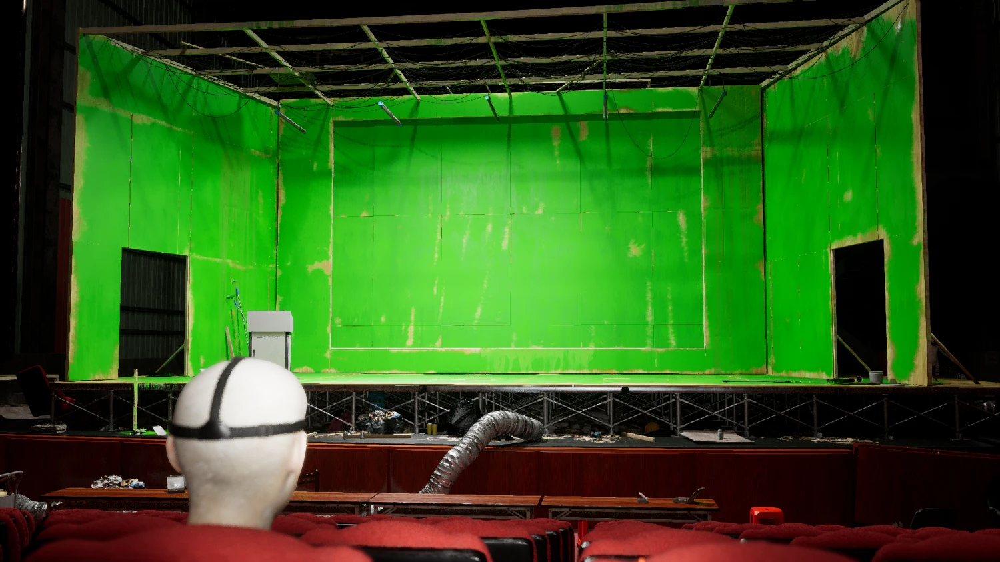
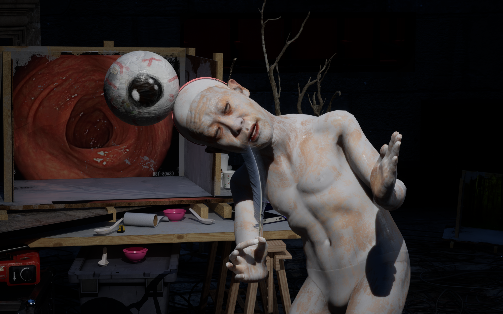

# Li Yi-Fan (李亦凡)

**Tag tecnica/formato:** `game-engine-realtime` `modellazione-3d` `vr-ar` `stampa-3d-scultura` `video`
**Tag tema:** `storia-computer-grafica` `corpo-identita` `intelligenza-artificiale-critica` `economia-attenzione`
**Tag corso:** `TAD-DCV` `TAD-AVM`

⚠️ **Avviso di contenuto**: le opere mostrano corpi nudi, organi antropomorfi, corpi smembrati, espressioni sessuali e scene di violenza. L'archivio dell'NTT InterCommunication Center indica per *howdoyouturnthison* la presenza di espressioni sessuali e sconsiglia la visione senza accompagnatori ai minori di 12 anni.[^icc]

## Biografia
Nato a Taipei, Taiwan, nel 1989. Ha un master in arte dei nuovi media alla Taipei National University of the Arts.[^brochure] Si è formato in un dipartimento di pittura di impostazione occidentale, centrato su pittura a olio, prospettiva e anatomia.[^cat-intervista] Dal 2024 al 2026 è artista in residenza alla Rijksakademie di Amsterdam.[^rijks]

Premi: Kaohsiung Award, primo premio (2020);[^cat-bio] premio per le arti visive del 20° Taishin Arts Award (2022), per *howdoyouturnthison*;[^brochure][^taishin] Gran premio della 46ª edizione dei Golden Harvest Awards di Taiwan (金穗獎, 2024), per *What Is Your Favorite Primitive*, che nella stessa edizione ha ricevuto anche il premio del pubblico e il premio della critica.[^jinsui]

Mostre principali: 13ª Taipei Biennial, Taipei Fine Arts Museum (2023);[^tb] *ICC Annual 2024: Faraway, so close*, NTT InterCommunication Center, Tokyo (2024);[^icc] *Last Warning / Dernier avertissement*, prima personale in Europa, Institut d'art contemporain, Villeurbanne (16 maggio-27 luglio 2025);[^iac] *Screen Melancholy: Li Yi-Fan*, evento collaterale di Taiwan alla 61ª Biennale di Venezia, Palazzo delle Prigioni (9 maggio-22 novembre 2026).[^brochure] La Rijksakademie segnala anche la partecipazione al Carnegie International di Pittsburgh (2 maggio 2026-3 gennaio 2027) e una nuova presentazione di *Screen Melancholy* al Nederlands Fotomuseum di Rotterdam (22 gennaio-11 aprile 2027).[^rijks]

## Poetica e ricerca
Li Yi-Fan lavora con scultura, pittura, proiezioni e game engine, e usa il monologo come forma per indagare il rapporto tra esseri umani e tecnologia; nelle opere il processo creativo, la vita dell'artista e i media usati si intrecciano.[^brochure] Il punto di partenza dichiarato è un rifiuto del keyframe, il metodo dell'animazione 3D in cui l'animatore fissa le pose chiave e il software calcola quelle intermedie, giudicato lento e nemico della spontaneità. Da *important_message.mp4* (2019-2020) Li costruisce un sistema proprio: cattura facciale con il telefono, motion capture, rig dentro il game engine, e un visore VR con i controller per manovrare il personaggio in tempo reale. L'obiettivo è che lo strumento sparisca nell'uso, come uno strumento musicale nelle mani di chi suona; lo studio è un palcoscenico in cui lo strumento si costruisce, si prova e si ricostruisce.[^cat-intervista] Li colloca questo lavoro nella tradizione del *machinima*, i film realizzati dai giocatori con i motori dei videogiochi a partire da *Quake*, negli anni Novanta, quando i programmi di animazione non erano accessibili.[^cat-parole]

Il personaggio che compare nelle opere è una marionetta digitale con il volto dell'artista: Li lo chiama «doll» nei propri file e «puppet» in pubblico, perché la parola tiene insieme controllo e recitazione.[^cat-intervista] Il critico Patrick Langley, recensendo la personale di Villeurbanne, scrive che Li si presenta come «maker and made, puppeteer and puppet».[^langley] Il personaggio tiene lezioni improvvisate su tecnologia, immagini e software, spesso nella forma del tutorial, il formato su cui l'artista si è formato; nelle opere la figura della guida che insegna è però inaffidabile.[^cat-parole][^jeppesen]

Un secondo nucleo riguarda le condizioni del software. Nel catalogo di *Screen Melancholy* Li descrive i limiti nascosti dei programmi distribuiti in abbonamento: l'intelligenza artificiale di Photoshop e il generatore Runway rifiutano le immagini giudicate inappropriate, come la nudità, e il modello del *software as a service* è progettato per un uso continuo, che diventa dipendenza dal produrre immagini.[^cat-parole] Il critico Travis Jeppesen, su *ArtReview*, legge la stessa condizione con il concetto di *enshittification*, coniato dallo scrittore Cory Doctorow per il degrado progressivo delle piattaforme digitali: il software «is now no longer available for purchase, but rather strictly on a subscription basis», e l'artista è costretto a una servitù che lo trasforma nella marionetta del software.[^jeppesen] Langley inquadra invece il lavoro nella disinformazione online, alla quale Taiwan è particolarmente esposta, e ne sottolinea il ritmo: un lavoro «marked by its frenetic pace and unsettling imagery».[^langley]

Il curatore Raphael Fonseca colloca *Screen Melancholy* in una genealogia dello schermo che va dalla televisione al cinema, alla fotografia e alla metafora albertiana della pittura come finestra, e chiama malinconia la condizione di chi guarda frammenti di tutto attraverso finestre portatili.[^brochure] Per Li la malinconia è l'attenzione per chi cerca di capire il mondo e ne scopre i limiti.[^cat-intervista]

## Opere principali

### Walking on the Beach / 海邊散步 (2010)
**Descrizione:** video monocanale, 6'50", realizzato alla fine degli studi con sculture meccatroniche.[^cat-indice] La scheda del catalogo lo descrive come un breve film pornografico a bassa tecnologia su un protagonista che riflette su desideri e scelte, mostrato su un televisore molto piccolo; Fonseca ricorda la struttura in tre «casi» ambientati su una spiaggia, in ciascuno dei quali viene scelta l'opzione C.[^cat-opere]
**Lettura critica:** Li lo considera il suo primo film, quello in cui il tempo e il gesto entrano nel lavoro come materia.[^cat-intervista]

### An Animation / 一部動畫 (2013), An Accident / 一場車禍的誕生 (2015), Don't You Love Me No More / 你不要我了喔 (2016)
**Descrizione:** installazioni multimediali (6'03", 11'30", 16'37").[^cat-indice] *An Animation* nasce da un film d'animazione abbandonato, di cui restano scenografie e oggetti ripresi con un proiettore; *An Accident* proietta piccole scene teatrali attorno a un incidente d'auto su una catasta di scatole di cartone; *Don't You Love Me No More* proietta su forme scultoree il delirio di un moribondo che canta canzoni militari, con sottotitoli in mandarino come nel karaoke.[^cat-opere]
**Lettura critica:** secondo l'artista, *Don't You Love Me No More* segna il passaggio al lavoro sulla voce e sul linguaggio.[^cat-intervista]

### important_message.mp4 (2019-2020)
**Corso:** `TAD-AVM` `TAD-DCV`
**Temi:** `avatar-e-corpo-virtuale` `propaganda-e-media`
**Descrizione:** installazione video multicanale, 17'30";[^cat-indice] a Villeurbanne era presentata come installazione LED a 360 gradi.[^langley] Il punto di partenza sono le teorie del complotto in rete e la domanda «What is real?» di *Matrix*.[^cat-opere] Langley descrive la metafora centrale: la disinformazione si diffonde come le «zombie snails», le lumache infettate da un verme parassita, in un messaggio ripetuto finché perde senso.[^langley] È la prima opera in cui Li cerca di animare i personaggi senza keyframe.[^cat-intervista]
**Lettura critica:** Fonseca indica *important_message.mp4* e *Boring Gray* come i primi esperimenti in cui Li mappa il proprio corpo e lo manovra come una marionetta digitale.[^cat-fonseca]

### Rewiring (2020)
**Descrizione:** video monocanale, 5'03".[^cat-indice] Parte dagli sparatutto in prima persona e si chiede se il controllo dei corpi digitali derivi dall'esperienza fisica o se sia il gioco a modificare il modo in cui i giocatori percepiscono la carne; la scheda del catalogo indica l'uso di game engine e motion capture.[^cat-opere] Li data però al 2021 l'inizio del proprio lavoro con i game engine.[^cat-testo]

### Boring Gray / 灰色是最無聊的顏色 (2021)
**Descrizione:** installazione video multicanale, 7'30" nell'indice del catalogo;[^cat-indice] Langley, che l'ha vista a Villeurbanne, la data 2021-2025 e la descrive con sagome di cartone e parti del corpo animate proiettate.[^langley] Immagini di videogiochi, foto di repertorio e modelli comprati online sono composti in un enorme cadavere, simile al mostro morente di un videogioco, che sussurra maledizioni visive.[^cat-opere]
**Lettura critica:** per Langley l'opera mette in scena la dissoluzione dell'agire individuale in una massa.[^langley]

### howdoyouturnthison / 不好意思…請問一下這個怎麼打開 (2021)
**Corso:** `TAD-AVM` `TAD-DCV`
**Temi:** `prospettiva-e-camera` `realismo-sintetico`
**Descrizione:** video monocanale, 17'30" secondo il catalogo, 16'07" nell'archivio dell'NTT InterCommunication Center.[^cat-indice][^icc] L'opera si inserisce nella tradizione del machinima e costruisce uno strumento per manovrare i personaggi con visore e controller VR, interrogando il legame tra le linee di vista reali e i corpi virtuali degli sparatutto.[^cat-opere] Jeppesen descrive il personaggio in un seminterrato buio, quasi nudo, con una sigaretta e il disegno di un robot ispirato a *Terminator* (1984), che dice di aver fatto da bambino.[^jeppesen]
**Lettura critica:** presentata alla Asian Art Biennial 2021 al National Taiwan Museum of Fine Arts (30 ottobre 2021-6 marzo 2022), ha ottenuto il premio per le arti visive del Taishin Arts Award 2021/22; la giuria ne rileva l'umorismo nero e la rielaborazione del machinima per interrogare il modo in cui la tecnologia vincola il racconto e la produzione delle immagini.[^taishin] Nel 2024 è stata esposta all'NTT InterCommunication Center di Tokyo.[^icc]

**Approfondimento:** [NTT InterCommunication Center, *howdoyouturnthison*](https://www.ntticc.or.jp/en/archive/works/howdoyouturnthison/)

### What Is Your Favorite Primitive / 難忘的形狀 (2023)
**Corso:** `TAD-AVM` `TAD-DCV`
**Temi:** `prospettiva-e-camera` `norma-e-standardizzazione`
**Descrizione:** video monocanale 4K. La durata è di 37'05" secondo il catalogo, la Rijksakademie e Langley;[^cat-indice][^rijks][^langley] la Taipei Biennial indica 30 minuti.[^tb] Nella forma di una parodia di un keynote tecnologico, un protagonista si confronta con le questioni etiche e sociali poste dai software per produrre immagini.[^tb] L'ambientazione è un teatro abbandonato e buio;[^jeppesen] Langley vi rileva un umorismo violento e scatologico e lo accosta ai video di Ryan Trecartin.[^langley] Nel catalogo Li racconta di aver chiesto a ChatGPT e ai generatori di immagini una prospettiva inversa: i sistemi ne conoscono il concetto ma non riescono a produrla, perché sono addestrati su fotografie e dipinti costruiti sulla prospettiva lineare.[^cat-parole]
**Lettura critica:** presentato alla 13ª Taipei Biennial (2023),[^tb] ha vinto nel 2024 il Gran premio dei Golden Harvest Awards, il primo assegnato a un film sperimentale; la giuria ha lodato i «momenti magici» nati dalle questioni etiche e sociali poste dagli strumenti di generazione delle immagini.[^jinsui] *ArtReview* attribuisce il premio al Taipei Golden Horse Film Festival:[^artreview-gh] i Golden Harvest Awards sono promossi dal Ministero della Cultura di Taiwan e organizzati dal comitato esecutivo del Golden Horse.[^jinsui] Jeppesen lo considera il video più noto dell'artista.[^jeppesen]

**Approfondimento:** [Taipei Biennial 2023, Li Yi-Fan](https://www.taipeibiennial.org/2023/content/participant-li-yi-fan)

### Last Warning / Dernier avertissement (mostra, Villeurbanne, 2025)
**Corso:** `TAD-AVM`
**Temi:** `prospettiva-e-camera`
**Descrizione:** prima personale dell'artista in Europa, all'Institut d'art contemporain di Villeurbanne, a cura di Sarah Caillet e Martin Guinard (16 maggio-27 luglio 2025), in dialogo con la personale di Chang Yung-Ta. Riunisce le installazioni video più recenti, realizzate con game engine e metodi artigianali; tra le opere, *If You Can't Larp You'll Cry* (2024), con Harrison Hall e Mat Spisbah.[^iac] Langley vi ha visto *important_message.mp4*, *Boring Gray* e *What Is Your Favorite Primitive*.[^langley]
**Lettura critica:** Langley definisce la mostra «memorably disturbing» e ne descrive l'immaginario come un impasto di lumache zombie, avatar cadaverici, pubblicità, operazioni psicologiche e burattinai.[^langley]

**Approfondimento:** [Institut d'art contemporain Villeurbanne, *Dernier avertissement / Last Warning*](https://www.i-ac.eu/en/exhibitions/24_in-situ/2025/750_DERNIER-AVERTISSEMENT-LAST-WARNING)

### Screen Melancholy / 鬱卒的平面 (2026)
**Corso:** `TAD-AVM`
**Temi:** `prospettiva-e-camera` `architettura-e-citta`
**Descrizione:** installazione video; il video centrale, indicato in 60 minuti, è mostrato in loop su un pannello LED e ha tutte le azioni ambientate in una simulazione del Palazzo delle Prigioni di Venezia, completato nel 1614 e collegato al Palazzo Ducale dal Ponte dei Sospiri. Intorno, grandi sculture stampate in 3D (mani, piedi, una testa, parte di una gamba, braccia) riprendono i corpi dei performer digitali e fanno da sedute.[^brochure] Li ha misurato e modellato l'edificio per progettare l'allestimento e poi ha girato il video dentro il modello.[^vtv-venezia] Il racconto ha tre livelli: la narrazione dell'artista, la voce del personaggio, intrappolato nel palazzo in un ciclo in cui racconta la storia di un «occhio» che cerca di tornare a casa, e l'animazione che il personaggio sta realizzando.[^cat-testo]

Il parlato è in gran parte in mandarino, con sottotitoli inglesi.[^visita] Il testo alterna lezioni tecniche, aneddoti ed esercizi rivolti al pubblico: la *normal map*, che memorizza nei tre canali RGB i vettori delle superfici di un modello ad alta risoluzione per trasferirne i dettagli su uno a bassa risoluzione («It's a color for machine to read»); rumore e casualità nella computer grafica («Noise has a pattern. Pure randomness has no memory»); il keyframe e il metodo *first frame, last frame* dei modelli generativi, con domande sulla provenienza dei dati e sui modelli che rifiutano i contenuti; la famiglia di organi che accoglie l'occhio a cena. Il ciclo si chiude e riparte su un codice QR che promette un tutorial («You scan the code and you get the tutorial») e rimanda invece al video di *Never Gonna Give You Up* di Rick Astley, il cosiddetto *rickroll*.[^visita] In due passaggi, un carro armato che entra nell'edificio e le lacrime del personaggio, è usata l'intelligenza artificiale generativa; il resto è recitato con visore e controller.[^vtv-venezia]

**Programma pubblico:** conversazione tra l'artista, il curatore e il pubblico il 7 maggio 2026; performance *She seemed devastated, when I was weeping with joy* (2024) dell'artista sudcoreana Eunju Hong, con la performer Isu Kim Lee, il 7, 8 e 9 maggio.[^brochure]
**Lettura critica:** Fonseca definisce l'ambientazione nel palazzo «an unprecedented site-specific gesture» nel percorso dell'artista. Le lezioni del video parlano della differenza tra immagini di cultura «alta» e «bassa», del *normal mapping* e della simulazione delle texture; seduti sulle sculture, telefono in mano, i visitatori appaiono a loro volta presi in un ciclo, e il curatore conclude che ciascuno contiene «something of the prisoner, the puppeteer, and the puppet».[^brochure] Il titolo, pensato in portoghese come *Melancolia de tela*, gioca sul doppio senso di *screen* come nome e come verbo; il titolo cinese unisce 鬱卒, uno stato di frustrazione, e 平面, la superficie piatta.[^cat-fonseca] Li chiude il proprio testo con una domanda: «Images were once a vital window to the world. Now that we realize this window is just a flat plane, how should we respond?»[^cat-testo]

**Approfondimento:** [e-flux, *Li Yi-Fan: Screen Melancholy*](https://www.e-flux.com/announcements/6787011/li-yi-fanscreen-melancholy)

## Approfondimenti

### Parole dell'artista
- Sulla formazione: dentro lo spazio virtuale, «there's a classically trained painter inside me», che controlla la linea dell'orizzonte.[^cat-intervista]
- Sugli strumenti: il primo contatto con gli sparatutto come *Quake* ha prodotto una grammatica corporea dello spazio virtuale; la domanda che ne ricava è «What do we forget when the interface disappears?»[^cat-intervista]
- Sulla scrittura: i testi nascono da un diario tenuto dai dieci anni, passato dai quaderni ai programmi di appunti; «The structure of the tool shapes the structure of thought».[^cat-intervista]
- Sul software: «If you work with technology, you never start from scratch. You always have to work with some kind of framework», e la parte più interessante è riconoscere come quel quadro inquadri il mondo.[^vtv-video]

### Letture critiche e concetti
- **La finestra.** Nel catalogo Li richiama il libro di Anne Friedberg, studiosa di cinema e media, *The Virtual Window: From Alberti to Microsoft* (MIT Press, 2006), che segue la metafora della finestra dalla prospettiva rinascimentale allo schermo del cinema e alle finestre dell'interfaccia grafica.[^cat-parole] Fonseca, nello stesso catalogo, ricorda che la prima versione di Windows è uscita il 20 novembre 1985 e data la metafora albertiana al 1450; il *De pictura* di Alberti, in cui la metafora compare, è del 1435-1436.[^cat-fonseca]
- **La malinconia.** Fonseca lega il titolo all'incisione *Melencolia I* di Albrecht Dürer (1514), con gli strumenti di misura che non spiegano l'esperienza umana, allo studio di Raymond Klibansky, Erwin Panofsky e Fritz Saxl *Saturn and Melancholy* (1964) e a *Lutto e melanconia* di Sigmund Freud (1917).[^cat-fonseca]
- **Enshittification.** Jeppesen riprende il termine di Cory Doctorow per leggere la dipendenza dell'artista da software in abbonamento come una nuova forma di controllo delle aziende sugli strumenti e sulle opere.[^jeppesen]
- **Disinformazione.** Langley collega *important_message.mp4* e *What Is Your Favorite Primitive* alla disinformazione online e al legame tra il trolling in rete e la violenza reale.[^langley]

## Interviste e talk
- [Li Yi-Fan e Raphael Fonseca, conversazione a Venezia, 7 maggio 2026 (VernissageTV, YouTube)](https://www.youtube.com/watch?v=tfKxCXe5uDg); stesso video su [Dailymotion](https://www.dailymotion.com/video/xag9kt6)
- [*Li Yi-Fan: Screen Melancholy / Taiwan in Venice 2026*, VernissageTV (2026)](https://www.youtube.com/watch?v=xfVP03fsO_M): interviste a Li e a Fonseca e visita della mostra
- [*What Is Your Favorite Primitive?*, intervista per *Dream Screen*, Leeum Museum of Art, Seoul (2024)](https://www.youtube.com/watch?v=M23Ye2_36og)

## Fonti
- Li Yi-Fan, Raphael Fonseca, *Screen Melancholy: Li Yi-Fan*, catalogo della mostra, Taipei Fine Arts Museum, 2026 (cartaceo)
- [Taiwan in Venice 2026, brochure ufficiale (PDF)](https://www.taiwaninvenice.org/2026/download/TFAM_ScreenMelancholy_brochure-web.pdf): testo di Raphael Fonseca, biografia, programma pubblico
- [Taiwan in Venice 2026, sito ufficiale](https://www.taiwaninvenice.org/2026/)
- [Biennale Arte 2026, *Screen Melancholy: Li Yi-Fan* (evento collaterale)](https://www.labiennale.org/en/art/2026/collateral-events/screen-melancholy-li-yi-fan)
- [Travis Jeppesen, «Li Yi-Fan: Poet of the Enshittosphere», *ArtReview*](https://artreview.com/li-yi-fan-poet-of-the-enshittosphere-taiwan-pavilion-venice-biennale-2026-feature-travis-jeppesen/)
- [Patrick Langley, «Li Yi-Fan and Chang Yung-Ta», *e-flux Criticism*](https://www.e-flux.com/criticism/674152/li-yi-fan-and-chang-yung-ta)
- [Rijksakademie, Li Yi-Fan](https://rijksakademie.nl/en/residents-advisors-team/li-yi-fan)
- [M+, Li Yi-Fan](https://www.mplus.org.hk/en/collection/makers/li-yi-fan/)
- [Taishin Arts Award 2021/22, *howdoyouturnthison*](https://www.taishinart.org.tw/en/art-award-year-detail/2021/626)
- [NTT InterCommunication Center, *howdoyouturnthison*](https://www.ntticc.or.jp/en/archive/works/howdoyouturnthison/)
- [Taipei Biennial 2023, Li Yi-Fan](https://www.taipeibiennial.org/2023/content/participant-li-yi-fan)
- [Institut d'art contemporain Villeurbanne, *Dernier avertissement / Last Warning*](https://www.i-ac.eu/en/exhibitions/24_in-situ/2025/750_DERNIER-AVERTISSEMENT-LAST-WARNING)
- [China Times, 46ª edizione dei Golden Harvest Awards (in cinese)](https://www.chinatimes.com/realtimenews/20240504002901-260404)
- Il sito dell'artista (`liyifan-studio.com`) e il portfolio su Cargo Collective non sono più consultabili (novembre 2026).

## Mostre viste
- *Screen Melancholy* (Taiwan in Venice), Palazzo delle Prigioni, Venezia (2026) — visto da @danMa-hub (11 agosto 2026; seconda visita il 22 novembre 2026, ultimo giorno)

## Crediti delle immagini
- *important_message.mp4*, *howdoyouturnthison*, *What Is Your Favorite Primitive*, *Last Warning*, *Screen Melancholy*: un'immagine per opera, scelta tra le meno esplicite disponibili da fonti istituzionali (NTT InterCommunication Center, Taipei Biennial, IAC Villeurbanne, e-flux) e da YouTube; diritti dei rispettivi titolari, uso didattico.

[^brochure]: Taipei Fine Arts Museum, *Screen Melancholy: Li Yi-Fan*, brochure della mostra, con testo di Raphael Fonseca e biografia dell'artista, 2026. [link](https://www.taiwaninvenice.org/2026/download/TFAM_ScreenMelancholy_brochure-web.pdf)

[^cat-intervista]: Li Yi-Fan, Raphael Fonseca, *Screen Melancholy: Li Yi-Fan*, catalogo, Taipei Fine Arts Museum, 2026, intervista a Li Yi-Fan di Raphael Fonseca.

[^cat-parole]: Ivi, sezione delle parole chiave (Windows, Machinima, Tutorial, Protocol, Addiction).

[^cat-opere]: Ivi, schede delle opere.

[^cat-indice]: Ivi, indice delle opere (anni, durate e formati).

[^cat-testo]: Ivi, testo di Li Yi-Fan su *Screen Melancholy*.

[^cat-fonseca]: Ivi, saggio di Raphael Fonseca.

[^cat-bio]: Ivi, biografia dell'artista (testo cinese: 高雄獎首獎, primo premio del Kaohsiung Award).

[^rijks]: Rijksakademie van beeldende kunsten, pagina di Li Yi-Fan (residente 2024-2026), consultata il 23 novembre 2026. [link](https://rijksakademie.nl/en/residents-advisors-team/li-yi-fan)

[^taishin]: Taishin Arts Award 2021/22, pagina di *howdoyouturnthison*, con il commento della giuria al vincitore del premio per le arti visive. [link](https://www.taishinart.org.tw/en/art-award-year-detail/2021/626)

[^icc]: NTT InterCommunication Center, archivio delle opere, *howdoyouturnthison* (*ICC Annual 2024: Faraway, so close*, 22 giugno-10 novembre 2024). [link](https://www.ntticc.or.jp/en/archive/works/howdoyouturnthison/)

[^tb]: 13ª Taipei Biennial, *Small World*, 2023, pagina di Li Yi-Fan. [link](https://www.taipeibiennial.org/2023/content/participant-li-yi-fan)

[^iac]: Institut d'art contemporain, Villeurbanne/Rhône-Alpes, *Dernier avertissement / Last Warning*, 2025. [link](https://www.i-ac.eu/en/exhibitions/24_in-situ/2025/750_DERNIER-AVERTISSEMENT-LAST-WARNING)

[^langley]: Patrick Langley, «Li Yi-Fan and Chang Yung-Ta», *e-flux Criticism*, 6 giugno 2025. [link](https://www.e-flux.com/criticism/674152/li-yi-fan-and-chang-yung-ta)

[^jeppesen]: Travis Jeppesen, «Li Yi-Fan: Poet of the Enshittosphere», *ArtReview*, 24 marzo 2026. [link](https://artreview.com/li-yi-fan-poet-of-the-enshittosphere-taiwan-pavilion-venice-biennale-2026-feature-travis-jeppesen/)

[^jinsui]: Weng Zixi (翁紫曦), «第46屆金穗獎得獎名單揭曉！實驗片首獲大獎» (I vincitori della 46ª edizione dei Golden Harvest Awards: un film sperimentale vince per la prima volta il Gran premio), *China Times*, 4 maggio 2024. [link](https://www.chinatimes.com/realtimenews/20240504002901-260404)

[^artreview-gh]: «Li Yi-Fan Wins the Golden Harvest Award», *ArtReview*, 13 maggio 2024. [link](https://artreview.com/li-yi-fan-wins-the-golden-harvest-award)

[^vtv-venezia]: Conversazione tra Li Yi-Fan e Raphael Fonseca, Venezia, 7 maggio 2026, video VernissageTV, min 24-25 (il modello del palazzo) e 41-42 (l'intelligenza artificiale generativa). [link](https://www.youtube.com/watch?v=tfKxCXe5uDg)

[^vtv-video]: *Li Yi-Fan: Screen Melancholy / Taiwan in Venice 2026*, VernissageTV, 2026, min 05:25-05:42. [link](https://www.youtube.com/watch?v=xfVP03fsO_M)

[^visita]: Sottotitoli inglesi del video centrale, visto in mostra il 22 novembre 2026.
