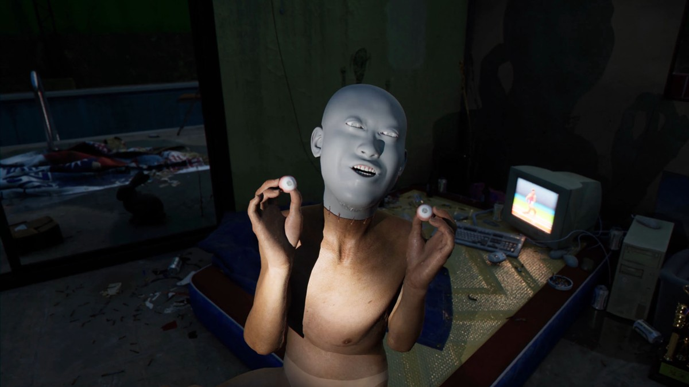
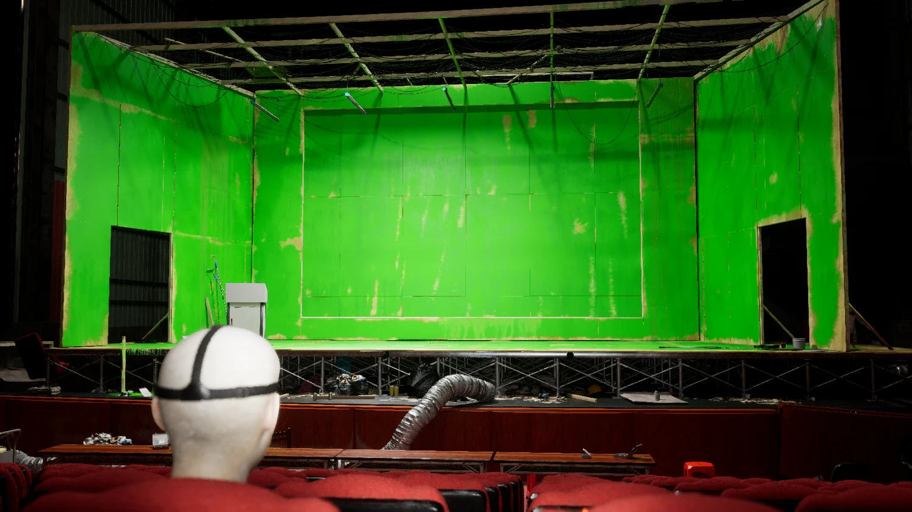
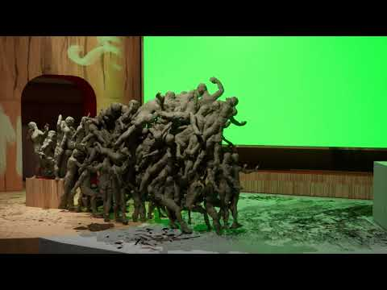
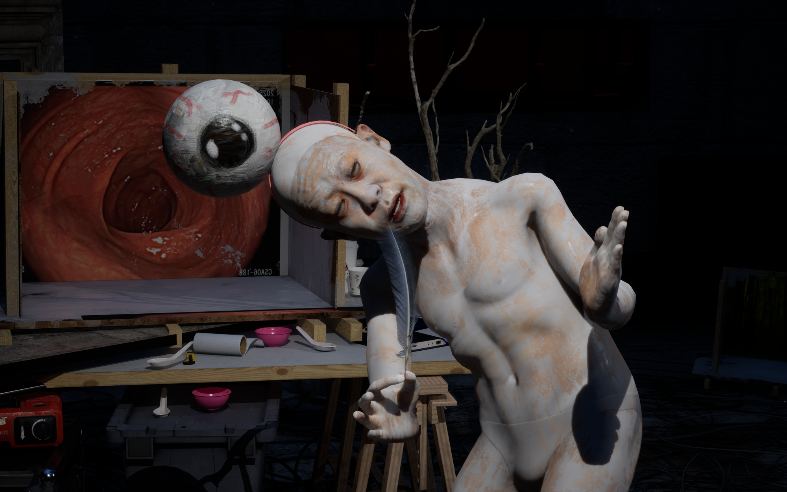

# Li Yi-Fan (李亦凡)

**Tag tecnica/formato:** `game-engine-realtime` `modellazione-3d` `vr-ar` `stampa-3d-scultura` `video`
**Tag tema:** `storia-computer-grafica` `corpo-identita` `intelligenza-artificiale-critica` `economia-attenzione`
**Tag corso:** `TAD-DCV` `TAD-AVM`

⚠️ **Avviso di contenuto**: le opere includono immagini di corpi/organi antropomorfizzati e senza testa, con movimento instabile/da "bug" — l'installazione veneziana segnalava esplicitamente discrezione consigliata per il pubblico e supervisione per i minori.

## Biografia
Nato nel 1989 a Taipei, Taiwan. BA in Belle Arti/pittura alla National Taiwan Normal University; MA/MFA in New Media Art alla Taipei National University of the Arts (2016) — formazione originaria in pittura, poi convertito al cinema/CGI. Vive fra Taipei e Amsterdam; residenza alla Rijksakademie (Amsterdam, 2025). Kaohsiung Award (2020); 20° Taishin Arts Award, Visual Arts (2022, per *howdoyouturnthison*); Golden Harvest Award al Taipei Golden Horse Film Festival (2023, per *What Is Your Favorite Primitive* — prima volta che un film sperimentale riceve questo premio). Espone alla 13ª Taipei Biennial (2023, TFAM) e con la prima personale europea *Last Warning/Dernier avertissement* (Institut d'art contemporain, Villeurbanne, Francia, 2025). Nel 2026 rappresenta Taiwan alla 61ª Biennale di Venezia con la personale *Screen Melancholy* (鬱卒的平面), evento collaterale "Taiwan in Venice" organizzato dal Taipei Fine Arts Museum, curato da Raphael Fonseca, Palazzo delle Prigioni, 9 maggio-22 novembre 2026 — occasione della visita che ha originato questa scheda.

## Poetica e ricerca
Li Yi-Fan lavora come crew di una sola persona: costruisce ambienti, oggetti di scena e meccaniche dentro Unreal Engine, scrive uno script che interpreta lui stesso vocalmente, mappa i propri movimenti facciali sull'avatar e manovra i personaggi tramite visore VR e controller portatili — una tecnica che ha definito **"digital puppetry"** (marionettismo digitale). Citazione dell'artista: *"The figures you see in my work weren't really acted out by me; they were puppets I manipulated. And the weird bodily contortions actually came about because I was unable to manipulate the puppets with precision. Most puppeteers stand behind their puppets, but I stood in front of mine."* Questo spiega esteticamente le contorsioni corporee "sbagliate", da bug, dei suoi avatar — un'estetica dell'errore tecnico diventata cifra stilistica riconoscibile. Temi ricorrenti: il rapporto fra umanità e tecnologia nell'era digitale con umorismo nero; la genealogia degli strumenti di produzione delle immagini (dal cinema alla CGI al game engine), che l'artista descrive come "un death match tra artista e software"; teorie del complotto, disinformazione, saturazione informativa online; gerarchie delle immagini e tecniche di simulazione della texture nello spazio virtuale; l'impatto dell'IA generativa sull'espressione umana. Il critico Travis Jeppesen (ArtReview) definisce Li "Poet of the Enshittosphere", leggendo la sua pratica come resistenza anti-sistemica al fatto che i sistemi digitali riducano l'espressione umana a un numero finito e sempre più povero di forme disponibili. Il critico Patrick Langley (e-flux) descrive il lavoro come segnato da "ritmo frenetico e immaginario inquietante — lumache zombie, avatar cadaverici, pop-up pubblicitari, psy-ops e burattinai" che catturano l'umore apocalittico dell'era AI incipiente. Il curatore Raphael Fonseca (su *Screen Melancholy*): *"Using such tools as real-time engines and modeling systems, Yi-Fan deconstructs the structure of image-production technology"* e *"When this intersects with the dark humor he often employs in his works, he sheds light on a certain melancholia that connects all viewers in front of a flat screen."*

## Opere principali
### important_message.mp4 (2019-2020)
**Corso:** `TAD-AVM` `TAD-DCV`
**Temi:** `avatar-e-corpo-virtuale` `propaganda-e-media`
**Descrizione:** video multicanale, 17'30", prima sperimentazione dell'artista con Unreal Engine in tempo reale. Un avatar guida lo spettatore in un "tornado" di teorie del complotto da clickbait, interrogando cosa sia reale in un'epoca di consumo sovrumano di informazione.

**Approfondimento:** [Cargo Collective — important_message.mp4](https://cargocollective.com/LIYIFAN/Works/important_message-mp4-2020)

### howdoyouturnthison / 不好意思…請問一下這個怎麼打開 (2021)
**Corso:** `TAD-AVM` `TAD-DCV`
**Temi:** `prospettiva-e-camera` `realismo-sintetico`
**Descrizione:** video monocanale, 17'30". Formalmente una "lecture" che spiega tecniche di produzione video CG contemporanea, mentre esplora somiglianze/differenze fra immagine CG e realtà; l'artista manovra il proprio avatar che si contorce senza vincoli fisici, sovvertendo la tradizione tecnica del "machinima".
**Lettura critica:** vince il Visual Arts Award al 20° Taishin Arts Award (2022); in collezione/archivio NTT InterCommunication Center (ICC), Tokyo.

**Approfondimento:** [NTT InterCommunication Center — howdoyouturnthison](https://www.ntticc.or.jp/en/archive/works/howdoyouturnthison/)

### What Is Your Favorite Primitive (2023)
**Corso:** `TAD-AVM` `TAD-DCV`
**Temi:** `prospettiva-e-camera` `norma-e-standardizzazione`
**Descrizione:** cortometraggio di 30', nella forma satirica di un keynote tech; un protagonista alle prese con questioni etiche e sociali insite negli strumenti software per la produzione di immagini. Debutta alla 13ª Taipei Biennial (2023).
**Lettura critica:** Golden Harvest Award al Taipei Golden Horse Film Festival — prima volta assegnato a un film sperimentale.

**Approfondimento:** [Taipei Biennial 2023 — Li Yi-Fan](https://www.taipeibiennial.org/2023/content/participant-li-yi-fan)

### Last Warning / Dernier avertissement (2025, IAC Villeurbanne)
**Corso:** `TAD-AVM`
**Temi:** `prospettiva-e-camera`
**Descrizione:** prima personale europea dell'artista, quattro sale con un'opera per sala (incl. *Boring Gray*, 2022-25, e *If You Can't Larp You'll Cry*, 2024, con Harrison Hall e Mat Spisbah).
**Lettura critica:** approccio radicalmente DIY — l'artista adatta i game engine e sviluppa i lavori tramite sperimentazione costante con la macchina; Patrick Langley (e-flux) la legge come pratica "in trasformazione permanente, sempre un passo avanti alla propria obsolescenza".

**Approfondimento:** [Institut d'art contemporain Villeurbanne — Dernier avertissement / Last Warning](https://www.i-ac.eu/en/exhibitions/24_in-situ/2025/750_DERNIER-AVERTISSEMENT-LAST-WARNING)

### Screen Melancholy / 鬱卒的平面 (2026, Palazzo delle Prigioni, Venezia — "Taiwan in Venice")
**Corso:** `TAD-AVM`
**Temi:** `prospettiva-e-camera` `architettura-e-citta`
**Descrizione:** opera site-specific, terza dell'artista con game engine come metodo di produzione ma la prima concepita come installazione site-specific. Video principale di 60 minuti più due video minori, allestiti nel Palazzo delle Prigioni (un tempo collegato al Palazzo Ducale dal Ponte dei Sospiri). Intorno allo schermo, sculture stampate in 3D ingrandite di mani, piedi, gambe, braccia — che fungono anche da sedute per i visitatori. Trama: un "occhio" che torna a casa e istruisce una "famiglia di organi" (fra cui una figura coronata da uno stomaco e una da un'appendice) su nozioni base di "alfabetizzazione all'animazione", tra frammenti in stile meme, mentre cerca il cervello assente — che rimane mancante per tutta la storia. Un "filmmaker umano digitale" dirige "attori digitali" come marionette, in dialoghi fra "organi umani" che riflettono sull'impatto dell'IA sull'umanità. Vista dall'utente alla mostra, 11 agosto 2026.
**Lettura critica:** il curatore Raphael Fonseca inquadra l'installazione nella metafora dello schermo come finestra (da Leon Battista Alberti alle superfici luminose degli smartphone) e nella "malinconia" prodotta dall'eccesso di immagini/storie compresse in rettangoli portatili; il pubblico, seduto sulle sculture-arti, "specchia" le marionette digitali che a loro volta specchiano il pubblico — un dispositivo che mette in scena la condizione di essere insieme prigionieri, burattinai e marionette.

**Approfondimento:** [e-flux — Li Yi-Fan: Screen Melancholy](https://www.e-flux.com/announcements/6787011/li-yi-fanscreen-melancholy)

## Interviste e talk
- _Nessuna ancora: da aggiungere._

## Fonti
- [Biennale Arte 2026 — Screen Melancholy, Li Yi-Fan (evento collaterale)](https://www.labiennale.org/en/art/2026/collateral-events/screen-melancholy-li-yi-fan)
- [Taiwan in Venice 2026 — sito ufficiale](https://www.taiwaninvenice.org/2026/)
- [ArtReview — "Li Yi-Fan: Poet of the Enshittosphere" (Travis Jeppesen)](https://artreview.com/li-yi-fan-poet-of-the-enshittosphere-taiwan-pavilion-venice-biennale-2026-feature-travis-jeppesen/)
- [e-flux — Li Yi-Fan: Screen Melancholy](https://www.e-flux.com/announcements/6787011/li-yi-fanscreen-melancholy)
- [e-flux Criticism — Li Yi-Fan and Chang Yung-Ta (Patrick Langley)](https://www.e-flux.com/criticism/674152/li-yi-fan-and-chang-yung-ta)
- [SCMP — "Li Yi-Fan's bizarre digital puppet critiques screen-obsessed world" (Venice Biennale)](https://www.scmp.com/lifestyle/arts/article/3355266/li-yi-fans-bizarre-digital-puppet-critiques-screen-obsessed-world-venice-biennale)
- [NTT InterCommunication Center (ICC) — howdoyouturnthison](https://www.ntticc.or.jp/en/archive/works/howdoyouturnthison/)
- [Taipei Biennial 2023 — Li Yi-Fan](https://www.taipeibiennial.org/2023/content/participant-li-yi-fan)
- [Institut d'art contemporain Villeurbanne — Dernier avertissement / Last Warning](https://www.i-ac.eu/en/exhibitions/24_in-situ/2025/750_DERNIER-AVERTISSEMENT-LAST-WARNING)
- [Rijksakademie — Li Yi-Fan](https://rijksakademie.nl/en/residents-advisors-team/li-yi-fan)
- [Cargo Collective — portfolio ufficiale artista](https://cargocollective.com/LIYIFAN)

## Mostre viste
- *Screen Melancholy* (Taiwan in Venice), Palazzo delle Prigioni, Venezia (2026) — visto da @danMa-hub

## Crediti delle immagini
Immagine per ciascuna delle cinque opere, inclusa sotto la relativa descrizione in "Opere principali", scelte tra le meno esplicite disponibili da fonti istituzionali (ICC Tokyo, Taipei Biennial, IAC Villeurbanne, e-flux) e YouTube, in coerenza con l'avviso di contenuto in testa alla scheda.
