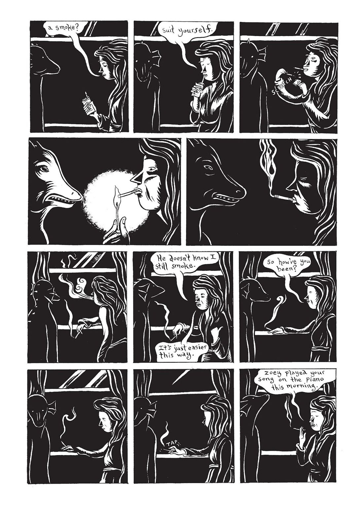
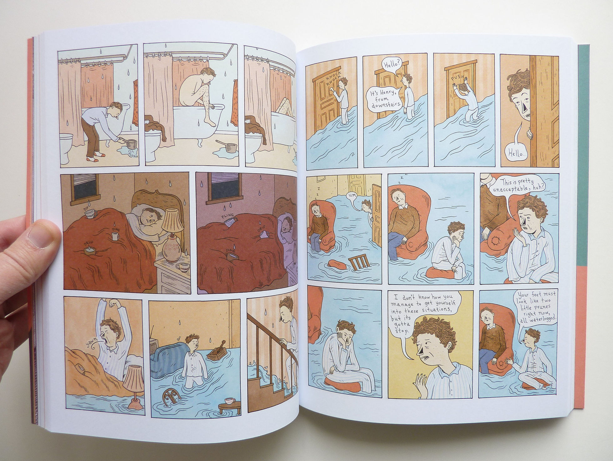
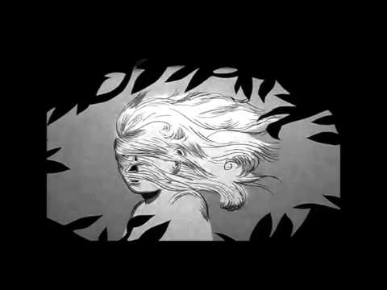
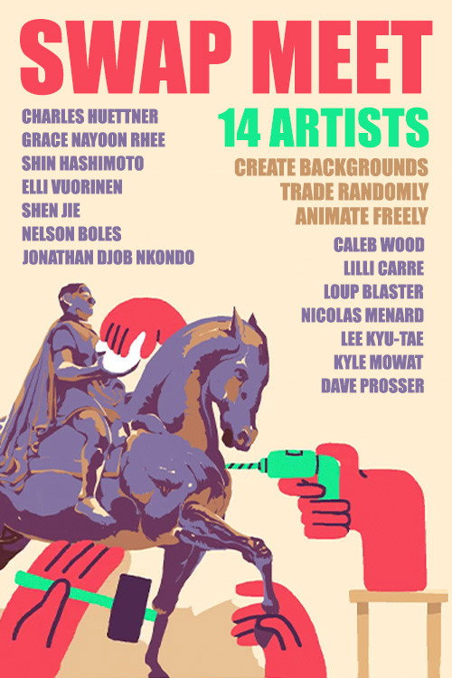
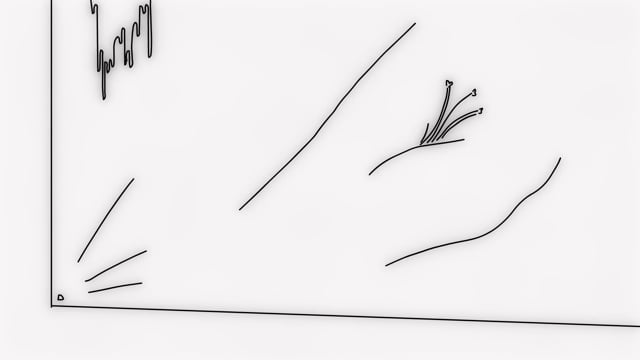
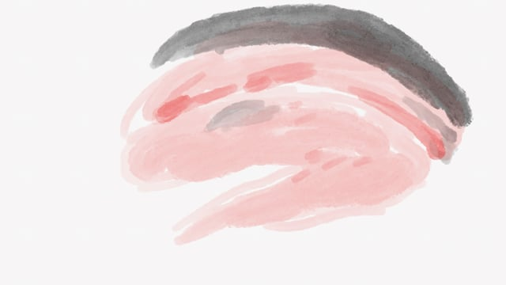

# Lilli Carrè

**Tag tecnica/formato:** `animazione-2d` `stampa-3d-scultura`
**Tag tema:** `corpo-identita` `temporalita-non-lineare`

## Biografia
Nata nel 1983 a Los Angeles. Si trasferisce a Chicago per studiare alla School of the Art Institute of Chicago (SAIC), inizialmente con l'intenzione di diventare artista sonora, poi orientandosi verso scrittura creativa, cinema e incisione; consegue il BFA nel 2006. Ottiene in seguito un MFA alla Northwestern University (2016). Ha vissuto e lavorato a lungo a Chicago (base della sua forte associazione con la scena dei fumetti alternativi e dell'animazione sperimentale locale); fonti più recenti (2024) la collocano a Los Angeles, dove insegna al dipartimento di Experimental Animation del CalArts. È co-fondatrice e co-direttrice (con Alexander Stewart) dell'Eyeworks Festival of Experimental Animation, festival annuale fondato nel 2010 con edizioni a Chicago, Los Angeles e New York. Nel 2024 riceve una Guggenheim Fellowship nella categoria Creative Arts/Film-Video. Ha svolto residenze al MacDowell e al Bemis Center for Contemporary Arts. Il suo lavoro è apparso su *The New Yorker*, *The New York Times*, per la Los Angeles Philharmonic, sulla Poetry Foundation, in *Best American Comics* e *Best American Nonrequired Reading*. Rappresentata dalla galleria Western Exhibitions di Chicago.

⚠️ Correzione: non risulta alcuna collaborazione come animatrice sulla serie TV *Adventure Time* — l'unico legame documentato è una copertina variante per il fumetto tie-in *Adventure Time* (BOOM! Studios, numero 12), non un lavoro di animazione sulla serie stessa.

## Poetica e ricerca
La pratica di Carrè attraversa fumetto, incisione, scultura/ceramica e animazione sperimentale/adiacente allo stop-motion, segnata costantemente da un'estetica disegnata e artigianale a mano, da una logica narrativa onirica e perturbante, e da sottotoni folklorici o gotici. *Slate*, recensendo la raccolta *Heads or Tails* (2012), descrive i suoi racconti brevi come "onirici, improbabili e inquietanti", con personaggi che inseguono pipistrelli, appartamenti che si riempiono d'acqua, mondi che si restringono — un'arte che "varia da racconto a racconto... ma mantiene sempre una bellezza intricata che dà a ogni storia una qualità senza tempo", definendo il suo lavoro una trasformazione "da incubi a favole". *The Comics Journal*, nella stessa recensione, inquadra i suoi personaggi ricorrenti come intrappolati in "una zona grigia di contraddizioni... tra yin e yang", guidati da apatia o punti ciechi, in attesa di forze esterne che ristabiliscano l'equilibrio. Il blog di Fantagraphics e la copertura del romanzo grafico *The Lagoon* (2008) legano esplicitamente la sua sensibilità visiva/narrativa a Flannery O'Connor e Carson McCullers (gotico sudista, narrazione familiare) e a riferimenti di genere come *Il mostro della laguna nera* e *La morte corre sul fiume*. Il proprio statement d'artista (riassunto nella pagina della Guggenheim Foundation) inquadra la pratica animata attuale attorno alle "possibilità e storie aperte del corpo animato — al tempo stesso estremamente fisico e virtuale, libero da aspettative o forme fisse", con un interesse ricorrente per "le rappresentazioni della forma femminile, del desiderio e dell'agentività attraverso la storia". Il Museum of Contemporary Art di Chicago l'ha ospitata nella serie BMO Harris Bank Chicago Works (2013, mostra personale) e in una proiezione curata "MCA Screen: Lilli Carré, Cycles & Marks" (aprile 2014).

## Opere principali

### The Lagoon (2008, romanzo grafico, Fantagraphics)
**Descrizione:** primo romanzo grafico lungo dell'artista, 80 pagine, bianco e nero, disegnato con pennino e pennello. Una famiglia viene sedotta/perseguitata da un canto simile a quello di una sirena proveniente da una laguna; ogni membro della famiglia reagisce in modo diverso (il nonno viene richiamato a rispettare e temere la natura; la giovane figlia Zoey percepisce qualcosa che non riesce ancora a comprendere).
**Lettura critica:** letto in relazione alla tradizione letteraria del gotico sudista (O'Connor, McCullers) e a riferimenti horror cinematografici (*Il mostro della laguna nera*, *La morte corre sul fiume*).

**Approfondimento:** [lillicarre.com — The Lagoon](https://www.lillicarre.com/the-lagoon)

### Heads or Tails (2012, raccolta di racconti a fumetti, Fantagraphics)
**Descrizione:** storie sviluppate nell'arco di circa cinque anni, unificate dai temi della dualità, della scelta e dell'ambivalenza ("facce della stessa medaglia"). Include racconti come "The Thing About Madeline" (una narrazione sul doppio) e "Rainbow Moment". Lo stile grafico cambia da racconto a racconto (matita bianco e nero contro colore/collage).
**Lettura critica:** recensita sia da *Slate* sia da *The Comics Journal* (vedi sopra) — la struttura a raccolta di racconti autonomi permette all'artista di variare radicalmente registro grafico da un pezzo all'altro, mantenendo però una coerenza tematica sulla dualità.

### How She Slept at Night (2007, cortometraggio animato)
**Descrizione:** un uomo cerca di ricordare sua moglie, con la memoria che si erode in dettagli scarsi e sfuggenti. Presentato al Sundance Film Festival 2007, in un doppio programma con un corto di Wes Anderson.
**Lettura critica:** tra i primi riconoscimenti festivalieri di rilievo dell'artista come animatrice, non solo come autrice di fumetti.

### Swap Meet (2015, cortometraggio animato collaborativo)
**Descrizione:** collaborazione a staffetta tra 14 animatori internazionali: ciascuno crea un'immagine di sfondo e la scambia con un altro artista, che la anima sopra. Sequenze oniriche e surreali (un cane-palloncino che cammina su pianeti, un telefono che sputa fuori un angelo, una farfalla di carta).
**Lettura critica:** un raro esempio, nel corpus dell'artista, di collaborazione strutturata con altri animatori internazionali, che mette alla prova la coerenza del suo stile a contatto con mani e sensibilità diverse.

### Private Properties (2020, cortometraggio animato)
**Descrizione:** animazione disegnata a mano e in continua metamorfosi, in cui un soggiorno si contrae e si espande, con una credenza, una serratura, un rubinetto e oggetti personali che transitano continuamente l'uno nell'altro. Proiettato nella sezione Bright Future dell'International Film Festival Rotterdam (IFFR) 2020.
**Lettura critica:** l'IFFR la descrive come "un'indagine forense di uno spazio privato che può continuamente cambiare forma" — la metamorfosi disegnata a mano diventa metafora diretta dell'instabilità della memoria e dell'identità domestica.

**Approfondimento:** [IFFR — Private Properties](https://iffr.com/en/iffr/2020/films/private-properties)

### Glazing (2022, cortometraggio animato)
**Descrizione:** un corpo femminile nudo animato si muove, con fotogrammi "sfumati", attraverso pose tratte dalla storia della pittura, abitando e poi rifiutando ciascuna rappresentazione storico-artistica del corpo femminile.
**Lettura critica:** letto come una critica diretta alla fantasia/oggettificazione incorporata nella tradizione pittorica del nudo — l'animazione permette al corpo di "rifiutare" attivamente pose che nella pittura restano fisse e passive.

## Immagini

Immagine per ciascuna delle sei opere, inclusa sotto la relativa descrizione in "Opere principali", dal sito ufficiale dell'artista, Vimeo, YouTube e TMDB.
- [Fantagraphics — pagina artista/collezione](https://www.fantagraphics.com/collections/lilli-carre)
- [Guggenheim Foundation — pagina fellow](https://www.gf.org/fellows/lilli-carre/)
- [CalArts — pagina docente](https://calarts.edu/members/lilli-carre)

## Fonti
- [Fantagraphics — pagina artista/collezione](https://www.fantagraphics.com/collections/lilli-carre)
- [Guggenheim Foundation — pagina fellow](https://www.gf.org/fellows/lilli-carre/)
- [CalArts — pagina docente](https://calarts.edu/members/lilli-carre)
- [IFFR — pagina artista, Private Properties](https://iffr.com/en/iffr/2020/films/private-properties)
- [The Comics Journal — recensione di Heads or Tails](https://www.tcj.com/reviews/heads-or-tails/)
- [Slate — recensione di Heads or Tails](https://slate.com/culture/2012/12/lilli-carres-heads-or-tails-reviewed.html)
- [The Marginalian (Maria Popova) — su Head Garden](https://www.themarginalian.org/2013/01/14/head-garden-lilli-carre/)
- [Museum of Contemporary Art Chicago — Chicago Works: Lilli Carré (2013)](https://mcachicago.org/Exhibitions/2013/Lilli-Carre)
- [Western Exhibitions — pagina artista](https://westernexhibitions.com/artist/lilli-carre/)
- [Sundance Institute — su How She Slept at Night](https://www.sundance.org/blogs/short-order-a-sundance-selected-double-feature-of-shorts-by-wes-anderson-and-lilli-carre/)

---

## Appunti da organizzare
- Non citata in un programma specifico dei corsi — inserita dalla lista generale "da scrivere da zero" per la rilevanza nell'ambito dell'animazione sperimentale disegnata a mano.
- ⚠️ Correzioni: nata a Los Angeles, non a Chicago (Chicago è dove si è formata e ha vissuto a lungo); *Nine Ways to Disappear* (2009) è un libro di racconti illustrati, non un cortometraggio animato — se si cerca un esempio di corto animato, usare invece *Private Properties*, *Glazing*, *Head Garden*, *How She Slept at Night* o *Swap Meet*.
- Video ulteriori: canale Vimeo dell'artista con la maggior parte dei lavori animati: [vimeo.com/lillicarre](https://vimeo.com/lillicarre/videos).
