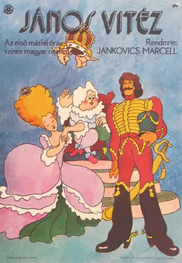
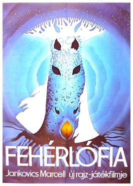

# Marcell Jankovics

**Tag tecnica/formato:** `animazione-2d`
**Tag tema:** `memoria-archivio`
**Stato:** scheda parziale, scritta a partire da fonti web (Wikipedia, siti di festival e gallerie); non ancora assegnata a un corso · immagini controllate (diritti degli autori)

## Biografia
Nato a Budapest il 21 ottobre 1941, morto il 29 maggio 2021. Grafico, regista, animatore e autore ungherese. Dal 1955 frequenta il liceo benedettino di Pannonhalma e dal 1960 lavora agli studi cinematografici Pannónia. Vince la Palma d'Oro a Cannes 1977 (*A küzdelem*), il Winsor McCay Award (1999) e il Leonardo da Vinci World Award of Arts (2009).

## Poetica e ricerca
Attinge a folklore e letteratura ungheresi: le sue opere più note si basano su poemi e miti popolari.

## Opere principali

### Johnny Corncob (János vitéz, 1973)
**Descrizione:** Primo lungometraggio d'animazione ungherese, tratto dal poema *János vitéz* (1845) di Sándor Petőfi.

### Sisyphus (1974)
**Descrizione:** Cortometraggio candidato all'Oscar.

⚠️ Nessuna immagine trovata.

### The Struggle (A küzdelem, 1977)
**Descrizione:** Cortometraggio, Palma d'Oro a Cannes 1977.

⚠️ Nessuna immagine trovata.

### Son of the White Mare (Fehérlófia, 1981)
**Descrizione:** Lungometraggio ispirato al mito popolare ungherese: una dea cavalla dà alla luce tre fratelli che scendono nel mondo sotterraneo per salvare tre principesse da tre draghi e riconquistare il regno perduto degli antenati. Spesso citato tra i migliori film d'animazione di sempre.

### Altri lavori
**Descrizione:** *Tangram* (1988), la serie TV *Hungarian Folk Tales* (1988-1996), *The Tragedy of Man* (2011, lavorazione dal 1988), *Toldi* (uscito postumo, 2022).

## Fonti
- [Wikipedia — Marcell Jankovics](https://en.wikipedia.org/wiki/Marcell_Jankovics)
- [Wikipedia — Son of the White Mare](https://en.wikipedia.org/wiki/Son_of_the_White_Mare)

## Crediti delle immagini
Immagini controllate il 2026-11-01: provengono dalle pagine indicate (festival, gallerie, siti degli artisti, piattaforme) e restano di proprietà degli autori.
- Son of the White Mare (Fehérlófia) (1): [en.wikipedia.org](https://en.wikipedia.org/wiki/File%3APoster_art_for_the_1982_Hungarian_animated_motion_picture_Feh%C3%A9rl%C3%B3fia%2C_directed_by_Marcell_Jankovics_for_the_Pann%C3%B3nia_Filmmst%C3%BAdi%C3%B3.jpg) · Locandina, diritti degli autori; uso didattico
- Johnny Corncob (János vitéz) (1): [en.wikipedia.org](https://en.wikipedia.org/wiki/File%3AJohnny_Corncob_poster.jpg) · Locandina, diritti degli autori; uso didattico
