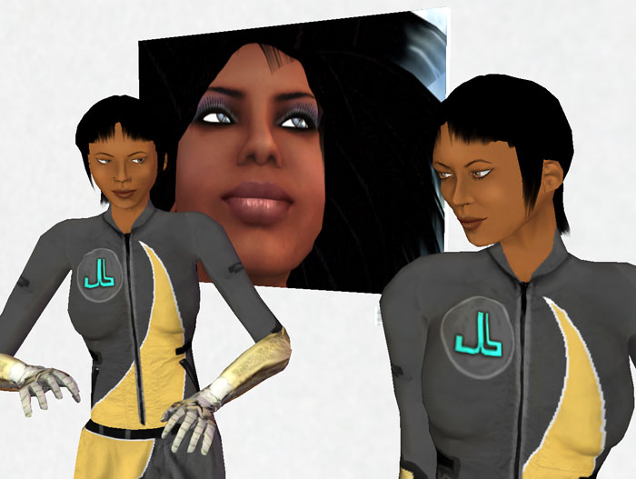
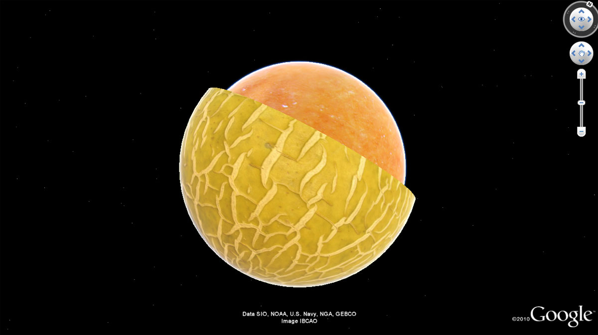
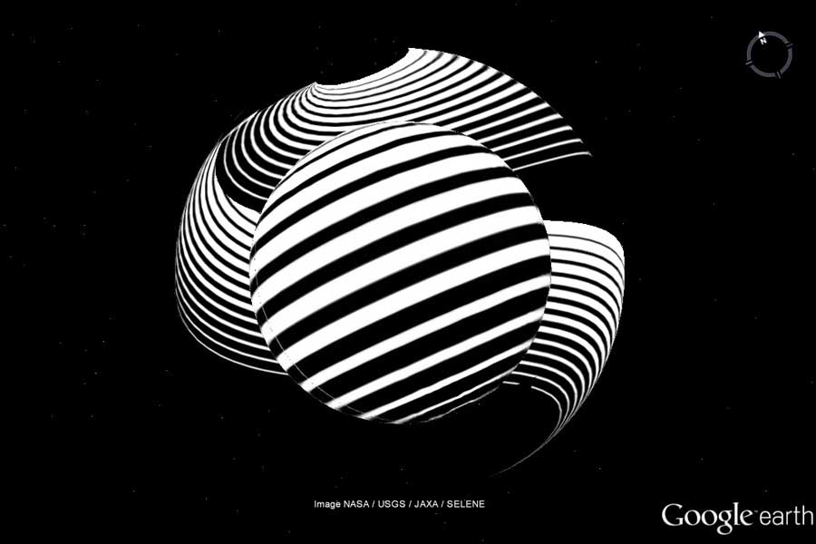
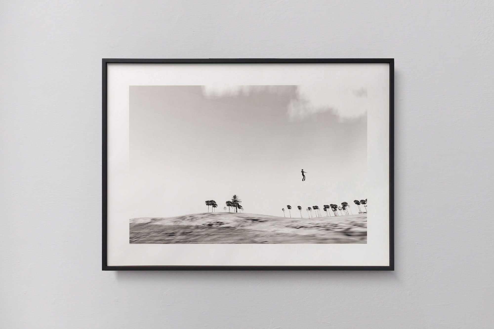
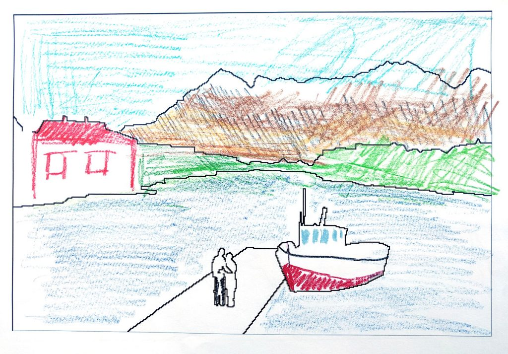

# Marco Cadioli

**Tag tecnica/formato:** `net-art-sito-web` `fotografia` `videogioco-simulazione`
**Tag tema:** `mondi-virtuali-simulazione` `memoria-archivio` `intelligenza-artificiale-critica`

## Biografia
Nato nel 1960 a Milano, dove vive e lavora. Laureato in Fisica (indirizzo Cibernetica), segue l'evoluzione dei new media dai primi anni Novanta, affiancando la ricerca artistica all'attività didattica. È attualmente professore di NetArt e Cultura Digitale all'Accademia di Belle Arti di Carrara e all'Accademia SantaGiulia di Brescia; ha insegnato come docente a contratto all'Accademia di Belle Arti di Brera dal 2014 al 2022. Ha esposto in mostre personali e collettive presso BASE Milano, iMAL (Bruxelles), Link Art Center (Brescia), Electronic Media Arts Centre (Toronto) e alla Biennale di Venezia. Nel 2011, con lo pseudonimo "Marco Manray", fonda insieme a Domenico Quaranta, Fabio Paris e Lucio Chiappa il Link Center for the Arts of the Information Age (poi Link Art Center) di Brescia, tra le piattaforme curatoriali italiane di riferimento per la ricerca artistica nell'età dell'informazione; è tra gli artisti coinvolti nel progetto Link Point (2012-2014) insieme, tra gli altri, a Elisa Giardina Papa e Filippo Minelli.

⚠️ Nota di disambiguazione: l'"Accademia di Belle Arti di Carrara" (Carrara, Toscana) dove Cadioli insegna è un istituto distinto dall'"Accademia Carrara" di Bergamo (storica pinacoteca e accademia di pittura) citata come sede di riferimento in altri contesti — nome simile ma istituzioni diverse, verificare sempre quale delle due si intende.

## Poetica e ricerca
Fin dai primi anni Duemila la ricerca di Cadioli si concentra sullo sfumare il confine tra reale e virtuale, a partire dalle prime esperienze come "fotoreporter" nei mondi virtuali. Con lo pseudonimo Marco Manray, dal 2005 al 2008 documenta con "scatti" fotografici gli eventi, i protagonisti e la vita quotidiana di Second Life, pubblicando poi il libro "Io, reporter in Second Life" (Shake Edizioni, 2007). Un tratto ricorrente della sua pratica è la sovversione dell'uso previsto del software: forzarne i limiti e superare la superficie levigata degli algoritmi per appropriarsi del sistema dall'interno — un metodo applicato anche a Google Earth e Google Maps, di cui l'artista attraversa le geografie sfruttando gli errori di rendering e le cuciture visibili tra le fotografie satellitari per rompere l'illusione iperrealistica offerta dal software. Negli anni più recenti la ricerca si sposta sull'intelligenza artificiale, osservata non come strumento di produzione di immagini ma come oggetto di indagine: cosa e come sta "imparando" un sistema di IA, e quale forma di conoscenza — o di incomprensione — si genera nell'incontro tra la logica umana e quella della macchina.

## Opere principali
### Marco Manray reporter in Second Life (2005-2008)
**Descrizione:** serie fotografica realizzata all'interno del mondo virtuale Second Life, che documenta eventi, protagonisti e vita quotidiana della piattaforma nei suoi anni di massima visibilità mediatica. Confluita nel libro "Io, reporter in Second Life" (Shake Edizioni, 2007) e in una prima personale, "REPLICA", in occasione dell'apertura della sede in Second Life della galleria Overfoto di Napoli.
**Lettura critica:** tra le prime pratiche italiane di fotografia documentaria applicata sistematicamente a un mondo virtuale, con l'artista nel ruolo esplicito di "reporter" — un dispositivo critico che tratta lo spazio virtuale con lo stesso statuto epistemico del reale.

**Approfondimento:** [marcocadioli.com — Marco Manray](https://marcocadioli.com/marco-manray/)

### Google Melon (2011) e Google Error (2012)
**Descrizione:** opere realizzate attraversando le geografie di Google Maps e Google Earth fino a raggiungere i punti in cui l'illusione iperrealistica della rappresentazione satellitare del software si incrina, rivelando errori di cucitura, texture deformate e artefatti di rendering.
**Lettura critica:** letti come un'archeologia degli errori del software cartografico — momenti in cui la superficie "neutra" della rappresentazione geografica computazionale tradisce la propria natura costruita e fallibile.

**Approfondimento:** [marcocadioli.com — Google Melon](https://marcocadioli.com/google-melon/) · [marcocadioli.com — Google Error](https://marcocadioli.com/google-error/)

### Back to the Metaverse (2022)
**Descrizione:** mostra personale a SMDOT/Contemporary Art di Udine, che affianca opere del 2007 a nuove installazioni, coprendo un arco di quindici anni dalle prime esperienze nei mondi virtuali fino alla recente esplosione di interesse mediatico per il "metaverso".
**Lettura critica:** un bilancio retrospettivo che mette in prospettiva storica l'attuale narrativa del "metaverso", mostrando come gran parte delle sue promesse e dei suoi problemi fossero già presenti — e già indagati artisticamente — nell'esperienza di Second Life di quindici anni prima.

**Approfondimento:** [marcocadioli.com — Back to the Metaverse](https://marcocadioli.com/back-to-the-metaverse/)

### Database for Human Training (2019) e Watching the Sea (2019)
**Descrizione:** opere che affrontano l'addestramento dell'intelligenza artificiale al riconoscimento delle emozioni facciali (Database for Human Training) e una situazione di osservazione condivisa del mare tra un umano e una macchina, rappresentata come una forma di simbiosi tra logiche differenti (Watching the Sea).
**Lettura critica:** segnano lo spostamento della ricerca dell'artista dai mondi virtuali "abitati" (Second Life) all'intelligenza artificiale come nuovo territorio da esplorare con lo stesso spirito da reporter/etnografo delle opere precedenti.

**Approfondimento:** [marcocadioli.com — Database for Human Training](https://marcocadioli.com/database-for-human-training/) · [marcocadioli.com — Watching the Sea](https://marcocadioli.com/watching-the-sea/)

## Interviste e talk
- _Nessuna ancora: da aggiungere._

## Fonti
- [Sito ufficiale dell'artista](https://marcocadioli.com/)
- [Sito ufficiale dell'artista — pagina About](https://marcocadioli.com/about/)
- [SMDOT/Contemporary Art, Udine — pagina artista](https://www.smdot.net/artists/marco-cadioli/)
- [Mousse Magazine — Marco Cadioli, Back to the Metaverse at SMDOT/Contemporary Art, Udine](https://www.moussemagazine.it/magazine/marco-cadioli-back-to-the-metaverse-at-smdot-contemporary-art-udine/)
- [Arshake — Marco Cadioli, Back to the Metaverse](https://www.arshake.com/en/marco-cadioli-back-to-the-metaverse/)
- [Arshake — Special Project #20, Marco Cadioli: The Whirlpool](https://www.arshake.com/en/special-project-20-marco-cadioli-the-whirlpool/)
- [Link Art Center — sito](https://www.linkartcenter.eu/)
- [EduEDA — The Educational Encyclopedia of Digital Arts, voce Cadioli Marco](https://www.edueda.net/index.php?title=Cadioli_Marco)
- [Accademia di Belle Arti di Carrara — pagina docente](https://accademiacarrara.it/cadioli-marco/)

## Crediti delle immagini
Immagine per ciascuna opera/coppia di opere, inclusa sotto la relativa descrizione in "Opere principali", dal sito ufficiale dell'artista.
- [Sito ufficiale dell'artista](https://marcocadioli.com/)
- [SMDOT/Contemporary Art, Udine — Back to the Metaverse](https://www.smdot.net/artists/marco-cadioli/)
- [Arshake — Marco Cadioli, Back to the Metaverse](https://www.arshake.com/en/marco-cadioli-back-to-the-metaverse/)
