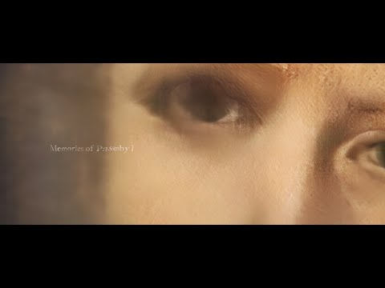
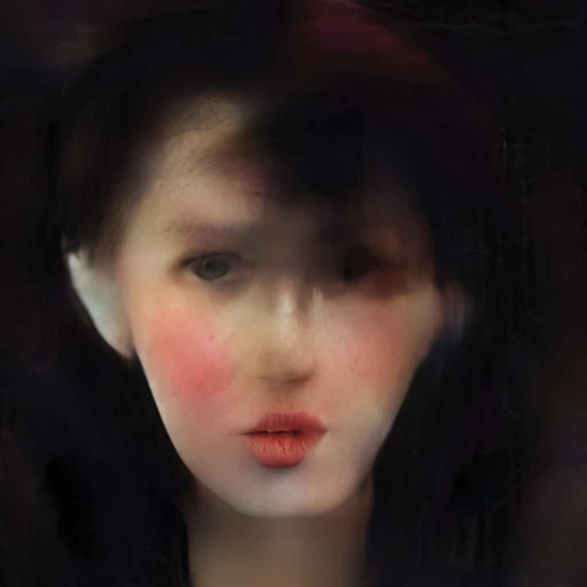
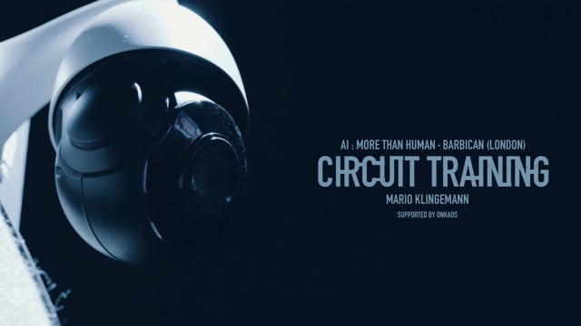
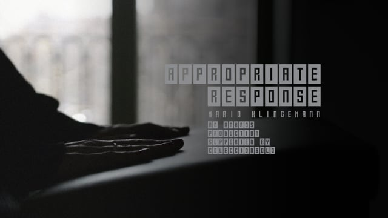
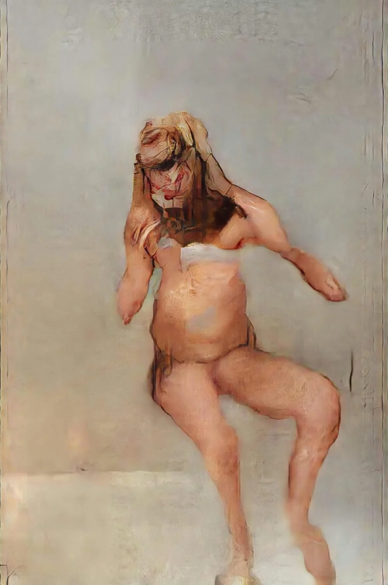

# Mario Klingemann

**Tag tecnica/formato:** `ai-generativa` `installazione` `data-visualization`
**Tag tema:** `storia-computer-grafica` `intelligenza-artificiale-critica`

## Biografia
Nato nel 1970 a Laatzen, Bassa Sassonia, Germania (data esatta di nascita non confermata dalle fonti raggiungibili). Artista tedesco, noto anche con lo pseudonimo online storico "Quasimondo". Autodidatta — non ha frequentato scuole d'arte né università, iniziando a insegnarsi la programmazione informatica nei primi anni '80; padre ingegnere, madre pittrice. Vive e lavora a Monaco di Baviera, dove gestisce anche uno spazio/progetto chiamato "Dog & Pony" insieme all'artista della carta Alexandra Lukaschewitz. È stato artista in residenza al Google Cultural Institute/Google Arts & Culture Lab di Parigi (circa 2015/16-2018). È ampiamente riconosciuto come uno dei pionieri dell'arte con reti neurali/machine learning, e ha coniato il termine "neurografia" per la creazione di immagini tramite reti neurali invece che con una fotocamera. Riconoscimenti: British Library Labs Creative Award (2015, per "The Order of Things", basato su classificazione automatica di circa un milione di immagini dell'archivio Flickr Commons della British Library); Lumen Prize Gold Award (2018, per "The Butcher's Son"); menzione d'onore, categoria Interactive Art+, Prix Ars Electronica 2020, per "Appropriate Response". Ha esposto ad Ars Electronica, Centre Pompidou, MoMA, Metropolitan Museum, Barbican Centre, The Photographers' Gallery, British Library, Hermitage Museum, ZKM Karlsruhe; un disegno legato a "The Butcher's Son" è nella collezione permanente del Victoria & Albert Museum.

⚠️ Precisazione importante: *Memories of Passersby I* (2018) è spesso definita "la prima opera d'arte IA venduta all'asta" — formulazione da correggere: è la **prima opera IA venduta da Sotheby's** e la prima installazione IA dal vivo/generativa venduta da una grande casa d'aste, ma non la prima opera IA in assoluto venduta in una grande asta: quel primato appartiene al "Ritratto di Edmond de Belamy" del collettivo Obvious, venduto da **Christie's** nell'ottobre 2018 per 432.500 dollari, cinque mesi prima della vendita di Klingemann.

## Poetica e ricerca
Klingemann inizia a lavorare con le reti neurali e, dal 2015-16, con le GAN, anni prima del boom dell'arte IA basata sui modelli di diffusione (DALL-E, Midjourney, Stable Diffusion, dal 2021 in poi) — una cronologia da early adopter confermata dalla sua residenza Google (2015-2018) e dalla serie *Neural Glitch*, datata esplicitamente aprile-ottobre 2018. La curatrice e ricercatrice Luba Elliott, in un profilo per *Flash Art* ("AI through the Technologist's Eye", 2017), lo descrive come uno degli artisti pionieri nella comunità del machine learning e del creative coding, capace di "spingere i limiti delle capacità [delle reti neurali] ed esporne i confini", dettagliando la sua pratica di addestrare GAN su insiemi di immagini trovate (ad esempio annuari fotografici) invece di dipingere o fotografare. *Neural Glitch* è il corpus di lavori che meglio dimostra il suo impegno critico, non semplicemente spettacolare, con la percezione automatica: Klingemann corrompe deliberatamente i pesi interni delle proprie GAN già addestrate, così che i modelli — originariamente costruiti per migliorare o ricostruire immagini in ingresso — le fraintendano invece "a livello sia estetico sia semantico". I glitch risultanti vengono descritti dalla rivista *Issues in Science and Technology* come una rara finestra visibile sull'interno "scatola nera" di una specifica e breve generazione di architettura GAN convoluzionale — un metodo artistico per interrogare la macchina, non solo per usarla come generatore di stile. Klingemann viene sistematicamente distinto dagli artisti "di tendenza" arrivati con il boom successivo dell'IA proprio perché la sua sperimentazione con le GAN precede l'ondata mainstream, e perché le sue opere mettono in primo piano il processo/sistema (installazioni generative dal vivo, mai ripetute, modelli deliberatamente corrotti) piuttosto che una singola immagine finale rifinita: Sotheby's stessa, nella descrizione di *Memories of Passersby I*, sottolinea esplicitamente che l'opera è il sistema vivente stesso, non un manufatto stampato — "l'arte è il codice e il sistema".

## Opere principali
### Memories of Passersby I (2018)
**Descrizione:** installazione GAN dal vivo e autosufficiente: una console/mobile in legno che ospita un computer personalizzato (il "cervello" dell'IA) collegato a due schermi incorniciati in stile vintage, che generano continuamente e autonomamente un flusso infinito e mai ripetuto di ritratti immaginari maschili e femminili in tempo reale. Addestrata su migliaia di dipinti-ritratto europei del XVII-XIX secolo; Klingemann ha ulteriormente calibrato le preferenze estetiche del modello con uno strumento di valutazione umana delle immagini in stile Tinder di propria invenzione. Realizzata in collaborazione con lo studio di arte digitale ONKAOS. Venduta da Sotheby's Londra, Contemporary Art Day Auction (6 marzo 2019, lotto 109), per 40.000 sterline (circa 51.000 dollari).
**Lettura critica:** inquadrata da Sotheby's e dalla stampa come storicamente significativa proprio perché l'"opera" è il sistema generativo autonomo stesso, non un'immagine fissa — sollevando interrogativi su autorialità, proprietà e cosa costituisca "l'opera" quando l'output è infinito e mai ripetuto. *Dazed* ha offerto una lettura più scettica del risultato modesto della vendita rispetto al clamore mediatico.
**Video:** [documentario Onkaos su Memories of Passersby I (YouTube)](https://www.youtube.com/watch?v=V8ApauQwfUw)

### Neural Glitch, serie (2018)
**Descrizione:** un corpo di esperimenti (titolati con timestamp numerici, es. "Neural Glitch 1541266710") iniziato nell'aprile 2018, in cui Klingemann altera manualmente i pesi interni addestrati delle proprie GAN personalizzate, causando una lettura e una distorsione errate degli input, sia visiva sia semantica. Il lavoro video correlato in trittico "Mistaken Identity" è stato esposto allo ZKM Karlsruhe durante il Beyond Festival (ottobre 2018).
**Lettura critica:** presentata da *Issues in Science and Technology* come un metodo per esporre la "scatola nera" convoluzionale di un momento tecnico specifico e storicamente circoscritto dell'architettura GAN — un'estetica inseparabile da quell'era tecnica particolare, non riproducibile con modelli successivi.

**Approfondimento:** [Issues in Science and Technology — Neural Glitch](https://issues.org/klingemann-neural-glitch/)

### Circuit Training (2019)
**Descrizione:** installazione interattiva mostrata nella mostra "AI: More Than Human" del Barbican, Londra (2019, curata da Suzanne Livingston e Maholo Uchida). I visitatori vengono fotografati per costruire in tempo reale un insieme di dati di addestramento, poi valutano/selezionano gli output prodotti dalla rete, insegnando al sistema — dal vivo, davanti al pubblico — quali tratti visivi ottengano approvazione, mettendo in scena esplicitamente un ciclo di feedback umano/ottimizzazione dell'attenzione.
**Lettura critica:** ⚠️ non risulta confermato alcun riconoscimento del Prix Ars Electronica specificamente per quest'opera (talvolta riportato in fonti secondarie) — l'unico riconoscimento Ars Electronica confermato nella carriera dell'artista è la menzione d'onore 2020 per *Appropriate Response* (vedi sotto).

### Appropriate Response (2020)
**Descrizione:** installazione interattiva: un inginocchiatoio in legno posto davanti a un pannello a schede meccaniche (split-flap, stile aeroportuale) di 125 lettere, che esegue un modello linguistico GPT-2 addestrato su misura. Quando un visitatore si inginocchia, il sistema genera per lui un breve testo di risposta unico — messo in scena con iconografia religiosa/oracolare esplicita, interrogando quanto significato una macchina (o un essere umano) possa comprimere in 125 caratteri, e quanto facilmente le persone proiettino intenzione o saggezza su un output algoritmico. Riceve una menzione d'onore, categoria Interactive Art+, Prix Ars Electronica 2020; mostrata nell'ambito di CyberArts 2020.
**Lettura critica:** l'opera che dimostra con più chiarezza l'interesse dell'artista per la proiezione umana di significato su output puramente statistici — l'iconografia religiosa (l'inginocchiatoio) non è casuale ma sottolinea direttamente il parallelo tra oracolo e algoritmo.
**Video:** [documentazione di Appropriate Response (Vimeo)](https://vimeo.com/394544451)

### The Butcher's Son (2017), serie "Imposture"
**Descrizione:** parte di una serie di sei stampe in cui Klingemann incatena più GAN in sequenza: una figura stilizzata generata casualmente innesca una prima GAN che produce una proto-immagine "pittorica" a bassa risoluzione, progressivamente ampliata e dettagliata da stadi GAN successivi addestrati su immagini figurative raccolte da internet. Frequentemente accostata (dalla critica Luba Elliott su *Flash Art*) alla figurazione distorta di Francis Bacon, pur non contenendo alcun riferimento diretto a immagini di Bacon come fonte. Vince il Lumen Prize Gold Award (2018). Un disegno collegato all'opera è nella collezione permanente del Victoria & Albert Museum.
**Lettura critica:** dimostra come un processo puramente algoritmico e concatenato possa produrre risultati visivamente affini a una tradizione pittorica specifica (l'espressionismo figurativo di Bacon) senza alcuna citazione diretta — sollevando la domanda se questa somiglianza sia significativa o solo una coincidenza statistica.

**Approfondimento:** [Lumen Prize — The Butcher's Son](https://lumenprize.org/2018-winners/mario-klingemann)

## Interviste e talk
- [Ars Electronica — pagina artista, Kepler's Gardens](https://ars.electronica.art/keplersgardens/en/artist-talk-mario-klingemann/)
- [Goethe-Institut — intervista "Words behave like pixels and sentences like pictures"](https://www.goethe.de/prj/k40/en/kun/kli.html)

## Fonti
- [Sotheby's — pagina del lotto, Memories of Passersby I](https://www.sothebys.com/en/auctions/ecatalogue/2019/contemporary-art-day-auction-l19021/lot.109.html)
- [Sotheby's — approfondimento editoriale sull'IA e Klingemann](https://www.sothebys.com/en/articles/artificial-intelligence-and-the-art-of-mario-klingemann)
- [Issues in Science and Technology — "Neural Glitch"](https://issues.org/klingemann-neural-glitch/)
- [Flash Art — Luba Elliott, "AI through the Technologist's Eye"](https://flash---art.com/article/mario-klingemann/)
- [Lumen Prize — vincitori 2018](https://lumenprize.org/2018-winners/mario-klingemann)
- [Victoria & Albert Museum — The Butcher's Son (disegno), collezione](https://collections.vam.ac.uk/item/O1572110/the-butchers-son-drawing-mario-klingemann)
- [Barbican — comunicato stampa "AI: More Than Human" (PDF)](https://www.barbican.org.uk/sites/default/files/documents/2019-04/FINAL%20AI%20More%20than%20Human%20exhibition%20release%20280219_1.pdf)
- [Artnet News — sulla vendita da Sotheby's](https://news.artnet.com/market/artificial-intelligence-sothebys-1481590)

## Crediti delle immagini
Immagine per ciascuna delle cinque opere, inclusa sotto la relativa descrizione in "Opere principali", da YouTube, Vimeo, Issues in Science and Technology e Lumen Prize.
- [Sotheby's — pagina del lotto, Memories of Passersby I](https://www.sothebys.com/en/auctions/ecatalogue/2019/contemporary-art-day-auction-l19021/lot.109.html)
- [Sotheby's — approfondimento editoriale sull'IA e Klingemann](https://www.sothebys.com/en/articles/artificial-intelligence-and-the-art-of-mario-klingemann)
- [Issues in Science and Technology — "Neural Glitch"](https://issues.org/klingemann-neural-glitch/)
