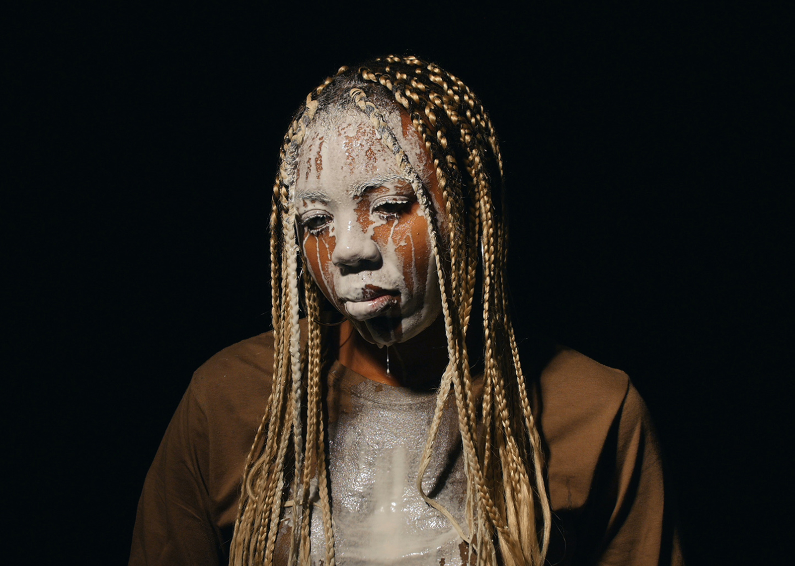
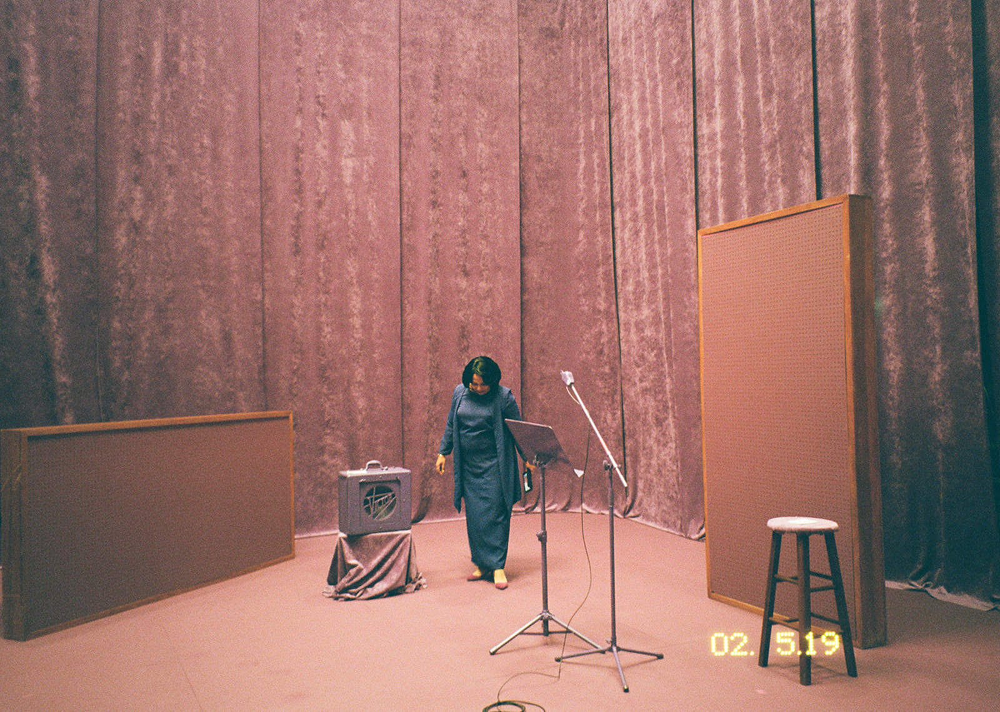
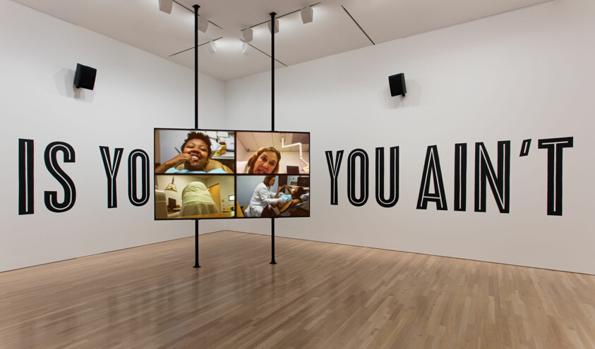
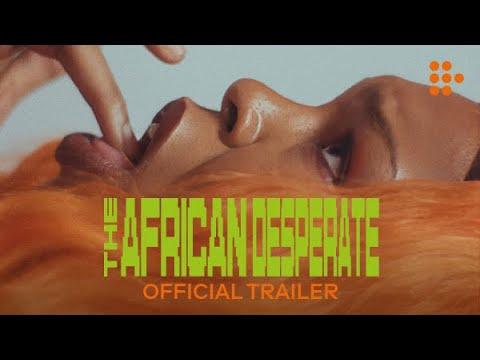
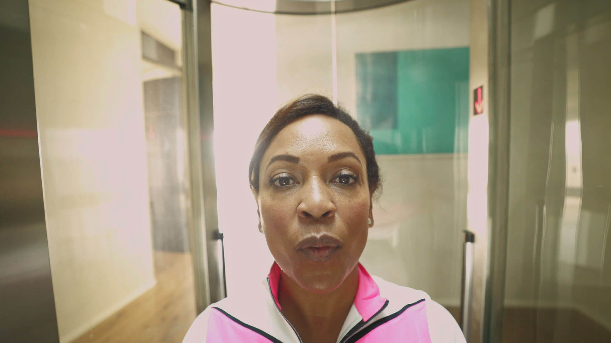

# Martine Syms

**Tag tecnica/formato:** `video` `performance-dal-vivo` `net-art-sito-web` `ai-generativa`
**Tag tema:** `corpo-identita` `genere-queerness` `economia-attenzione`
**Tag corso:** `TAD` `M3D`

## Biografia
Nata nel 1988 a Los Angeles, California. Consegue un BFA alla School of the Art Institute of Chicago (2007) e un MFA al Bard College (2017). Tra il 2007 e il 2011 gestisce Golden Age, spazio/negozio gestito da artisti a Chicago (oggi archivio online dei suoi progetti). Tornata a Los Angeles, fonda Dominica Publishing (2011 o 2012, a seconda della fonte), casa editrice indipendente dedicata a "esplorare la blackness nell'arte contemporanea e nella cultura visiva", che ha pubblicato, oltre alla stessa Syms, artiste come Diamond Stingily, Hannah Black e Laurie Anderson. Dal settembre 2017 insegna alla School of Art del CalArts. Vive e lavora a Los Angeles. Riconoscimenti: Creative Capital Award; Tiffany Foundation Biennial Award; segnalazione speciale al Future Generation Art Prize (2017); Guggenheim Fellowship; Herb Alpert Award in the Arts (2022, 75.000 dollari e residenza al CalArts); MacDowell Fellow. Opere nelle collezioni di MoMA, Whitney Museum, Guggenheim, LACMA, Tate, Art Institute of Chicago, MOCA Los Angeles e Studio Museum in Harlem. Rappresentata da Sadie Coles HQ (Londra), Sprüth Magers e Bridget Donahue (New York).

⚠️ Correzione: non risulta una mostra personale all'ICA di Boston, come talvolta riportato — l'unica personale istituzionale "ICA" documentata è "Fact & Trouble" all'ICA di **Londra** (2016); l'unico legame con l'ICA Boston è la partecipazione a una collettiva del 2022.

## Poetica e ricerca
Syms conia nel 2007 il termine **"conceptual entrepreneur"** (imprenditrice concettuale) per descrivere la propria pratica — un'autodefinizione legata al proprio interesse per la musica indipendente, le attività commerciali gestite da neri e l'"autodeterminazione attraverso un'istituzione sostenibile" (istituzionalizzare se stessi). Il suo lavoro attraversa video, performance, installazione, fotografia, disegno, scultura, editoria e lecture-performance per esaminare le rappresentazioni della blackness, il vernacolo delle sitcom/della televisione americana, le tradizioni femministe e radicali nere, la cultura di internet/dei meme e la circolazione e manipolazione delle immagini. Il testo più citato della sua produzione è **"The Mundane Afrofuturist Manifesto"** (2013, pubblicato da Rhizome, il portale di net art affiliato al New Museum), che argomenta contro le convenzioni spazio-fantascientifiche e aliene tipiche dell'afrofuturismo, proponendo al loro posto un "afrofuturismo mondano" radicato nelle condizioni materiali e politiche quotidiane della vita nera. Il saggio è stato oggetto di trattazione accademica sul *New American Studies Journal*, nell'articolo "The Intertextual Aesthetics of Contemporary Art Manifestos... in Martine Syms's 'The Mundane Afrofuturist Manifesto'". Il suo lavoro riceve ampia attenzione critica: *Artforum* le ha dedicato un'intervista in occasione della mostra "Projects 106" al MoMA (2017) e una recensione della performance "Misdirected Kiss" al The Broad (a firma di Catherine Damman); *frieze* le ha dedicato più articoli, tra cui "The Electricity of Martine Syms's Misdirected Kiss"; *ARTnews* le ha dedicato la rubrica "Consumer Reports" (2015); *The Art Newspaper* ha recensito "She Mad Season One" al MCA Chicago (2022).

## Opere principali
### The Mundane Afrofuturist Manifesto (2013, poi ampliato 2014-15)
**Descrizione:** testo/saggio, in seguito messo in scena come installazione a parete, post di blog e video-lezione di un'ora. Pubblicato per la prima volta su Rhizome (New Museum) il 17 dicembre 2013. Argomenta contro la dipendenza dell'afrofuturismo dai tropi alieni/spaziali, orientando l'immaginazione speculativa nera verso il "mondano", il presente materiale e politico. Ripubblicato/esposto dal Pérez Art Museum Miami (PAMM) come opera di collezione.
**Lettura critica:** un testo teorico che ha avuto un impatto diretto sul discorso critico dell'afrofuturismo contemporaneo — non solo un manifesto artistico personale, ma un intervento di teoria culturale ampiamente citato e insegnato.

⚠️ Nessuna immagine trovata per quest'opera in questa sessione: la pagina PAMM (che ne detiene l'installazione a parete in collezione) ha restituito errore del server a ogni tentativo, e l'archivio dell'artista non include immagini fisse per questo progetto testuale/video.

### Lessons I-CLXXX (2014-2018)
**Descrizione:** serie video/"poema filmico" di 180 clip sequenziali di 30 secondi ("canto"), la durata di uno spot pubblicitario televisivo, che combina filmati d'archivio trovati (TV, pubblicità) con materiale d'archivio personale, ispirata al libro *The Grey Album* di Kevin Young. Nelle collezioni permanenti di MoMA e MOCA Los Angeles.
**Lettura critica:** costruisce un "poema incompleto" della tradizione radicale nera attraverso ripetizione, campionamento e gesto vernacolare — la forma frammentata a "lezioni" numerate riflette la natura necessariamente incompleta di qualsiasi archivio della storia nera.

**Approfondimento:** [shopgoldenage.com — Lessons](https://shopgoldenage.com/martinesy.ms/projects/lessons)

### Incense, Sweaters & Ice (2017)
**Descrizione:** primo lungometraggio dell'artista. Strutturato attorno a messaggi di testo scambiati tra la protagonista "Girl" e il suo partner "WB", sovrapposti a riprese in stile documentario, girato lungo il percorso della Grande Migrazione afroamericana del Novecento (Clarksdale, Mississippi; St. Louis, Missouri; Los Angeles). Presentato in anteprima come opera centrale della sua prima mostra personale museale statunitense, "Projects 106: Martine Syms", MoMA (27 maggio-16 luglio 2017).
**Lettura critica:** esamina come le strutture razzializzate di sorveglianza e autorappresentazione persistano dal Middle Passage/dalla Grande Migrazione fino alla comunicazione digitale contemporanea.

**Approfondimento:** [shopgoldenage.com — Incense Sweaters & Ice](https://shopgoldenage.com/martinesy.ms/projects/incense-sweaters-ice)

### She Mad, serie (2015-2021, cinque episodi)
**Descrizione:** serie video semi-autobiografica in formato sitcom che segue "Martine", una graphic designer/artista emergente iperattiva a Los Angeles. Episodi: *A Pilot for a Show About Nowhere* (2015), *Laughing Gas* (2016), *Intro to Threat Modeling* (2017), *Bitch Zone* (2020), *The Non-Hero* (2021, in stile "Life Story" di TikTok, sul modello di Lil Nas X). L'installazione completa della "Stagione Uno" viene mostrata al MCA Chicago (2 luglio 2022-12 febbraio 2023), in un set immersivo dai toni viola che richiama gli sfondi da chroma-key e *Il colore viola* di Alice Walker.
**Lettura critica:** *The Art Newspaper* e *Newcity* leggono la serie come un uso delle convenzioni della sitcom e della forma dei social media per esporre le strutture mediali che costruiscono la "banalità" nera e la performance quotidiana dell'identità online e in TV.

**Approfondimento:** [Art Institute of Chicago — SHE MAD: Laughing Gas](https://www.artic.edu/artworks/245038/she-mad-laughing-gas)

### The African Desperate (2022)
**Descrizione:** debutto alla regia di lungometraggio dell'artista (co-scritto con Rocket Caleshu), con l'artista Diamond Stingily nel ruolo di Palace Bryant, una laureanda MFA nera nell'ultimo giorno in una scuola d'arte a maggioranza bianca nello stato di New York. Anteprima mondiale all'International Film Festival Rotterdam; anteprima nordamericana come film di chiusura di New Directors/New Films (MoMA/Film at Lincoln Center, 2022); distribuito su MUBI.
**Lettura critica:** satira e critica della filiera contemporanea dei master in belle arti (MFA) e delle sue dinamiche razziali, condensata nell'arco di una singola giornata allucinatoria.
**Video:** [The African Desperate, trailer ufficiale (YouTube)](https://www.youtube.com/watch?v=cVSXgmZQezY)

### Neural Swamp (2022)
**Descrizione:** installazione video multicanale commissionata, che usa IA e generazione testuale, prima presentazione statunitense al Philadelphia Museum of Art (14 maggio-30 ottobre 2022), secondo volume della Future Fields Commission in Time-Based Media (Philadelphia Museum of Art e Fondazione Sandretto Re Rebaudengo, Torino). Esplora i sistemi automatizzati che "cancellano o sfruttano corpi, voci e narrazioni nere".
**Lettura critica:** applica la ricerca dell'artista sulla sorveglianza e la rappresentazione razzializzata direttamente ai sistemi di intelligenza artificiale contemporanei, non solo ai media televisivi/digitali precedenti.

**Approfondimento:** [Philadelphia Museum of Art — Neural Swamp](https://www.philamuseum.org/exhibitions/martine-syms-neural-swamp-future-fields-commission)

## Interviste e talk
- [Artforum — intervista su Projects 106 al MoMA](https://www.artforum.com/interviews/martine-syms-discusses-her-projects-exhibition-at-moma-68509)

## Fonti
- [Sadie Coles HQ — biografia ufficiale](https://www.sadiecoles.com/artists/44-martine-syms/biography/)
- [MoMA — profilo artista](https://www.moma.org/collection/artists/68036)
- [MoMA — Lessons I-CLXXX, collezione](https://www.moma.org/collection/works/273168)
- [Rhizome — The Mundane Afrofuturist Manifesto (testo integrale)](https://rhizome.org/editorial/2013/dec/17/mundane-afrofuturist-manifesto/)
- [Pérez Art Museum Miami — The Mundane Afrofuturist Manifesto, collezione](https://www.pamm.org/en/artwork/2016.27/)
- [Philadelphia Museum of Art — Neural Swamp](https://www.philamuseum.org/exhibitions/martine-syms-neural-swamp-future-fields-commission)
- [MCA Chicago — She Mad Season One](https://mcachicago.org/exhibitions/2022/martine-syms)
- [The Art Newspaper — recensione di She Mad Season One](https://www.theartnewspaper.com/2022/08/29/martine-syms-museum-contemporary-art-chicago-review)
- [ICA Londra — Fact & Trouble (archiviato)](https://archive.ica.art/whats-on/martine-syms-fact-trouble/)
- [Filmmaker Magazine — su The African Desperate](https://filmmakermagazine.com/114258-martine-syms-the-african-desperate/)

## Crediti delle immagini
Immagine per cinque delle sei opere, inclusa sotto la relativa descrizione in "Opere principali", dall'archivio dell'artista (shopgoldenage.com), Art Institute of Chicago, Philadelphia Museum of Art e YouTube. Nessuna immagine reperita per *The Mundane Afrofuturist Manifesto* — vedi nota nella sezione corrispondente.
- [Sadie Coles HQ — biografia ufficiale](https://www.sadiecoles.com/artists/44-martine-syms/biography/)
- [MoMA — profilo artista](https://www.moma.org/collection/artists/68036)
- [MoMA — Lessons I-CLXXX, collezione](https://www.moma.org/collection/works/273168)
