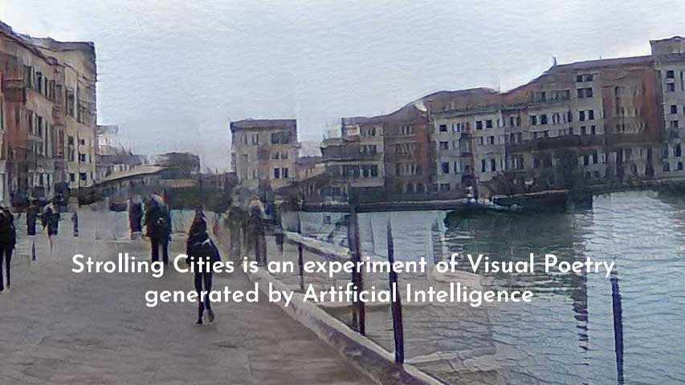
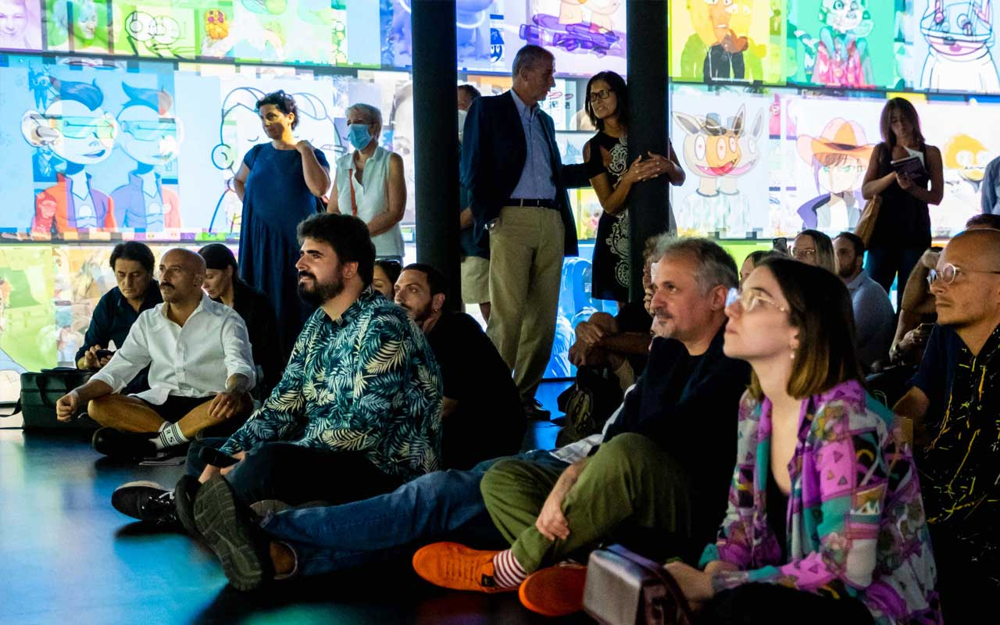
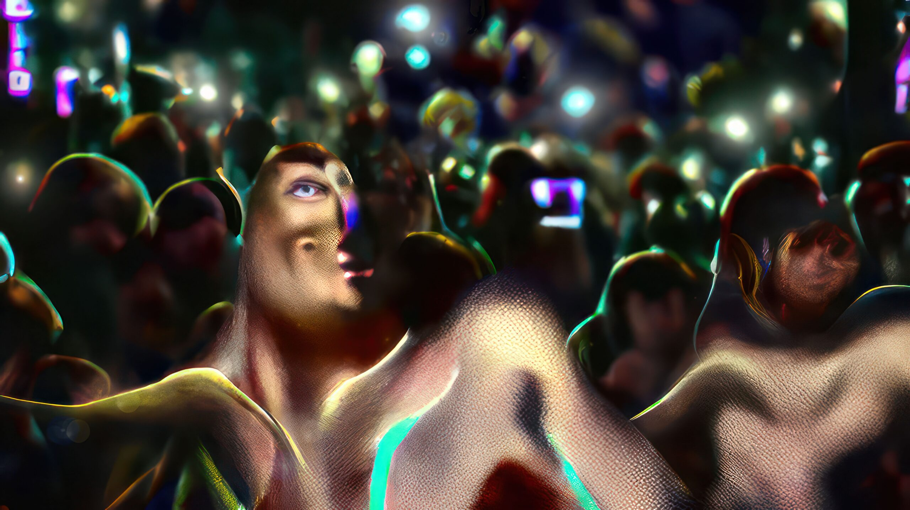

# Mauro Martino

**Tag tecnica/formato:** `ai-generativa` `data-visualization` `video` `installazione`
**Tag tema:** `intelligenza-artificiale-critica` `memoria-archivio`
**Stato:** da verificare se la partecipazione alla Biennale di Venezia 2021 riguardi la Biennale Arte o un'altra sezione

## Biografia
Artista, designer e ricercatore italiano. Laureato al Politecnico di Milano, consegue un dottorato con una tesi in Urban Interaction Design sviluppata all'interno del Senseable City Lab del MIT (diretto da Carlo Ratti) in collaborazione con il Politecnico di Milano. È Principal Research Scientist presso il MIT-IBM Watson AI Lab (Cambridge, MA), dove ha fondato e dirige il Visual Artificial Intelligence Lab; è inoltre Professor of Practice alla Northeastern University, dove insegna intelligenza artificiale applicata a creatività e design, e tiene regolarmente workshop su AI e creatività al MIT e ad Harvard. Le sue opere sono state esposte alla Biennale di Venezia (Padiglione Italia, 2021), alla Serpentine Gallery di Londra, al Ludwig Museum di Budapest, al Lincoln Center di New York, al GAFTA di San Francisco, allo ZKM - Center for Art and Media di Karlsruhe, e fanno parte della collezione permanente dell'Ars Electronica Center di Linz. In Italia collabora stabilmente con il MEET Digital Culture Center di Milano. Come visual designer ha realizzato inoltre visualizzazioni di dati per BBC, Scientific American, The New York Times, The Washington Post, Süddeutsche Zeitung, Der Spiegel, Le Figaro, Corriere della Sera, National Geographic, Popular Science e Wired, ricevendo tra gli altri la medaglia d'oro al Vizzies Visualization Challenge della National Science Foundation (2017) e più Webby Award.

## Poetica e ricerca
Il lavoro di Martino si colloca nel punto di incontro tra ricerca scientifica sull'intelligenza artificiale e pratica artistica, usando reti neurali e modelli generativi addestrati su grandi archivi di immagini o dati come strumento di visualizzazione critica di fenomeni collettivi — dalla vita urbana durante la pandemia alla dinamica del mercato NFT. La sua doppia identità di scienziato attivo nella ricerca AI di punta (MIT-IBM Watson AI Lab) e di artista gli permette di costruire opere che non si limitano a illustrare esteticamente l'output di un modello generativo, ma ne rendono visibile — spesso in forma immersiva e site-specific — il processo di apprendimento e i suoi dati di addestramento, in una tensione dichiarata tra rigore scientifico e libertà interpretativa artistica.

## Opere principali
### Strolling Cities (2021)
**Descrizione:** installazione interattiva presentata al Padiglione Italia della Biennale di Venezia 2021, realizzata in collaborazione con il Politecnico di Milano; descritta come il primo progetto a unire intelligenza artificiale generativa, voce umana, poesia e paesaggio urbano. Il modello è addestrato su milioni di fotografie scattate durante i lockdown italiani del 2020-2021, che ritraggono lo spazio urbano privato della sua popolazione — strade, muri, edifici vuoti.
**Lettura critica:** l'opera trasforma un archivio fotografico involontario e collettivo — le città italiane deserte del lockdown — in un paesaggio generativo abitato dalla voce e dalla poesia, facendo della memoria pandemica il materiale grezzo dell'intelligenza artificiale.

**Approfondimento:** [strollingcities.com](https://strollingcities.com/)

### Understanding the Invisible – Mapping the NFT Revolution (2022)
**Descrizione:** installazione immersiva di data visualization presentata al MEET Digital Culture Center di Milano, che mappa cinque anni di evoluzione del mercato NFT attraverso l'analisi mediante deep learning di circa 10 milioni di NFT, ricostruendone in forma esplorabile l'evoluzione estetica e di mercato.
**Lettura critica:** applica gli strumenti dell'AI research a un fenomeno culturale-economico di grande attualità (il mercato degli NFT), rendendo visibile su scala macroscopica un'estetica collettiva che i singoli osservatori non potrebbero percepire.

**Approfondimento:** [mauromartino.com — Understanding the Invisible](https://mauromartino.com/projects/UnderstandingtheInvisible/index.html)

### L'immortalità del pensiero (Forever Young: The Dorian Gray Syndrome, MEET, Milano)
**Descrizione:** opera realizzata per la mostra collettiva "Forever Young: The Dorian Gray Syndrome" al MEET Digital Culture Center di Milano.
**Lettura critica:** l'opera chiude la mostra con un ribaltamento del tema centrale: nella ricerca dell'eterna giovinezza, secondo Martino a dover restare giovani sono mente, cervello e creatività, non l'aspetto fisico. L'immagine frontale dei visitatori viene catturata da una telecamera e trasformata via machine learning da immagine 2D ad avatar 3D animato, proiettato sulle pareti dell'Immersive Room del MEET.

**Approfondimento:** [MEET Digital Culture Center — Forever Young: The Dorian Gray Syndrome](https://www.meetcenter.it/en/event/forever-young-the-dorian-gray-syndrome/)

## Interviste e talk
- _Nessuna ancora: da aggiungere._

## Fonti
- [Sito ufficiale dell'artista — About](https://mauromartino.com/about.html)
- [Wikipedia (EN) — Mauro Martino](https://en.wikipedia.org/wiki/Mauro_Martino)
- [MEET Digital Culture Center — pagina artista](https://www.meetcenter.it/en/guru/mauro-martino/)
- [MEET — Understanding the Invisible](https://www.meetcenter.it/en/understanding-the-invisible-mauro-martino/)
- [IBM Research — pagina profilo](https://research.ibm.com/people/mauro-martino)
- [Direzione Generale Creatività Contemporanea (Ministero della Cultura) — Padiglione Italia, Biennale Architettura 2021](https://creativitacontemporanea.cultura.gov.it/padiglioneitalia2021-biennalearchitettura/)
- [Artribune — "Mauro Martino - Milano Fabbrica di Futuro"](https://www.artribune.com/mostre-evento-arte/mauro-martino-milano-fabbrica-di-futuro/)
- [Insideart — "Mauro Martino e l'IA: senso e sensibilità dell'astrazione algoritmica"](https://insideart.eu/2024/07/11/mauro-martino-e-lia-senso-e-sensibilita-dellastrazione-algoritmica-poesia-e-bellezza-dove-meno-te-lo-aspetti/)

## Crediti delle immagini
Immagine per ciascuna delle tre opere, inclusa sotto la relativa descrizione in "Opere principali", dal sito ufficiale dell'artista e da MEET Digital Culture Center.
- [Sito ufficiale dell'artista](https://mauromartino.com/about.html)
- [MEET Digital Culture Center — pagina artista](https://www.meetcenter.it/en/guru/mauro-martino/)
- [MEET — Understanding the Invisible](https://mauromartino.com/projects/UnderstandingtheInvisible/index.html)
