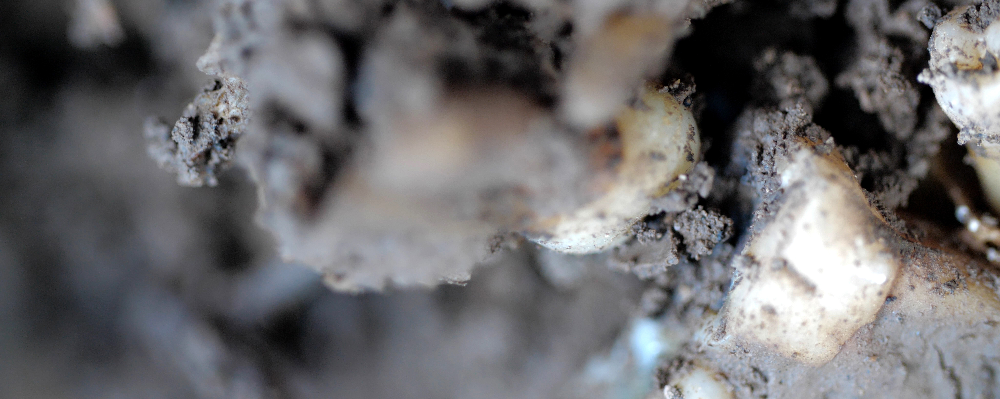
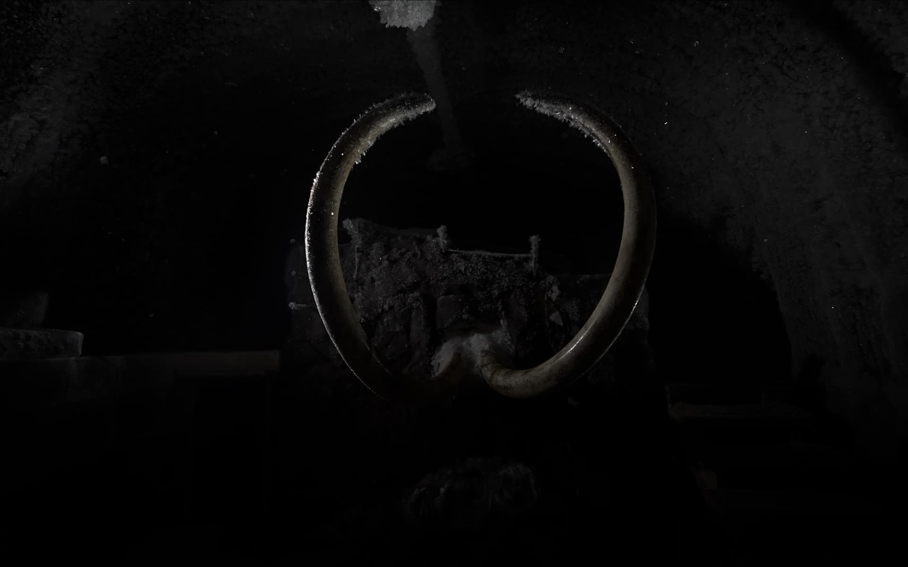

# Maya Watanabe

**Tag tecnica/formato:** `video` `installazione`
**Tag tema:** `memoria-archivio` `ecologia-ambiente`

## Biografia
Nata nel 1983 a Lima, Perù. BFA, School of Fine Arts and Architecture, Universidad Europea (Madrid, 2006); MA in Art Praxis, Dutch Art Institute/ArtEZ (Arnhem, 2018); dottoranda al Dept. of Visual Cultures, Goldsmiths College (Londra). Premi: ARCOmadrid Award/Hans Nefkens Foundation (2018), DAFO Peruvian National Competition of Experimental Films (2016). Mostre presso Palais de Tokyo (Parigi), Matadero Madrid, Museo de Arte de Lima, De Pont Museum, Rose Art Museum (Brandeis University, prima personale museale negli USA). Nel 2026 presente alla mostra collettiva **CANICULA** (Fondazione In Between Art Film, Complesso dell'Ospedaletto, Venezia, 6 maggio-22 novembre 2026, cur. Alessandro Rabottini e Leonardo Bigazzi) — occasione della visita che ha originato questa scheda.

## Poetica e ricerca
Artista audiovisiva peruviana la cui pratica è centrata sull'installazione video multicanale, esplorando memoria, spostamento e politiche della rappresentazione attraverso ambienti immersivi in movimento. Rende tangibile — non attraverso la voce, ma attraverso l'effetto reso percepibile — l'indicibile: la "violenza strisciante" (*creeping violence*) caratteristica del conflitto interno peruviano, che cambia gradualmente ma persistentemente la vita quotidiana e produce vuoti nel paesaggio emotivo di chi la subisce. Tensione ricorrente fra riconoscibilità e astrazione dell'immagine.

## Opere principali
### Liminal (2019)
**Descrizione:** girato negli scavi delle fosse comuni delle vittime del conflitto armato interno peruviano (vent'anni di violenza); loop di un'ora, la camera scorre su terreni stratificati dove emergono frammenti di ossa, denti, bordi di stoffa consunta, strumenti archeologici.
**Lettura critica:** sfuma il confine fra resti umani e paesaggio; prima personale museale dell'artista negli USA al Rose Art Museum, Brandeis University.

**Approfondimento:** [Rose Art Museum — Maya Watanabe: Liminal](https://www.brandeis.edu/rose/exhibitions/2019/maya-watanabe.html)

### Jarkov (2026, CANICULA)
**Descrizione:** installazione video monocanale site-specific, colore, suono stereo, 20'. Co-prodotta da Mori Art Museum, con il supporto di Mondriaan Fund. Allestita al primo piano, nella sala 7, in una stanza inclinata così buia da sfiorare l'astrazione. Jarkov è un mammut lanoso vissuto circa 20.000 anni fa, ritrovato nel permafrost della Siberia settentrionale; al momento della scoperta fu estratto e trasportato come un unico blocco di terreno ghiacciato di 23 tonnellate, da cui spuntavano solo le due zanne. È conservato in una rete sotterranea di gallerie scavate nel permafrost, a una temperatura costante di –12 °C che ne impedisce lo scongelamento. Il film è girato in questi spazi: la camera si muove lentamente nei corridoi ghiacciati, mostrando le poche porzioni visibili di Jarkov e i resti di altri mammut, come ossa e molari. La camera ruota inoltre incessantemente su sé stessa. Il montaggio alterna primi piani serrati e allargamenti sull'ambiente, con immagini che emergono in forme nitide o in superfici tattili indistinte. La colonna sonora è composta da Robin Rimbaud (Scanner).
**Lettura critica:** il catalogo legge l'opera come un'esperienza di uno spazio-tempo che precede e supera la durata della vita umana: corpi che si trasformano in paesaggi e paesaggi in corpi, con le differenze di scala tra vita biologica e vita geologica che si confondono. Il contesto indicato è il ritiro del permafrost artico, che ogni anno si riduce di circa un metro e porta alla luce resti del Pleistocene. La tensione tra riconoscibilità e astrazione è già presente in *Liminal*.[^canicula]

**Approfondimento:** [Fondazione In Between Art Film — Jarkov](https://inbetweenartfilm.com/maya-watanabe-jarkov/)

## Interviste e talk
- _Nessuna ancora: da aggiungere._

## Fonti
- Fondazione In Between Art Film, *Canicula*, libretto e comunicato stampa, aprile 2026 (PDF)
- [Dutch Art Institute — pagina artista](https://dutchartinstitute.eu/page/19417/maya-watanabe)
- [Rose Art Museum, Brandeis University — Maya Watanabe: Liminal](https://www.brandeis.edu/rose/exhibitions/2019/maya-watanabe.html)
- [KADIST — pagina artista](https://kadist.org/people/maya-watanabe/)
- [De Pont Museum — pagina mostra](https://www.depont.nl/en/exhibitions/maya-watanabe)
- [Fondazione In Between Art Film — Maya Watanabe, Jarkov](https://inbetweenartfilm.com/maya-watanabe-jarkov/)

## Mostre viste
- *CANICULA*, Fondazione In Between Art Film, Complesso dell'Ospedaletto, Venezia (2026) — visitata il 22 novembre 2026 da @danMa-hub

## Crediti delle immagini
Immagine per ciascuna delle due opere, inclusa sotto la relativa descrizione in "Opere principali", dal Rose Art Museum e dal sito ufficiale della mostra CANICULA.

[^canicula]: Fondazione In Between Art Film, libretto e comunicato stampa della mostra *Canicula* (Venezia, 6 maggio–22 novembre 2026), sinossi e profili degli artisti, sala 7.
