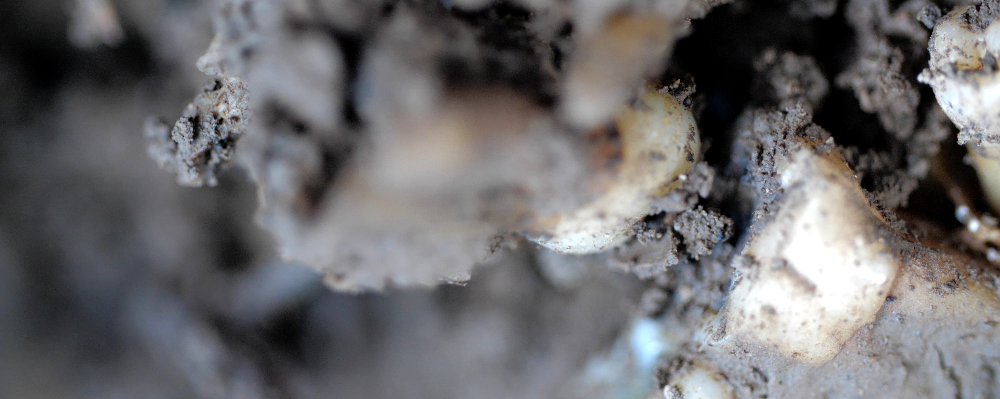
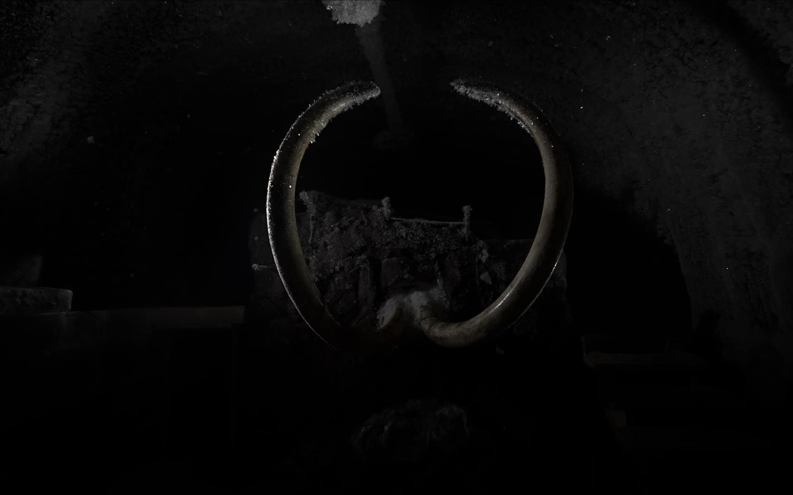

# Maya Watanabe

**Tag tecnica/formato:** `video` `installazione`
**Tag tema:** `memoria-archivio` `ecologia-ambiente`

## Biografia
Nata nel 1983 a Lima, Perù. BFA, School of Fine Arts and Architecture, Universidad Europea (Madrid, 2006); MA in Art Praxis, Dutch Art Institute/ArtEZ (Arnhem, 2018); dottoranda al Dept. of Visual Cultures, Goldsmiths College (Londra). Premi: ARCOmadrid Award/Hans Nefkens Foundation (2018), DAFO Peruvian National Competition of Experimental Films (2016). Mostre presso Palais de Tokyo (Parigi), Matadero Madrid, Museo de Arte de Lima, De Pont Museum, Rose Art Museum (Brandeis University, prima personale museale negli USA). Nel 2026 presente alla mostra collettiva **CANICULA** (Fondazione In Between Art Film, Complesso dell'Ospedaletto, Venezia, 6 maggio-22 novembre 2026, cur. Alessandro Rabottini e Leonardo Bigazzi) — occasione della visita che ha originato questa scheda.

## Poetica e ricerca
Artista audiovisiva peruviana la cui pratica è centrata sull'installazione video multicanale, esplorando memoria, spostamento e politiche della rappresentazione attraverso ambienti immersivi in movimento. Rende tangibile — non attraverso la voce, ma attraverso l'effetto reso percepibile — l'indicibile: la "violenza strisciante" (*creeping violence*) caratteristica del conflitto interno peruviano, che cambia gradualmente ma persistentemente la vita quotidiana e produce vuoti nel paesaggio emotivo di chi la subisce. Tensione ricorrente fra riconoscibilità e astrazione dell'immagine.

## Opere principali

### Liminal (2019)
**Descrizione:** girato negli scavi delle fosse comuni delle vittime del conflitto armato interno peruviano (vent'anni di violenza); loop di un'ora, la camera scorre su terreni stratificati dove emergono frammenti di ossa, denti, bordi di stoffa consunta, strumenti archeologici.
**Lettura critica:** sfuma il confine fra resti umani e paesaggio; prima personale museale dell'artista negli USA al Rose Art Museum, Brandeis University.

**Approfondimento:** [Rose Art Museum — Maya Watanabe: Liminal](https://www.brandeis.edu/rose/exhibitions/2019/maya-watanabe.html)

### Jarkov (2025-26, CANICULA)
**Descrizione:** installazione video incentrata su Jarkov, un mammut lanoso di circa 20.000 anni ritrovato nella tundra artica e conservato a -12°C in una rete di gallerie scavate nel permafrost siberiano; la camera si muove lentamente in corridoi ghiacciati tra resti del mammut (ossa, molari), montata in una sala buia e inclinata come coreografia frammentata fra primi piani taglienti e visioni ambientali indistinte. Vista dall'utente alla mostra CANICULA, Complesso dell'Ospedaletto, Venezia (agosto 2026).
**Lettura critica:** stessa tensione riconoscibilità/astrazione già presente in *Liminal*, spostata dalla violenza politica umana alla conservazione/estinzione su scala geologica.

**Approfondimento:** [Fondazione In Between Art Film — Jarkov](https://inbetweenartfilm.com/maya-watanabe-jarkov/)

## Immagini
Immagine per ciascuna delle due opere, inclusa sotto la relativa descrizione in "Opere principali", dal Rose Art Museum e dal sito ufficiale della mostra CANICULA.

## Fonti
- [Dutch Art Institute — pagina artista](https://dutchartinstitute.eu/page/19417/maya-watanabe)
- [Rose Art Museum, Brandeis University — Maya Watanabe: Liminal](https://www.brandeis.edu/rose/exhibitions/2019/maya-watanabe.html)
- [KADIST — pagina artista](https://kadist.org/people/maya-watanabe/)
- [De Pont Museum — pagina mostra](https://www.depont.nl/en/exhibitions/maya-watanabe)
- [Fondazione In Between Art Film — Maya Watanabe, Jarkov](https://inbetweenartfilm.com/maya-watanabe-jarkov/)

---

## Appunti da organizzare
- Fonte diretta: visita dell'utente alla mostra CANICULA (Fondazione In Between Art Film, Complesso dell'Ospedaletto, Venezia), agosto 2026 — cartello mostra fotografato in loco, poi approfondito con ricerca web (nessuna foto dei pannelli delle singole opere).
- Nota sul metodo: molti domini bloccati al fetch diretto in questa sessione — informazioni derivate da snippet di ricerca, da riverificare con lettura diretta prima di uso didattico definitivo.
