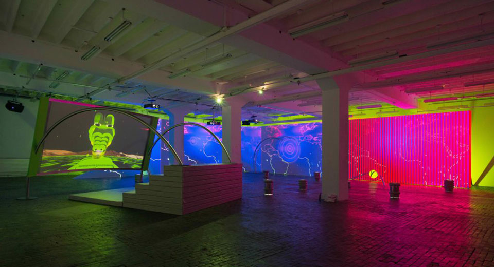
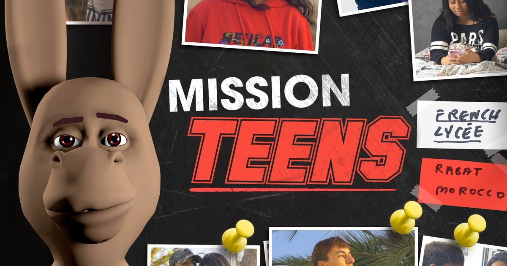
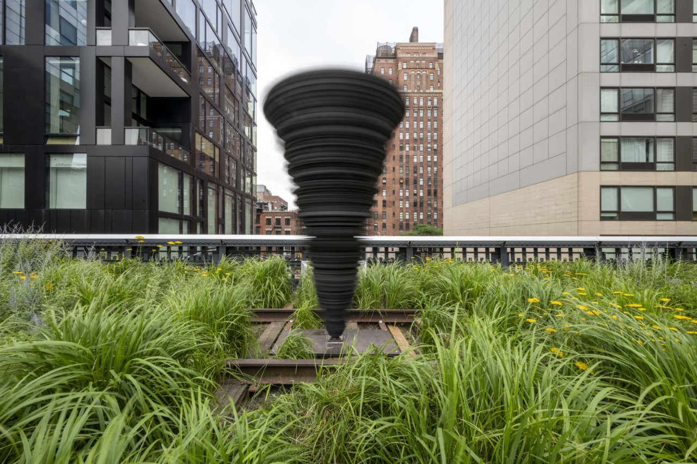
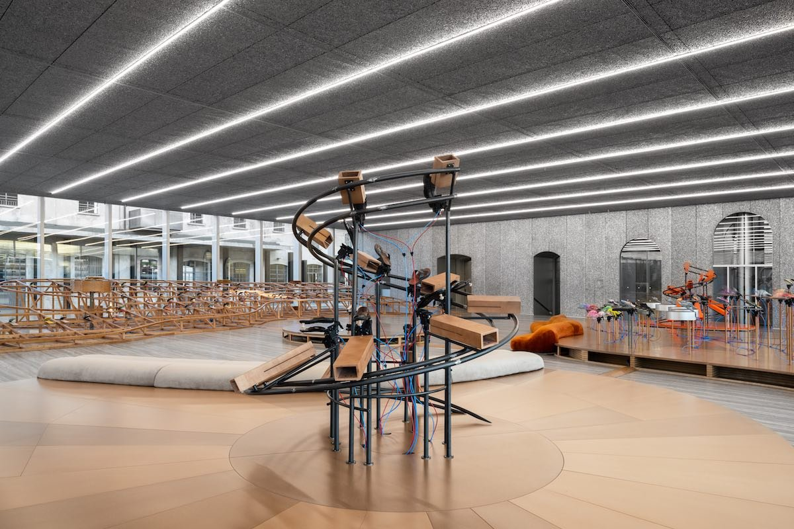

# Meriem Bennani

**Tag tecnica/formato:** `video` `installazione`
**Tag tema:** `colonialismo-decolonialita` `sorveglianza-controllo`
**Tag corso:** `TAD-DCV` `TAD-AVM`

## Biografia
Artista nata nel 1988 a Rabat, Marocco, cresciuta tra Rabat e Parigi, con base a New York. BFA alla Cooper Union (2012), MFA all'École Nationale Supérieure des Arts Décoratifs di Parigi (2011). Il suo lavoro è stato esposto al Kitchen (New York), alla Fondation Louis Vuitton (Parigi), alla Whitney Biennial, al MoMA PS1 e alla Renaissance Society di Chicago; opere nelle collezioni di Guggenheim, MoMA e Whitney Museum.

## Poetica e ricerca
Bennani lavora tra video, scultura, installazione multimediale, disegno e social media, mescolando reality TV, documentario, telenovela, videoclip musicali, fantascienza e cartoni animati in quella che descrive come una "iperattività di genere". La sua pratica affronta identità, femminilità, l'intersezione tra cultura pop religiosa e secolare in Marocco, migrazione, diaspora e sorveglianza — spesso attraverso il montaggio di footage documentario "sporco" (feste, scuole, comunità reali) con animazione digitale e personaggi CGI dal tono comico o "magico".

## Opere principali
### Party on the CAPS (2018-2019)
**Corso:** `TAD-AVM` `TAD-DCV`
**Temi:** `migrazione-e-confini`
**Descrizione:** film di fantascienza in cui il teletrasporto ha sostituito gli aerei e CAPS — ex istituto penale trasformato in campo profughi/isola per immigrati clandestini — diventa l'utopia di un'altra società possibile; la guida nel racconto è Fiona, un coccodrillo antropomorfo. Il film monta immagini documentarie di una festa della comunità marocchina insieme a sequenze CGI.
**Lettura critica:** affronta sfollamento, biotecnologie, immigrazione, privacy e le nuove tecnologie di controllo (droni militari che sorvegliano l'isola) attraverso un registro che mescola umorismo e realismo "magico".
**Da *WORLDBUILDING* (2022):** il teletrasporto danneggia i corpi, con sintomi come la «Plastic Face Syndrome» o il «Mega Ear», figure della dispersione delle diaspore. Il mondo unisce la «Favela Chic» di Bruce Sterling al mito afrofuturista di Drexciya. Chi può permetterselo compra un nuovo corpo.
**Video:** [Party on the CAPS — trailer, IFFR 2019 (YouTube)](https://www.youtube.com/watch?v=v3nPMddau00) · [talk sulla genesi dell'opera, con trailer lungo (YouTube, da 15:30)](https://www.youtube.com/watch?v=UzArB94HzpI&t=3315s)

### Mission Teens
**Corso:** `TAD-AVM`
**Temi:** `migrazione-e-confini`
**Descrizione:** documentario/video su una scuola francese in Marocco.
**Lettura critica:** indaga l'identità linguistica e culturale sospesa tra due mondi ("in between languages").
**Video:** [Art21, New York Close Up — "Meriem Bennani: In Between Languages" (da 3:51)](https://art21.org/watch/new-york-close-up/meriem-bennani-in-between-languages/)

### Windy (2022, The High Line, New York — co-commissione con Audemars Piguet Contemporary)
**Corso:** `TAD-AVM`
**Temi:** `paesaggio-e-territorio`
**Descrizione:** prima scultura pubblica dell'artista: una struttura cinetica alta 9 metri a forma di tornado, composta da circa 200 dischi in schiuma UV/impermeabile che ruotano a velocità diverse su una decina di motori elettrici da bicicletta. Esposta sulla High Line (24th Street) fino a maggio 2023 ([The High Line](https://www.thehighline.org/art/projects/meriem-bennani-windy/)).
**Lettura critica:** ispirata al dinamismo e al movimento costante della High Line, la scultura cattura in forma astratta l'esperienza frenetica di camminare per le strade affollate di New York.
**Video:** [making-of di Windy (YouTube)](https://www.youtube.com/watch?v=kLcAu-59IGA)

### For My Best Family (2024-2025, Fondazione Prada, Milano)
**Corso:** `TAD-AVM`
**Temi:** `performance-audiovisiva`
**Descrizione:** installazione con quasi duecento paia di infradito e scarpe da tip tap che eseguono un brano musicale meccanico.
**Lettura critica:** esplora questioni di convivenza e il posto dell'individuo nella comunità, tradotte in un'orchestra di oggetti quotidiani ([Fondazione Prada](https://www.fondazioneprada.org/)).

### Altre opere (elenco esteso, da approfondire)
**Corso:** `TAD-AVM` `TAD-DCV`
**Temi:** `migrazione-e-confini`

- **2 Lizards** (2020, con Orian Barki) — serie animata episodica realizzata durante la pandemia di COVID-19, seguita da due lucertole antropomorfe a New York.
- **Sole Crushing** — presentata a Lafayette Anticipations, Parigi.
- Esposizioni personali recenti: Fondazione Prada, Milano (2024-25); Fondation Kamel Lazaar, Tunisi (2023); Whitney Museum of American Art (2022); Renaissance Society, Chicago (2022); Nottingham Contemporary (2022).
- 2025: "Rave into the Future: Art in Motion", Asian Art Museum, San Francisco; "It Smells Like Girl", Jeffrey Deitch, Los Angeles.

## Interviste e talk
- _Nessuna ancora: da aggiungere._

## Fonti
- [Wikipedia — Meriem Bennani](https://en.wikipedia.org/wiki/Meriem_Bennani)
- [Whitney Museum — profilo artista](https://whitney.org/artists/18525)
- [Art21 — profilo artista](https://art21.org/artist/meriem-bennani/)
- [François Ghebaly — galleria dell'artista](https://ghebaly.com/artists/meriem-bennani/)
- [Sadie Coles HQ — galleria dell'artista](https://www.sadiecoles.com/artists/meriem-bennani)
- [Lafayette Anticipations — pagina artista](https://www.lafayetteanticipations.com/en/artiste/meriem-bennani)
- [Party on the CAPS — testo critico, NERO Editions](https://not.neroeditions.com/party-on-the-caps/)
- [Mission Teens (e-flux)](https://www.e-flux.com/announcements/292230/meriem-bennanimission-teens-french-school-in-morocco/)
- [Windy — The High Line](https://www.thehighline.org/art/projects/meriem-bennani-windy/)
- [Art21 — New York Close Up: "Meriem Bennani: In Between Languages"](https://art21.org/watch/new-york-close-up/meriem-bennani-in-between-languages/)
- [Sturm&Drang Studio | Meriem Bennani (YouTube)](https://www.youtube.com/watch?v=HCAnRGvSKSw) — vedi anche la scheda [Sturm&Drang / Sturm&Drang Studio](sturm-und-drang-studio.md)
- *WORLDBUILDING: Gaming and Art in the Digital Age*, booklet della mostra, Julia Stoschek Collection, Düsseldorf, 2022 (testo di Rahel Aima)

## Crediti delle immagini
Immagine per ciascuna delle quattro opere principali, inclusa sotto la relativa descrizione in "Opere principali", da e-flux e atpdiary.com (per le due opere aggiunte in questa sessione).
- [Wikipedia — Meriem Bennani](https://en.wikipedia.org/wiki/Meriem_Bennani)
- [Whitney Museum — profilo artista](https://whitney.org/artists/18525)
- [Art21 — profilo artista](https://art21.org/artist/meriem-bennani/)

