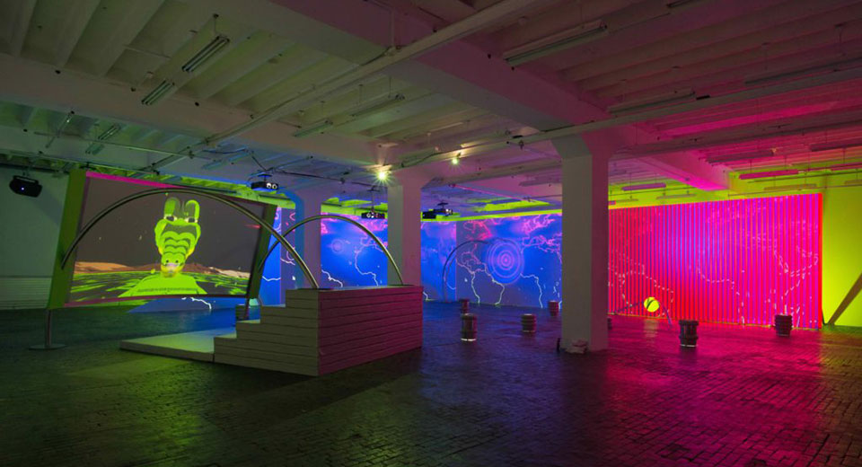
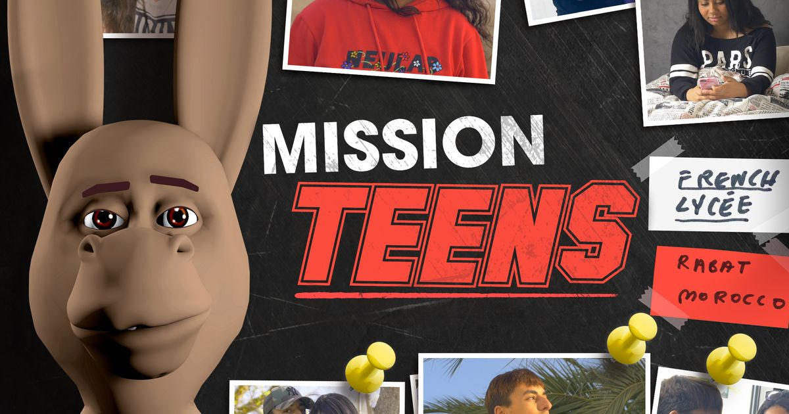
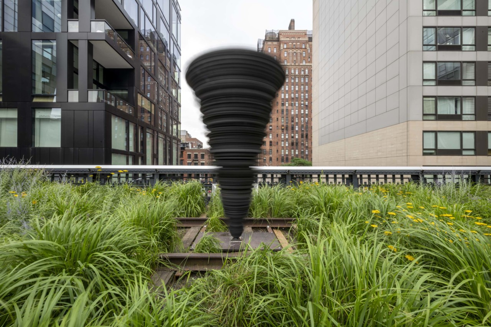
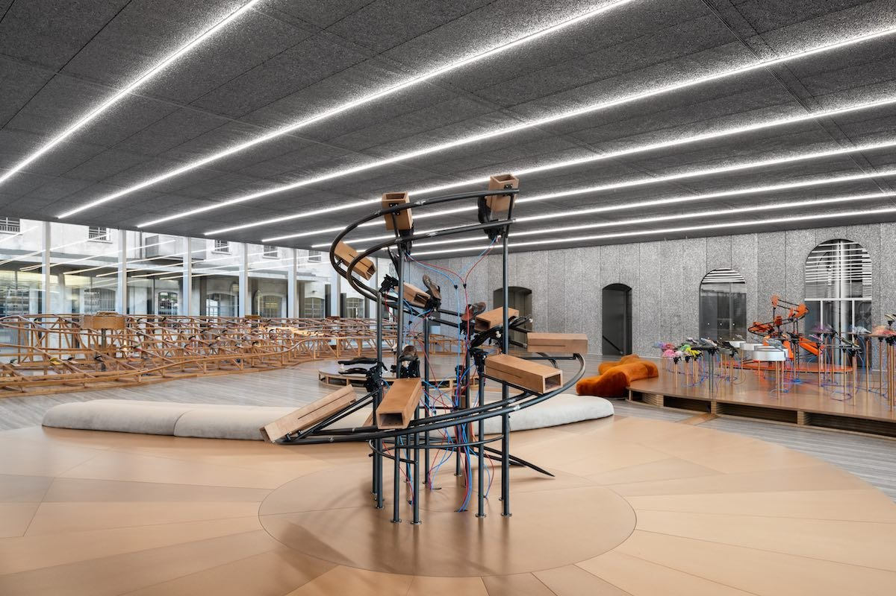

# Meriem Bennani

**Tag tecnica/formato:** `video` `installazione`
**Tag tema:** `colonialismo-decolonialita` `sorveglianza-controllo`
**Tag corso:** `TAD-DCV` `TAD-AVM`
**Stato:** scheda avanzata · da aggiungere: *Fly* (2016), *Siham and Hafida* (2017), *Fardaous Funjab*, *Gradual Kingdom* (2015), *For Aicha* (2025)

## Biografia
Nata nel 1988 a Rabat, in Marocco, dove cresce; vive e lavora a New York.[^1][^2] Secondo Wikipedia consegue un MFA in animazione all'École Nationale Supérieure des Arts Décoratifs di Parigi (2011) e poi un BFA alla Cooper Union di New York (2012).[^1] Ha esposto tra l'altro al Kitchen e al MoMA PS1 di New York, alla Whitney Biennial del 2019, alla Renaissance Society di Chicago e a Nottingham Contemporary (2022) e alla Fondazione Prada di Milano (2024-25).[^1][^2] Nel 2019 vince l'Eye Art & Film Prize. Le sue opere sono nelle collezioni del Guggenheim, della Kadist Foundation e del Musée d'Art Moderne de Paris; la serie *2 Lizards* è al MoMA e al Whitney.[^1]

## Poetica e ricerca
Bennani lavora con video, scultura, installazione multimediale, disegno e social media come Instagram e Snapchat, con un uso ironico di animazione 3D, proiezioni mappate e motion capture.[^1] La High Line descrive i suoi lavori come serie video che uniscono realismo magico, umorismo assurdo e tecniche di molti generi dell'immagine in movimento (reality televisivo, video di famiglia, documentario, video da telefono, animazione) per raccontare il comportamento umano dentro e fuori la rete, con temi come la lingua, lo spostamento e la vita in diaspora; i video sono spesso inseriti in grandi sculture geometriche di acciaio dai colori da cartone animato.[^3] Sasha Weiss, sul *New York Times Magazine* (2021), ha scritto che il suo lavoro unisce il surrealismo frenetico dei video di Ryan Trecartin, il gergo dei meme, gli effetti speciali di Hollywood e le riprese a mano con lo smartphone.[^1]

## Opere principali
### Party on the CAPS (2018-2019)
**Corso:** `TAD-AVM` `TAD-DCV`
**Temi:** `migrazione-e-confini`
**Descrizione:** installazione video di fantascienza (2018) in cui il teletrasporto ha sostituito gli aerei e CAPS, un'isola-campo per immigrati clandestini nata come luogo di detenzione, diventa l'utopia di un'altra società possibile. A raccontare la vita nel campo è Fiona, un coccodrillo che dialoga direttamente con il pubblico, alter ego della regista. Il film è proiettato in un ambiente ampio, da vedere seduti o in piedi su strutture composite, con una grande lente che ingrandisce alcuni punti della proiezione.[^4][^5]
**Lettura critica:** per Simone Arcagni (*Cinema futuro*, 2021) è un film «sparso» nello spazio e fatto di scarti televisivi e della rete, che tratta sfollamento, biotecnologie, immigrazione, privacy e sorveglianza, con i droni militari che circondano l'isola; ciò che si vede davvero sono però immagini documentarie di una festa della comunità marocchina, riprese non professionali con un umorismo sottile e un realismo che Arcagni chiama «magico». La narrazione non è lineare, e la regista delega il racconto all'alter ego, come in *This is the Future* di Hito Steyerl.[^5]
**Da *WORLDBUILDING* (2022):** il teletrasporto danneggia i corpi, con sintomi come la «Plastic Face Syndrome» o il «Mega Ear», figure della dispersione delle diaspore. Il mondo unisce la «Favela Chic» di Bruce Sterling, un futuro iperconnesso ma povero di risorse, alla leggendaria «Atlantide nera» di Drexciya, popolata dai discendenti delle persone ridotte in schiavitù gettate in mare durante la traversata. Chi può permetterselo compra un nuovo corpo.[^4]
**Video:** [Party on the CAPS — trailer, IFFR 2019 (YouTube)](https://www.youtube.com/watch?v=v3nPMddau00) · [talk sulla genesi dell'opera, con trailer lungo (YouTube, da 15:30)](https://www.youtube.com/watch?v=UzArB94HzpI&t=3315s)

### Mission Teens: French School in Morocco (2019)
**Corso:** `TAD-AVM`
**Temi:** `migrazione-e-confini`
**Descrizione:** film che segue un gruppo di studenti del Lycée Descartes, il liceo francese di Rabat. Ispirato ai film per adolescenti e al reality televisivo, è un documentario di finzione che li accompagna dalla classe a casa e alle feste e raccoglie le loro testimonianze su un sistema scolastico ereditato dalla presenza francese in Marocco e oggi riservato all'élite locale. Dietro la telecamera c'è l'avatar animato dell'artista, un asino, che indaga la formazione dell'identità tra due culture e due età.[^6]
**Video:** [Art21, New York Close Up — "Meriem Bennani: In Between Languages" (da 3:51)](https://art21.org/watch/new-york-close-up/meriem-bennani-in-between-languages/)

### Windy (2022, The High Line, New York — co-commissione con Audemars Piguet Contemporary)
**Corso:** `TAD-AVM`
**Temi:** `paesaggio-e-territorio`
**Descrizione:** prima scultura pubblica dell'artista, co-commissionata da High Line Art e Audemars Piguet Contemporary ed esposta sulla High Line all'altezza della 24th Street da giugno 2022 a maggio 2023: una scultura a forma di tornado, in schiuma nera, che gira su se stessa a una velocità che rende quasi impossibile coglierne i dettagli. Rovescia la tradizione della scultura pubblica, che di solito si guarda girandole intorno a distanza; è la prima scultura di Bennani che non contiene video, e il movimento prosegue il suo interesse per l'animazione. L'artista si è ispirata al dinamismo e al movimento continuo della High Line.[^3]
**Video:** [making-of di Windy (YouTube)](https://www.youtube.com/watch?v=kLcAu-59IGA)

### For My Best Family (2024-2025, Fondazione Prada, Milano)
**Corso:** `TAD-AVM`
**Temi:** `performance-audiovisiva`
**Descrizione:** mostra commissionata dalla Fondazione Prada e sviluppata in due anni, in due parti su piani diversi: l'installazione meccanica *Sole Crushing*, realizzata con il musicista Reda Senhaji (Cheb Runner), e il lungometraggio d'animazione *For Aicha*, diretto con Orian Barki, presentato come il primo lungometraggio d'animazione prodotto in Marocco; una versione rimontata è uscita nei festival nel settembre 2025 con il titolo *Bouchra*.[^1] In *Sole Crushing* quasi duecento paia di infradito e scarpe da tip tap eseguono un brano meccanico. [verificare: numero e materiali, non riscontrati sulla pagina della Fondazione Prada]

### Altre opere (elenco esteso, da approfondire)
**Corso:** `TAD-AVM` `TAD-DCV`
**Temi:** `migrazione-e-confini`

- **2 Lizards** (2020, con l'artista israeliana Orian Barki) — otto brevi video sulla vita a New York durante la pandemia di COVID-19, con due lucertole antropomorfe; oggi nelle collezioni del MoMA e del Whitney.[^1]
- Esposizioni personali recenti: Fondazione Prada, Milano (2024-25); Fondation Kamel Lazaar, Tunisi (2023); Whitney Museum of American Art (2022); Renaissance Society, Chicago (2022); Nottingham Contemporary (2022).
- 2025: "Rave into the Future: Art in Motion", Asian Art Museum, San Francisco; "It Smells Like Girl", Jeffrey Deitch, Los Angeles.

## Interviste e talk
- [Art21, New York Close Up — «Meriem Bennani: In Between Languages»](https://art21.org/watch/new-york-close-up/meriem-bennani-in-between-languages/)

## Fonti
- [Wikipedia — Meriem Bennani](https://en.wikipedia.org/wiki/Meriem_Bennani)
- [Whitney Museum — profilo artista](https://whitney.org/artists/18525)
- [Art21 — profilo artista](https://art21.org/artist/meriem-bennani/)
- [François Ghebaly — galleria dell'artista](https://ghebaly.com/artists/meriem-bennani/)
- [Sadie Coles HQ — galleria dell'artista](https://www.sadiecoles.com/artists/meriem-bennani)
- [Lafayette Anticipations — pagina artista](https://www.lafayetteanticipations.com/en/artiste/meriem-bennani)
- [Simone Arcagni, «Party on the CAPS», NERO, 2021](https://not.neroeditions.com/party-on-the-caps/)
- [Mission Teens (e-flux)](https://www.e-flux.com/announcements/292230/meriem-bennanimission-teens-french-school-in-morocco/)
- [Windy — The High Line](https://www.thehighline.org/art/projects/meriem-bennani-windy/)
- [Art21 — New York Close Up: "Meriem Bennani: In Between Languages"](https://art21.org/watch/new-york-close-up/meriem-bennani-in-between-languages/)
- [Sturm&Drang Studio | Meriem Bennani (YouTube)](https://www.youtube.com/watch?v=HCAnRGvSKSw) — vedi anche la scheda [Sturm&Drang / Sturm&Drang Studio](sturm-und-drang-studio.md)
- *WORLDBUILDING: Gaming and Art in the Digital Age*, booklet della mostra, Julia Stoschek Collection, Düsseldorf, 2022 (testo di Rahel Aima)

## Crediti delle immagini
Immagine per ciascuna delle quattro opere principali, inclusa sotto la relativa descrizione in "Opere principali", da e-flux e atpdiary.com.
- Seconda immagine di *Party on the CAPS*: veduta d'installazione; sede, anno e autore della foto [verificare].
- [Wikipedia — Meriem Bennani](https://en.wikipedia.org/wiki/Meriem_Bennani)
- [Whitney Museum — profilo artista](https://whitney.org/artists/18525)
- [Art21 — profilo artista](https://art21.org/artist/meriem-bennani/)

[^1]: «Meriem Bennani», *Wikipedia* (inglese), consultata il 2026-11-08. [link](https://en.wikipedia.org/wiki/Meriem_Bennani)

[^2]: Whitney Museum of American Art, pagina dell'artista. [link](https://whitney.org/artists/18525)

[^3]: The High Line, «Meriem Bennani: Windy», giugno 2022 - maggio 2023. [link](https://www.thehighline.org/art/projects/meriem-bennani-windy/)

[^4]: Rahel Aima, «Meriem Bennani», in *WORLDBUILDING: Gaming and Art in the Digital Age*, booklet della mostra, Julia Stoschek Collection, Düsseldorf, 2022 (PDF 41).

[^5]: Simone Arcagni, «Party on the CAPS. Frammenti sparsi del racconto cinematografico», *NERO*, 20 luglio 2021, brano da *Cinema futuro* (2021). [link](https://not.neroeditions.com/party-on-the-caps/)

[^6]: e-flux, «Meriem Bennani: Mission Teens: French School in Morocco», annuncio, 26 ottobre 2019. [link](https://www.e-flux.com/announcements/292230/meriem-bennanimission-teens-french-school-in-morocco/)
