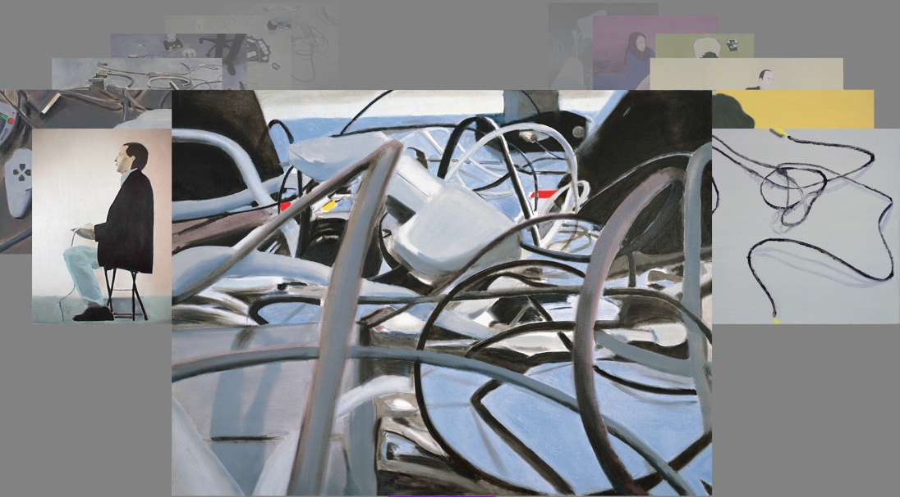
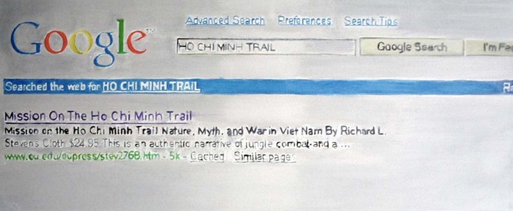

# Miltos Manetas

**Tag tecnica/formato:** `net-art-sito-web` `videogioco-simulazione` `video`
**Tag tema:** `storia-computer-grafica` `economia-attenzione`
**Stato:** da approfondire: il comunicato stampa o il catalogo MAXXI · il ruolo di Mai Ueda come co-fondatrice di NEEN

## Biografia
Nato ad Atene il 6 ottobre 1964. Pittore, artista concettuale e teorico di origine greca; vive e lavora tra Bogotà, Roma e New York, con una presenza istituzionale e di mercato in Italia particolarmente consolidata (per questo incluso in questa ricerca come "artista con base anche in Italia", pur non essendo di nazionalità italiana). Nel 2000, insieme a Mai Ueda, fonda alla Gagosian Gallery di New York il movimento NEEN, definito "il primo movimento artistico del ventunesimo secolo", volto a fondere le nuove tecnologie dell'epoca con arte e poesia; è inoltre considerato un pioniere del machinima (l'"arte dopo i videogiochi"). Nel 2009 fonda e cura alla Biennale di Venezia il primo Padiglione Internet della storia della manifestazione. Nel 2018 il MAXXI di Roma gli dedica "Le pitture Internet", mostra personale istituzionale a cura di Bartolomeo Pietromarchi. È rappresentato in Italia dalla galleria Pinksummer (Genova) — con cui nel 2000 realizza la mostra congiunta "Murakami-Manetas" con Takashi Murakami — e dalla Galleria Valentina Bonomo (Roma), che ne ha ospitato mostre personali e collettive, tra cui una personale nel 2023.

## Poetica e ricerca
Manetas è tra i primi artisti a trattare sistematicamente l'estetica della cultura informatica — schermi, cavi, periferiche, interfacce di videogiochi — come soggetto della pittura e, insieme, a spostare la propria pratica dentro la Rete stessa, anticipando concettualmente temi che sarebbero poi diventati centrali nel discorso su NFT e metaverso ben prima della loro emersione mainstream. Il movimento NEEN, da lui fondato, teorizzava un'arte capace di assorbire senza filtri il linguaggio visivo delle nuove tecnologie di consumo, in polemica con la tradizione della videoarte "seria" e mediata dalla critica istituzionale. Parallelamente, la sua produzione pittorica — i cosiddetti "Internet Paintings" — ritrae con tecnica tradizionale (colore, tela) soggetti nativi del mondo digitale: computer, cavi, schermi, periferiche, personaggi di videogiochi, in un cortocircuito deliberato tra il medium più antico dell'arte occidentale e l'iconografia più contemporanea della cultura di rete.

## Opere principali
### Padiglione Internet (2009, Biennale di Venezia)
**Descrizione:** primo Padiglione Internet nella storia della Biennale di Venezia, ideato e curato da Manetas come spazio dedicato all'arte nata e diffusa in Rete.
**Lettura critica:** un gesto curatoriale-istituzionale prima ancora che un'opera: rivendica per l'arte di Internet uno status pari a quello dei padiglioni nazionali, in un momento in cui la net art non aveva ancora una collocazione stabile nel sistema delle grandi manifestazioni.

**Approfondimento:** [manetas.com — Padiglione Internet](https://cargocollective.com/manetas/PADIGLIONE-INTERNET-2009)

### Internet Paintings (dagli anni 2000)
**Descrizione:** ciclo pittorico in corso da oltre vent'anni, che ritrae con la tecnica della pittura a olio o acrilica su tela soggetti tratti dal mondo dei computer e di Internet: laptop, cavi, joystick, interfacce, personaggi di videogiochi.
**Lettura critica:** la scelta di un medium "antico" come la pittura per ritrarre l'iconografia più effimera e aggiornabile della cultura digitale mette in tensione permanenza e obsolescenza tecnologica, uno dei temi ricorrenti della ricerca dell'artista.

**Approfondimento:** [internetpaintings.manetas.com](https://internetpaintings.manetas.com/)

### Le pitture Internet (2018, personale, MAXXI, Roma)
**Descrizione:** mostra personale istituzionale a cura di Bartolomeo Pietromarchi presso il MAXXI di Roma, dedicata al ciclo degli Internet Paintings.
**Lettura critica:** la prima grande consacrazione museale italiana per un ciclo pittorico che da vent'anni lavora sulla soglia tra pittura tradizionale e cultura visiva di Internet — riconoscimento istituzionale del MAXXI, tra le principali istituzioni italiane dedicate all'arte contemporanea e ai nuovi media, al lavoro di Manetas.

⚠️ Nessuna immagine specifica della mostra MAXXI trovata in questa sessione — vedi l'immagine di *Internet Paintings* qui sopra per il ciclo pittorico oggetto della mostra.

## Interviste e talk
- [My Art Guides — intervista, "From Screen to Nature and Back Again: an Interview with NEEN founder Miltos Manetas"](https://myartguides.com/interviews/from-screen-to-nature-and-back-again-an-interview-with-neen-founder-miltos-manetas/)

## Fonti
- [Wikipedia (EN) — Miltos Manetas](https://en.wikipedia.org/wiki/Miltos_Manetas)
- [Galleria Valentina Bonomo — biografia](https://galleriabonomo.com/portfolio-item/miltos-manetas-biografia/)
- [Pinksummer Contemporary Art — pagina artista](https://www.pinksummer.com/en/miltos-manetas/)
- [Pinksummer — mostra "Murakami-Manetas" (2000)](https://www.pinksummer.com/portfolio_page/takashi-murakami-miltos-manetas/)
- [Sito ufficiale / Manetas Timeline — Internet Paintings](https://internetpaintings.manetas.com/)
- [Sito ufficiale / Manetas Timeline — NEENBOOK](https://neenbook.manetas.com/)
- [Right Click Save — "Painter of Machines | Miltos Manetas"](https://www.rightclicksave.com/article/painter-of-machines-miltos-manetas-neen-internet-pavilion)
- [Artribune — profilo/articoli](https://www.artribune.com/artista-mostre-biografia/miltos-manetas/)

## Crediti delle immagini
Immagine per due delle tre opere (Padiglione Internet e Internet Paintings), inclusa sotto la relativa descrizione in "Opere principali", dal sito ufficiale dell'artista.
- [Sito ufficiale dell'artista / archivio "Internet Paintings"](https://internetpaintings.manetas.com/)
- [Pinksummer Contemporary Art — pagina artista](https://www.pinksummer.com/en/miltos-manetas/)
- [Galleria Valentina Bonomo — biografia](https://galleriabonomo.com/portfolio-item/miltos-manetas-biografia/)
