# Morehshin Allahyari

**Tag tecnica/formato:** `stampa-3d-scultura` `ai-generativa`
**Tag tema:** `colonialismo-decolonialita` `genere-queerness` `memoria-archivio` `lecture-performance`
**Tag corso:** `M3D` `TAD-AVM`
**Stato:** scheda avanzata · le opere dopo *Moon-faced* e le «Altre opere» sono descritte dal sito dell'artista, senza letture di terzi

## Biografia
Nata a Teheran nel 1985, di origine curda, cresce durante la guerra tra Iran e Iraq.[^1][^2] Dopo la laurea all'Università di Teheran (2003-2007) si trasferisce negli Stati Uniti nel 2007; studia digital media studies alla University of Denver (MA, 2009) e new media art alla University of North Texas (MFA, 2012).[^2] Artista, attivista e scrittrice con base nella Bay Area, è assistant professor di digital media art alla Stanford University.[^1][^3]

Residenze: Carnegie Mellon STUDIO for Creative Inquiry, Autodesk Pier 9, Vilém Flusser Residency con transmediale, Eyebeam, Pioneer Works, Harvestworks. Ha esposto tra l'altro al New Museum, al Whitney, al Queens Museum, al Centre Pompidou, al MoMA, al Victoria and Albert Museum e alla Biennale di Architettura di Venezia.[^1] Riconoscimenti: Foreign Policy Leading Global Thinkers (2016), Sundance New Frontier Fellowship (2019), Joan Mitchell Foundation Painters & Sculptors Grant (2019), United States Artist Fellowship (2021), Chancellor's Postdoctoral Fellowship dell'Università della California a Berkeley (2024), Creative Capital Award e Gold Art Prize (2025), Artadia Award per la Bay Area (2026).[^1][^3] Il Whitney ha nella collezione la scultura stampata in 3D e il progetto web di *The Laughing Snake* (2018) e le ha dedicato la mostra *Refigured* (2023).[^2][^3]

## Poetica e ricerca
Allahyari usa simulazione 3D, video, codice, scultura e fabbricazione digitale per ripensare miti e storia. Con pratiche d'archivio e narrazione costruisce contronarrazioni opposte all'influenza del colonialismo tecnologico occidentale in Medio Oriente e Nord Africa.[^1]

Due concetti reggono il lavoro. **Digital colonialism**, termine che l'artista dichiara di aver coniato nel 2015 e sviluppato durante la residenza di ricerca a Eyebeam nel 2017,[^3][^4] indica la tendenza delle tecnologie dell'informazione a riprodurre rapporti di potere coloniali: scanner e stampanti 3D, usati per salvare il patrimonio mediorientale, possono portare file e diritti lontano dai luoghi d'origine. **Re-figuring** è la pratica di recuperare un passato dimenticato o travisato per immaginare un altro presente.[^5]

Nella conferenza *Physical Tactics for Digital Colonialism* (New Museum, 2019) Allahyari sostiene che la scansione del patrimonio mediorientale da parte di istituzioni e aziende occidentali, presentata come cura, rimuove la violenza delle guerre occidentali, parla a nome di un'umanità universale e trattiene la proprietà dei dati; il busto di Nefertiti, portato in Germania nel 1912 e mai restituito, le serve come modello storico.[^4] Il lavoro con il 3D procede quindi insieme a testi, conferenze e organizzazione collettiva, come nell'#Additivism con Daniel Rourke.

## Opere principali
### Material Speculation: ISIS (2015-2016)
**Descrizione:** ricostruzione con modellazione e stampa 3D di dodici statue e manufatti, da Hatra (epoca romana) e da Ninive (Assiri), distrutti da ISIS nel 2015 in video diffusi su YouTube; il progetto nasce dal video della distruzione dei manufatti del Museo di Mosul, circolato il 26 febbraio 2015.[^6][^4] Dentro ogni oggetto ci sono una chiavetta USB e una scheda di memoria con immagini, mappe, PDF e video sui reperti e sui siti. L'artista li descrive come capsule del tempo per civiltà future. Nel febbraio 2016 un modello, King Uthal, è stato pubblicato apertamente con Rhizome; per gli altri file cerca un museo o una piattaforma, preferibilmente in Medio Oriente.[^6] In seguito l'artista ha tenuto privati gli altri undici file e ha definito ingenua la scelta del 2016: l'accesso aperto è ineguale, perché dipende da chi ha connessione, stampante, competenze e server.[^4]
**Lettura critica:** l'artista presenta la stampa 3D come strumento di resistenza e documentazione, e il progetto come un'indagine sui rapporti «petropolitici» tra stampa 3D, plastica, petrolio, tecnocapitalismo e jihad.[^6] La questione della proprietà dei dati, che il progetto pone, è sviluppata poi in *Digital Colonialism*.[^4]

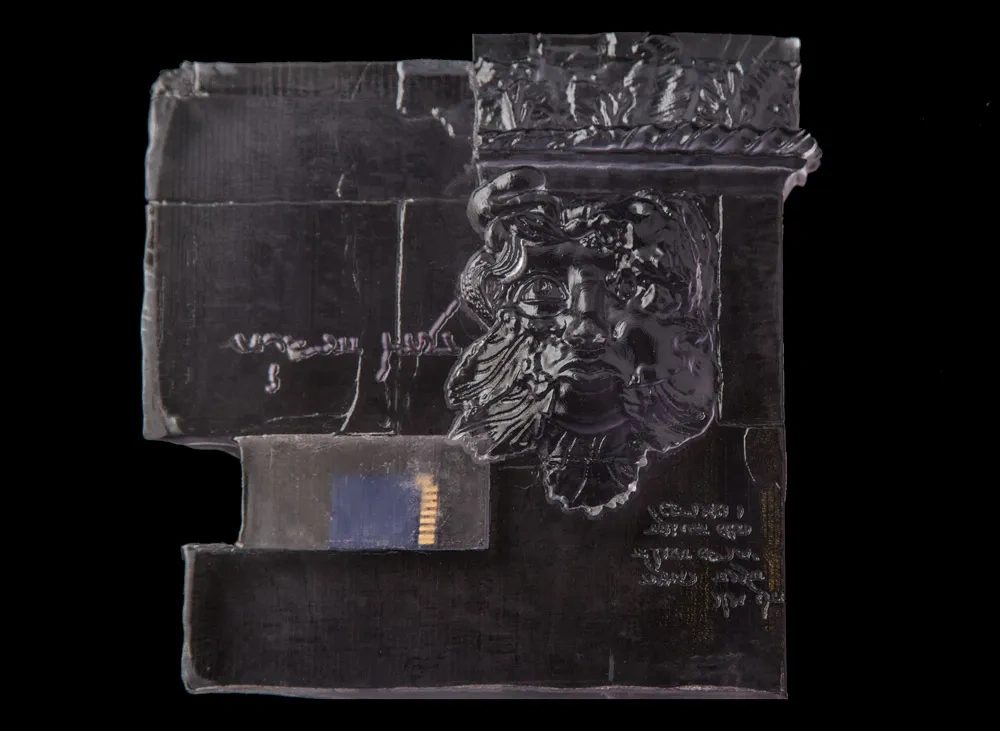

**Approfondimento:** [morehshin.com — Material Speculation: ISIS](https://www.morehshin.com/material-speculation-isis)

### The 3D Additivist Manifesto (2015, con Daniel Rourke)
**Corso:** `M3D`
**Temi:** `glitch-e-errore`
**Descrizione:** manifesto del marzo 2015, in forma di testo e di video, scritto da Allahyari e Daniel Rourke, con sound design di Andrea Young. Parte dalla plastica della stampa 3D come metafora: derivata dal petrolio, la materia stessa porta con sé una storia complicata. Dichiara una nuova bellezza, quella dei rifiuti e dei detriti. Il manifesto apre il movimento dell'*#Additivism* (da *additive* e *activism*), che critica le tecnologie «radicali» nei fablab, nei laboratori e nelle aule e rilegge la stampante 3D come Donna Haraway ha fatto con il cyborg.

**Video:** [The 3D Additivist Manifesto (Vimeo)](https://vimeo.com/122642166)

**Approfondimento:** [additivism.org — Manifesto](https://additivism.org/manifesto)

### The 3D Additivist Cookbook (2016, a cura di Allahyari e Rourke)
**Corso:** `M3D`
**Temi:** `patrimonio-e-scansione` `copia-e-autenticita` `glitch-e-errore`
**Descrizione:** raccolta gratuita di opere di oltre 100 artisti, attivisti e teorici, nata dall'invito del Manifesto e pubblicata nel dicembre 2016 come PDF 3D dall'Institute of Network Cultures di Amsterdam, dopo la Vilém Flusser Residency a transmediale. Contiene file 3D, testi critici e di finzione, template e «ricette». Non ha capitoli: si attraversa con tag di formato, tema e azione. Due sezioni sono curate da Browntourage e A Parede. Licenza Creative Commons BY-NC-SA 4.0 ([additivism.org](https://additivism.org/cookbook)).

Alcuni contributi, verificati sul testo del libro:
  - **NefertitiHack** (Nora Al-Badri e Jan Nikolai Nelles, 2016): una scansione segreta del busto di Nefertiti resa pubblica, per criticare il possesso coloniale.
  - **Free Universal Construction Kit** (Golan Levin e Shawn Sims, 2012): adattatori stampabili che rendono compatibili dieci sistemi di costruzioni per bambini.
  - **Liberator Variations** (Kyle McDonald, 2013): variazioni assurde sul file della pistola stampata in 3D.
  - **The Evolution of the Spermalege** (Joey Holder): organi sessuali interspecie modellati sui genitali degli insetti.
  - **URME Recipes: Cooking with Privilege** (Leo Selvaggio, 2016): l'identità dell'artista come materiale da opporre al potere tecnologico.
  - **Occupy Gramercy** (Anonymous, 2016-2017): modello 3D di una chiave del parco privato di New York.
  - **On Preserving Glitch** (Sophie Kahn, 2016): i difetti dei file esposti invece di essere riparati.
  - **The Universal Addressability of Dumb Things** (Mark Leckey, 2013); **3D Print Simulator** (Alan Warburton, 2015); **How Not to Be Read** (Rosa Menkman, 2016).
  - **Material Speculation: ISIS** (Allahyari con Paul Soulellis).

**Lettura critica:** l'introduzione del libro presenta la ricetta come un modo di fare, imparare, condividere e rivedere mondi possibili: si può seguire, modificare e tramandare, e contiene un potenziale anche quando non è eseguibile.[^7]

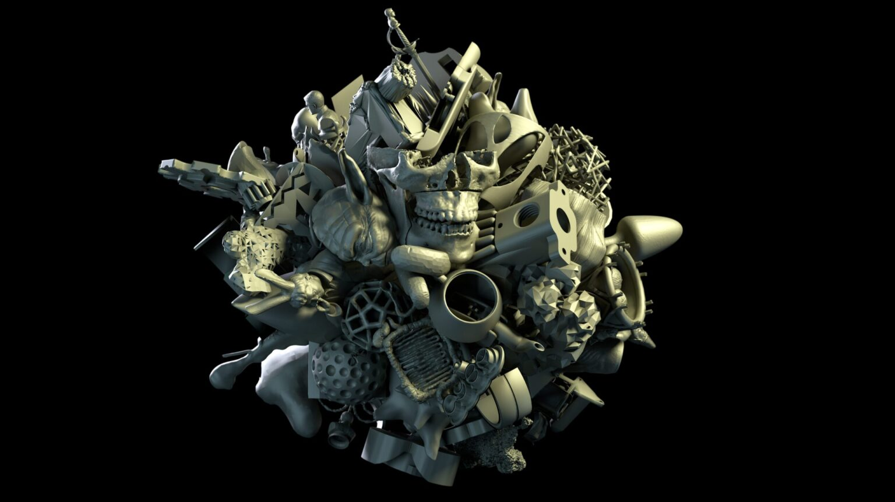

**Approfondimento:** [additivism.org — Cookbook](https://additivism.org/cookbook); [testo su archive.org](https://archive.org/details/The3DAdditivistCookbook)

### She Who Sees the Unknown (2016-2021)
**Descrizione:** progetto di ricerca a lungo termine iniziato nell'ottobre 2016 durante una residenza a Eyebeam, a New York. Con modellazione 3D, scansione 3D, stampa 3D e narrazione ricrea figure mostruose femminili e queer di origine mediorientale (i jinn), usando le tradizioni e i miti che le accompagnano per esplorare le catastrofi del colonialismo, del patriarcato e del degrado ambientale in relazione al Medio Oriente. Allahyari chiama *Re-Figuring* la pratica che ha sviluppato: un atto di attivazione e di conservazione, di recupero di un passato dimenticato o travisato per immaginare un altro presente e un altro futuro. Il progetto comprende installazioni, video, un'esperienza di realtà virtuale, una *Reading Room* (installazione con libri, articoli e immagini, 2016-in corso), eventi pubblici come la performance-lecture *Breaching Towards Other Futures* (The Floating University, Berlino, 2018) e un archivio consultabile online.
**Lettura critica:** nell'intervista per *The Believer* (2020), Katie Peyton Hofstadter descrive il progetto come una serie di cinque esperienze immersive, ciascuna dedicata a un jinn e realizzata con tecniche diverse (scultura, stampa 3D, realtà virtuale, video, proiezione, ipertesto), e lega il *re-figuring* di *Kabous* ai temi della parentela, al pensiero di Donna Haraway e alla giustizia riproduttiva. L'artista vi descrive il proprio metodo come quello di un'investigatrice privata: cartelle di ricerca simili a fascicoli giudiziari, ricerche nelle biblioteche da New York a Teheran, il modello dell'agente Cooper di *Twin Peaks*.[^8] Manischa Eichwalder, su *AN-ICON* (2024), legge *Kabous* come una critica della realtà virtuale intesa come «macchina dell'empatia»: l'immersione non produce vicinanza con l'altro ma un «incontro strano», nel senso di Sara Ahmed, che mette in crisi la sovranità di chi guarda.[^9]

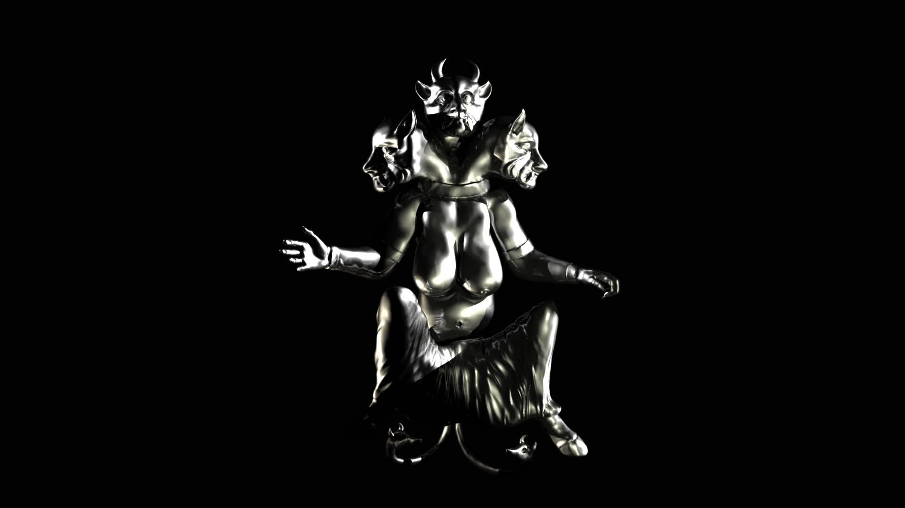

**Approfondimento:** [shewhoseestheunknown.com](https://shewhoseestheunknown.com/)

#### Huma
**Descrizione:** Huma è un jinn noto in vari racconti e miti mediorientali che porta il calore al corpo umano ed è responsabile della comune febbre. Viene raffigurata come un demone con tre teste e una o due code. Installazione con scultura 3D e video.

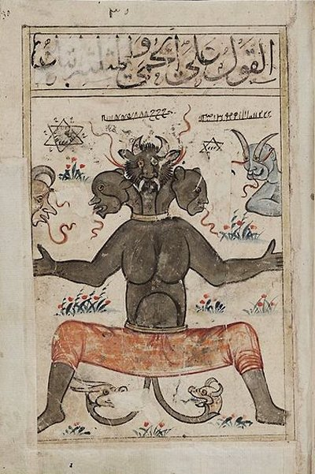

**Video:** [Huma (Vimeo)](https://vimeo.com/342057560)

**Approfondimento:** [She Who Sees the Unknown — Huma](https://shewhoseestheunknown.com/huma/)

#### Ya'jooj Ma'jooj
**Descrizione:** secondo il Corano, i popoli di Ya'jooj e Ma'jooj diffondono grande disordine sulla terra e rappresentano il caos: Dio concede a Zulqarnain (in altre versioni identificato con Alessandro Magno) il potere di costruire un muro di ferro per trattenerli, separandoli dagli esseri umani. Installazione con video.

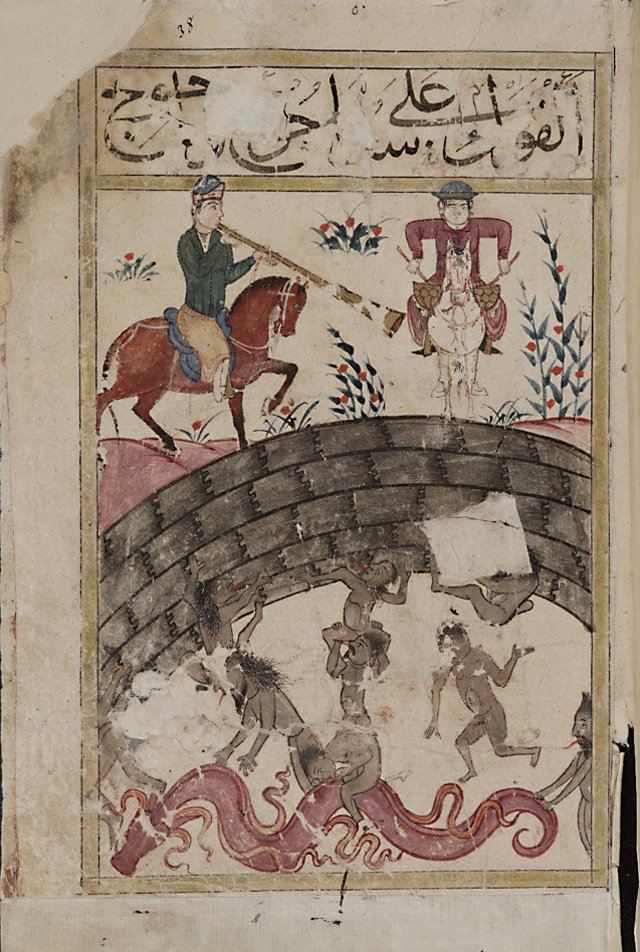

**Video:** [Yajooj Majooj (Vimeo)](https://vimeo.com/296029355)

**Video:** [Yajooj Majooj (Vimeo, seconda clip)](https://vimeo.com/342063763)

**Approfondimento:** [She Who Sees the Unknown — Ya'jooj Ma'jooj](https://shewhoseestheunknown.com/yajooj-majooj/)

#### Aisha Qandisha
**Descrizione:** Aisha Qandisha (عيشة قنديشه) è uno dei jinn più onorati e temuti dell'Islam, originario del Marocco; è chiamata «colei che apre» ed è il jinn dei fiumi. Installazione con scultura in resina stampata in 3D, vasca riflettente e video HD.

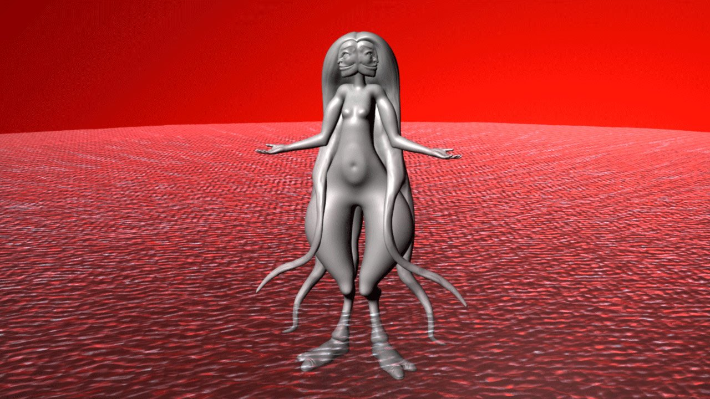

**Video:** [Aisha Qandisha (Vimeo)](https://vimeo.com/342079010)

**Approfondimento:** [She Who Sees the Unknown — Aisha Qandisha](https://shewhoseestheunknown.com/aisha-qandisha/)

#### Kabous
**Descrizione:** Kabous (al-Kabus, detto anche al-Jathoom, «incubo») appartiene alla stirpe di jinn che portano agli esseri umani malattie, traumi e incubi: viene raffigurata mentre possiede una persona con un incubo, seduta sul suo petto mentre dorme. *Kabous, The Right Witness and The Left Witness* (2019), commissionata da The Shed di New York per la mostra *Manual Override* curata da Nora Khan, è l'ultima opera della serie: il visitatore si sdraia su un letto che ricostruisce la camera dell'artista a Teheran e, nel visore, attraversa un hammam mentre la voce della madre legge dal diario scritto durante la guerra tra Iran e Iraq. Per questa figura l'artista ha studiato la paralisi del sonno e il suo legame con lo stress e il trauma.[^8]

**Video:** [Kabous (Vimeo)](https://vimeo.com/393977901)

**Approfondimento:** [She Who Sees the Unknown — Kabous](https://shewhoseestheunknown.com/kabous/)

#### The Laughing Snake
**Descrizione:** i vari miti sul Serpente che Ride descrivono una figura mostruosa (per alcuni un jinn) che ha preso il controllo di una città e delle sue terre, uccidendone gli abitanti e gli animali; molti tentativi di distruggerla sono falliti. Nella versione del *Kitab al-bulhan* (*Libro delle meraviglie*, manoscritto arabo del XIV-XV secolo) un vecchio la uccide mostrandole uno specchio, perché il serpente ride della propria immagine fino a morire. L'opera, del 2018, è una narrazione ipertestuale con poesia, suono e animazioni 3D, commissionata dal Whitney con la Biennale di Liverpool e FACT e pubblicata su artport, il portale del Whitney per l'arte in rete; mescola storie personali e immaginate su femminilità, abuso sessuale, moralità e isteria.[^2]

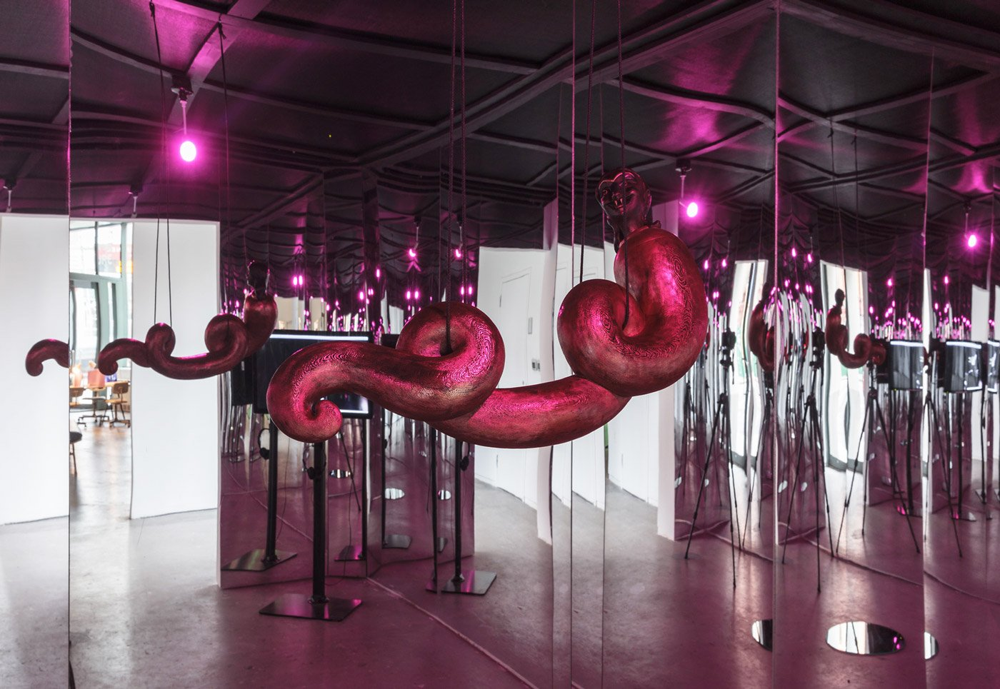

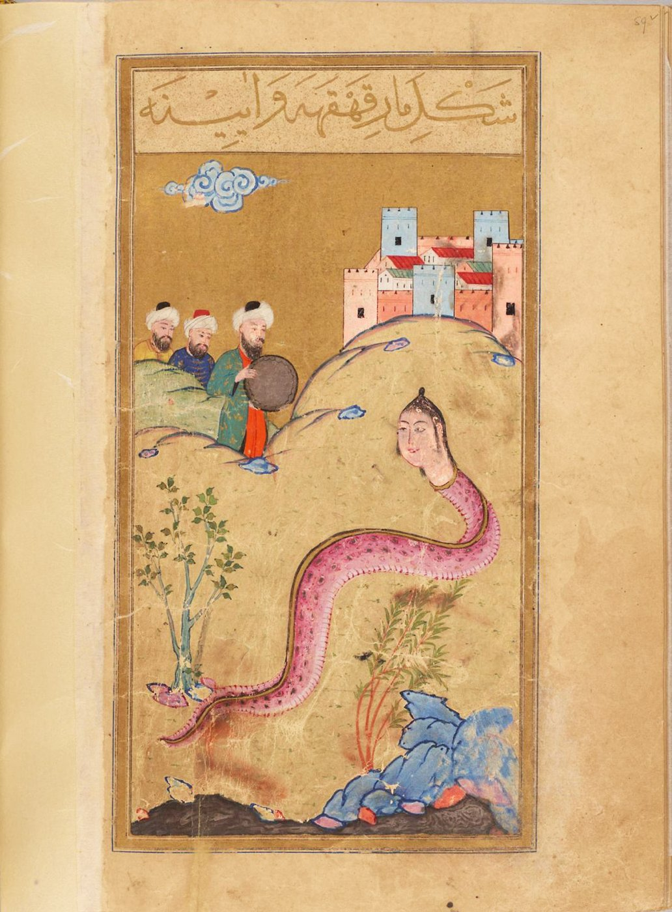

**Approfondimento:** [She Who Sees the Unknown — The Laughing Snake](https://shewhoseestheunknown.com/the-laughing-snake/)

### Moon-faced / ماه طلعت (2022)
**Descrizione:** nella letteratura persiana antica «ماه طلعت» (volto di luna) era un aggettivo senza genere che definiva la bellezza di uomini e donne; nell'Iran contemporaneo indica solo la bellezza femminile. Qualcosa di simile è accaduto ai ritratti della dinastia Qajar (1786-1925), noti per l'indifferenziazione di genere: la modernizzazione dell'Iran, l'influenza della pittura realistica europea e della fotografia ne hanno cancellato la rappresentazione queer dei generi. Allahyari usa parole chiave scelte e ricercate con un modello di IA multimodale per generare una serie di video a partire dall'archivio di pittura Qajar: la macchina impara a dipingere nuovi ritratti senza genere, nel tentativo di disfare e riparare la storia dell'occidentalizzazione che ha interrotto la rappresentazione non binaria nella cultura visiva persiana. Musica di Mani Nilchiani. Presentato in *Plásmata: Bodies, Dreams, and Data* (Onassis Foundation, 2022) e in *What Models Make Worlds* (Ford Foundation Center for Social Justice, 2023).
**Lettura critica:** il sito dell'artista presenta il progetto come un tentativo di «disfare e riparare» con un modello di IA la storia dell'occidentalizzazione che ha interrotto la rappresentazione non binaria nella cultura visiva persiana.[^10]

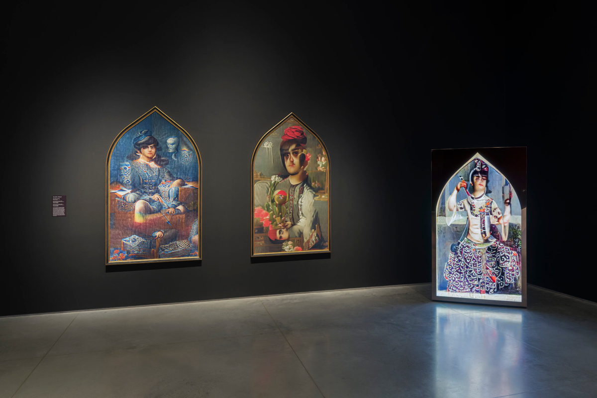

**Video:** [Moon-faced (Vimeo)](https://vimeo.com/664965589)

**Approfondimento:** [morehshin.com — Moon-faced](https://www.morehshin.com/moon-faced)

### Dark Matter (2014)
**Descrizione:** serie di oggetti scultorei modellati in Maya e stampati in 3D, accostati in giustapposizioni umoristiche. Gli oggetti della prima serie sono cose vietate o sgradite in Iran per il governo (cane, dildo, pistola, cravatta, parabola satellitare e altro): possederle significa rischiare carcere, multe o l'attenzione della polizia morale. Stampare il 3D virtuale e portarlo nell'esistenza fisica permette di resistere e di sensibilizzare sul potere che ne scoraggia il possesso, e di archiviare una collezione di oggetti proibiti.

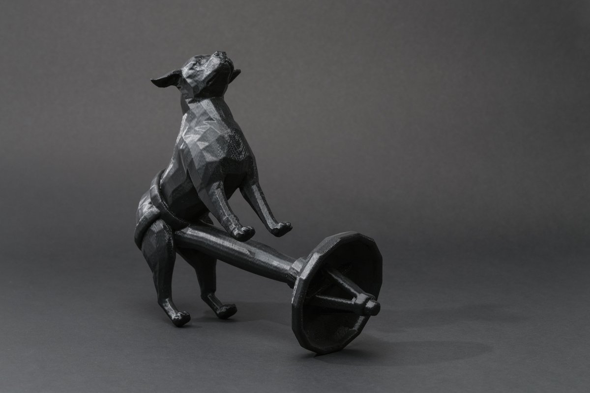

**Approfondimento:** [morehshin.com — Dark Matter](https://www.morehshin.com/dark-matter)

### Like Pearls (2014)
**Descrizione:** progetto web realizzato con un mash-up di immagini e GIF raccolte dallo spam in farsi di negozi online di biancheria iraniani. Per la legge islamica i corpi delle modelle sono cancellati, coperti di bianco o di un motivo, e ne esce un'immagine surreale di sensualità e censura; si aggiungono GIF luccicanti e una versione digitale di «I Want it That Way» dei Backstreet Boys. Cliccando sulle GIF compaiono finestre con frasi romantiche dal tono vagamente minaccioso.
**Lettura critica:** secondo il sito dell'artista, il progetto esamina l'estetica kitsch dello spam e della pubblicità sul web iraniano come un fenomeno complesso, fatto di strati di censura culturale e religiosa e di oppressione verso le donne e il romanticismo.[^11]

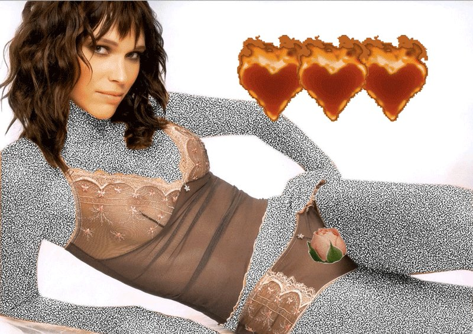

**Approfondimento:** [morehshin.com — Like Pearls](https://www.morehshin.com/like-pearls); [likepearls.com](http://likepearls.com/)

### Digital Colonialism (2016-2019)
**Corso:** `M3D` `TAD-AVM`
**Temi:** `lecture-performance` `patrimonio-e-scansione`
**Descrizione:** esempio di *lecture performance*: ricerca che Allahyari porta avanti dal 2016, in conferenze e testi, e che nel 2019 diventa una lecture-performance commissionata da Rhizome (New Museum). Definisce il colonialismo digitale come un quadro per esaminare criticamente la tendenza delle tecnologie dell'informazione a essere usate in modi che riproducono relazioni di potere coloniali, con attenzione a stampanti e scanner 3D e al loro uso, o abuso, nella ricostruzione di manufatti e patrimonio culturale mediorientale in pericolo o perduto. Nella performance lo scanner 3D, descritto come «uno strumento di stregoneria e magia», diventa un atto performativo e incarnato: l'artista esegue scansioni dal vivo di repliche di manufatti del Medio Oriente mentre parla della loro storia.

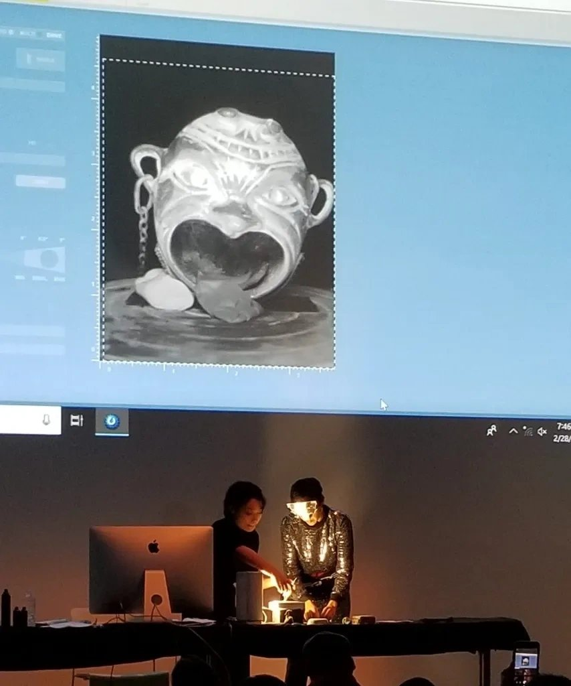

**Video:** [Digital Colonialism, lecture-performance (Vimeo)](https://vimeo.com/337394969)

**Approfondimento:** [Physical Tactics for Digital Colonialism (Medium)](https://medium.com/@morehshin_87856/physical-tactics-for-digital-colonialism-45e8d3fcb2da); [morehshin.com — Digital Colonialism](https://www.morehshin.com/digital-colonialism)

### The Queer Withdrawings (2022-2023)
**Descrizione:** installazione site-specific di disegni e due opere scultoree ispirate a un archivio annotato e illustrato di manoscritti e altre fonti sulle mitologie islamiche e le scienze occulte (consultabile in archive.shewhoseestheunknown.com), frutto della ricerca e della raccolta di libri, manoscritti e immagini per *She Who Sees the Unknown*, con attenzione alle figure femminili e queer, alla scienza occulta e ai talismani. Allahyari immagina un'assemblea queer di jinn, che abitano un territorio né-né che sfugge alle definizioni di genere: nell'installazione a parete le figure si passano una palla, un catalizzatore di solidarietà.

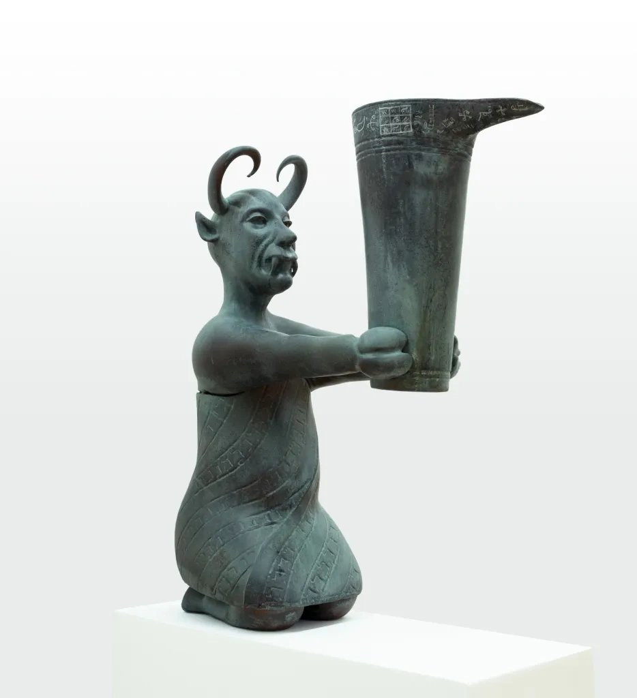

**Approfondimento:** [morehshin.com — The Queer Withdrawings](https://www.morehshin.com/the-queer-withdrawings); [archivio di She Who Sees the Unknown](https://archive.shewhoseestheunknown.com/)

### Speculations on Capture (2024)
**Descrizione:** film poetico in video 4K a canale singolo, con suono, commissionato dal Victoria and Albert Museum di Londra, che conserva oltre 19.000 oggetti del mondo islamico. Racconta le storie di strumenti astronomici fatti in Iran e in Pakistan tra il XIII e il XVIII secolo e oggi al V&A: ogni oggetto è stato modellato in 3D apposta per il progetto e compare nel film accanto a documenti d'archivio e fotografie. Gli archivi del museo registrano solo frammenti: l'arrivo degli oggetti tra il 1865 e il 1930 circa, ma poco dello spostamento e dei suoi effetti sui luoghi d'origine. Allahyari, nata e cresciuta a Teheran, combina volutamente fatti e finzione per immaginare gli incontri perduti e le conoscenze deviate.

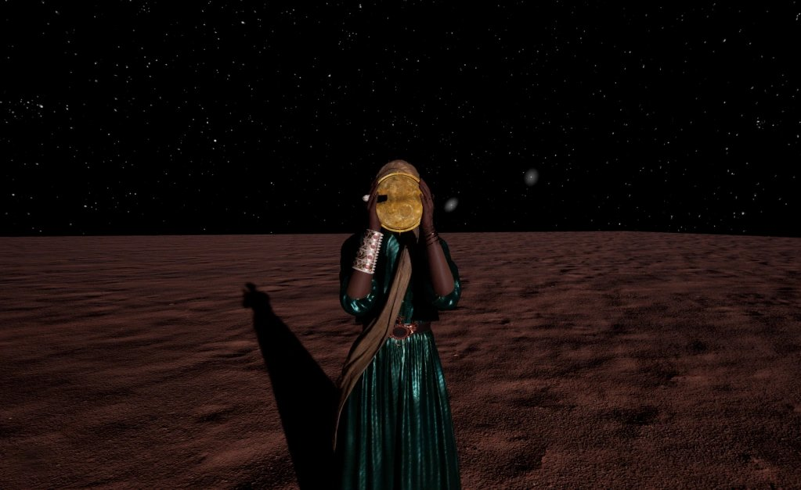

**Approfondimento:** [morehshin.com — Speculations on Capture](https://www.morehshin.com/speculations-on-capture)

### The Remaining Signs of Future Centuries (in corso)
**Descrizione:** progetto di ricerca in corso sulla storia trascurata della scienza e della tecnologia islamicate, letta con uno sguardo anticoloniale, femminista e queer. Ottica, orologi, tavolette geomantiche, oggetti celesti e strumenti alchemici saranno accostati a storiche, scienziate e indovine arabe e iraniane, con interviste, storie e previsioni poetiche. Sostiene che «la tecnologia ha bisogno della magia», ispirandosi a figure come Ibn al-Haytham, scienziato, poeta e praticante spirituale.

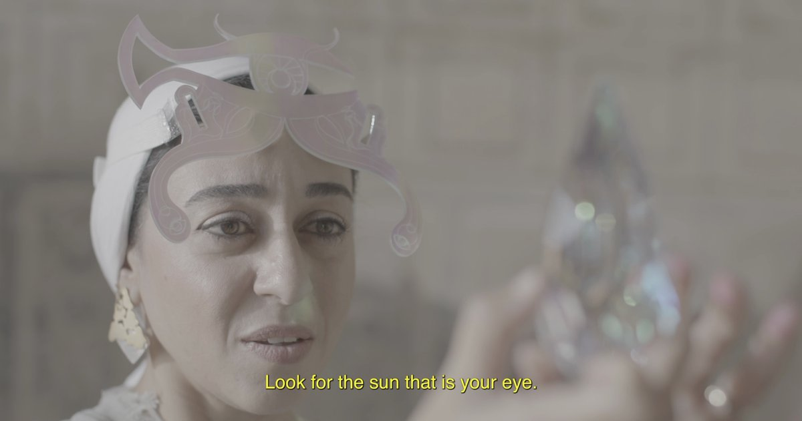

**Video:** [The Remaining Signs of Future Centuries (YouTube)](https://www.youtube.com/watch?v=H6DOOibg-xU)

**Approfondimento:** [morehshin.com — The Remaining Signs of Future Centuries](https://www.morehshin.com/the-remaining-signs-of-future-centuries)

### Altre opere (dal sito dell'artista, da approfondire)
**Descrizione:** *In Mere Spaces All Things Are Side by Side I* (2014), *As You Scroll Down* (2014), *The Recitation of a Soliloquy* (2012), *Aragh* (2012), *The Paintings of George W. Bush* (2014), *Bitrates* (2014), *AppArt Project* (2015). Progetti di organizzazione e femminismo: *Ha'm Neshini* (2021-2024), *Womxn, Life, Freedom* (parti I-III, 2023), *Refiguring the Feminist Future* (2018), *Re-Figuring and Fabulation* (2017). Descrizioni da scrivere.

**Approfondimento:** [morehshin.com](https://www.morehshin.com/)

## Approfondimenti

### Parole dell'artista
- Sul metodo: si definisce «artista/investigatrice privata»; i progetti nascono da archivi frammentari e non digitalizzati, raccolti con l'aiuto di parenti e amici nelle biblioteche iraniane e con il lavoro alla Morgan Library e al Metropolitan di New York. L'archivio della ricerca è pubblicato insieme all'opera, e per alcune figure, come Ya'jooj Ma'jooj o il Serpente che Ride, è diventato la fonte di riferimento.[^8]
- Sul patrimonio: l'ISIS si riappropria degli oggetti creando un'assenza, i governi e le aziende occidentali se ne riappropriano dopo, con una nuova presenza la cui violenza resta invisibile; l'esempio è la replica dell'Arco di Palmira esposta a Trafalgar Square nel 2016.[^4]

### Letture critiche e concetti
- **«Violent-care» (Thom van Dooren).** Nella conferenza del 2019 Allahyari riprende dallo studioso di ambiente Thom van Dooren il concetto di cura violenta, elaborato nel 2015 su un centro di conservazione delle Hawaii dove si salvano i corvi minacciati e si uccidono i maiali selvatici, e lo applica alla ricostruzione digitale del patrimonio: un regime che decide quali oggetti salvare e quali sacrificare. Ne distingue due figure nel linguaggio di CyArk, Project Mosul e Google Arts and Culture: l'«allineamento», cioè il patrimonio presentato come universale e condiviso, e l'«alleanza», cioè l'assistenza ai paesi d'origine che li tiene in posizione subordinata, per la quale cita *Digital Postcolonialism* (2015) di Petar Jandrić e Ana Kuzmanić.[^4]
- **La realtà virtuale e l'altro.** Manischa Eichwalder (*AN-ICON*, 2024) legge *Kabous* contro l'idea della VR come «macchina dell'empatia», con Sara Ahmed (*Strange Encounters*, 2000).[^9]

## Interviste e talk
- [Katie Peyton Hofstadter, «The Process», *The Believer* n. 131 (2020)](https://www.thebeliever.net/the-process-morehshin-allahyari-she-who-sees-the-unknown-kabous-the-right-witness-and-the-left-witness-2019/)
- **Video:** [Digital Colonialism: lecture-performance (Rhizome, 2019)](https://vimeo.com/337394969)
- [Hyperallergic Podcast — «Talking Digital Colonialism with Morehshin Allahyari»](https://podcast.hyperallergic.com/episodes/talking-digital-colonialism-with-morehshin-allahyari)
- [Physical Tactics for Digital Colonialism (Medium, testo dell'artista)](https://medium.com/@morehshin_87856/physical-tactics-for-digital-colonialism-45e8d3fcb2da)
- [Animal New York — Artist's Notebook: Morehshin Allahyari (2014)](http://animalnewyork.com/2014/artists-notebook-morehshin-allahyari/)

## Fonti
- [morehshin.com](https://www.morehshin.com/)
- [Material Speculation: ISIS](https://www.morehshin.com/material-speculation-isis)
- [She Who Sees the Unknown](https://www.morehshin.com/she-who-sees-the-unknown)
- [The 3D Additivist Manifesto — testo e video](https://additivism.org/manifesto)
- [The 3D Additivist Cookbook](https://additivism.org/cookbook)
- [additivism.org](https://additivism.org/)
- [shewhoseestheunknown.com](https://shewhoseestheunknown.com/) e il suo [archivio](https://archive.shewhoseestheunknown.com/)
- [Digital Colonialism — morehshin.com](https://www.morehshin.com/digital-colonialism)

## Crediti delle immagini
Immagine per ciascuna delle quattro opere/serie principali, inclusa sotto la relativa descrizione in "Opere principali", dal sito ufficiale dell'artista, additivism.org e shewhoseestheunknown.com.
- [morehshin.com](https://www.morehshin.com/)
- [Material Speculation: ISIS](https://www.morehshin.com/material-speculation-isis)
- [She Who Sees the Unknown](https://www.morehshin.com/she-who-sees-the-unknown)
- Immagini e video dei progetti dal sito [morehshin.com](https://www.morehshin.com/) e dal sito di progetto [shewhoseestheunknown.com](https://shewhoseestheunknown.com/); diritti dell'artista.

[^1]: Morehshin Allahyari, «About», sito dell'artista. [link](https://morehshin.com/about)

[^2]: «Morehshin Allahyari», *Wikipedia* (inglese), consultata il 2026-11-08. [link](https://en.wikipedia.org/wiki/Morehshin_Allahyari)

[^3]: Whitney Museum of American Art, pagina dell'artista. [link](https://www.whitney.org/artists/19002)

[^4]: Morehshin Allahyari, «Physical Tactics for Digital Colonialism», *Medium*, 7 giugno 2019, trascrizione della lecture-performance al New Museum del 28 febbraio 2019. [link](https://medium.com/@morehshin_87856/physical-tactics-for-digital-colonialism-45e8d3fcb2da)

[^5]: Morehshin Allahyari, «She Who Sees the Unknown», sito dell'artista. [link](https://www.morehshin.com/she-who-sees-the-unknown)

[^6]: Morehshin Allahyari, «Material Speculation: ISIS», sito dell'artista. [link](https://www.morehshin.com/material-speculation-isis)

[^7]: Morehshin Allahyari e Daniel Rourke (a cura di), *The 3D Additivist Cookbook*, Institute of Network Cultures, Amsterdam, 2016, introduzione. [link](https://additivism.org/cookbook)

[^8]: Katie Peyton Hofstadter, «The Process: Morehshin Allahyari, She Who Sees the Unknown: Kabous, The Right Witness and The Left Witness, 2019», *The Believer*, n. 131, 1 giugno 2020. [link](https://www.thebeliever.net/the-process-morehshin-allahyari-she-who-sees-the-unknown-kabous-the-right-witness-and-the-left-witness-2019/)

[^9]: Manischa Eichwalder, «Embracing Otherness? A VR Body Hack by Morehshin Allahyari», *AN-ICON. Studies in Environmental Images*, vol. 3, n. I, 2024. Letto l'abstract. [link](https://riviste.unimi.it/index.php/anicon/article/view/23206)

[^10]: Morehshin Allahyari, «Moon-faced», sito dell'artista. [link](https://www.morehshin.com/moon-faced)

[^11]: Morehshin Allahyari, «Like Pearls», sito dell'artista. [link](https://www.morehshin.com/like-pearls)
