# Morehshin Allahyari

**Tag tecnica/formato:** `stampa-3d-scultura` `ai-generativa`
**Tag tema:** `colonialismo-decolonialita` `genere-queerness` `memoria-archivio` `lecture-performance`
**Tag corso:** `M3D` `TAD-AVM`
**Stato:** testo in parte generato con IA: da verificare l'anno di nascita (1985) e, contro additivism.org, l'esattezza di ogni progetto del Cookbook elencato · le sezioni *Moon-faced*, *She Who Sees the Unknown* e le opere dopo *Moon-faced* sono riscritte dal sito dell'artista; le letture critiche delle opere più vecchie restano da verificare

## Biografia
Artista iraniano-americana. *(Anno di nascita indicato in una fonte non verificata come 1985 — da controllare.)*

## Poetica e ricerca
La pratica di Morehshin Allahyari si configura come una **contro-archeologia**: una metodologia di resistenza che usa gli strumenti della produzione digitale — scansione 3D, modellazione, intelligenza artificiale — per sovvertirne le logiche intrinseche di controllo e colonialità. La sua ricerca non si limita a documentare o rappresentare: è un atto di **riconfigurazione** (*re-figuring*), un intervento politico che contesta la violenza dell'archivio, la cancellazione della storia e le narrative egemoniche del tecno-capitalismo. Opera in uno spazio teorico che interseca critica postcoloniale, femminismo speculativo e materialismo digitale: per lei la tecnologia non è mai neutra, è un campo di battaglia dove il passato viene attivamente cancellato o, al contrario, radicalmente reclamato. Il suo lavoro è una forma di "rifiuto" — rifiuto della perdita, rifiuto dell'archivio occidentale come arbitro finale della storia, rifiuto di una visione utopica della tecnologia.

## Opere principali
### Material Speculation: ISIS (2015-2016)
**Descrizione:** ricostruzione e stampa 3D, in resina traslucida, di dodici statue (da Hatra e Ninive) distrutte da ISIS al museo di Mosul nel 2015; ogni scultura contiene al proprio interno, visibile, una scheda di memoria o chiavetta USB con tutta la ricerca (immagini, mappe, file 3D).
**Lettura critica:** non è un atto di restauro — Allahyari non cerca di creare una copia perfetta per un museo, ma un "pacchetto dati" in-archiviabile: incorporando la scheda di memoria dentro l'oggetto fisico, crea un **data-ghost** (fantasma di dati), rendendo oggetto e dati inseparabili e rifiutando che l'artefatto venga decontestualizzato o assorbito passivamente in un archivio occidentale. Un atto di *digital disobedience* contro la **violenza d'archivio** (Derrida, Foucault) — il concetto secondo cui gli archivi non sono registri passivi ma strumenti di potere che attivamente costruiscono, classificano e quindi cancellano la storia.

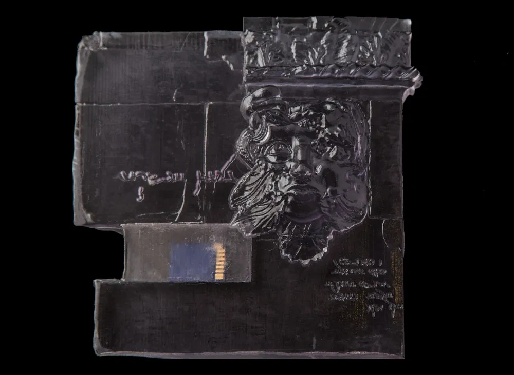

**Approfondimento:** [morehshin.com — Material Speculation: ISIS](https://www.morehshin.com/material-speculation-isis)

### The 3D Additivist Manifesto (2015, con Daniel Rourke)
**Descrizione:** manifesto del marzo 2015, in forma di testo e di video, scritto da Allahyari e Daniel Rourke. Parte dalla plastica della stampa 3D come metafora: derivata dal petrolio, la materia stessa porta con sé una storia complicata. Dichiara una nuova bellezza, quella dei rifiuti e dei detriti. Il manifesto apre il movimento dell'*#Additivism* (da *additive* e *activism*), che critica le tecnologie «radicali» nei fablab, nei laboratori e nelle aule e rilegge la stampante 3D come Donna Haraway ha fatto con il cyborg.

**Video:** [The 3D Additivist Manifesto (Vimeo)](https://vimeo.com/122642166)

**Approfondimento:** [additivism.org — Manifesto](https://additivism.org/manifesto)

### The 3D Additivist Cookbook (2016-2017, a cura di Allahyari e Rourke)
**Descrizione:** il *Cookbook* è l'insieme delle «ricette» (un libro di contributi nato da una open call) che invita artisti e attivisti a spingere la stampa 3D oltre il suo "hype utopico e la sua critica distopica" — una raccolta di contributi che esplorano il potenziale sovversivo, critico e "strano" della stampa 3D in ambiti come critica politica e sociale, sovversione e attivismo, speculazione ed estetica, mutazione corporea e postumanesimo. Tra i progetti raccolti nel Cookbook:
  - **NefertitiHack** (Nora Al-Badri e Nikolai Nelles) — scansione "clandestina" del busto di Nefertiti al Neues Museum di Berlino, dati rilasciati pubblicamente: atto di "pirateria museale" sul colonialismo e la proprietà culturale.
  - **The Free Universal Construction Kit** (Golan Levin e Shawn Sims) — 80 file .stl per collegare tra loro 10 diversi sistemi di costruzioni per bambini (LEGO, Duplo, K'Nex, Tinkertoys), un hack che promuove l'interoperabilità e il "fair use".
  - **The Fellatio Modification Project** (Kuang-Yi Ku) — protesi stampabili in 3D per aumentare il piacere sessuale, al confine tra potenziamento medico, modificazione corporea e tecnologia sessuale.
  - **Liberator Variations** (vari artisti) — variazioni sulla "Liberator" (prima pistola funzionante interamente stampata in 3D), che ne esplorano criticamente o poeticamente le implicazioni.
  - **The Evolution of the Spermalege** (Joey Holder) — organi sessuali interspecie stampabili in 3D, ispirati a una struttura riproduttiva traumatica di alcuni insetti: esplorazione postumana dell'evoluzione e della biologia sintetica.
  - **Tactical Cans** (Scott Kildall) — adattatore stampabile che collega una bomboletta spray a un bastone estensibile, per graffiti/attivismo in luoghi alti — "oggetti utili alla promozione della protesta e del disordine".
  - **P-ARK** (Wei-Chieh Tseng e Jing-Yao Chen) — droni acquatici che raccolgono plastica oceanica e la usano per stampare in 3D "arche" galleggianti, nuovi habitat per la vita marina — trasforma il rifiuto ("Plasticene") in culla per la vita ("Cthulucene").
  - **Voxel-PoP** (Antonia Coterill) — software progettato per corrompere deliberatamente i file 3D, introducendo errori e glitch come forza creativa, non come difetto.
  - **Ex-sist** (Cathrine Disney) — bio-pirateria con kit DNA casalingo per mappare la topografia della propria pelle (batteri inclusi) e stamparla in 3D come "esoscheletro".
  - **A Cryptoporn and Bio-hacking Tool-Kit** (Mary Maggic) — strumentazione da laboratorio stampabile (pipette, piastre di Petri) per esperimenti ormonali "fai-da-te" fuori dalle istituzioni mediche: "disobbedienza estrogenica".
  - **URME Recipes: Cooking with Privilege** (Leo Selvaggio) — maschere 3D iperrealistiche del volto dell'artista, messe in vendita per permettere a chiunque di confondere i sistemi di riconoscimento facciale.
  - **Occupy Gramercy** (anonimo) — file 3D per stampare una copia della chiave che apre i cancelli di Gramercy Park (parco privato a New York): atto di "occupazione" digitale.
  - **An Archaeology of #Additivism** (Daniel Rourke e Morehshin Allahyari) — saggio teorico introduttivo del libro, sulle origini filosofiche, politiche e artistiche del movimento Additivista.

**Lettura critica:** l'"Additivismo" è una critica diretta al **soluzionismo tecnologico** (la convinzione neoliberista che ogni problema sociale complesso possa essere risolto con un'app o una nuova tecnologia): Allahyari e Rourke propongono di usare la stampa 3D per "la speculazione, la provocazione e la stranezza", vedendo il potenziale della stampante 3D non come strumento di consumo ma come dispositivo per la mutazione e l'intervento politico radicale.

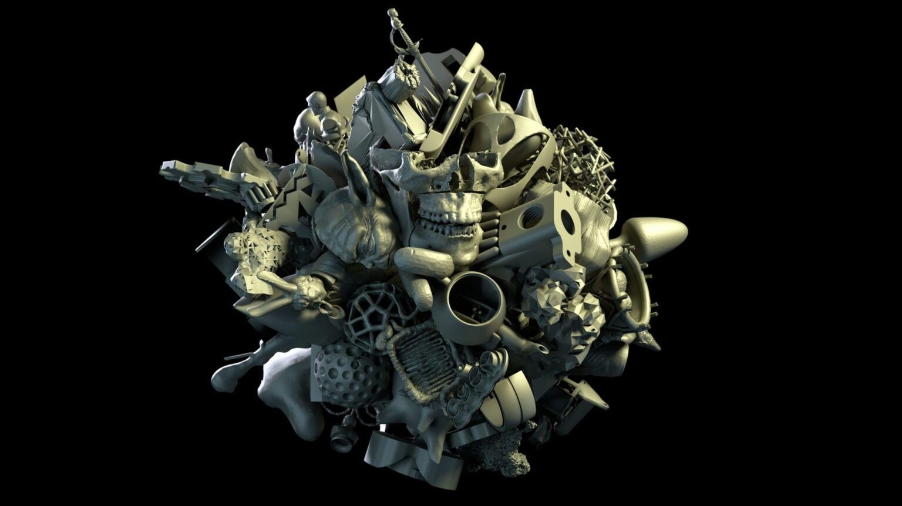

**Approfondimento:** [additivism.org — Cookbook](https://additivism.org/cookbook); [additivism.org](https://additivism.org/)

### She Who Sees the Unknown (2016-2021)
**Descrizione:** progetto di ricerca a lungo termine iniziato nell'ottobre 2016 durante una residenza a Eyebeam, a New York. Con modellazione 3D, scansione 3D, stampa 3D e narrazione ricrea figure mostruose femminili e queer di origine mediorientale (i jinn), usando le tradizioni e i miti che le accompagnano per esplorare le catastrofi del colonialismo, del patriarcato e del degrado ambientale in relazione al Medio Oriente. Allahyari chiama *Re-Figuring* la pratica che ha sviluppato: un atto di attivazione e di conservazione, di recupero di un passato dimenticato o travisato per immaginare un altro presente e un altro futuro. Il progetto comprende installazioni, video, un'esperienza di realtà virtuale, una *Reading Room* (installazione con libri, articoli e immagini, 2016-in corso), eventi pubblici come la performance-lecture *Breaching Towards Other Futures* (The Floating University, Berlino, 2018) e un archivio consultabile online.
**Lettura critica:** applica il **femminismo speculativo** (nella scia di Donna Haraway, che usa figure non-umane, mostruose o ibride per immaginare futuri oltre le categorie binarie del patriarcato). Il jinn è un dispositivo teorico perfetto: né umano né divino, né buono né cattivo, una figura ontologicamente ambigua che sfida le categorie fondamentali dell'esistenza. Usandolo, Allahyari decostruisce il *tecno-orientalismo* (la feticizzazione occidentale della tecnologia asiatica/mediorientale) e l'archivio patriarcale che ha demonizzato queste figure — un atto di "re-figuring" del mostruoso, che reclama l'ignoto e l'ibrido come fonti di potere femminista e decoloniale.

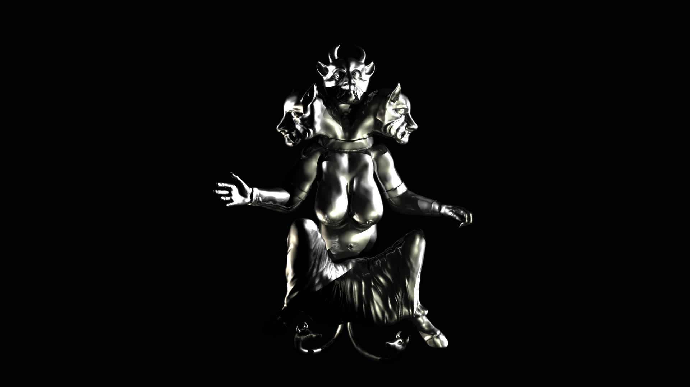

**Approfondimento:** [shewhoseestheunknown.com](https://shewhoseestheunknown.com/)

#### Huma
**Descrizione:** Huma è un jinn noto in vari racconti e miti mediorientali che porta il calore al corpo umano ed è responsabile della comune febbre. Viene raffigurata come un demone con tre teste e una o due code. Installazione con scultura 3D e video.

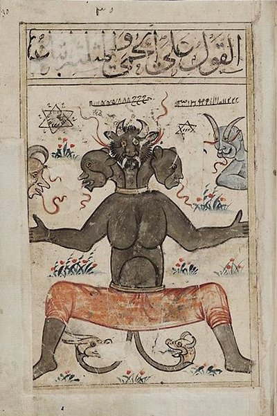

**Video:** [Huma (Vimeo)](https://vimeo.com/342057560)

**Approfondimento:** [She Who Sees the Unknown — Huma](https://shewhoseestheunknown.com/huma/)

#### Ya'jooj Ma'jooj
**Descrizione:** secondo il Corano, i popoli di Ya'jooj e Ma'jooj diffondono grande disordine sulla terra e rappresentano il caos: Dio concede a Zulqarnain (in altre versioni identificato con Alessandro Magno) il potere di costruire un muro di ferro per trattenerli, separandoli dagli esseri umani. Installazione con video.

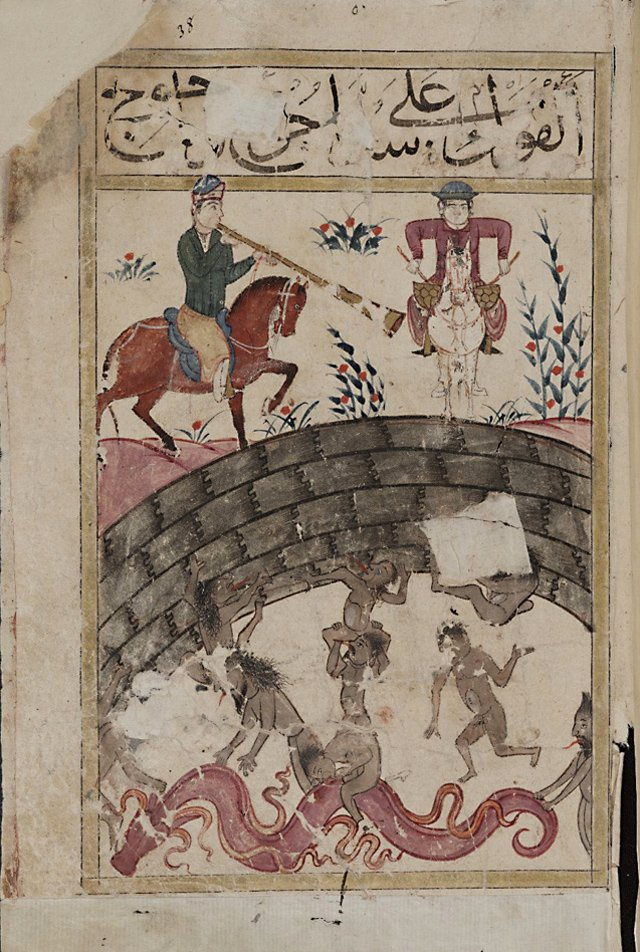

**Video:** [Yajooj Majooj (Vimeo)](https://vimeo.com/296029355)

**Video:** [Yajooj Majooj (Vimeo, seconda clip)](https://vimeo.com/342063763)

**Approfondimento:** [She Who Sees the Unknown — Ya'jooj Ma'jooj](https://shewhoseestheunknown.com/yajooj-majooj/)

#### Aisha Qandisha
**Descrizione:** Aisha Qandisha (عيشة قنديشه) è uno dei jinn più onorati e temuti dell'Islam, originario del Marocco; è chiamata «colei che apre» ed è il jinn dei fiumi. Installazione con scultura in resina stampata in 3D, vasca riflettente e video HD.

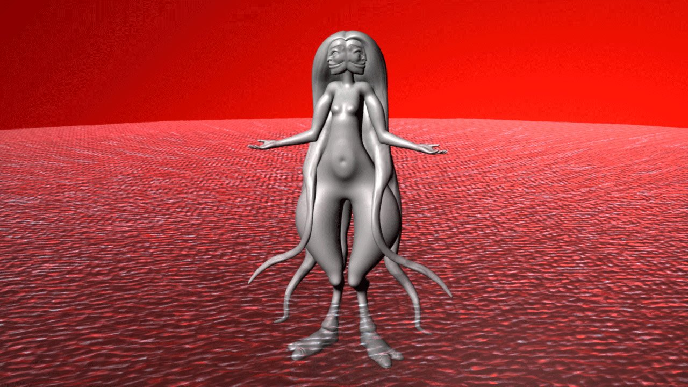

**Video:** [Aisha Qandisha (Vimeo)](https://vimeo.com/342079010)

**Approfondimento:** [She Who Sees the Unknown — Aisha Qandisha](https://shewhoseestheunknown.com/aisha-qandisha/)

#### Kabous
**Descrizione:** Kabous (al-Kabus, detto anche al-Jathoom, «incubo») appartiene alla stirpe di jinn che portano agli esseri umani malattie, traumi e incubi: viene raffigurata mentre possiede una persona con un incubo, seduta sul suo petto mentre dorme. Il progetto comprende un'installazione e un film in realtà virtuale.

**Video:** [Kabous (Vimeo)](https://vimeo.com/393977901)

**Approfondimento:** [She Who Sees the Unknown — Kabous](https://shewhoseestheunknown.com/kabous/)

#### The Laughing Snake
**Descrizione:** i vari miti sul Serpente che Ride descrivono una figura mostruosa (per alcuni un jinn) che ha preso il controllo di una città e delle sue terre, uccidendone gli abitanti e gli animali; molti tentativi di distruggerla sono falliti. Installazione e narrazione ipertestuale.

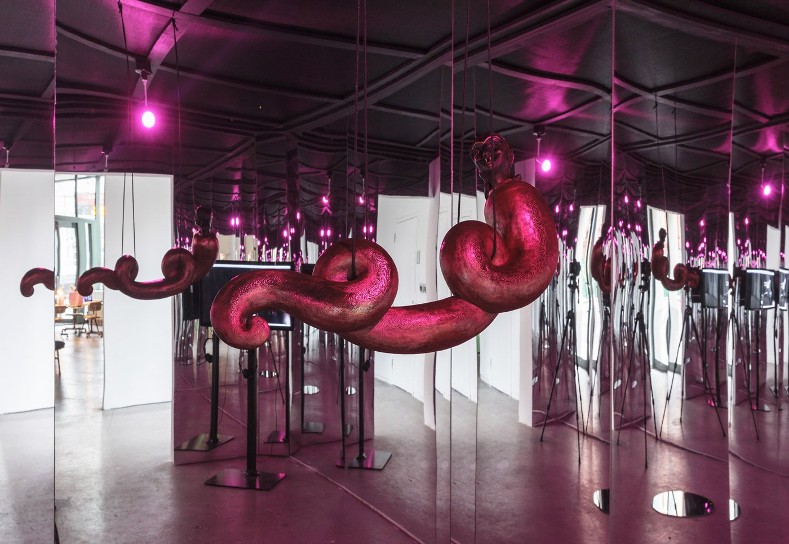

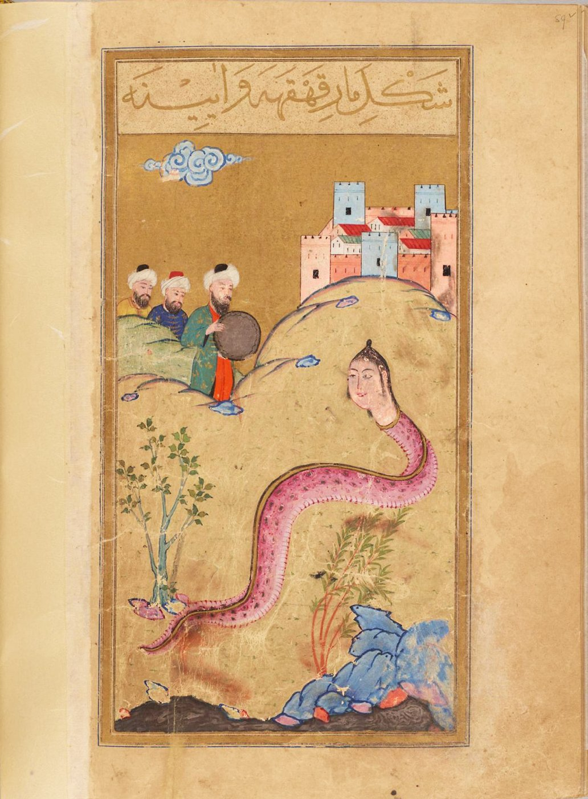

**Approfondimento:** [She Who Sees the Unknown — The Laughing Snake](https://shewhoseestheunknown.com/the-laughing-snake/)

### Moon-faced / ماه طلعت (2022)
**Descrizione:** nella letteratura persiana antica «ماه طلعت» (volto di luna) era un aggettivo senza genere che definiva la bellezza di uomini e donne; nell'Iran contemporaneo indica solo la bellezza femminile. Qualcosa di simile è accaduto ai ritratti della dinastia Qajar (1786-1925), noti per l'indifferenziazione di genere: la modernizzazione dell'Iran, l'influenza della pittura realistica europea e della fotografia ne hanno cancellato la rappresentazione queer dei generi. Allahyari usa parole chiave scelte e ricercate con un modello di IA multimodale per generare una serie di video a partire dall'archivio di pittura Qajar: la macchina impara a dipingere nuovi ritratti senza genere, nel tentativo di disfare e riparare la storia dell'occidentalizzazione che ha interrotto la rappresentazione non binaria nella cultura visiva persiana. Musica di Mani Nilchiani. Presentato in *Plásmata: Bodies, Dreams, and Data* (Onassis Foundation, 2022) e in *What Models Make Worlds* (Ford Foundation Center for Social Justice, 2023).
**Lettura critica:** è una riparazione storica fatta con lo strumento che di solito riproduce le norme dei suoi dataset: qui le parole chiave e l'archivio sono scelti per far emergere ciò che la modernizzazione aveva cancellato.

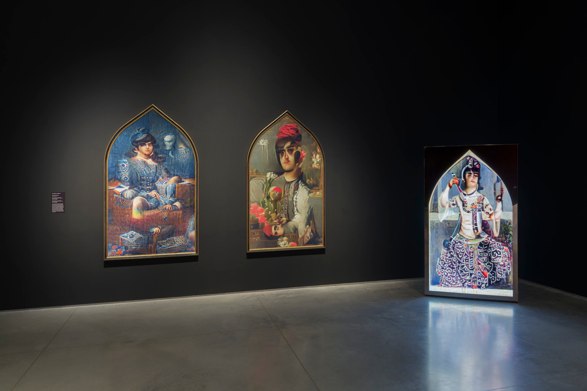

**Video:** [Moon-faced (Vimeo)](https://vimeo.com/664965589)

**Approfondimento:** [morehshin.com — Moon-faced](https://www.morehshin.com/moon-faced)

### Dark Matter (2014)
**Descrizione:** serie di oggetti scultorei modellati in Maya e stampati in 3D, accostati in giustapposizioni umoristiche. Gli oggetti della prima serie sono cose vietate o sgradite in Iran per il governo (cane, dildo, pistola, cravatta, parabola satellitare e altro): possederle significa rischiare carcere, multe o l'attenzione della polizia morale. Stampare il 3D virtuale e portarlo nell'esistenza fisica permette di resistere e di sensibilizzare sul potere che ne scoraggia il possesso, e di archiviare una collezione di oggetti proibiti.

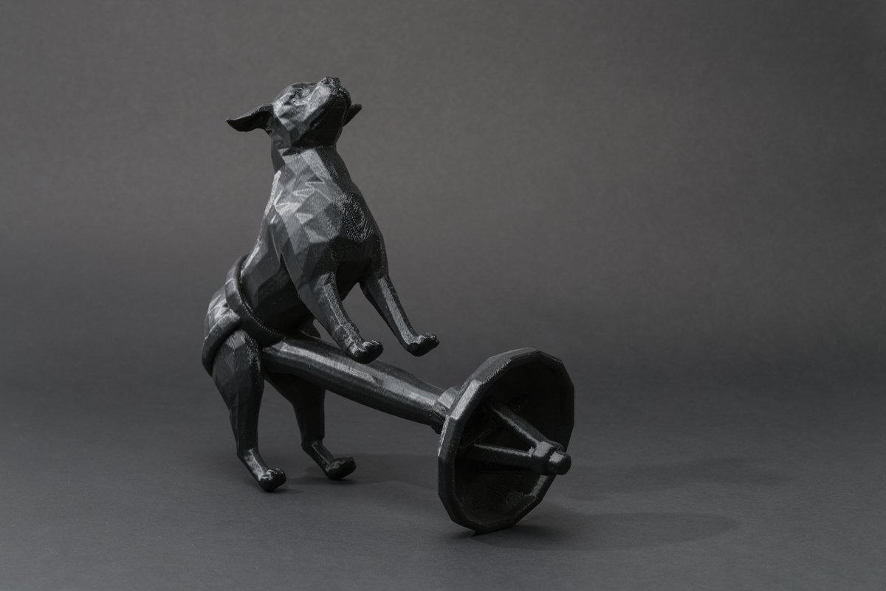

**Approfondimento:** [morehshin.com — Dark Matter](https://www.morehshin.com/dark-matter)

### Like Pearls (2014)
**Descrizione:** progetto web realizzato con un mash-up di immagini e GIF raccolte dallo spam in farsi di negozi online di biancheria iraniani. Per la legge islamica i corpi delle modelle sono cancellati, coperti di bianco o di un motivo, e ne esce un'immagine surreale di sensualità e censura; si aggiungono GIF luccicanti e una versione digitale di «I Want it That Way» dei Backstreet Boys. Cliccando sulle GIF compaiono finestre con frasi romantiche dal tono vagamente minaccioso.
**Lettura critica:** esamina come l'estetica kitsch dello spam e della pubblicità sul web iraniano sia un fenomeno complesso, fatto di strati di censura culturale e religiosa e di oppressione verso le donne e il romanticismo.

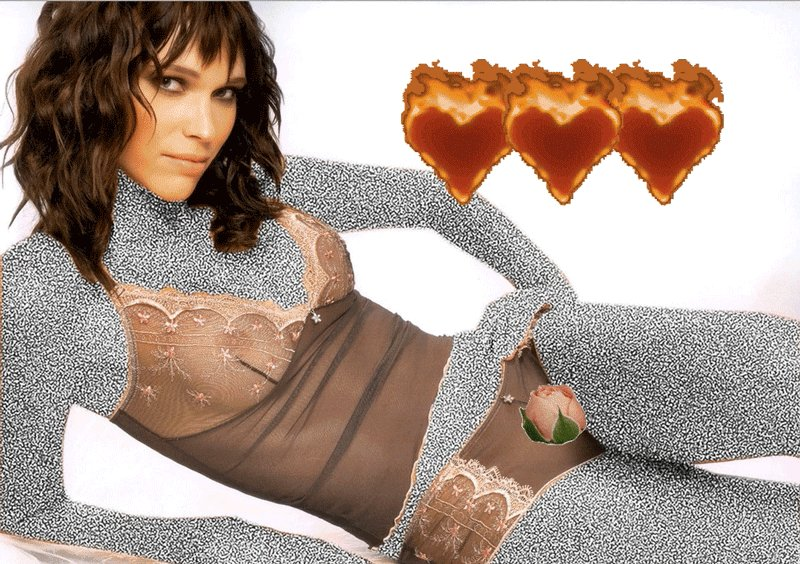

**Approfondimento:** [morehshin.com — Like Pearls](https://www.morehshin.com/like-pearls); [likepearls.com](http://likepearls.com/)

### Digital Colonialism (2016-2019)
**Corso:** `M3D` `TAD-AVM`
**Temi:** `lecture-performance` `patrimonio-e-scansione`
**Descrizione:** esempio di *lecture performance*: ricerca che Allahyari porta avanti dal 2016, in conferenze e testi, e che nel 2019 diventa una lecture-performance commissionata da Rhizome (New Museum). Definisce il colonialismo digitale come un quadro per esaminare criticamente la tendenza delle tecnologie dell'informazione a essere usate in modi che riproducono relazioni di potere coloniali, con attenzione a stampanti e scanner 3D e al loro uso, o abuso, nella ricostruzione di manufatti e patrimonio culturale mediorientale in pericolo o perduto. Nella performance lo scanner 3D, descritto come «uno strumento di stregoneria e magia», diventa un atto performativo e incarnato: l'artista esegue scansioni dal vivo di repliche di manufatti del Medio Oriente mentre parla della loro storia.

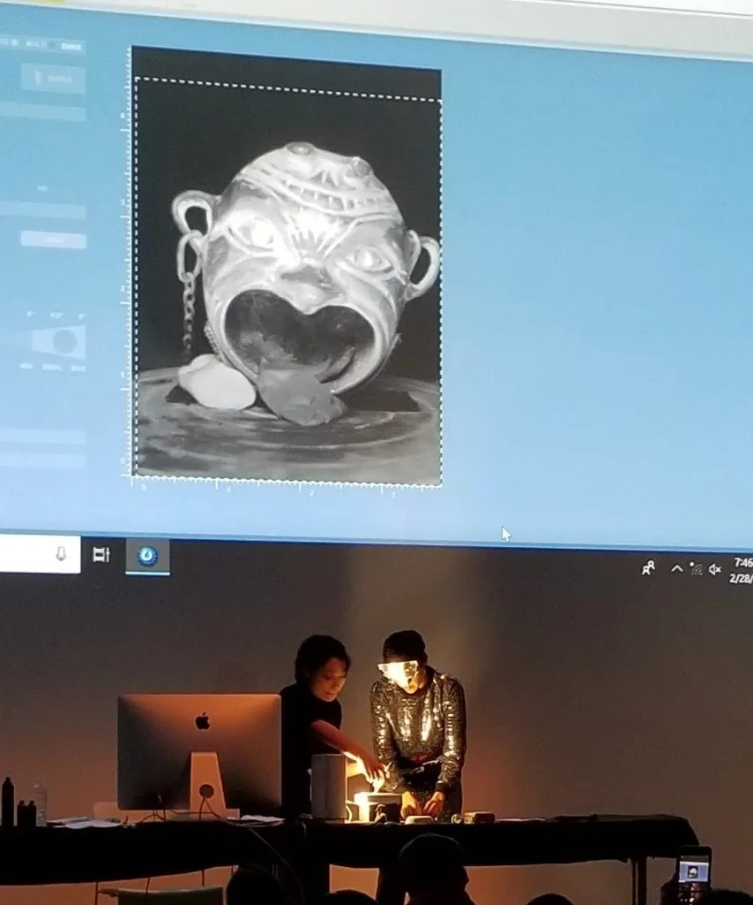

**Video:** [Digital Colonialism, lecture-performance (Vimeo)](https://vimeo.com/337394969)

**Approfondimento:** [Physical Tactics for Digital Colonialism (Medium)](https://medium.com/@morehshin_87856/physical-tactics-for-digital-colonialism-45e8d3fcb2da); [morehshin.com — Digital Colonialism](https://www.morehshin.com/digital-colonialism)

### The Queer Withdrawings (2022-2023)
**Descrizione:** installazione site-specific di disegni e due opere scultoree ispirate a un archivio annotato e illustrato di manoscritti e altre fonti sulle mitologie islamiche e le scienze occulte (consultabile in archive.shewhoseestheunknown.com), frutto della ricerca e della raccolta di libri, manoscritti e immagini per *She Who Sees the Unknown*, con attenzione alle figure femminili e queer, alla scienza occulta e ai talismani. Allahyari immagina un'assemblea queer di jinn, che abitano un territorio né-né che sfugge alle definizioni di genere: nell'installazione a parete le figure si passano una palla, un catalizzatore di solidarietà.

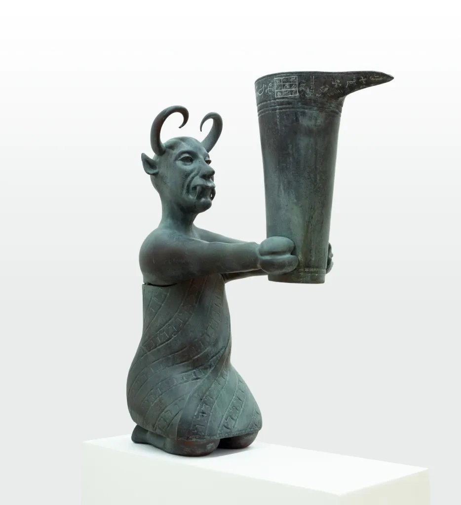

**Approfondimento:** [morehshin.com — The Queer Withdrawings](https://www.morehshin.com/the-queer-withdrawings); [archivio di She Who Sees the Unknown](https://archive.shewhoseestheunknown.com/)

### Speculations on Capture (2024)
**Descrizione:** film poetico in video 4K a canale singolo, con suono, commissionato dal Victoria and Albert Museum di Londra, che conserva oltre 19.000 oggetti del mondo islamico. Racconta le storie di strumenti astronomici fatti in Iran e in Pakistan tra il XIII e il XVIII secolo e oggi al V&A: ogni oggetto è stato modellato in 3D apposta per il progetto e compare nel film accanto a documenti d'archivio e fotografie. Gli archivi del museo registrano solo frammenti: l'arrivo degli oggetti tra il 1865 e il 1930 circa, ma poco dello spostamento e dei suoi effetti sui luoghi d'origine. Allahyari, nata e cresciuta a Teheran, combina volutamente fatti e finzione per immaginare gli incontri perduti e le conoscenze deviate.

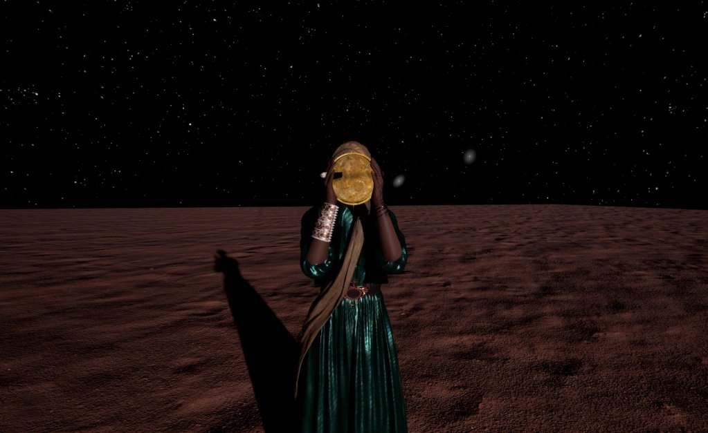

**Approfondimento:** [morehshin.com — Speculations on Capture](https://www.morehshin.com/speculations-on-capture)

### The Remaining Signs of Future Centuries (in corso)
**Descrizione:** progetto di ricerca in corso sulla storia trascurata della scienza e della tecnologia islamicate, letta con uno sguardo anticoloniale, femminista e queer. Ottica, orologi, tavolette geomantiche, oggetti celesti e strumenti alchemici saranno accostati a storiche, scienziate e indovine arabe e iraniane, con interviste, storie e previsioni poetiche. Sostiene che «la tecnologia ha bisogno della magia», ispirandosi a figure come Ibn al-Haytham, scienziato, poeta e praticante spirituale.

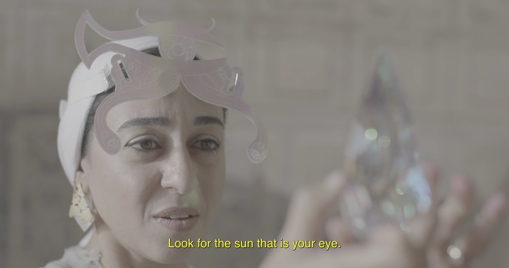

**Video:** [The Remaining Signs of Future Centuries (YouTube)](https://www.youtube.com/watch?v=H6DOOibg-xU)

**Approfondimento:** [morehshin.com — The Remaining Signs of Future Centuries](https://www.morehshin.com/the-remaining-signs-of-future-centuries)

### Altre opere (dal sito dell'artista, da approfondire)
**Descrizione:** *In Mere Spaces All Things Are Side by Side I* (2014), *As You Scroll Down* (2014), *The Recitation of a Soliloquy* (2012), *Aragh* (2012), *The Paintings of George W. Bush* (2014), *Bitrates* (2014), *AppArt Project* (2015). Progetti di organizzazione e femminismo: *Ha'm Neshini* (2021-2024), *Womxn, Life, Freedom* (parti I-III, 2023), *Refiguring the Feminist Future* (2018), *Re-Figuring and Fabulation* (2017). Descrizioni da scrivere.

**Approfondimento:** [morehshin.com](https://www.morehshin.com/)

## Interviste e talk
- **Video:** [Digital Colonialism: lecture-performance (Rhizome, 2019)](https://vimeo.com/337394969)
- [Hyperallergic Podcast — «Talking Digital Colonialism with Morehshin Allahyari»](https://podcast.hyperallergic.com/episodes/talking-digital-colonialism-with-morehshin-allahyari)
- [Physical Tactics for Digital Colonialism (Medium, testo dell'artista)](https://medium.com/@morehshin_87856/physical-tactics-for-digital-colonialism-45e8d3fcb2da)
- [Animal New York — Artist's Notebook: Morehshin Allahyari (2014)](http://animalnewyork.com/2014/artists-notebook-morehshin-allahyari/)

## Fonti
- [morehshin.com](https://www.morehshin.com/)
- [Material Speculation: ISIS](https://www.morehshin.com/material-speculation-isis)
- [She Who Sees the Unknown](https://www.morehshin.com/she-who-sees-the-unknown)
- [The 3D Additivist Manifesto — testo e video](https://additivism.org/manifesto)
- [The 3D Additivist Cookbook](https://additivism.org/cookbook)
- [additivism.org](https://additivism.org/)
- [shewhoseestheunknown.com](https://shewhoseestheunknown.com/) e il suo [archivio](https://archive.shewhoseestheunknown.com/)
- [Digital Colonialism — morehshin.com](https://www.morehshin.com/digital-colonialism)

## Crediti delle immagini
Immagine per ciascuna delle quattro opere/serie principali, inclusa sotto la relativa descrizione in "Opere principali", dal sito ufficiale dell'artista, additivism.org e shewhoseestheunknown.com.
- [morehshin.com](https://www.morehshin.com/)
- [Material Speculation: ISIS](https://www.morehshin.com/material-speculation-isis)
- [She Who Sees the Unknown](https://www.morehshin.com/she-who-sees-the-unknown)
- Immagini e video dei progetti dal sito [morehshin.com](https://www.morehshin.com/) e dal sito di progetto [shewhoseestheunknown.com](https://shewhoseestheunknown.com/); diritti dell'artista, uso didattico.
