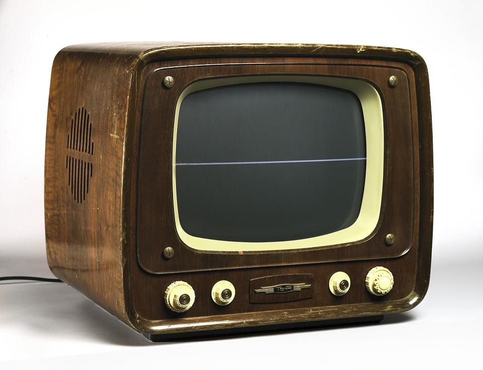
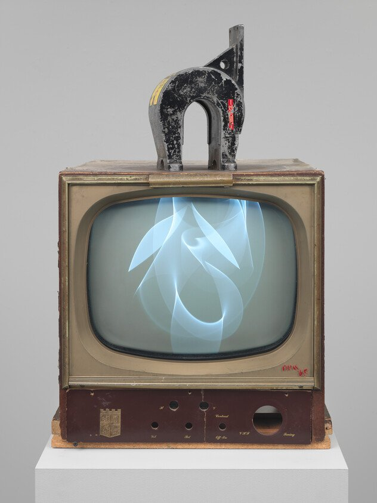
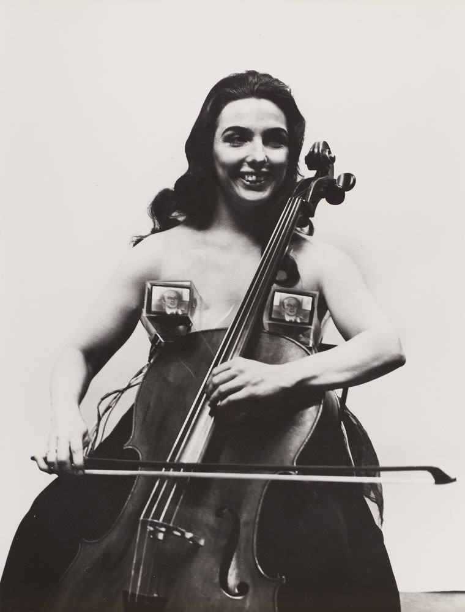
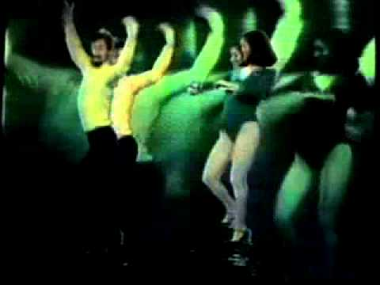
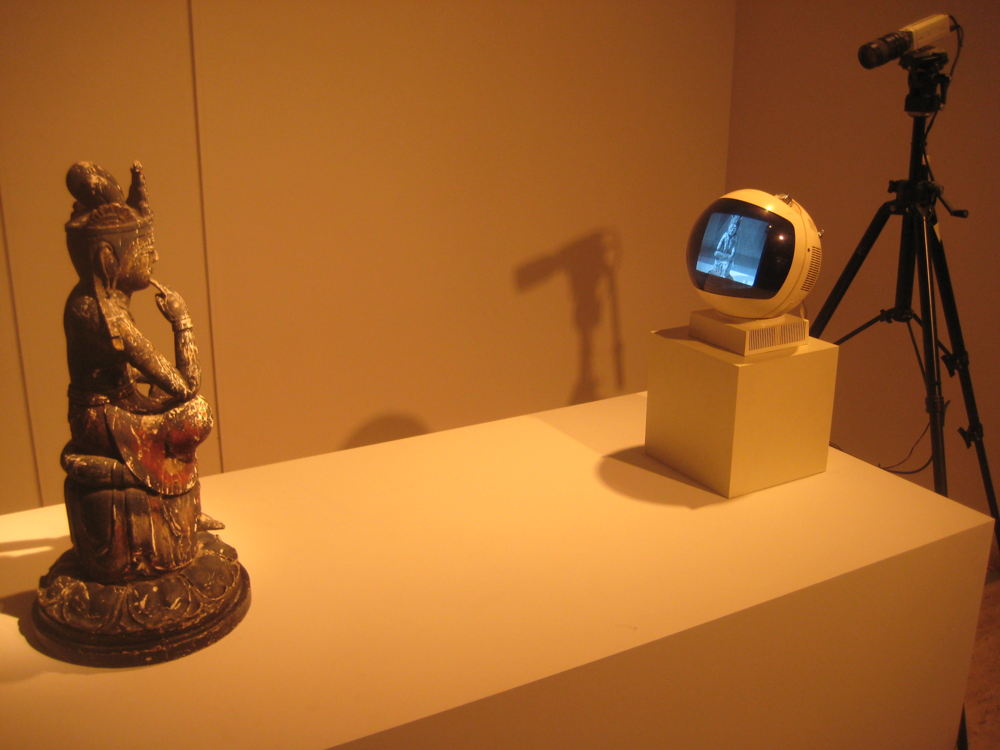
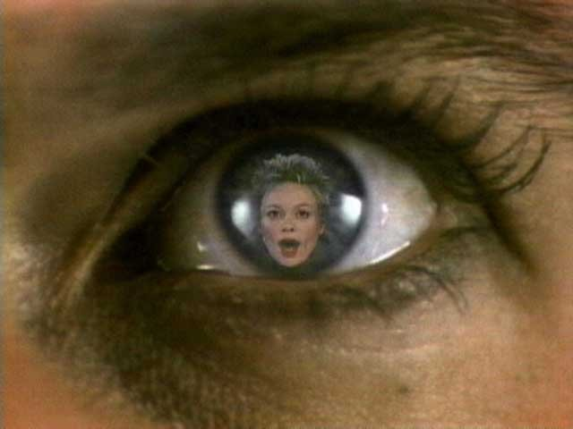
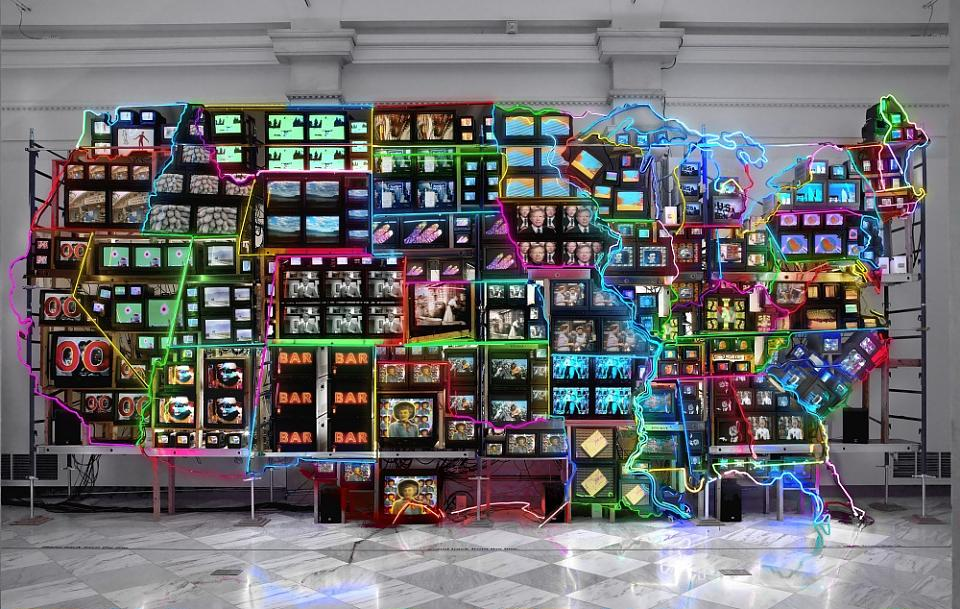

# Nam June Paik

**Tag tecnica/formato:** `video` `installazione`
**Tag tema:** `storia-computer-grafica` `sorveglianza-controllo`
**Stato:** dati da verificare: testo e data del necrologio del New York Times, anni di alcuni premi (UNESCO Picasso Medal 1988, Kaiserring 1991) · Approfondimenti aggiunti il 2026-11-01

## Biografia
Nato nel 1932 a Seoul, Corea, da una famiglia industriale benestante. Fugge dalla Corea nel 1950, all'inizio della guerra di Corea, prima a Hong Kong poi in Giappone. Studia estetica all'Università di Tokyo, laureandosi nel 1956 con una tesi su Arnold Schönberg. Si trasferisce poi in Germania per approfondire la composizione d'avanguardia: studia alle università di Monaco e Colonia e al Conservatorio di Musica di Friburgo. A Colonia lavora allo studio di musica elettronica della WDR, dove incontra John Cage e Karlheinz Stockhausen (circa 1958-63); nel 1961 conosce George Maciunas, fondatore di Fluxus, ed entra nel movimento neo-dada. Nel 1963 realizza la sua prima mostra personale, "Exposition of Music – Electronic Television", alla Galerie Parnass di Wuppertal, con televisori "preparati" (alterati fisicamente). Nel 1964 emigra negli Stati Uniti, stabilendosi a New York, dove vive e lavora per il resto della carriera, legato all'ambiente Fluxus/dell'avanguardia newyorkese. Nel 1996 un ictus lo lascia parzialmente paralizzato, ma continua a lavorare. Muore il 29 gennaio 2006 a Miami, Florida, a 73 anni. Riconoscimenti: Will Grohmann Prize (1981); borsa della Rockefeller Foundation; Maya Deren Award dell'American Film Institute; UNESCO Picasso Medal (1988); Kurt Schwitters Prize (1989); Kaiserring della città di Goslar (1991); Leone d'oro per il miglior padiglione nazionale alla Biennale di Venezia (1993, Padiglione tedesco); Ho-Am Prize (1995); Kyoto Prize (1998); Wilhelm Lehmbruck Prize (2001). Nel 2000 il Solomon R. Guggenheim Museum gli dedica la retrospettiva "The Worlds of Nam June Paik" (curata da John G. Hanhardt e Jon Ippolito), la prima retrospettiva statunitense dal 1982. Nel 2009 lo Smithsonian American Art Museum acquisisce l'intero archivio del suo lascito (oltre 200 videocassette, corrispondenza, robot, appunti di produzione), diventando il centro internazionale di riferimento per gli studi su Paik. Nel 2008 apre a Yongin, vicino Seoul, il Nam June Paik Art Center, pensato dallo stesso artista come propria sede istituzionale permanente.

## Poetica e ricerca
Paik è comunemente definito "padre della videoarte" — un'etichetta ampiamente adottata nella letteratura museale e giornalistica, non riconducibile a un singolo critico che l'abbia coniata per primo. Nella mostra del 1963 a Wuppertal tratta il televisore come materiale scultoreo da smontare, distorcere e riassemblare, e la televisione via etere come sistema politico/ideologico da sovvertire. Coniò il termine **"electronic super highway"** in un rapporto del 1974 commissionato dal programma artistico della Rockefeller Foundation, intitolato "Media Planning for the Post-Industrial Society": il rapporto prevedeva una "rete di comunicazione a banda larga" — televisione, video, audiocassette, telex, raccolta dati, satelliti continentali, microfiche, microonde private e, in seguito, fibra ottica su frequenza laser — un concetto retrospettivamente collegato, negli anni '90, all'emergente internet/World Wide Web. Charlotte Moorman, violoncellista dell'avanguardia americana, è la sua principale collaboratrice/performer dalla metà degli anni '60: insieme realizzano *TV Bra for Living Sculpture* (1969) e *TV Cello* (Everson Museum of Art, 1972); nel febbraio 1967 Moorman viene arrestata per atti osceni durante l'esecuzione dell'*Opera Sextronique* di Paik (performance al violoncello a seno nudo), e i due trascorrono una notte in carcere — un episodio spesso ridotto, nella copertura stampa dell'epoca, all'etichetta riduttiva di "la violoncellista topless", oggetto di una recente rivalutazione critica. La pratica del 1963 (*Zen for Head*, *Zen for Wind*, *Zen for TV*) fonde sensibilità zen-buddista e sciamanica coreana con la tecnologia elettronica occidentale; l'interesse condiviso con John Cage per lo zen (mediato dall'influenza di D.T. Suzuki su Cage) viene ripetutamente citato dagli studiosi come fondamento dell'estetica del caso, della ripetizione meditativa e della "distruzione degli stereotipi" in Paik. Il curatore John G. Hanhardt (curatore della mostra/catalogo del 1982 al Whitney Museum, poi curatore senior per i media arts allo Smithsonian) è la voce accademica principale citata per la lettura della fusione paikiana tra rappresentazione/realtà e sintesi tecnologia-spiritualità Est/Ovest.

## Opere principali

### Zen for TV (1963, poi rifabbricata nel 1981/1990)
**Descrizione:** un televisore fisicamente alterato/danneggiato in modo che il segnale trasmesso collassi in un'unica linea di luce verticale o orizzontale; Paik ruota l'apparecchio di 90 gradi, trasformando un ricevitore rotto in un oggetto scultoreo minimalista. Nato da un televisore che si era accidentalmente rotto durante il trasporto per la mostra di Wuppertal del 1963, un incidente che Paik accoglie e trasforma in titolo con riferimento alla concentrazione meditativa zen.
**Lettura critica:** i curatori dello Smithsonian la leggono come una trasformazione del malfunzionamento in meditazione — collegata direttamente all'estetica del caso influenzata da Cage e al minimalismo.

**Approfondimento:** [Smithsonian American Art Museum — Zen for TV](https://americanart.si.edu/artwork/zen-tv-76252)

### Random Access (1963)
**Descrizione:** presentata alla prima mostra personale di Paik, *Exposition of Music – Electronic Television* (Galerie Parnass, Wuppertal, marzo 1963): strisce di nastro magnetico fissate alla parete producevano suono quando venivano strofinate con una testina di lettura. Il visitatore ascoltava dal punto scelto, in modo casuale, invece che in sequenza come in una riproduzione meccanica: da qui il titolo.

**Approfondimento:** [Nam June Paik Art Center — Random Access nella mostra di Wuppertal](https://prenjpac-en.ggcf.kr/?p=1202)

### Magnet TV (1965)
**Descrizione:** presentata alla prima mostra personale di Paik negli Stati Uniti, *Nam June Paik: Cybernetic Arts and Music* (New School for Social Research, New York): il pubblico poteva modificare le immagini sullo schermo spostando un magnete. Secondo il Whitney, la sua interattività richiama il coinvolgimento del pubblico tipico della performance e degli happening dei primi anni Sessanta.

**Approfondimento:** [Whitney Museum — Magnet TV](https://whitney.org/collection/works/6139)

### TV Bra for Living Sculpture (1969, con Charlotte Moorman)
**Descrizione:** due piccoli tubi TV alloggiati in custodie di plexiglass, indossati come un reggiseno sul petto di Charlotte Moorman tramite cinghie di vinile/plastica trasparente, mentre esegue dal vivo musica per violoncello. Moorman può alterare le immagini trasmesse tramite un pedale o un magnete legato al polso, distorcendo l'immagine in tempo reale. Presentata per la prima volta alla Howard Wise Gallery, New York (maggio 1969), in parte come risposta al suo arresto per oscenità del 1967.
**Lettura critica:** letta come umanizzazione ed erotizzazione della tecnologia, che costringe la TV in una relazione ibrida con il corpo e la performance — punto di riferimento per il discorso sulla fusione corpo-tecnologia e per una lettura femminista/adiacente al femminismo della performance.

### Global Groove (1973)
**Descrizione:** video a canale singolo, colore e sonoro, 28 minuti e 30 secondi, prodotto al TV Lab di WNET Channel 13 dove Paik è artista residente, con John Godfrey. Un collage elettronico/"manifesto radicale sulla comunicazione globale", che monta pubblicità giapponesi, Charlotte Moorman al TV Cello con indosso la TV Bra, il volto di Richard Nixon distorto magneticamente, segmenti di "Participation TV", performance di John Cage, Merce Cunningham, Allen Ginsberg, con un uso intenso di sintesi video, colorazione e montaggio stratificato.
**Lettura critica:** Electronic Arts Intermix (distributore ufficiale) lo inquadra come profeticamente anticipatore di un futuro panorama televisivo saturo di media — ampiamente insegnato come il "manifesto fondativo" della videoarte.
**Video:** [Global Groove, film integrale (PBS American Masters)](https://www.pbssocal.org/shows/american-masters/special/global-groove-full-film)

### TV Buddha (1974, esistono più versioni)
**Descrizione:** scultura video a circuito chiuso: una statua antica del Buddha (Paik acquista una statua del XVIII secolo su Canal Street, New York) siede di fronte a un televisore; una telecamera sopra il televisore riprende dal vivo la statua e la ritrasmette sullo schermo che il Buddha guarda, così che la statua "osserva" perpetuamente la propria immagine in diretta. Realizzata per riempire uno spazio vuoto in una mostra del 1974 alla Galerie Bonino, New York.
**Lettura critica:** letta come meditazione su auto-riflessione, sorveglianza, cicli di feedback e il collasso della tradizione contemplativa orientale nei media elettronici occidentali — descritta dalla critica come anticipatrice della cultura del "selfie"/dell'auto-immagine a circuito chiuso.

### Good Morning, Mr. Orwell (1984)
**Descrizione:** trasmissione satellitare internazionale in diretta, andata in onda il 1° gennaio 1984, che collega WNET (New York) e il Centre Pompidou (Parigi), con collegamenti aggiuntivi a emittenti in Germania e Corea del Sud. Include performance di Laurie Anderson, Merce Cunningham, Peter Gabriel, Allen Ginsberg e altri; Paik progetta la grafica televisiva di collegamento e coordina il mix internazionale. Concepita esplicitamente come replica alla visione distopica della tecnologia-come-sorveglianza di George Orwell in *1984*. Raggiunge un pubblico stimato di oltre 25 milioni di spettatori nel mondo. Paik dichiara: "Non vedo il video come un medium dittatoriale, ma come uno liberatorio... un simbolo di come la televisione satellitare possa attraversare i confini internazionali e colmare enormi divari culturali."
**Lettura critica:** la realizzazione pratica del concetto di "electronic superhighway" — arte come telecomunicazione globale e democratizzata a due vie, non come controllo unidirezionale della trasmissione.

### Electronic Superhighway: Continental U.S., Alaska, Hawaii (1995)
**Descrizione:** grande scultura/installazione video — installazione a 51 canali (incluso un feed a circuito chiuso), elettronica personalizzata, tubi al neon, acciaio e legno; oltre 300 monitor televisivi e circa 50 lettori video/DVD disposti nella forma di una mappa degli Stati Uniti (circa 15x40x4 piedi). Ogni stato mostra clip video in loop che citano la cultura popolare/mitologia di quello stato (ad esempio *Il mago di Oz* per il Kansas), mentre il neon disegna la rete autostradale interstatale. In mostra permanente allo Smithsonian American Art Museum di Washington D.C. dal 2006.
**Lettura critica:** letta come visualizzazione della collisione tra il sistema autostradale interstatale di metà secolo, la televisione via cavo e l'internet emergente degli anni '90 in un unico sistema nervoso nazionale/elettronico — la realizzazione concreta del concetto di "electronic superhighway" coniato nel rapporto Rockefeller del 1974.

**Approfondimento:** [Smithsonian American Art Museum — Electronic Superhighway](https://americanart.si.edu/artwork/electronic-superhighway-continental-us-alaska-hawaii-71478)

### Video Synthesizer (Paik-Abe)
**Descrizione:** strumento per manipolare l'immagine video. In un'intervista via satellite con la ZDF, legata alla retrospettiva alla Kunsthalle di Brema (1999), Paik lo ha definito la sua opera più importante.

**Approfondimento:** [Nam June Paik Art Center](https://njpart.ggcf.kr/events/246)

## Approfondimenti
Materiale per la didattica, aggiunto il 2026-11-01. Le voci con link sono state lette sulla fonte, salvo dove è indicato il contrario.

### Parole dell'artista
- **Vita cibernata.** Nelle note *Cybernated Art* (pubblicate in *Manifestos*, Something Else Press, 1966; le fonti danno anche 1964 e 1965 per la stesura) Paik scrive che l'arte cibernata è importante, ma che l'arte per la vita cibernata lo è di più, e non deve per forza essere cibernata ([testo](https://elmcip.net/node/11264)).
- **Gli scritti.** *We Are in Open Circuits: Writings by Nam June Paik*, a cura di John G. Hanhardt, Gregory Zinman ed Edith Decker-Phillips (MIT Press), raccoglie i testi. Ryan Wong ne ricava la critica al consumo di immagini, cioè il pubblico che riceve pubblicità a cui non può rispondere, e il ricordo della televisione come intimità e insieme potere diseguale tra America e Corea ([Hyperallergic, 2019](https://hyperallergic.com/523659/why-is-television-dumb-and-other-musings-by-nam-june-paik/)).

### Letture critiche e concetti
- **«Padre della videoarte»: una formula da discutere.** A Wuppertal, nel 1963, il televisore diventa soggetto e oggetto dell'opera, ma Pavel Pyś mette Paik accanto a Wolf Vostell e ai suoi *Dé-coll/age*: due modi di togliere al televisore il ruolo di status e di veicolo passivo di ideologia, uno giocoso e uno distruttivo ([Walker Art Center, 2016](https://www.walkerart.org/reader/nam-june-paik-golden-age-television/)). C'è poi un'obiezione tecnica: quelle opere del 1963 sono televisori alterati, non video, perché il mezzo non era ancora accessibile agli artisti ([discussione su nettime, 2007](https://nettime.org/Lists-Archives/nettime-l-0701/msg00041.html); fonte non accademica).
- **Il mito del Portapak.** Si racconta che nel 1965 Paik abbia ripreso da un taxi il corteo del papa sulla Fifth Avenue con uno dei primi Portapak, mostrando le immagini la sera stessa: Rhizome lo definisce un racconto apocrifo, utile per capire il passaggio di una tecnologia ad arte, ma capace di oscurare figure meno note ([Rhizome, 2007](https://old.rhizome.org/editorial/2007/jan/29/a-moving-world)).
- **Il televisore come feedback (Joselit).** In *Feedback: Television Against Democracy* (MIT Press), David Joselit tratta Paik tra gli artisti che tentano di aprire il circuito chiuso della televisione privata. Una recensione riassume la tesi su Paik come rovesciamento del rapporto tra figura e sfondo nella visione televisiva ([recensione di Clark Buckner](https://clarkbuckner.com/?p=112)). *(Libro non letto.)*
- **Il consulente.** Sera Jung, recensendo una mostra sulle carte di Paik, sostiene che i rapporti per la Rockefeller Foundation lo mostrano come autore di politiche culturali, oltre che come artista ([Panorama](https://journalpanorama.org/article/the-consultant-paiks-papers/)).

### Per la didattica
- *TV Buddha* accanto a Rosalind Krauss, «Video: The Aesthetics of Narcissism» (1976): il circuito chiuso come specchio. L'accostamento è uno spunto da verificare sul testo, non una lettura data dalle fonti lette qui.
- *Good Morning, Mr. Orwell*: la televisione satellitare come risposta a Orwell, poi la lettura di Paglen e Blas sulla sorveglianza. Che cosa resta dell'ottimismo di Paik?
- *Electronic Superhighway* e il rapporto del 1974: una previsione o una proposta politica?

### Da leggere
Non letti in questa revisione: Martha Rosler, «Video: Shedding the Utopian Moment» (in *Illuminating Video*, Aperture, 1990), sul mito delle origini della videoarte: va controllato che cosa dica esattamente di Paik; Ina Blom, «The Autobiography of Video», *Critical Inquiry* 39, 2 (2013), pp. 276-95.

## Interviste e talk
- **Video:** [MoMA, walkthrough di *Zen for TV* (YouTube)](https://www.youtube.com/watch?v=-_EGwhZ64LQ)
- [Smithsonian American Art Museum — archivio Paik](https://americanart.si.edu/research/paik): oltre 200 videocassette e trascrizioni di interviste, tra cui una a Dick Higgins.
- [*Nam June Paik: Moon Is the Oldest TV* (2023), documentario di Amanda Kim — recensione BFI](https://www.bfi.org.uk/sight-and-sound/reviews/nam-june-paik-moon-oldest-tv-thoughtful-celebration-video-art-pioneer)
- [EAI — *Nam June Paik: Edited for Television*: intervista di Calvin Tomkins](https://eai.org/titles/nam-june-paik-edited-for-television)
- [Nicholas Zurbrugg — «Nam June Paik: An Interview»](https://journals.uc.edu/index.php/vl/article/view/5619)
- *Nam June Paik – Das Gute Gewissen der Avantgarde* (WDR, 1977) e *Nam June Paik: Lessons from the Video Master* (Skip Blumberg, 2006, 48 minuti): documentari biografici da cercare.
- [Nam June Paik Art Center — filmati d'archivio, tra cui l'intervista via satellite con ZDF (1999)](https://njpart.ggcf.kr/events/246)

## Fonti
- [Smithsonian American Art Museum — biografia e archivio Paik](https://americanart.si.edu/research/paik/biography)
- [Smithsonian American Art Museum — Electronic Superhighway: Continental U.S., Alaska, Hawaii](https://americanart.si.edu/artwork/electronic-superhighway-continental-us-alaska-hawaii-71478)
- [MoMA — Global Groove, collezione](https://www.moma.org/collection/works/107679)
- [MoMA — Good Morning, Mr. Orwell, collezione](https://www.moma.org/collection/works/122336)
- [Guggenheim Museum — retrospettiva "The Worlds of Nam June Paik" (2000)](https://www.guggenheim.org/exhibition/the-worlds-of-nam-june-paik-2)
- [Tate — pagina artista e retrospettiva 2018-19](https://www.tate.org.uk/art/artists/nam-june-paik-6380)
- [Panorama (Terra Foundation for American Art) — "The Consultant: Paik's Papers, 1968-1979"](https://journalpanorama.org/article/the-consultant-paiks-papers/)
- [Asia Society — su Good Morning, Mr. Orwell](https://asiasociety.org/blog/asia/good-morning-mr-orwell-look-back-nam-june-paik-video-greeted-1984)
- [MIT Press Reader — su TV Bra for Living Sculpture](https://thereader.mitpress.mit.edu/its-very-likely-you-wont-be-electrocuted-on-charlotte-moorman-and-nam-june-paiks-tv-bra/)
- [Smarthistory — saggio su Electronic Superhighway](https://smarthistory.org/nam-june-paik-electronic-superhighway-continental-u-s-alaska-hawaii/)
- [Electronic Arts Intermix — biografia](https://www.eai.org/artists/nam-june-paik/biography)

## Crediti delle immagini
Immagini incluse sotto la relativa descrizione in "Opere principali", da Smithsonian American Art Museum, M+ Museum, Wikipedia e YouTube.
- [Smithsonian American Art Museum — biografia e archivio Paik](https://americanart.si.edu/research/paik/biography)
- [Smithsonian American Art Museum — Electronic Superhighway: Continental U.S., Alaska, Hawaii](https://americanart.si.edu/artwork/electronic-superhighway-continental-us-alaska-hawaii-71478)
- [MoMA — Global Groove, collezione](https://www.moma.org/collection/works/107679)
- *Magnet TV*: immagine dalla pagina [whitney.org](https://whitney.org/collection/works/6139); diritti dei rispettivi titolari, uso didattico.
- *Good Morning, Mr. Orwell*: immagine dalla pagina [asiasociety.org](https://asiasociety.org/blog/asia/good-morning-mr-orwell-look-back-nam-june-paik-video-greeted-1984); diritti dei rispettivi titolari, uso didattico.
