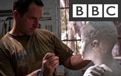
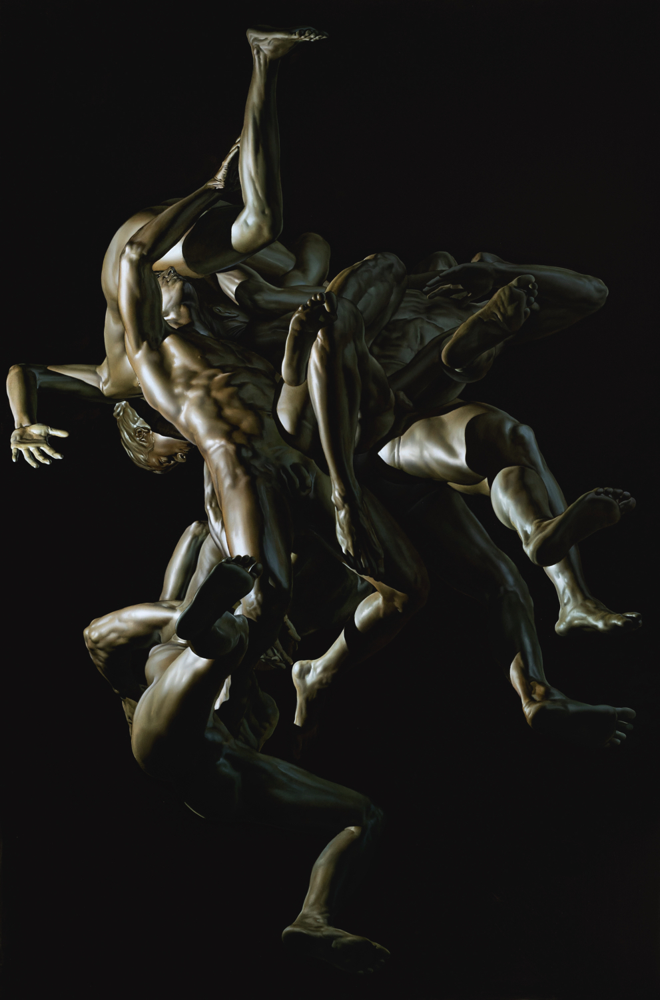
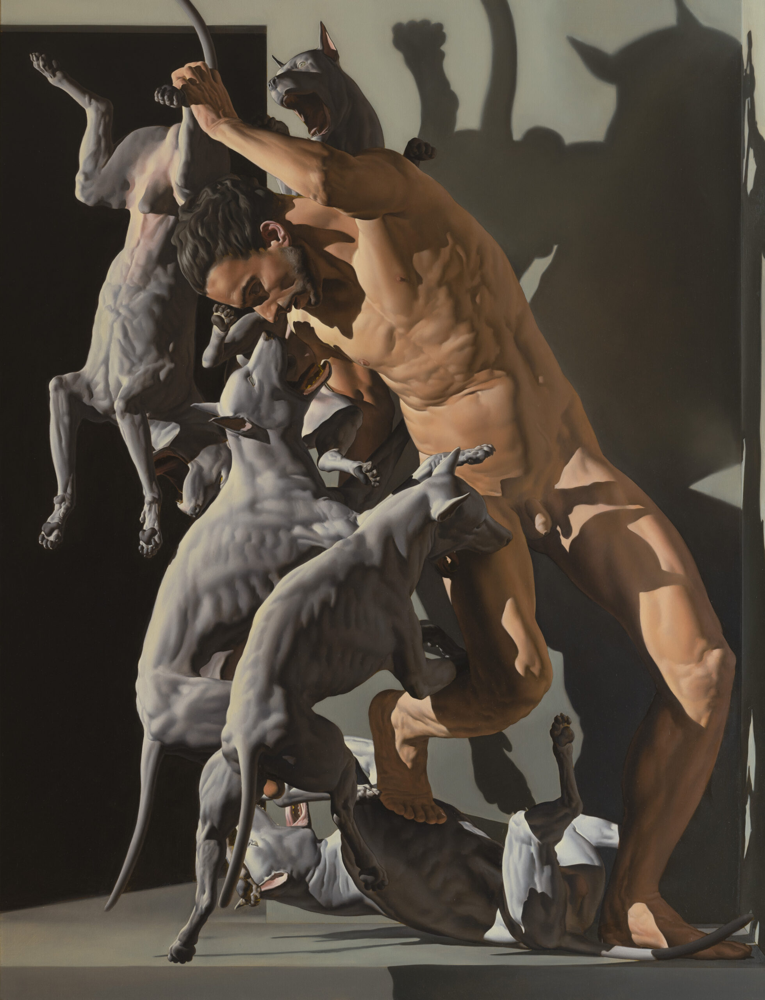

# Nicola Verlato

**Tag tecnica/formato:** `modellazione-3d`
**Tag tema:** `storia-computer-grafica` `game-culture`

## Biografia
Nato il 19 febbraio 1965 a Verona. Inizia a dipingere da giovanissimo, formandosi con Fra' Terenzio, pittore nel convento dei frati francescani di Lonigo; studia musica classica (liuto e composizione) ai conservatori di Verona e Padova, e architettura allo IUAV di Venezia (1984-1990, senza laurearsi). Nel 2004 si trasferisce da Milano a New York, dove insegna composizione e pittura alla New York Academy of Art; dal 2011 vive e lavora a Los Angeles. Ha esposto, tra le altre sedi, a White Columns (New York), al Museum of Modern Art di Arnhem, alla Biennale di Praga, e con un'installazione di dipinti e sculture al Padiglione Italia della 53ª Biennale di Venezia (2009, mostra "Collaudi", a cura di Beatrice Buscaroli e Luca Beatrice) — opere basate su un modello tridimensionale del volto di James Dean, realizzato con software 3D. Nel 2020 tiene la sua prima personale alla Postmasters Gallery di New York ("The Merging: beyond the end"), storica galleria newyorchese/romana con un programma di lunga data dedicato ad arte e nuove tecnologie. È rappresentato da Postmasters Gallery (New York-Roma), Poulsen Gallery (Copenhagen), Isabel Croxatto Gallery (Santiago del Cile) e Galleria Giovanni Bonelli (Milano). Ha scritto un saggio per il volume "The Figure" (Rizzoli, USA) sul rapporto tra prospettiva geometrica e democrazia, dall'antica Grecia all'era dei videogiochi.

## Poetica e ricerca
Verlato costruisce le proprie opere attraverso un processo che ibrida tecniche pittoriche classiche — un manierismo iperrealista debitore del barocco italiano del Seicento, con effetti di luce spettacolari, nudi contorti e composizioni dense — e strumenti di modellazione 3D contemporanei come Maya e ZBrush, con cui costruisce corpi e volti per verificarne la corretta disposizione nello spazio e gli effetti di chiaroscuro prima di trasferirli su tela o in scultura. Il nucleo teorico esplicito della sua ricerca, formulato dall'artista stesso, è la continuità storica tra la costruzione prospettica rinascimentale e il wireframe tridimensionale dei videogiochi e del cinema CGI contemporaneo: un aneddoto spesso citato dall'artista racconta come, vedendo nel 1982 un fotogramma del film Tron su una rivista, abbia riconosciuto un'coincidenza assoluta tra i wireframe dei modelli 3D del film e i disegni prospettici di Piero della Francesca e Paolo Uccello. Da qui la formula critica coniata dallo stesso Verlato per definire la propria estetica, "la metafisica dell'ovvio": un iperrealismo manierista che attinge insieme a pop art, fumetto, videogioco e storia dell'arte antica, trattando la modellazione digitale non come scorciatoia tecnica ma come lo stadio più recente di una storia secolare della rappresentazione prospettica dello spazio e del corpo.

## Opere principali

### Il Duce (2009, ciclo per il Padiglione Italia, Biennale di Venezia)
**Descrizione:** dipinti e sculture realizzati a partire da un modello 3D del volto di James Dean, presentati nell'installazione del Padiglione Italia alla 53ª Biennale di Venezia 2009 ("Collaudi", a cura di Beatrice Buscaroli e Luca Beatrice).
**Lettura critica:** tra le prime opere dell'artista a rendere esplicito, in un contesto istituzionale di primo piano, il passaggio dal modello digitale tridimensionale all'opera pittorica/scultorea finita — un processo che diventerà la cifra stabile della sua ricerca successiva.

### The Merging: beyond the end (2020, mostra personale, Postmasters Gallery, New York)
**Descrizione:** prima personale dell'artista alla Postmasters Gallery di New York (19 settembre-31 ottobre 2020), storica galleria con un programma dedicato da decenni al rapporto tra arte e nuove tecnologie (tra i primi spazi commerciali statunitensi a esporre net art).
**Lettura critica:** colloca esplicitamente la ricerca pittorica di Verlato — apparentemente distante, in superficie, dai linguaggi "nativi digitali" — all'interno del discorso critico sulle nuove tecnologie applicate all'arte, per via del processo di modellazione 3D che la sottende.

**Approfondimento:** [Postmasters Gallery — The Merging: beyond the end](https://www.postmastersart.com/archive/verlato20/verlato20.html)

### Myth Generation (2024-2025, mostra personale, Museo di San Domenico, Imola)
**Descrizione:** mostra personale a Imola Musei (Museo di San Domenico) che comprende, tra gli altri nuclei, un ciclo dedicato a Pier Paolo Pasolini e a icone pop come James Dean, riletti attraverso il metodo ibrido pittura/modellazione 3D dell'artista.
**Lettura critica:** applica il metodo della "metafisica dell'ovvio" — corpo modellato digitalmente, poi reso in pittura iperrealista di ascendenza barocca — a figure della cultura italiana del Novecento, portando la ricerca dell'artista a confrontarsi con l'iconografia nazionale.

**Approfondimento:** [Imola Musei — Myth Generation](https://imolamusei.it/mostre/nicola-verlato-myth-generation/)

## Immagini
Immagine per ciascuna delle tre opere, inclusa sotto la relativa descrizione in "Opere principali", da Jonathan Levine Projects, Postmasters Gallery e Imola Musei.
- [Sito ufficiale dell'artista](https://www.nicolaverlato.com/)
- [Galleria Giovanni Bonelli, Milano — pagina artista](https://www.galleriagiovannibonelli.com/artista/nicola-verlato/)
- [Postmasters Gallery — The Merging: beyond the end (2020)](https://www.postmastersart.com/archive/verlato20/verlato20.html)
- [Imola Musei — Myth Generation](https://imolamusei.it/mostre/nicola-verlato-myth-generation/)

## Fonti
- [Sito ufficiale dell'artista — Bio](https://www.nicolaverlato.com/bio)
- [Galleria Giovanni Bonelli, Milano — pagina artista](https://www.galleriagiovannibonelli.com/artista/nicola-verlato/)
- [Postmasters Gallery — The Merging: beyond the end (2020)](https://www.postmastersart.com/archive/verlato20/verlato20.html)
- [Artsy — Nicola Verlato: The Merging, beyond the end, Postmasters Gallery](https://www.artsy.net/show/postmasters-gallery-nicola-verlato-the-merging-beyond-the-end)
- [Ministero della Cultura — Direzione Generale Creatività Contemporanea, Padiglione Italia Biennale Arte 2009](https://creativitacontemporanea.cultura.gov.it/padiglioneitalia2009-biennalearte/)
- [Artribune — Nicola Verlato, tra pittura e tecnologia](https://www.artribune.com/professioni-e-professionisti/who-is-who/2016/11/nicola-verlato-discorsi-sulla-pittura-tra-manierismo-e-videogame-tecnologia-losangeles/)
- [Artribune — L'artista Nicola Verlato in mostra a Imola Musei](https://www.artribune.com/arti-visive/arte-contemporanea/2025/01/nicola-versato-mostra-imola-musei/)
- [Imola Musei — Myth Generation](https://imolamusei.it/mostre/nicola-verlato-myth-generation/)
- [Espoarte — Nicola Verlato, Recent Highlights in Galleria Bonelli](https://www.espoarte.net/arte/nicola-verlato-recent-highlights-in-galleria-bonelli/)

---

## Appunti da organizzare
- Scheda scritta il 19 agosto 2026, ricerca sulla scena italiana (angolo gallerie/critica/accademia, non festival). Nota sul metodo: WebFetch bloccato in sandbox — contenuti da snippet WebSearch, da riverificare prima di uso didattico.
- Caso limite rispetto al taglio del database: l'output finale dell'artista è quasi sempre un dipinto su tela o una scultura fisica (non un'opera "nativa digitale"), con la modellazione 3D usata come fase intermedia del processo. Incluso perché il taglio critico esplicito dell'artista è proprio la storia della computer grafica e il suo rapporto con la storia della rappresentazione prospettica — coerente con l'ambito "3D modelling/execution ... a livello concettuale/critico" del database, ma da ridiscutere se il criterio di selezione si volesse restringere solo a opere il cui output rimane digitale.
- Il vocabolario tag attuale (`contenuti/tags.md`) non ha una voce dedicata per "pittura/scultura fisica derivata da modello digitale": per questa scheda si è scelto di limitare i tag tecnica/formato al solo `modellazione-3d`, il più accurato per il processo, senza forzare `stampa-3d-scultura` (che implica letteralmente la stampa 3D, tecnica diversa dalla scultura tradizionale in bronzo/marmo/resina usata da Verlato). Da valutare se proporre un tag nuovo (es. "pittura-scultura-da-modello-3d") qualora emergano altri casi simili nel database.
