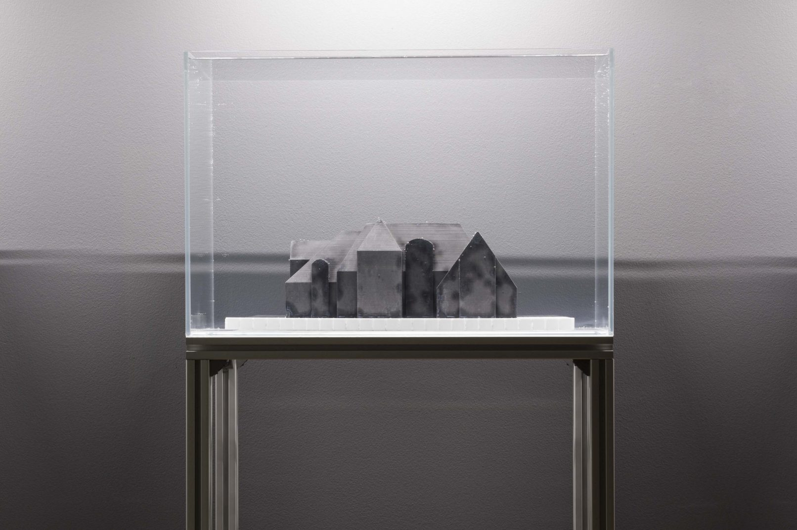
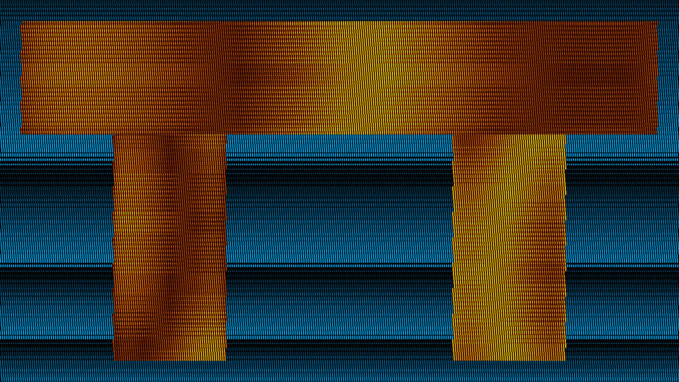
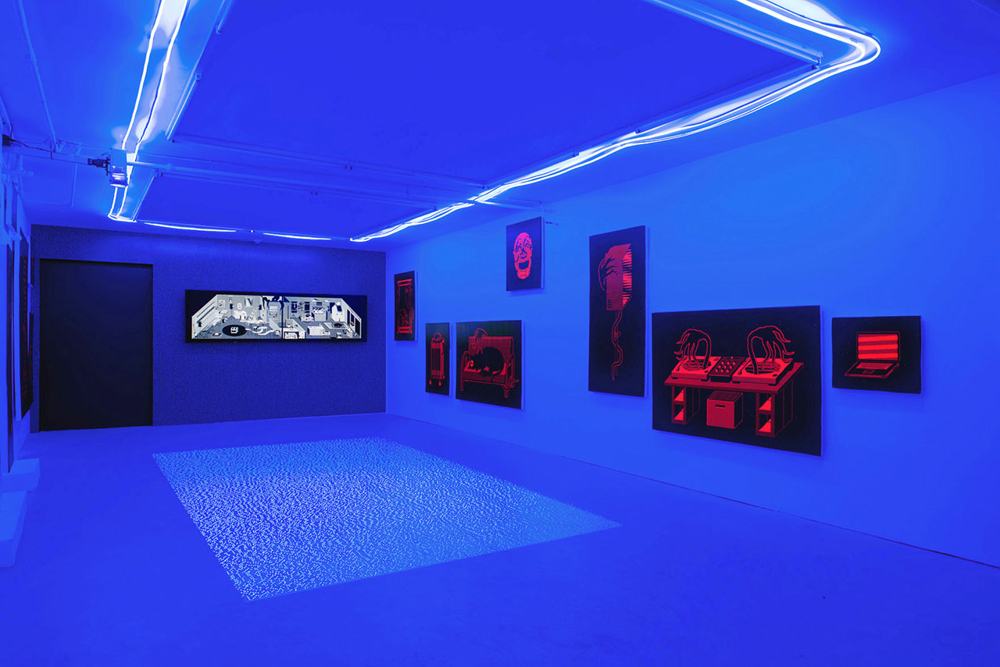
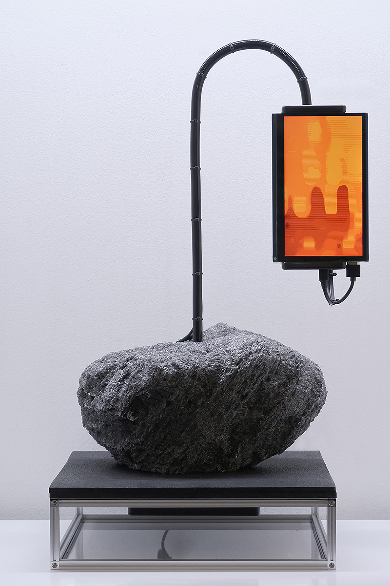

# Nicolas Sassoon

**Tag tecnica/formato:** `procedurale-generativo` `installazione` `fotogrammetria-scansione`
**Tag tema:** `ecologia-ambiente` `mondi-virtuali-simulazione`

## Biografia
Artista con base a Vancouver, BC (Canada). Fondatore del collettivo W-A-L-L-P-A-P-E-R-S.

## Poetica e ricerca
Sassoon usa tecniche di imaging computerizzato "primitive" (pattern pixelati, moiré) per rendere architetture, paesaggi e forze naturali attraverso animazioni digitali, installazioni, stampe e sculture. La sua pratica traduce idee di materialità e immaterialità in immagine digitale, esplorando le dimensioni contemplative e proiettive dello spazio basato su schermo — e come l'immagine digitale possa esprimere dimensioni del reale fisico. Anche se gran parte del suo output è pubblicato online, Sassoon materializza costantemente la sua pratica web-based in un'ampia gamma di media fisici, spesso in collaborazioni cross-disciplinari (architettura, musica elettronica, tessile).

## Opere principali

### MANSIONS (2013)
**Descrizione:** collezione di modelli 3D di dimore di lusso trovate online (create da utenti anonimi), fuse in calcestruzzo, acquari, LED, alluminio.
**Lettura critica:** "le tecnologie informatiche sono un vettore di fantasie per architetture, paesaggi, interni, vita domestica" (Sassoon) — oggetti in uno stato transitorio tra dato e concreto, che significano qualcosa di più grande di ciò che sono.

**Approfondimento:** [WAAP — Nicolas Sassoon: Dream Homes](https://www.waapart.com/portfolio/nicolas-sassoon-dream-homes/)

### STRUCTURES
**Descrizione:** cinque animazioni digitali in 4K di studi architettonici, con tecnica di pattern moiré, composizioni di forme geometriche fluttuanti nello spazio.
**Lettura critica:** forme digitali sempre in stato transitorio tra reale e finzione, virtuale e fisico, utopia e distopia — architetture immaginarie mai pensate per essere costruite, esistenti su un proprio piano come forme liminali.

### Index, Avenue, Skylight
**Descrizione:** rievoca tre venue della scena underground artistica e musicale di Vancouver, attive tra il 2014 e il 2016, tradotte in pattern pixelati, moiré digitali e prospettiva isometrica.
**Lettura critica:** visualizzazioni soggettive a metà tra ricordo e immaginazione, che rendono visibili le forze invisibili che attraversavano quegli spazi comunitari.

**Approfondimento:** [nicolassassoon.com — Index, Avenue, Skylight](https://nicolassassoon.com/INDEXAVENUESKYLIGHT.html)

### THE PROPHETS (2019)
**Descrizione:** animazione digitale, rocce laviche, pannelli LCD, media player, alluminio.
**Lettura critica:** una "geologia speculativa" della condizione digitale — senza i materiali estratti dalle profondità geologiche, le nostre tecnologie di vita in rete cesserebbero di funzionare; le rocce come media e forze viventi che comunicano attraverso il tempo.

**Approfondimento:** [nicolassassoon.com — THE PROPHETS](https://www.nicolassassoon.com/PROPHETS_SCULPTURE.html)

### SIGNALS / CORES (con Rick Silva)
**Descrizione:** progetto collaborativo di video-installazioni 3D su paesaggi oceanici e geologici alterati, con rocce scansionate in 3D (CORES).
**Lettura critica:** riflessione su contaminazione, mutazione ed ecologie future a partire da survey oceanografici, studi climatici e fantascienza.

**Approfondimento:** [s-i-g-n-a-l-s.com](https://s-i-g-n-a-l-s.com/)

## Immagini

Immagine per ciascuna delle cinque opere, inclusa sotto la relativa descrizione in "Opere principali", dal sito ufficiale dell'artista, WAAP e s-i-g-n-a-l-s.com.
- [nicolassassoon.com](https://www.nicolassassoon.com)
- [MANSIONS](https://www.nicolassassoon.com/MANSIONS.html)
- [STRUCTURES](https://www.nicolassassoon.com/STRUCTURES.html)

## Fonti
- [nicolassassoon.com](https://www.nicolassassoon.com)
- [MANSIONS](https://www.nicolassassoon.com/MANSIONS.html)
- [STRUCTURES](https://www.nicolassassoon.com/STRUCTURES.html)
- [THE PROPHETS](https://www.nicolassassoon.com/PROPHETS_SCULPTURE.html)
- [SIGNALS (con Rick Silva)](https://s-i-g-n-a-l-s.com/videoworks)
- [Intervista — Outland](https://outland.art/nicolas-sassoon-studio-visit/)

---

## Appunti da organizzare
- Fonte: scheda REF originale su Drive. Nome scritto "Nicolas Sasson" nella cartella Drive — corretto in **Nicolas Sassoon**, grafia corretta.
- Collaborazione ricorrente con **Rick Silva** (già presente come scheda a sé) su SIGNALS/CORES — le due schede si richiamano a vicenda.
