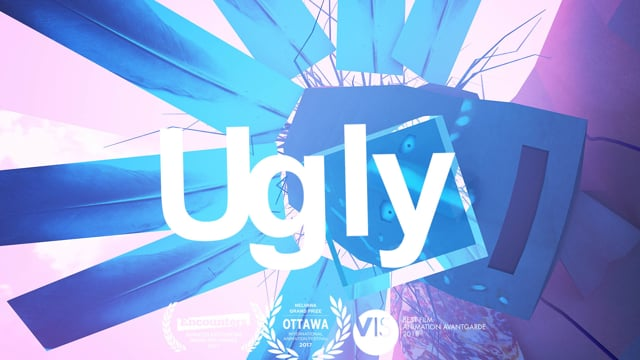
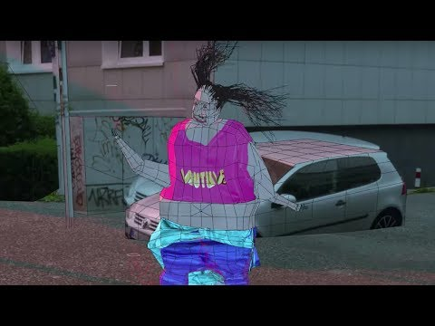
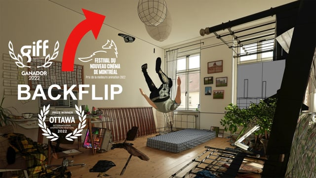

# Nikita Diakur

**Tag tecnica/formato:** `modellazione-3d` `procedurale-generativo` `ai-generativa`
**Tag tema:** `corpo-identita` `storia-computer-grafica`
**Tag corso:** `TAD` `M3D`

## Biografia
Nato a Mosca, Russia (anno di nascita non reperibile con fonte diretta). Si forma interamente a Londra: Foundation Diploma in Art & Design alla Wimbledon School of Art (2003-2004); BA (Hons) in Graphic Design, indirizzo Moving Image, alla Central Saint Martins (2004-2007); MA in Animation Direction al Royal College of Art (2007-2009), con il film di diploma *Fly on the Window*, proiettato a Zagabria, Annecy ed Edimburgo. Vive e lavora in Germania (le fonti divergono tra Mainz e Lipsia — da verificare). Si definisce "regista dell'ugly" (Ugly filmmaker). Artista in residenza al Q21/MuseumsQuartier di Vienna (2018). Tiene regolarmente talk e workshop a festival e università (Playgrounds, Forward Festival, Pictoplasma Conference Berlino, In Motion Londra). Riconoscimenti: Nelvana Grand Prize per il miglior corto d'animazione indipendente, Ottawa International Animation Festival (OIAF) 2017; Grand Prix, Animated Encounters Bristol 2017; New Talent Award, Fantoche; menzione d'onore, Prix Ars Electronica; Best Technique, OIAF 2018; Anča Award, Fest Anča International Animation Festival 2019.

⚠️ Correzione importante: *Zoon* (2021) **non** è un film di Nikita Diakur — è diretto da Jonatan Schwenk, regista tedesco diverso, con tecniche di stop-motion/pupazzi (assolotl in plastilina + bipedi animati con burattini), presentato in anteprima al Sundance 2022. Non attribuirlo a Diakur.

## Poetica e ricerca
La cifra distintiva di Diakur è l'**"animazione interattiva"** (termine coniato dallo stesso artista), definita dalla critica anche "Ugly Dynamics": invece di animare a mano fotogramma per fotogramma il movimento dei personaggi, costruisce rig fisici a corpo rigido/morbido in una pipeline CG (basata su Blender), collega i personaggi a scheletri da "pupazzo di pezza" tramite vincoli elastici a molla ("fili") che ne impediscono il collasso totale, e lascia poi che una simulazione fisica generi il movimento — accettando i glitch, i tremolii e i "guasti" risultanti come estetica finale, invece di correggerli. Descrive questo processo come una rinuncia al controllo registico a favore dei calcoli propri del computer, producendo risultati imprevedibili, spontanei, spesso grotteschi. *It's Nice That* (Jenny Brewer) descrive il lavoro come "uno studio grezzo sulla simulazione dinamica computerizzata"; *Engadget* lo inquadra come un cortometraggio "costruito su simulazioni piene di glitch", dove i "bug" diventano deliberatamente una caratteristica estetica, non un difetto da correggere. La critica Federica Giampaolo, in un'intervista per Zippy Frames/GoCritic! intitolata "The Art of Unpredictability", descrive Diakur come qualcuno che "cura le condizioni per l'emergenza" invece di coreografare il movimento, discutendo il suo interesse per l'imprevedibilità generata dalla macchina come metodo artistico. *Short of the Week*, recensendo sia *Ugly* sia *Backflip*, sottolinea come l'uso della simulazione/machine learning da parte dell'artista non sia mai "un espediente facile", ma porti sempre un peso tematico (ambizione, fallimento, controllo contro caso).

## Opere principali

### Ugly (2017, con Redbear Easterman)
**Descrizione:** cortometraggio 3D finanziato tramite crowdfunding (Kickstarter, 206 sostenitori) su un gatto maltrattato e "brutto" (ispirato a una storia reale circolata su internet) che trova accettazione presso un mistico capo nativo americano in un mondo frammentato e pieno di glitch. Costruito quasi interamente da simulazione dinamica a corpo rigido: i personaggi sono rigati come scheletri da pupazzo di pezza con "fili" a vincolo elastico che tengono insieme gli arti, producendo un movimento iperrealistico ma costantemente vacillante e "rotto".
**Lettura critica:** vince il Nelvana Grand Prize per il miglior corto d'animazione indipendente all'Ottawa International Animation Festival 2017, il Grand Prix di Animated Encounters Bristol, il New Talent Award di Fantoche e una menzione d'onore al Prix Ars Electronica — descritto come l'apertura di "una nuova frontiera" per l'animazione CG proprio nell'abbracciare la casualità simulata invece di sopprimerla.
**Video:** [Ugly, film integrale (Vimeo)](https://vimeo.com/281529369)

### Fest (2018)
**Descrizione:** cortometraggio di 3 minuti che raffigura una scena caotica di rave/festa di quartiere in un complesso residenziale grigio in stile "Ostblock" — barbecue, gelati, figure danzanti — costruito ancora una volta con simulazione dinamica/burattinaggio digitale, estendendo il metodo di *Ugly* alla coreografia di gruppo/folla, senza dialogo. Suono e musica di David Kamp (Studio Kamp). Selezione ufficiale ad Annecy (2018), Animafest Zagabria, Fantoche e L'Alternativa (Barcellona).
**Lettura critica:** la giuria dell'OIAF lo ha premiato "per aver trasformato l'animazione 3D in un teatro di burattini in cui personaggi brutti e posseduti si dissolvono la vita al rave" — vince il Best Technique all'OIAF 2018 e l'Anča Award al Fest Anča 2019.

### Backflip (2022)
**Descrizione:** cortometraggio di 12 minuti e 30 secondi (co-produzione Germania/Francia con Miyu Productions). Premessa: troppo spaventato per tentare davvero un salto mortale all'indietro, Diakur crea un avatar digitale e lo addestra a eseguire l'acrobazia usando tecniche di apprendimento per rinforzo/machine learning (derivate dal paper di ricerca "DeepMimic"), lasciando che l'avatar "si eserciti" tramite tentativi ed errori simulati su un processore multi-core. Combina l'estetica basata sulla simulazione dell'artista con un processo esplicito di machine learning come soggetto stesso dell'opera, e un dispositivo autobiografico (la paura reale dell'artista per l'acrobazia).
**Lettura critica:** *Short of the Week* sottolinea come Diakur usi il machine learning "non come un espediente facile" ma per esplorare ambizione, paura, il desiderio di controllo contro l'accettazione dell'incertezza, e il cambiamento tecnologico. Selezione ufficiale al Festival di Annecy 2022, al Toronto International Film Festival e all'Ottawa International Animation Festival 2022 (nota della giuria: "Sperimentando con un design concettuale che va oltre le aspettative tradizionali dell'animazione... ha messo in discussione le nostre percezioni sulla senzienza").
**Video:** [Backflip, documentazione (Vimeo)](https://vimeo.com/868805980)

## Immagini

Immagine per ciascuna delle tre opere, inclusa sotto la relativa descrizione in "Opere principali", da Vimeo e YouTube.
- [Ottawa International Animation Festival — vincitori 2017 (Animation World Network)](https://www.awn.com/news/nikita-diakurs-ugly-masaaki-yuasas-night-short-walk-girl-win-grand-prizes-oiaf-2017)
- [It's Nice That — su Ugly](https://www.itsnicethat.com/articles/nikita-diakurs-ugly-animation-010518)
- [Engadget — su Ugly](https://www.engadget.com/2018-08-17-ugly-nikita-diakur-animation-dynamic-simulation.html)

## Fonti
- [Vimeo — canale ufficiale dell'artista](https://vimeo.com/nikitadiakur)
- [Ottawa International Animation Festival — vincitori 2017 (Animation World Network)](https://www.awn.com/news/nikita-diakurs-ugly-masaaki-yuasas-night-short-walk-girl-win-grand-prizes-oiaf-2017)
- [It's Nice That — su Ugly](https://www.itsnicethat.com/articles/nikita-diakurs-ugly-animation-010518)
- [Engadget — su Ugly](https://www.engadget.com/2018-08-17-ugly-nikita-diakur-animation-dynamic-simulation.html)
- [Short of the Week — su Ugly](https://www.shortoftheweek.com/2018/07/27/ugly/)
- [Short of the Week — su Backflip](https://www.shortoftheweek.com/2023/12/29/backflip/)
- [Zippy Frames/GoCritic! — intervista "The Art of Unpredictability"](https://www.zippyframes.com/interviews/nikita-diakur-interview-fest-anca-go-critic)
- [Miyu Productions — pagina di Backflip](https://www.miyu.fr/production/en/backflip-en/)
- [Festival di Annecy — selezione ufficiale Backflip 2022](https://www.annecyfestival.com/about/archives:en/2022:en/official-selection/film-index:film-20221899)
- [Fest Anča — Anča Award 2019 a Fest](https://www.festanca.sk/en/anca-award-2019-goes-to-nikita-diakurs-fest/)

---

## Appunti da organizzare
- Non citato in un programma specifico dei corsi — inserito dalla lista generale "da scrivere da zero" per la rilevanza nell'ambito dell'animazione procedurale/fisica simulata.
- ⚠️ Correzioni e verifiche necessarie: *Zoon* (2021) non è un suo film (vedi sopra, è di Jonatan Schwenk); città di residenza attuale non certa (Mainz o Lipsia, a seconda della fonte); anno di nascita non reperibile; nessuna partecipazione confermata al Sundance Film Festival per un film di Diakur (Sundance 2022 è invece confermato per "Zoon" di Schwenk — da non confondere).
- Lavori recenti in ambito galleria/NFT (dal 2020 circa): pezzi più brevi basati su simulazione mostrati su piattaforme di arte digitale/cripto (fellowship.xyz, daily.xyz, Verse.works, SOLOS gallery) — un circuito espositivo diverso da quello dei festival (Annecy/Ottawa), da segnalare come contesto ulteriore ma con cautela critica.
- Video ulteriori: [Fest, presentato da Adult Swim (YouTube)](https://www.youtube.com/watch?v=Q2VMWR8xlls); [intervista su Backflip (YouTube)](https://www.youtube.com/watch?v=56fqmI--T0I).
