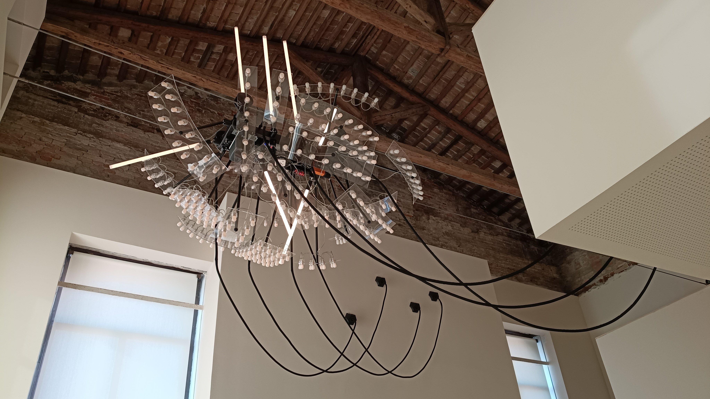

# Philippe Parreno

**Tag tecnica/formato:** `installazione` `procedurale-generativo`
**Tag tema:** `mondi-virtuali-simulazione` `temporalita-non-lineare`

## Biografia
Artista nato nel 1964 in Algeria.

## Poetica e ricerca
Parreno concepisce la mostra stessa come una "partitura vivente" — un'orchestrazione di durata, attenzione e contingenza, dove le opere non sono oggetti fissi ma eventi che si dispiegano nel tempo, spesso reagendo in tempo reale a dati ambientali reali (meteo, maree, presenza del pubblico).

## Opere principali

### The Diambulist Humself (2026, Strange Rules, Palazzo Diedo, Venezia — opera site-specific permanente)
**Descrizione:** scultura mobile che scorre lungo due cavi elettrificati tesi in alto attraverso la sala, trasportando lampadine LED e neon a intensità variabile. Il comportamento non è programmato: una rete di sensori legge in tempo reale l'ambiente interno ed esterno, traducendo dati fisici (maree, pressione atmosferica, umidità) in movimento e luce; a Venezia un calo di pressione (spesso preludio all'acqua alta) rallenta la scultura.
**Lettura critica:** l'opera non rappresenta Venezia — respira la stessa aria, è soggetta alle stesse pressioni, abita lo stesso tempo: un'estensione della ricerca di Parreno sulla mostra come organismo vivente più che come sequenza di oggetti da contemplare. (Testo di sala, mostra "Strange Rules", Palazzo Diedo, Venezia.)

## Immagini

## Fonti
- Testo di sala, "Strange Rules", Palazzo Diedo, Venezia (foto scattata dal docente, 9 agosto 2026)
- Sito ufficiale/portfolio: **non ancora cercato** — da fare.

---

## Appunti da organizzare
- Fonte unica finora: testo di sala fotografato dal vivo. Biografia estesa, altre opere storiche (Parreno è artista molto affermato, con una lunga carriera dagli anni '90) e sito ufficiale ancora da ricercare.
