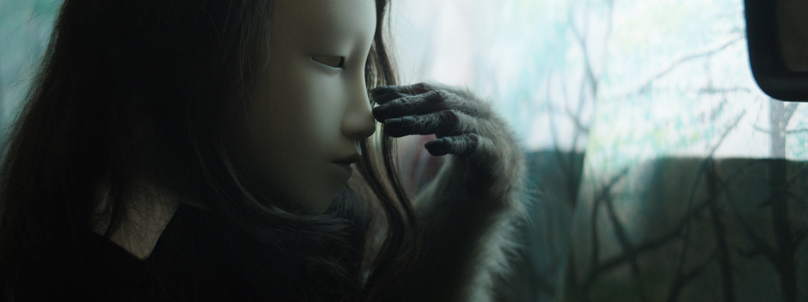
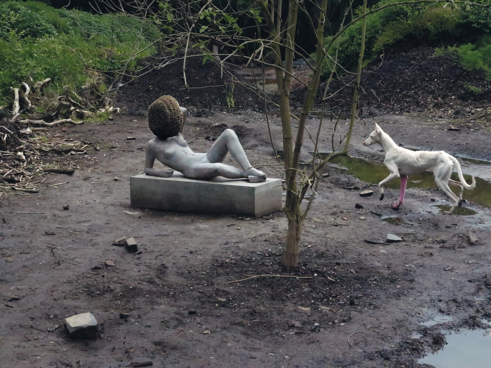
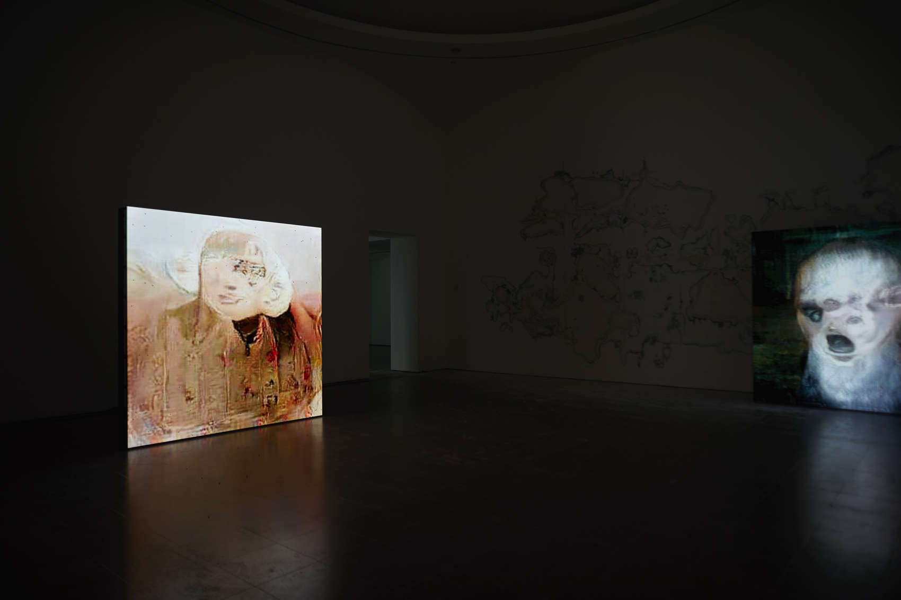

# Pierre Huyghe

**Tag tecnica/formato:** `installazione` `procedurale-generativo` `video`
**Tag tema:** `mondi-virtuali-simulazione` `ecologia-ambiente`
**Tag corso:** `TAD` `M3D`

## Biografia
Nato l'11 settembre 1962 a Parigi. Formazione all'École nationale supérieure des Arts décoratifs di Parigi, diplomato nel 1985. Vive e lavora a Santiago del Cile. Premio speciale della giuria alla 49ª Biennale di Venezia (2001, padiglione francese); Nasher Prize 2017 (Nasher Sculpture Center, Dallas). Fu tra i fondatori, insieme ad altri artisti francesi come Philippe Parreno (già in database), della corrente dell'"estetica relazionale" negli anni '90.

## Poetica e ricerca
Huyghe non produce opere finite ma **sistemi**: ecosistemi viventi, protocolli algoritmici, situazioni che continuano a evolvere autonomamente dopo l'intervento dell'artista, spesso al confine tra biologia, intelligenza artificiale e scultura. Il suo lavoro rifiuta la distinzione tra ciò che è "esposto" e ciò che semplicemente accade — un alveare che cresce su una scultura, un sistema di intelligenza artificiale che genera immagini a partire da segnali biometrici, un ambiente che si autoregola senza pubblico. Ricorrono temi di ibridazione tra umano, animale, vegetale e macchina, e una critica implicita all'idea stessa di "opera d'arte" come oggetto stabile e concluso.

## Opere principali

### Untitled (Human Mask) (2014)
**Descrizione:** film che segue una scimmia addestrata, che indossa una maschera Noh e una parrucca femminile, mentre si aggira in un ristorante abbandonato nei dintorni di Fukushima dopo il disastro nucleare del 2011.
**Lettura critica:** una figura ambigua — non umana ma vestita da umano, in un paesaggio svuotato dalla catastrofe — mette in crisi i confini tra specie, performance e sopravvivenza in un mondo post-disastro.

### Untilled (2011-2012, dOCUMENTA 13, Kassel)
**Descrizione:** ambiente vivente all'aperto: una scultura di cemento raffigurante una figura femminile reclinata, con la testa progressivamente ricoperta da un alveare vivo e ronzante; intorno, piante allergeniche o psicotrope e un cane bianco con una zampa dipinta di rosa.
**Lettura critica:** una delle opere più celebrate di dOCUMENTA 13 — collaborazione tra scultura umana e sistema naturale autogenerantesi, dove il "completamento" dell'opera è delegato a un processo biologico fuori dal controllo dell'artista.

**Approfondimento:** [Esther Schipper — Untilled](https://www.estherschipper.com/exhibitions/386-untilled-pierre-huyghe/)

### UUmwelt (2018, Serpentine Gallery, Londra)
**Descrizione:** installazione che collega intelligenza artificiale e vita organica: immagini generate da una rete neurale a partire da segnali di attività cerebrale umana vengono proiettate sulle pareti della galleria, mentre mosche vive volano libere nello spazio espositivo.
**Lettura critica:** il titolo richiama il concetto di *Umwelt* (Jakob von Uexküll) — l'ambiente percettivo specifico di ogni specie — mettendo in tensione la percezione umana, quella (presunta) della rete neurale e quella delle mosche, tre "mondi" incommensurabili che condividono lo stesso spazio fisico.

**Approfondimento:** [Serpentine Galleries — Pierre Huyghe: UUmwelt](https://www.serpentinegalleries.org/whats-on/pierre-huyghe-uumwelt/)

## Immagini

Immagine per ciascuna delle tre opere, inclusa sotto la relativa descrizione in "Opere principali", da Copenhagen Contemporary, Esther Schipper e Art Viewer.
- [Esther Schipper — biografia](https://www.estherschipper.com/artists/41-pierre-huyghe/biography/)
- [Wikipedia — Pierre Huyghe](https://en.wikipedia.org/wiki/Pierre_Huyghe)
- [Ocula — biografia](https://ocula.com/artists/pierre-huyghe/)

## Fonti
- [Esther Schipper — biografia](https://www.estherschipper.com/artists/41-pierre-huyghe/biography/)
- [Wikipedia — Pierre Huyghe](https://en.wikipedia.org/wiki/Pierre_Huyghe)
- [Ocula — biografia](https://ocula.com/artists/pierre-huyghe/)
- [Pinault Collection — Untitled (Human Mask)](https://lesoeuvres.pinaultcollection.com/en/artwork/untitled-human-mask)
- [LUMA Arles — profilo artista](https://luma.org/en/arles/artists-thinkers-a-z/pierre-huyghe)

---

## Appunti da organizzare
- Citato in *Tecniche di modellazione digitale 3D* e in *Applicazioni digitali per l'arte*, tra gli artisti storici/contemporanei di riferimento per il 3D e l'immagine digitale.
- Ha lavorato con **Ian Cheng** (già in database) come assistente di studio (2010-2012) — collegamento da esplicitare nella scheda di Cheng.
- Video da cercare per *Untitled (Human Mask)* e *UUmwelt* (spesso disponibili solo come estratti nei siti di gallerie/musei — verificare disponibilità di versioni integrali).
