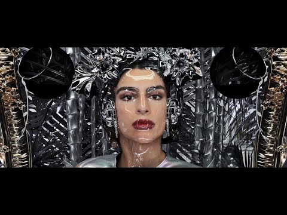
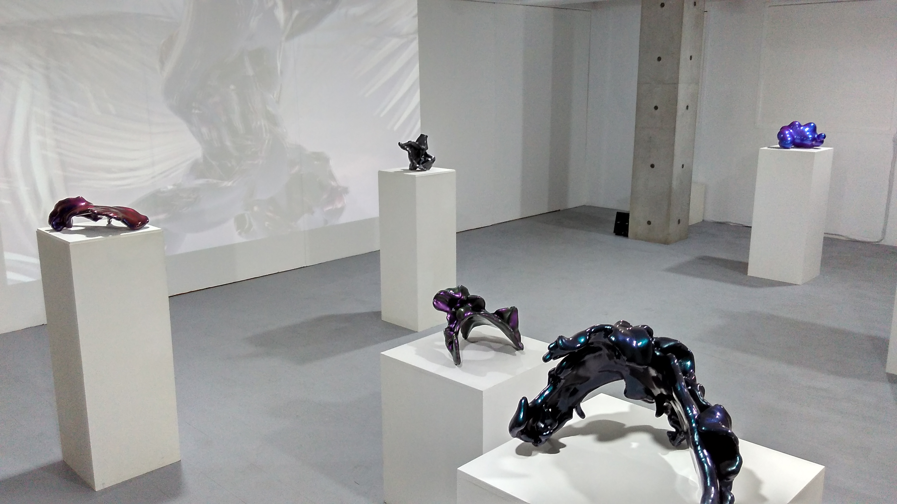
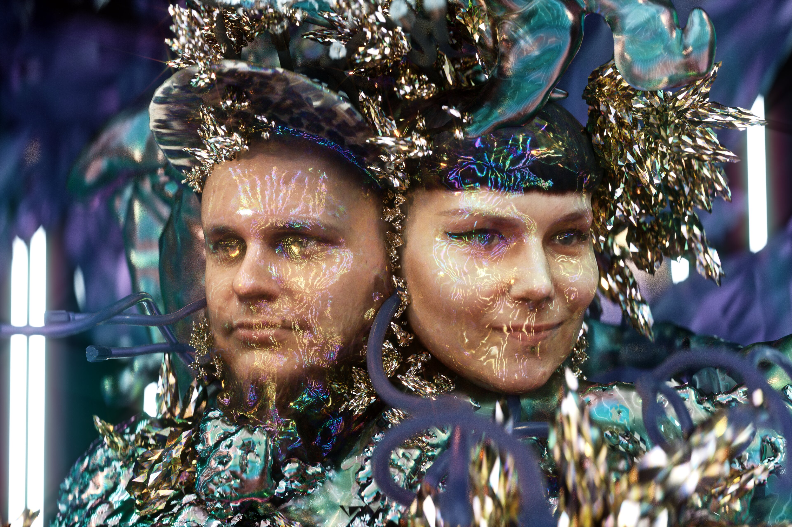

# Pussykrew

**Tag tecnica/formato:** `modellazione-3d` `fotogrammetria-scansione` `stampa-3d-scultura` `vr-ar`
**Tag tema:** `corpo-identita` `genere-queerness` `fantascienza-speculativa`

## Biografia
Pussykrew è il duo formato da **Ewelina Aleksandrowicz** ("Tikul") e **Andrzej Wojtas** ("mi$ gogo"), entrambi di origine polacca, oggi con base a New York. Descritti dalla stampa come "registi e artisti immersivi" pluripremiati, sviluppano una pratica che attraversa video, stampa 3D, realtà aumentata (AR), realtà virtuale (VR) e audio, sperimentando in particolare con l'animazione 3D e la scansione 3D come strumenti primari. Vincono l'**Artist of the Year Award** al 3D Print Show di Londra nel 2014. Firmano visual dal vivo, video concettuali e progetti stampati in 3D per artisti musicali quali Kelela, Hannah Diamond e Sevdaliza. Rappresentati per il mercato statunitense dalla casa di produzione **PRETTYBIRD**. Partecipano alla residenza **#NOWSEETHIS** del Carnegie Museum of Art (2015), insieme a Kelela, Dinner e Juliana Huxtable.

## Poetica e ricerca
Il lavoro di Pussykrew esplora lo spazio fra reame digitale e fisico, mescolando identità fluide e paesaggi futuristici attraverso la sperimentazione con animazione in tempo reale, fotogrammetria e scultura in VR. Il duo sintetizza belle arti, cinema, moda, musica, tecnologia e design, applicando una sensibilità distintiva a molteplici ambiti dell'espressione creativa: dalle installazioni multimediali ai videoclip, dalla performance audiovisiva alla scultura DIY con elettronica. Il passaggio alla stampa 3D nasce dal desiderio di attraversare senza soluzione di continuità il confine fra mondo digitale e fisico: gli oggetti stampati in 3D dell'artista, di dimensioni medie, sono spesso rivestiti da una vernice metallica viola-verde, ripresa direttamente dalla palette cromatica delle loro animazioni digitali. Il loro immaginario mette in scena un mondo futuristico onirico, fluido e sensuale, in cui forme umane e non-umane convivono in un territorio incerto fra utopia e "post-umano": *The FADER* titola un proprio articolo sul duo "How Pussykrew Is Using Art To Imagine A Post-Human World".

## Opere principali

### That Other Girl (2015, per Sevdaliza)
**Descrizione:** video musicale realizzato per la cantante di origine iraniana Sevdaliza, che combina immaginario neo-barocco con "tecno-sciamanesimo cyborg" — texture dorate, marmoree e metalliche preziose che si fondono con la voce vellutata e ipnotica dell'artista in un'esperienza 3D.
**Lettura critica:** *Vice*, coprendo l'opera con il titolo "A Lavish Trip Inside an Empress' 3D-Scanned Palace", ne sottolinea la costruzione tramite scansione 3D come tecnica portante dell'immaginario iconografico del duo.
**Video:** [Sevdaliza — That Other Girl (YouTube)](https://www.youtube.com/watch?v=koAtzvSBvfE)

### The Formula (2016, per Sevdaliza, con Lisette Donkersloot e Atlynn Vrolijk)
**Descrizione:** video musicale per Sevdaliza, co-diretto da Pussykrew insieme alle registe Lisette Donkersloot e Atlynn Vrolijk.
**Lettura critica:** prosegue la collaborazione pluriennale con Sevdaliza, confermando il duo come riferimento visivo per l'artista in un momento chiave della sua carriera musicale.

⚠️ Nessuna immagine trovata con attribuzione certa in questa sessione: alcune fonti (IMVDb) attribuiscono la regia di "The Formula" a Emmanuel Adjei, in apparente contrasto con l'attribuzione a Pussykrew riportata in questa scheda — da verificare prima di aggiungere un'immagine.

### Future Memories (2015, Seoul)
**Descrizione:** mostra che presenta il lavoro del duo, incentrata sull'ibridazione fra digitale e fisico tramite scultura stampata in 3D.
**Lettura critica:** una delle prime occasioni espositive internazionali del duo al di fuori del contesto del video musicale, segno della loro transizione verso l'oggetto scultoreo.

**Approfondimento:** [East Contemporary — Future Memories](https://www.east-contemporary.com/2015/10/20/unofficial-preview-gallery-pussykrew-future-memories/)

### Adidas Futurecraft 4D, busti di atleti stampati in 3D
**Descrizione:** progetto commerciale/artistico per adidas: busti di atleti realizzati con tecnologia di stampa 3D Futurecraft 4D.
**Lettura critica:** applicazione della pratica scultorea del duo — fotogrammetria/scansione 3D più stampa 3D — a un contesto di branding sportivo di alto profilo.

⚠️ Nessuna immagine dell'opera specifica trovata in questa sessione (fonti bloccate o non pertinenti).

### Serpent of Self (2021, Rewire Festival)
**Descrizione:** film interattivo scritto in collaborazione con un processo di apprendimento automatico (AI), presentato al Rewire Festival (edizione online, 6-9 maggio 2021). Esplora temi di materialità, sogni non binari, misticismo, forze primordiali della natura e ritualità, intrecciando passato, presente e futuro in nuove narrazioni e mitologie ispirate a folklore e fantascienza speculativa.
**Lettura critica:** rappresenta l'evoluzione più recente e concettualmente più esplicita della pratica del duo, che integra per la prima volta in modo dichiarato l'IA come co-autrice del processo narrativo, oltre a tematizzare apertamente identità non binarie e migrazioni forzate.

**Approfondimento:** [Rewire Festival — Pussykrew](https://www.rewirefestival.nl/artist/pussykrew)

## Immagini

Immagine per tre delle cinque opere, inclusa sotto la relativa descrizione in "Opere principali", da YouTube ed East Contemporary; un ritratto del duo per Serpent of Self, in assenza di documentazione diretta dell'opera. Nessuna immagine per The Formula (attribuzione della regia da verificare) e per il progetto Adidas.
- [Platoon — "Pussykrew: Dreams Made Real"](https://www.platoon.org/report/pussykrew)
- [The FADER — "How Pussykrew Is Using Art To Imagine A Post-Human World"](https://www.thefader.com/2016/01/21/pussykrew-artist-interview)
- [Vice — "A Lavish Trip Inside an Empress' 3D-Scanned Palace"](https://www.vice.com/en/article/3d57zk/music-video-a-lavish-trip-inside-an-empress-3d-scanned-palace)

## Fonti
- [Platoon — "Pussykrew: Dreams Made Real"](https://www.platoon.org/report/pussykrew)
- [The FADER — "How Pussykrew Is Using Art To Imagine A Post-Human World"](https://www.thefader.com/2016/01/21/pussykrew-artist-interview)
- [Vice — "A Lavish Trip Inside an Empress' 3D-Scanned Palace"](https://www.vice.com/en/article/3d57zk/music-video-a-lavish-trip-inside-an-empress-3d-scanned-palace)
- [All3DP — "Pussykrew's UFO's invade the 3D printed art scene"](https://all3dp.com/pussycrews-ufos-invade-3d-printed-art-scene/)
- [Adobe Blog — "Visions of Digital Utopia: Pussykrew Artist Interview"](https://blog.adobe.com/en/publish/2019/10/03/visions-of-digital-utopia-pussykrew-artist-interview)
- [CreativeApplications.Net — pagina artista](https://www.creativeapplications.net/people/pussykrew/)
- [Free The Bid — pagina regista](https://www.freethebid.com/directors/pussykrew/)
- [Rewire Festival — pagina artista 2021](https://www.rewirefestival.nl/artist/pussykrew)
- [shots Magazine — "PRETTYBIRD signs Pussykrew for US representation"](https://magazine.shots.net/news/view/prettybird-signs-pussykrew-for-us-representation)
- [East Contemporary — anteprima "Future Memories"](https://www.east-contemporary.com/2015/10/20/unofficial-preview-gallery-pussykrew-future-memories/)
- [VoxelMatters — scheda azienda/artista](https://www.voxelmatters.directory/company/pussykrew/)

---

## Appunti da organizzare
- Non citato in un programma specifico dei corsi — inserito dalla lista generale "da scrivere da zero".
- ⚠️ Correzione rispetto all'ipotesi di partenza: Pussykrew è un **duo** di due persone nominate (Ewelina Aleksandrowicz e Andrzej Wojtas), non un collettivo più ampio — terminologia da usare con precisione.
- ⚠️ Da non attribuire al duo: il video "Marilyn Monroe" di Sevdaliza (2016), diretto in realtà da Hirad Sab — verificato distintamente da "The Formula" e "That Other Girl", che sono invece opere di Pussykrew.
- Il #NOWSEETHIS residency al Carnegie Museum of Art (2015, con Kelela, Dinner, Juliana Huxtable) meriterebbe un cross-link con altre schede del database qualora questi artisti fossero già presenti.
