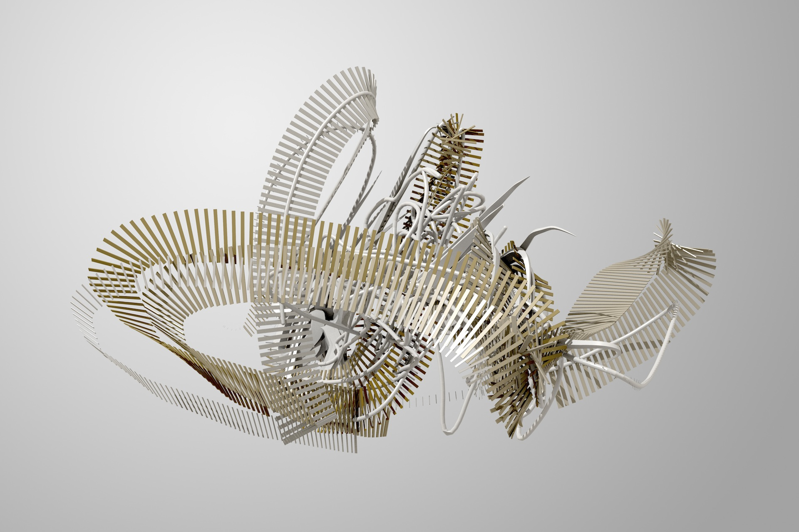
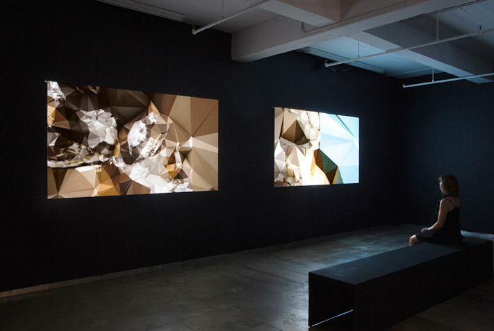
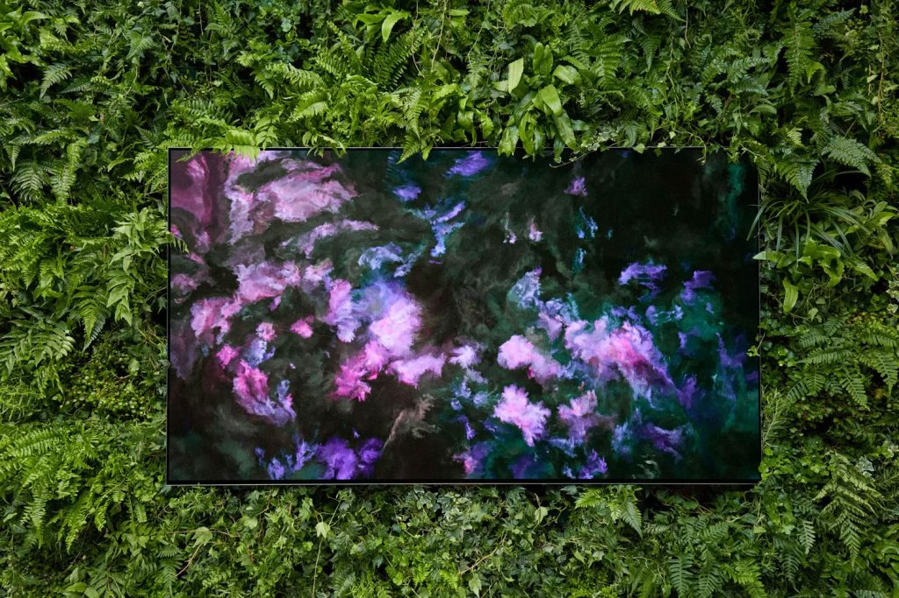
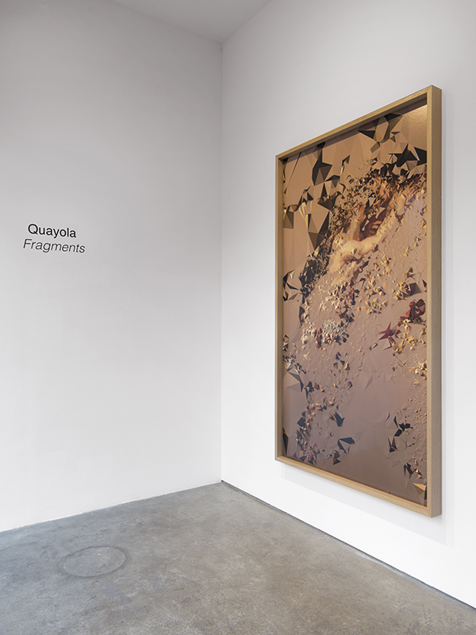

# Quayola

**Tag tecnica/formato:** `modellazione-3d` `procedurale-generativo` `stampa-3d-scultura`
**Tag tema:** `storia-computer-grafica` `memoria-archivio`
**Stato:** da verificare se vive tra Londra e Roma o solo a Londra · parte della pratica comprende commissioni di spettacolo dal vivo e installazioni scenografiche

## Biografia
Nome d'arte di Davide Quayola, nato a Roma nel 1982. Si trasferisce a Londra a diciannove anni; nel 2005 si laurea in Belle Arti alla University of the Arts London. Vive e lavora tra Londra e Roma. Nel 2013 vince il Golden Nica nella categoria Computer Animation/Film/VFX al Prix Ars Electronica di Linz, insieme all'artista turco Memo Akten, per l'opera "Forms" (2011-2012), commissionata dal National Media Museum del Regno Unito per la mostra "In the Blink of an Eye: Media and Movement" in occasione delle Olimpiadi di Londra 2012. Nel 2021 riceve la sua prima grande personale museale in Italia, a Palazzo Cipolla a Roma (Fondazione Terzo Pilastro Internazionale). È rappresentato dalla bitforms gallery (New York) e da Marignana Arte (Venezia); ha esposto anche al Domaine de Chaumont-sur-Loire (Francia) e alla galleria NOME (Berlino).

## Poetica e ricerca
La pratica di Quayola nasce dal software scritto su misura ("custom computer software") e si estende a performance audiovisive, video, scultura e opere su carta. Il suo lavoro è profondamente segnato dal confronto, fin dalla formazione, con la grandezza e il decadimento della scultura antica e dei capolavori rinascimentali: buona parte della sua ricerca consiste nel prendere immagini e forme canoniche della storia dell'arte — sculture ellenistiche, pittura dei maestri antichi, paesaggio pittorico ottocentesco, architettura barocca — e sottoporle a processi computazionali (algoritmi generativi, simulazioni fisiche, scansione e rielaborazione di dati tridimensionali) che le portano al limite tra figurazione e astrazione. Una parte della sua produzione più recente porta questo processo nello spazio fisico tramite bracci robotici che scolpiscono, incidono o "portano alla luce" forme scultoree, in un dialogo esplicito con la tecnica rinascimentale del "non finito" michelangiolesco. Quayola ha dichiarato di non essere convinto che si debba andare verso un mondo in cui "sono le macchine a fare arte per noi da contemplare": la sua posizione tiene ferma la centralità dell'autorialità umana nel disegno del processo algoritmico, anche quando il risultato visivo appare interamente generato dalla macchina.

## Opere principali
### Forms (2011-2012, con Memo Akten)
**Descrizione:** serie di studi sul movimento umano e le sue riverberazioni nello spazio e nel tempo. A partire da un archivio di filmati sportivi (salto in alto, nuoto, ecc. dai Commonwealth Games), Quayola e Akten generano forme tridimensionali in movimento lungo le stesse traiettorie dei corpi degli atleti, in un sistema astratto che rende visibile la tensione muscolare e la fluidità del movimento. Commissionata dal National Media Museum (UK) per la mostra "In the Blink of an Eye: Media and Movement", legata alle Olimpiadi di Londra 2012.
**Lettura critica:** vince il Golden Nica 2013 al Prix Ars Electronica (categoria Computer Animation/Film/VFX) — tra i massimi riconoscimenti internazionali per la computer grafica d'artista.

**Approfondimento:** [memo.tv — Forms](https://www.memo.tv/works/forms/)

### Strata (2013 - in corso)
**Descrizione:** serie che colloca la pratica dell'artista all'interno di un processo di tipo archeologico, per "stratificazione": paesaggi e architetture vengono scomposti computazionalmente in strati sovrapposti che ne rivelano la struttura nascosta.
**Lettura critica:** la metafora archeologica della stratificazione lega esplicitamente il processo algoritmico dell'artista a una riflessione sul tempo sedimentato nel paesaggio e nell'architettura.

**Approfondimento:** [bitforms gallery — Strata](https://www.bitforms.art/exhibition/quayola-strata/)

### Jardins d'Été / Remains (2016-2017)
**Descrizione:** utilizzando la complessità delle formazioni floreali mosse dal vento come dataset, Quayola genera nuovi "dipinti computazionali" in video e stampa, proseguendo la tradizione pittorica delle avanguardie di fine Ottocento nella rappresentazione del paesaggio.
**Lettura critica:** letto come un aggiornamento algoritmico della tradizione paesaggistica en plein air, in cui il dato ambientale sostituisce l'osservazione diretta dell'occhio pittorico.

### Fragments / Captives (dal 2018)
**Descrizione:** sculture computazionalmente replicate che imitano l'aspetto di frammenti archeologici ritrovati, e sculture "non finite" scolpite robot­icamente e lasciate volutamente incomplete, in esplicito dialogo con i Prigioni di Michelangelo, per documentare il processo computazionale stesso. Presentate in mostra personale a Palazzo Cipolla, Roma (2021, Fondazione Terzo Pilastro Internazionale) e alla bitforms gallery di New York.
**Lettura critica:** la scultura "non finita" e il frammento archeologico diventano dispositivi per rendere visibile — e apertamente incompleto — il processo algoritmico stesso, invece di nasconderlo dietro un risultato finale levigato.

**Approfondimento:** [bitforms gallery — Fragments](https://www.bitforms.art/exhibition/quayola-fragments/)

## Interviste e talk
- _Nessuna ancora: da aggiungere._

## Fonti
- [Sito ufficiale dell'artista](https://quayola.com/)
- [bitforms gallery — pagina artista](https://www.bitforms.art/artist/quayola/)
- [bitforms gallery — biografia PDF](https://www.bitforms.art/wp-content/uploads/2024/07/quayola_bio.pdf)
- [bitforms gallery — mostra Fragments](https://www.bitforms.art/exhibition/quayola-fragments/)
- [bitforms gallery — mostra Strata](https://www.bitforms.art/exhibition/quayola-strata/)
- [Fondazione Terzo Pilastro Internazionale — Quayola a Palazzo Cipolla (2021)](https://www.fondazioneterzopilastrointernazionale.it/en/project/quayola-a-palazzo-cipolla/)
- [Marignana Arte — pagina artista](https://www.marignanaarte.it/artists/quayola/)
- [Ars Electronica Blog — Quayola: From Prizewinner to Juror](https://ars.electronica.art/aeblog/en/2014/03/20/quayola-vom-gewinner-zum-juror/)
- [Digicult — Quayola & Memo Akten: "Forms", Prix Ars Electronica 2013](https://digicult.it/news/quayola-and-memo-atken-forms-something-about-life-at-ars-electronica-prix-2013/)
- [Memo Akten — pagina opera Forms (2011)](https://www.memo.tv/works/forms/)
- [Vice — Quayola's Glitchy Reimaginings of Broken Ancient Greek Artifacts](https://www.vice.com/en/article/quayola-glitchy-reimaginings-of-broken-ancient-greek-artifacts/)

## Crediti delle immagini
Immagine per ciascuna delle quattro opere, inclusa sotto la relativa descrizione in "Opere principali", da memo.tv e bitforms gallery.
- [Sito ufficiale dell'artista](https://quayola.com/)
- [bitforms gallery — pagina artista](https://www.bitforms.art/artist/quayola/)
- [Fondazione Terzo Pilastro Internazionale — Quayola a Palazzo Cipolla (2021)](https://www.fondazioneterzopilastrointernazionale.it/en/project/quayola-a-palazzo-cipolla/)
- [Marignana Arte — pagina artista](https://www.marignanaarte.it/artists/quayola/)
