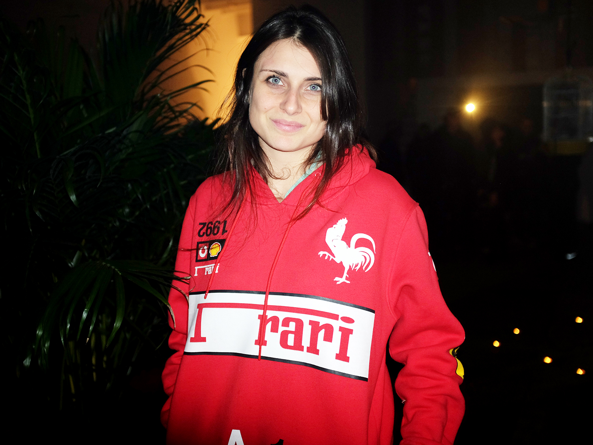
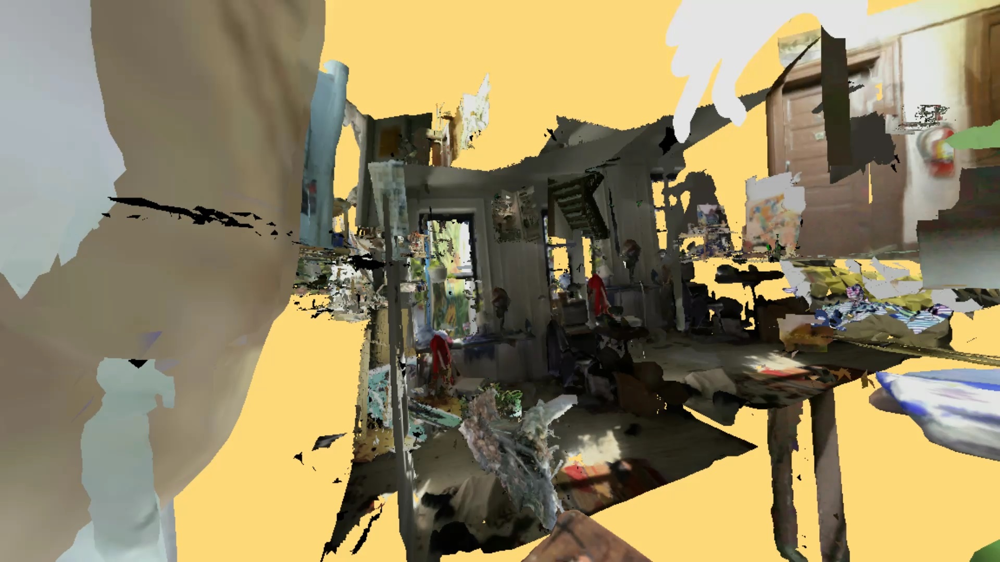
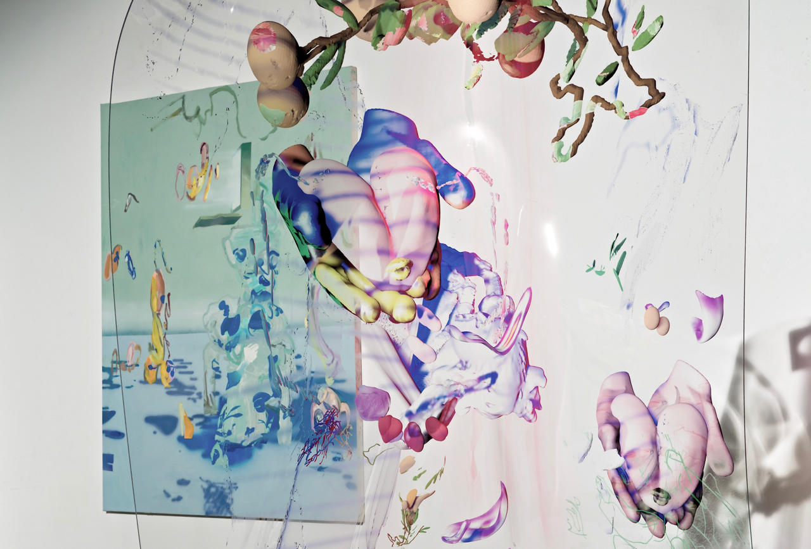
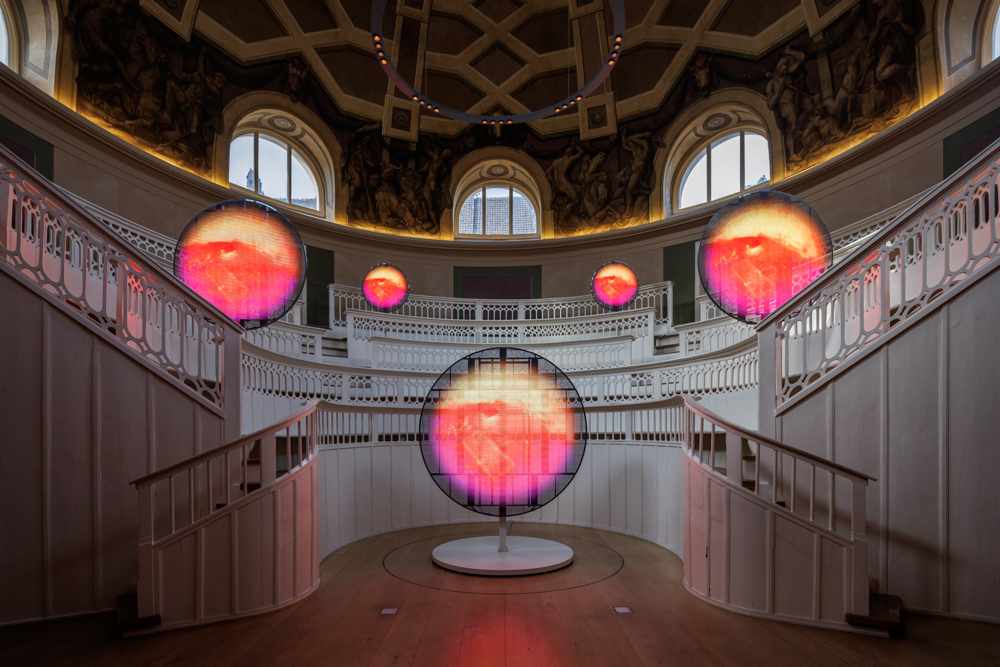
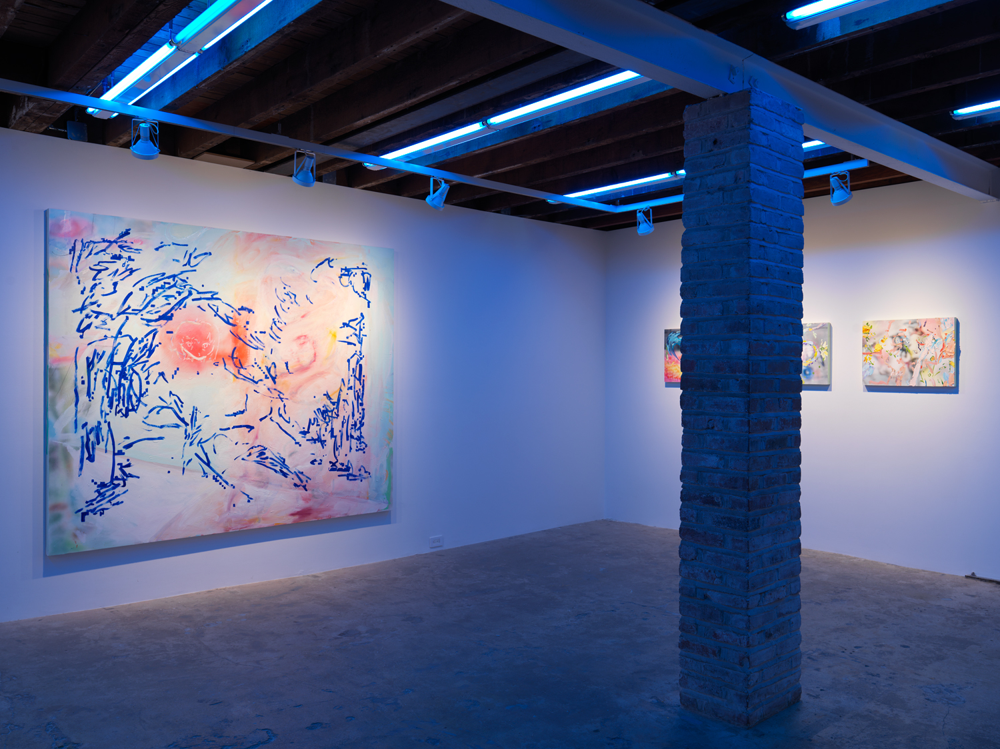

# Rachel Rossin

**Tag tecnica/formato:** `vr-ar` `modellazione-3d` `fotogrammetria-scansione` `installazione`
**Tag tema:** `corpo-identita` `mondi-virtuali-simulazione`

## Biografia
Nata nel 1987 a West Palm Beach, Florida. Consegue un BFA alla Florida State University (2009), unica formazione accademica formale — per il resto si definisce autodidatta nella programmazione, avendo iniziato a scrivere codice/"hackerare" computer fin da circa 5 anni, usando codice e disegno/videogiochi come modo per costruirsi "case" proprie durante un'infanzia difficile. Vive e lavora a New York. Riconoscimenti: Forbes "30 Under 30" (categoria Arte e Stile, 2017); prima Virtual Reality Fellow al NEW INC, l'incubatore del New Museum (circa 2015); Creative Capital Award (2024); borse dalla Peter S. Reed Foundation e dal Two Trees Cultural Affairs Cultural Space Subsidy Program (2018-2021). Nel 2025 il Solomon R. Guggenheim Museum acquisisce la sua opera *Scry Glass III* (2023) tramite lo Young Collectors Council, con il sostegno di Tiffany Zabludowicz — acquisizione annunciata nel gennaio 2026. Rappresentata dalla galleria Magenta Plains (New York) e da Albion Jeune (Londra); in precedenza da Zieher Smith & Horton e SIGNAL (entrambe New York/Brooklyn).

⚠️ Non verificati: un profilo dedicato del *New Yorker* (nessuna fonte trovata); partecipazione al Whitney Biennial — non confermata, il legame principale con il Whitney risulta essere la commissione artport e la collettiva *Refigured*, non la Biennale.

## Poetica e ricerca
Rossin viene descritta con continuità come "una pittrice e programmatrice" la cui pratica multidisciplinare — tra pittura a olio, scultura e realtà virtuale/motori di gioco — indaga lo slittamento tra spazio virtuale e fisico, l'incarnazione, l'entropia e gli effetti psicologici/fenomenologici della tecnologia sul sé. La sua tecnica distintiva: usa la fotogrammetria per convertire i propri dipinti a olio e gli spazi fisici del proprio studio/casa in ambienti VR 3D, li distorce algoritmicamente, e talvolta traduce i risultati di nuovo in dipinti — un loop di retroazione a doppio senso tra gesto pittorico e codice/glitch. La critica Dawn Chan, su *Artforum* (recensione della mostra "Lossy", 2016), scrive: "I fuochi d'artificio della mostra avvenivano all'intersezione tra queste due modalità, dove il guazzabuglio ottico generato da un computer veniva reso a mano con oli su tela, e incorniciato nella tradizione in evoluzione della pittura astratta. In 'Lossy' c'era senz'altro una hacker bambina che metteva in mostra i propri muscoli. Ma la mostra rivelava anche un'altra immagine di Rossin: una pittrice che, per il momento, ha trovato un punto di vista molto efficace da cui osservare il caos di un paesaggio mediatico in trasformazione." La critica Lola Kramer, in un'intervista su *CURA* (n. 37, dicembre 2021), collega il processo di "disegno in VR" di Rossin al concetto di "consapevolezza corporea" della pittrice Maria Lassnig — rappresentare "come il corpo si sente, non come appare" — a proposito della serie pandemica *Boohoo Stamina* (dipinti gestuali che integrano animazioni di avatar a forma di ventaglio olografico). Il Guggenheim, nel testo curatoriale dedicato alla serie *Scry Glass*, descrive le sue opere come "combine" — che integrano pittura/scultura con gioco, video e tecnologie emergenti, incluso talvolta materiale genetico/DNA dell'artista stessa — collocando la serie nella lunga storia della visione mediata tecnologicamente, a partire dallo "specchio di Claude" settecentesco, dispositivo usato dai pittori paesaggisti romantici.

## Opere principali

### N=7 / The Wake in Heat of Collapse (2015)
**Descrizione:** simulazione VR su Oculus Rift a scorrimento laterale, presentata da SIGNAL, New York. Lo spettatore naviga un paesaggio costruito da immagini "hackerate" di architettura e videogiochi e da collage algoritmici di dipinti famosi (Guernica, *Il bacio* di Klimt), insegne aziendali e loghi di browser, culminando in una scala crollante costruita con il testo di "Contro l'interpretazione" di Susan Sontag. La gravità all'interno dell'opera diminuisce di livello in livello secondo una sequenza di Fibonacci. Realizzata durante la fellowship VR al NEW INC del New Museum.
**Lettura critica:** una delle prime opere a integrare direttamente un testo teorico (Sontag) come materiale architettonico letterale dentro un ambiente VR, non solo come riferimento citato a parole.

### Lossy, con I Came and Went as a Ghost Hand (Cycle 2) (2015)
**Descrizione:** mostra personale da Zieher Smith & Horton, New York (15 ottobre-14 novembre 2015), che include l'opera VR *I Came and Went as a Ghost Hand (Cycle 2)*, esperibile tramite Oculus Rift. Processo: la fotogrammetria converte i dipinti a olio e lo studio/la casa dell'artista in ambienti VR 3D, alterati algoritmicamente, reinterpretati in nuovi dipinti astratti, poi tradotti di nuovo in VR come texture 2D avvolte su mesh 3D. Rossin descrive così il processo: "la nostra relazione con la realtà non è composta da un virtuale e un reale separati, ma somiglia più a un gradiente tra i due... Come la compressione lossy, questo processo include l'entropia come dato intrinseco."
**Lettura critica:** recensita da Dawn Chan su *Artforum* (vedi sopra) — l'opera che dà il nome all'intero corpus concettuale dell'artista, prendendo in prestito il termine tecnico della "compressione con perdita" come metafora della relazione tra virtuale e reale.

### Peak Performance (2017)
**Descrizione:** mostra personale da SIGNAL, Brooklyn (29 settembre-12 novembre 2017), con tre corpi di lavoro: dipinti a olio che raffigurano ambienti virtuali, sculture in plexiglass fuso, e opere "simili ad acquari" — hardware informatico smontato sospeso in olio minerale non conduttivo che raffredda e preserva i componenti come un "ecosistema chiuso". Esplora "la coscienza disincarnata nello spazio digitale... la fantasia seducente di un corpo liberato dai limiti dell'anatomia e della fisica... l'inevitabilità del deterioramento entropico." Include le opere VR *The Sky is a Gap* (2017, il movimento fisico dello spettatore, tracciato via motion capture, controlla la scena) e *I Came and Went as a Ghost Hand*.
**Lettura critica:** la mostra che porta a sintesi più compiuta il rapporto tra i tre media dell'artista (pittura, scultura, VR) attorno al tema condiviso dell'entropia — dal degrado dell'hardware fisico al degrado algoritmico dell'immagine.

### THE MAW OF (2022)
**Descrizione:** commissione transmediale co-prodotta dal KW Institute for Contemporary Art di Berlino e da artport, il portale di net art del Whitney Museum, descritta come una narrazione che si dispiega su più piattaforme e formati, riflettendo su come corpi e menti si fondano con la tecnologia e ne vengano alterati. Inclusa in seguito nella mostra collettiva del Whitney *Refigured*, insieme a American Artist, Morehshin Allahyari (già presente in questo database), Zach Blas & Jemima Wyman e Auriea Harvey — una mostra dedicata specificamente all'arte digitale e agli effetti della tecnologia sull'identità.
**Lettura critica:** conferma il posizionamento di Rossin accanto ad altre artiste e artisti del database (Allahyari, Blas) attorno al tema condiviso dell'identità digitalmente mediata/alterata.

### SCRY / Scry Glass III (2023)
**Descrizione:** serie mostrata nella personale "SCRY" nel nuovo spazio di Magenta Plains su Canal Street, New York (2023). *Scry Glass III*: display LED circolare e microcomputer, video digitale a colori, muto, 9 minuti e 5 secondi. Acquisita dal Solomon R. Guggenheim Museum nel 2025.
**Lettura critica:** il testo curatoriale del Guggenheim collega l'opera allo "specchio di Claude" del Settecento, dispositivo ottico portatile usato dai pittori di paesaggio romantici per inquadrare e tonalizzare la veduta — la superficie circolare a LED diventa l'erede tecnologico diretto di quello specchio da viaggio.

**Approfondimento:** [Guggenheim Museum — Rachel Rossin's Combined Sculptures](https://www.guggenheim.org/articles/checklist/rachel-rossins-combined-sculptures-between-real-and-virtual)

## Immagini

Immagine per ciascuna delle cinque opere, inclusa sotto la relativa descrizione in "Opere principali", da purple.fr, elephant.art e Magenta Plains.
- [rossin.co — sito ufficiale](http://rossin.co/index.php)
- [Magenta Plains — pagina artista](https://magentaplains.com/artists/rachel-rossin)
- [Whitney Museum — profilo artista](https://whitney.org/artists/20417)

## Fonti
- [rossin.co — sito ufficiale](http://rossin.co/index.php)
- [Magenta Plains — pagina artista](https://magentaplains.com/artists/rachel-rossin)
- [Whitney Museum — profilo artista](https://whitney.org/artists/20417)
- [Whitney Museum — THE MAW OF](https://whitney.org/exhibitions/the-maw-of)
- [Guggenheim Museum — testo curatoriale su Scry Glass](https://www.guggenheim.org/articles/checklist/rachel-rossins-combined-sculptures-between-real-and-virtual)
- [Zabludowicz Collection — pagina artista](https://www.zabludowiczcollection.com/collection/artists/view/rachel-rossin)
- [Art21 — pagina artista](https://art21.org/artist/rachel-rossin/)
- [Creative Capital — pagina artista](https://creative-capital.org/artists/rachel-rossin/)
- [CURA magazine (n. 37) — intervista di Lola Kramer](https://curamagazine.com/digital/rachel-rossin-2/)
- [Elephant Art — su I Came and Went as a Ghost Hand](https://elephant.art/digital-disintegration-the-artists-embracing-pixels-glitches-and-nineties-net-nostalgia-22042020/rachel-rossin-i-came-and-went-as-a-ghost-hand-cycle-2-2015-1/)

---

## Appunti da organizzare
- Non citata in un programma specifico dei corsi — inserita dalla lista generale "da scrivere da zero" per rilevanza nell'ambito VR/pittura-codice.
- ⚠️ Correzione importante: *THE MAW OF* non è un'opera del 2015 al New Museum come talvolta riportato in fonti secondarie — è una commissione del 2022 di KW Institute e Whitney artport. Il legame reale del 2015 con il New Museum è la fellowship VR al NEW INC, opera distinta.
- Non confermata: un'opera specifica che usi dati EEG/biometrici — la pista più vicina è la serie video Art21 "Brain-to-Machine" sui suoi esperimenti con IA e VR, da verificare prima di citare un'opera specifica con questo dispositivo.
- Video ulteriori da vedere in aula: [Art21, "Rachel Rossin's Digital Homes" (New York Close Up)](https://art21.org/watch/new-york-close-up/rachel-rossins-digital-homes/); [Artforum, intervista video](https://www.artforum.com/video/rachel-rossin-talks-about-her-life-and-work-166691/); canale Vimeo: [vimeo.com/rachelrossin](https://vimeo.com/rachelrossin/videos).
