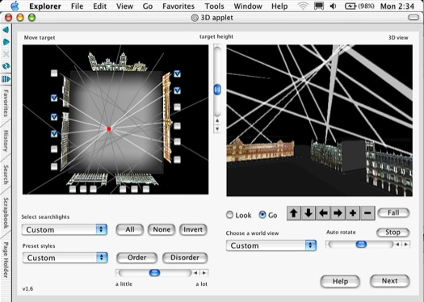
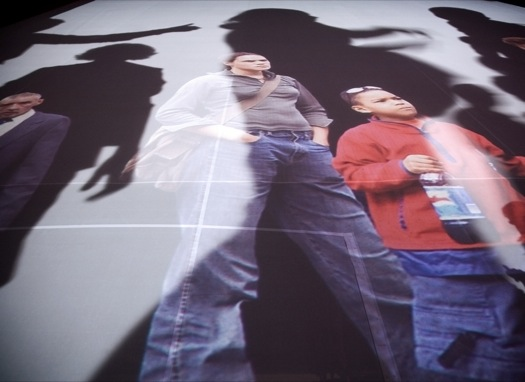
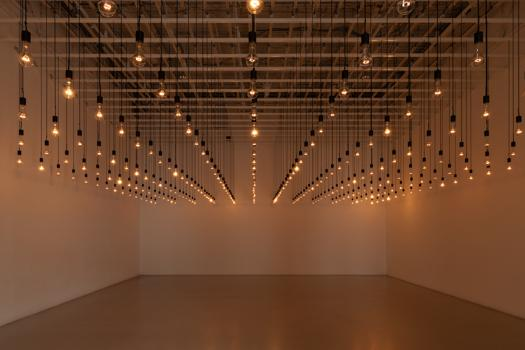
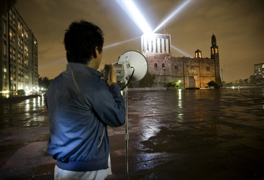
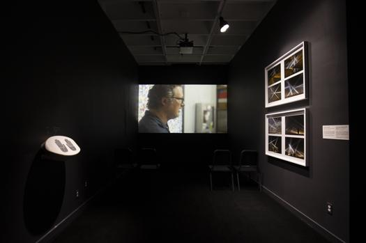

# Rafael Lozano-Hemmer

**Tag tecnica/formato:** `installazione` `projection-mapping` `data-visualization`
**Tag tema:** `corpo-identita` `sorveglianza-controllo`

## Biografia
Nato nel 1967 a Città del Messico, artista messicano-canadese. Emigra in Canada nel 1985, dove studia inizialmente alla University of Victoria (British Columbia); consegue poi un Bachelor of Science in chimica fisica alla Concordia University di Montréal (1989), lavorando in un laboratorio di chimica del riconoscimento molecolare e pubblicando su riviste scientifiche prima di dedicarsi interamente all'arte. Vive e lavora a Montréal. Nel 2007 è il primo artista a rappresentare ufficialmente il Messico alla Biennale di Venezia (52ª edizione) — prima presenza in assoluto di un padiglione messicano ufficiale — con la mostra personale *Some Things Happen More Often Than All of the Time*, Palazzo Van Axel, a cura di Príamo Lozada e Bárbara Perea (10 giugno-21 novembre 2007, sei installazioni interattive nel palazzo storico). Riconoscimenti: due BAFTA Award per l'Interactive Art (2002, 2005); Golden Nica del Prix Ars Electronica; Governor General's Award in Visual and Media Arts del Canada Council (2015); Compagnon des Arts et des Lettres du Québec (2016); Rave Award di *Wired*; Rockefeller Fellowship; International Bauhaus Award (Dessau); Trophée des Lumières (Lione); dottorato honoris causa in Fine Arts della OCAD University di Toronto (2025).

⚠️ Nota di correzione: alcune fonti secondarie circolanti riportano erroneamente un "dottorato in chimica fisica" — la formazione accademica verificata è un Bachelor of Science (laurea triennale), non un dottorato; il dottorato che effettivamente possiede è quello honorario in Fine Arts (2025), non in chimica.

## Poetica e ricerca
Lozano-Hemmer è l'autore della serie **"Relational Architecture"** (Architettura Relazionale): eventi interattivi su grande scala che usano robotica, software personalizzato, proiezioni e dati biometrici (battito cardiaco, respiro, impronte digitali, voce) per trasformare temporaneamente edifici simbolici e spazi pubblici/architettonici attraverso la presenza e la partecipazione del pubblico. Sceglie deliberatamente il termine "relazionale" invece di "interattivo", che considera un'estetica "predatoria, da pulsante" — mentre "relazionale" descrive qualcosa di più laterale, in rete, orientato a stabilire relazioni autentiche tra persone, tecnologia e luogo: una posizione esposta nel proprio manifesto "Perverting Technological Correctness" (*Leonardo*, MIT Press, vol. 29 n. 1, 1996). L'idea di fondo, ricorrente in tutta la sua opera, è che gli edifici non siano strutture fisse ma entità capaci di relazioni temporanee con chi li usa — l'obiettivo dichiarato è "materializzare i dati" nello spazio corporeo e architettonico reale, non in una simulazione virtuale che escluda il corpo: il corpo fisico resta l'interfaccia essenziale, non lo schermo. Il teorico dei nuovi media Ulrik Ekman, nel saggio "Of the Untouchability of Embodiment I: Rafael Lozano-Hemmer's Relational Architectures" (*CTheory*, 2012), e l'architetta e teorica María Fernández, in "Illuminating Embodiment: Rafael Lozano-Hemmer's Relational Architectures" (*Architectural Design*, Wiley, 2007), hanno entrambi affrontato criticamente come queste opere ridefiniscano il rapporto tra corpo, architettura e dato in tempo reale. Un articolo dedicato specificamente a *Pulse Room* — "Pulse on pulse: modulation and signification in Rafael Lozano-Hemmer's Pulse Room" (*Journal of Aesthetics & Culture*, Taylor & Francis, 2012) — ne teorizza il funzionamento come dispositivo di modulazione e significazione del battito cardiaco collettivo.

## Opere principali

### Vectorial Elevation / Alzado Vectorial — Relational Architecture n. 4 (1999-2000)
**Descrizione:** installazione realizzata sullo Zócalo di Città del Messico per le celebrazioni del millennio: partecipanti da tutto il mondo, tramite un'interfaccia web 3D, disegnano sculture di luce controllando 18 fari robotici (126.000 watt totali) installati sui tetti attorno alla piazza, visibili fino a 15 km di distanza. Attiva per due settimane, chiude il 7 gennaio 2000 con oltre 800.000 partecipanti da 89 paesi. Rimessa in scena in seguito a Vancouver (Olimpiadi invernali 2010), Dublino (allargamento UE 2004), Lione (Fête des Lumières, 2003) e al Basque Museum of Contemporary Art (2002).
**Lettura critica:** una delle prime opere a trasformare un intero centro urbano in interfaccia collettiva controllabile da remoto via web, anticipando linguaggi oggi comuni nell'arte partecipativa su scala cittadina.
**Video:** [Vectorial Elevation, Zócalo 1999, documentazione (Vimeo)](https://vimeo.com/33988779)

**Approfondimento:** [lozano-hemmer.com — Vectorial Elevation](https://www.lozano-hemmer.com/vectorial_elevation.php)

### Body Movies — Relational Architecture n. 6 (2001)
**Descrizione:** installazione sullo Schouwburgplein di Rotterdam (31 agosto-23 settembre 2001, per l'anno di Rotterdam Capitale Europea della Cultura). Proiettori controllati robotamente proiettano oltre 1.000 ritratti (girati a Rotterdam, Madrid, Città del Messico e Montréal) sulla parete del complesso cinematografico Pathé; i ritratti, sbiaditi da fari xeno a livello del suolo, diventano visibili solo dentro le ombre proiettate dai passanti, la cui sagoma varia da 2 a 22 metri di altezza a seconda della distanza dalle luci. Fa riferimento a un'incisione di Samuel van Hoogstraten del 1675, "La danza delle ombre", ambientata a Rotterdam.
**Lettura critica:** l'opera più immediatamente comprensibile della serie "Relational Architecture" — il corpo del passante non è semplice "utente" ma diventa letteralmente lo schermo che rivela l'immagine nascosta.
**Video:** [Body Movies, documentazione (YouTube)](https://www.youtube.com/watch?v=ENyOj26hmH0)

**Approfondimento:** [lozano-hemmer.com — Body Movies](https://www.lozano-hemmer.com/body_movies.php)

### Pulse Room (2006) / Pulse Index (2010)
**Descrizione:** *Pulse Room* consiste in una griglia a soffitto di 100-300 lampadine a incandescenza; un sensore all'ingresso registra il battito cardiaco di un partecipante e lo trasmette alla lampadina più vicina, che lampeggia in quel ritmo; ogni nuovo partecipante fa avanzare di una posizione lungo la rete i battiti registrati in precedenza, così che l'intera stanza diventa un coro asincrono e cumulativo dei battiti dei visitatori passati (con un ticchettio udibile). Ispirata a una scena allucinatoria del film messicano *Macario* (Roberto Gavaldón, 1960), in cui ogni persona vivente appare come una fiamma di candela in una grotta. Nella collezione permanente del MoMA dal 2006. *Pulse Index* (2010) applica lo stesso principio alle impronte digitali: i visitatori posano un dito su un sensore che combina un microscopio digitale 220x e un rilevatore di battito; l'impronta ingrandita appare, pulsando al ritmo del cuore, sulla cella più grande di una griglia, per poi essere spinta verso l'alto e fuori dalla griglia dai partecipanti successivi — un "memento mori" costruito con le impronte digitali, come lo definisce l'artista stesso.
**Lettura critica:** oggetto di un intero articolo accademico dedicato (*Journal of Aesthetics & Culture*, 2012) proprio per la capacità dell'opera di rendere fisicamente presente, in un'unica stanza, la somma di tracce corporee di sconosciuti — un archivio biometrico collettivo e anonimo insieme.

**Approfondimento:** [MoMA — Pulse Room](https://www.moma.org/collection/works/180180)

### Voz Alta / Loud Voice — Relational Architecture n. 15 (2008)
**Descrizione:** installazione in Plaza de las Tres Culturas, Tlatelolco, Città del Messico — sito esatto del massacro di Tlatelolco del 2 ottobre 1968. Opera memoriale e attivista: i partecipanti parlano liberamente in un megafono pubblico; la voce viene trasmessa dalla radio universitaria e insieme convertita in sequenze di lampi da un faro da 10kW, ripreso da altri tre fari puntati verso lo Zócalo e il Monumento alla Rivoluzione, visibili fino a 15 km di distanza.
**Lettura critica:** l'esempio più esplicito di "architettura relazionale attivata dalla voce" — collega letteralmente il corpo (la voce) all'infrastruttura fisica e luminosa dell'intera città, nel luogo stesso della memoria collettiva che l'opera vuole onorare.

**Approfondimento:** [lozano-hemmer.com — Voz Alta](https://www.lozano-hemmer.com/voz_alta.php)

### Border Tuner / Sintonizador Fronterizo (2019)
**Descrizione:** installazione a El Paso (Texas) e Ciudad Juárez (Messico), sui due lati del confine: sei stazioni interattive (tre per lato) controllano fari che, quando i due "bracci" di luce provenienti dai lati opposti del confine si incontrano nel cielo, aprono un canale audio bidirezionale dal vivo tra sconosciuti sui due lati.
**Lettura critica:** rende letterale, con mezzi tecnologici, la metafora della "connessione attraverso una divisione" — corpo (voce), luce e spazio binazionale nello stesso dispositivo.

**Approfondimento:** [bordertuner.net](https://www.bordertuner.net/)

## Immagini

Immagine per ciascuna delle cinque opere, inclusa sotto la relativa descrizione in "Opere principali", dal sito ufficiale dell'artista e da MoMA.
- [lozano-hemmer.com — sito ufficiale, biografia](https://www.lozano-hemmer.com/bio.php)
- [bitforms gallery — biografia ufficiale (PDF)](https://www.bitforms.art/wp-content/uploads/2024/07/lozano-hemmer_bio.pdf)
- [MoMA — Pulse Room, collezione](https://www.moma.org/collection/works/180180)

## Fonti
- [lozano-hemmer.com — sito ufficiale, biografia](https://www.lozano-hemmer.com/bio.php)
- [bitforms gallery — biografia ufficiale (PDF)](https://www.bitforms.art/wp-content/uploads/2024/07/lozano-hemmer_bio.pdf)
- [MoMA — Pulse Room, collezione](https://www.moma.org/collection/works/180180)
- [Tate — pagina artista](https://www.tate.org.uk/art/artists/rafael-lozano-hemmer-11405)
- [Media Art Net — Body Movies](http://www.medienkunstnetz.de/works/body-movies/)
- [Media Art Net — Vectorial Elevation](http://www.medienkunstnetz.de/works/vectorial-elevation/)
- [Hirshhorn Museum — mostra "Pulse" (2018-19)](https://hirshhorn.si.edu/exhibitions/rafael-lozano-hemmer-pulse)
- [Studio International — recensione "Pulse"](https://www.studiointernational.com/rafael-lozano-hemmer-pulse-review-hirshhorn-museum-washington)
- [CTheory — Ulrik Ekman, "Of the Untouchability of Embodiment I"](https://journals.uvic.ca/index.php/ctheory/article/view/14943/5839)
- [e-flux — Messico alla Biennale di Venezia 2007](https://www.e-flux.com/announcements/40731/mexico-at-the-venice-biennale-2007)
- [Canadian Art — su Pulse Room](https://canadianart.ca/features/pulse-room/)

---

## Appunti da organizzare
- Citato in *Tecniche di animazione digitale (Biennio)*, insieme a Klaus Obermaier, Miwa Matreyek, Nathaniel Stern e Robert Seidel, per l'interazione tra corpo fisico e proiezioni digitali.
- ⚠️ Correzione importante da ricordare in classe: non ha un dottorato in chimica fisica (solo una laurea triennale), il dottorato che possiede è honorario in Fine Arts (OCAD University, 2025).
- Non verificati con fonte solida (citati da fonte singola, da controllare prima di ripetere con sicurezza): nomination a un European Film Award; un eventuale saggio dedicato di Peter Weibel su Lozano-Hemmer, oltre alla presenza condivisa nell'antologia *Light Art from Artificial Light* (ZKM, 2006).
- Video ulteriori da vedere in aula: [Voz Alta, l'artista spiega l'opera (YouTube, in spagnolo)](https://www.youtube.com/watch?v=xSvpzgsDT9Q); canale Vimeo del bitforms (galleria), con documentazione di molte installazioni per sede e anno: [vimeopro.com/bitforms/lozano-hemmer](https://vimeopro.com/bitforms/lozano-hemmer).
- Opere recenti da approfondire: *Collider* (2024, Parrish Art Museum, tenda di luce LED reattiva ai muoni rilevati da un rilevatore di raggi cosmici in loco); *Listening Forest* (2023, Crystal Bridges Museum).
