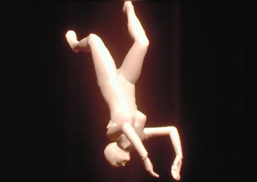
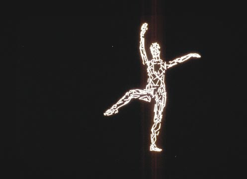
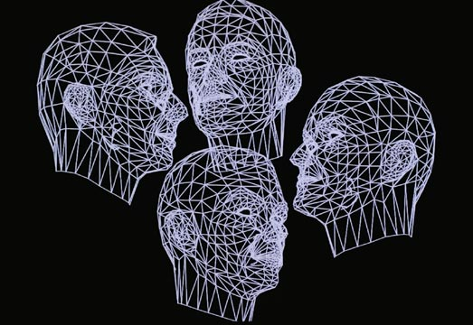
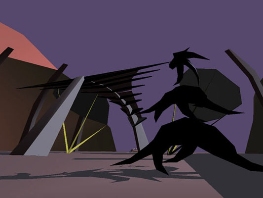
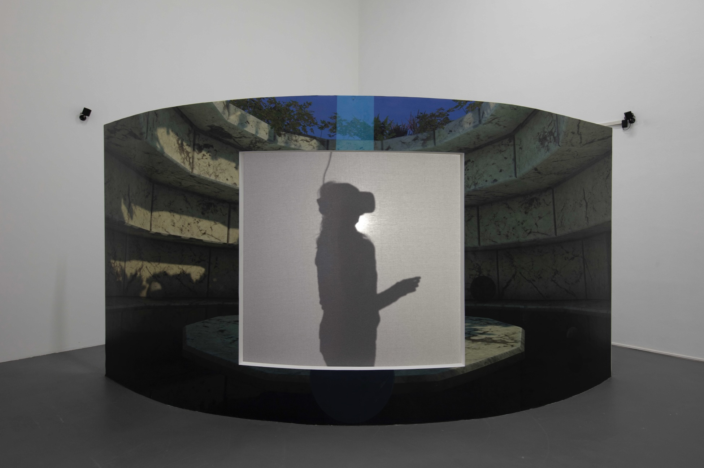
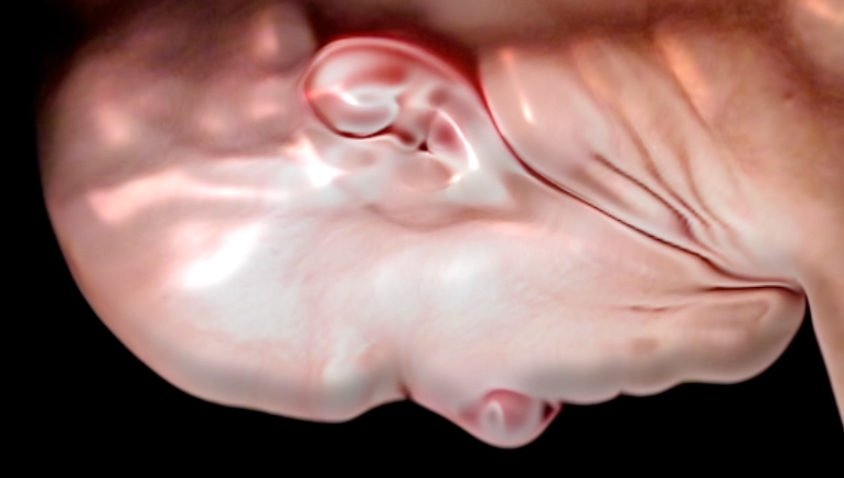

# Rebecca Allen

**Tag tecnica/formato:** `modellazione-3d` `motion-capture` `vr-ar`
**Tag tema:** `storia-computer-grafica` `corpo-identita`
**Tag corso:** `TAD-DCV` `TAD-AVM` `M3D`
**Stato:** scheda avanzata · da completare con il materiale della retrospettiva «Synthetic Creatures» (MEET, Milano, 2026) · produzione di *The Catherine Wheel* da verificare (PBS o BBC)

## Biografia
Nata nel 1953 a Detroit. BFA alla Rhode Island School of Design (RISD), dove inizia la propria pratica artistica nei primi anni '70. Lavora con il computer come medium artistico dagli anni Settanta. Al MIT entra nell'Architecture Machine Group di Nicholas Negroponte, lavora all'*Aspen Movie Map* (1978-80) e scrive una tesi sul rotoscoping al computer; passa poi sei anni e mezzo al Computer Graphics Lab del New York Institute of Technology. All'inizio degli anni Novanta lavora per due anni a Virgin Games, esperienza che descrive come difficile ([Serpentine, 2020](https://www.serpentinegalleries.org/art-and-ideas/rebecca-allen/)). Vincitrice del DAM Digital Art Award 2023/24 ([Beyond New Media Art](https://www.beyondnewmedia.art/texts/my-laudatory-speech-for-rebecca-allen-winner-of-the-dam-digital-art-award-2023-24/)).

## Poetica e ricerca
Rebecca Allen è tra le prime artiste ad animare digitalmente il corpo umano in 3D, in un'epoca in cui l'arte digitale era dominata dall'astrazione — pioniera anche del motion capture, oggi tecnica onnipresente in film e videogiochi ma allora del tutto sperimentale. La sua ricerca attraversa cinque decenni indagando costantemente lo stesso nodo: la relazione tra corpo, identità e presenza dentro mondi virtuali e forme di vita artificiale, dal primo modello femminile animato in 3D fino a domande più recenti su cosa significhi "essere" quando la materia fisica scompare.

## Opere principali

### Girl Lifts Skirt (1974)
**Temi:** `avatar-e-corpo-virtuale`
**Descrizione:** la sua prima animazione al computer: una donna senza volto si solleva la gonna. Disegni preparatori tradotti in coordinate animate dal software, con schede perforate ([Kunsthalle Wien](https://archiv.kunsthallewien.at/en/rebecca-allen/); [Quaranta](https://www.beyondnewmedia.art/texts/my-laudatory-speech-for-rebecca-allen-winner-of-the-dam-digital-art-award-2023-24/)).
**Lettura critica:** per Allen è un commento sulla sessualità femminile e sull'assenza dello sguardo femminile nella tecnologia ([Kunsthalle Wien](https://archiv.kunsthallewien.at/en/rebecca-allen/)). Domenico Quaranta la legge come gesto femminista e ironico, contro l'accademia conservatrice e il mondo tecnologico maschile.

### Swimmer (1981)
**Corso:** `M3D` `TAD-AVM`
**Temi:** `avatar-e-corpo-virtuale`
**Descrizione:** una delle prime animazioni 3D di un corpo umano in movimento, realizzata al Computer Graphics Lab del NYIT. Allen parte da un modello 3D di corpo femminile creato da Ed Catmull nel 1972 e, studiando i movimenti di una nuotatrice, riesce a farlo muovere ([Serpentine, 2020](https://www.serpentinegalleries.org/art-and-ideas/rebecca-allen/); [Right Click Save, 2023](https://www.rightclicksave.com/article/rebecca-allen-and-the-birth-of-virtual-reality-interview)). Il modello non è suo: suo è il movimento.
**Lettura critica:** apre la strada alla rappresentazione digitale del corpo in un campo allora dominato da astrazione geometrica e wireframe.

### The Catherine Wheel (1982, con la coreografa Twyla Tharp)
**Corso:** `M3D` `TAD-AVM`
**Temi:** `performance-audiovisiva`
**Descrizione:** animazione di figure digitali che salgono una scalinata in un movimento ciclico, realizzata con Tharp per l'omonimo film di danza, con musiche di David Byrne: un personaggio generato al computer interpreta Santa Caterina. La scheda indicava un film PBS, l'intervista alla Serpentine una produzione BBC [verificare].
**Lettura critica:** una delle prime collaborazioni tra danza/coreografia e animazione digitale del corpo.

**Approfondimento:** [SIGGRAPH History Archives — Catherine Wheel](https://history.siggraph.org/artwork/rebecca-allen-catherine-wheel/)

### Musique Non-Stop (1986, con Kraftwerk)
**Corso:** `TAD-DCV` `M3D`
**Temi:** `performance-audiovisiva`
**Descrizione:** Allen ha creato tutto il materiale visivo dell'album *Electric Café* (1986); videoclip musicale per Kraftwerk, con cui Allen inizia a collaborare nel 1984; teste digitali stilizzate dei membri della band animate in computer grafica.
**Lettura critica:** porta l'animazione digitale del corpo umano nella cultura pop di massa, anticipando l'estetica "robotica" che diventerà un riferimento ricorrente nella computer grafica successiva.

### The Bush Soul (1997-1999)
**Corso:** `M3D`
**Temi:** `vita-artificiale-e-simulazione` `avatar-e-corpo-virtuale`
**Descrizione:** serie di opere/ambienti virtuali che esplorano la relazione tra forme di vita artificiale e presenza umana: l'"anima" di una persona entra in un mondo virtuale vivo e reattivo (un cespuglio virtuale), popolato da creature astratte animate da programmi che ne definiscono comportamenti e desideri; l'utente lo esperisce come una "coscienza in viaggio" che si sposta tra le diverse creature.
**Lettura critica:** anticipa domande oggi centrali su agency, comportamento emergente e vita artificiale in ambienti simulati.
**Da *WORLDBUILDING* (2022):** in *The Bush Soul #3* (1999) il pubblico guida con il joystick un avatar fatto di particelle, può abitare temporaneamente una creatura e ne sente le reazioni nelle vibrazioni. L'opera nasce dal sistema *Emergence*, motore 3D con vita artificiale sviluppato con un gruppo di lavoro. Non ha obiettivi, solo esplorazione. La colonna sonora è di Mark Mothersbaugh. Il titolo viene dalla credenza di alcune culture dell'Africa occidentale in un'anima che abita negli animali selvatici.

**Approfondimento:** [rebeccaallen.com — The Bush Soul (#1)](https://www.rebeccaallen.com/projects/bush-soul-number-1)

### Life Without Matter (2018)
**Corso:** `M3D` `TAD-AVM`
**Temi:** `avatar-e-corpo-virtuale` `mito-e-rituale`
**Descrizione:** opera in realtà virtuale che immagina una vita futura in cui la materia fisica è quasi scomparsa e l'identità va ridefinita: il visitatore si trova in un luogo mitico dove uno specchio virtuale restituisce un riflesso che non è necessariamente il proprio aspetto fisico, ma una figura in cui convivono femminile, maschile e animale.
**Lettura critica:** riporta la domanda identitaria che attraversa tutta la carriera di Allen — chi siamo nel corpo digitale? — nel linguaggio contemporaneo della VR.

**Approfondimento:** [rebeccaallen.com — Life Without Matter](https://www.rebeccaallen.com/projects/life-without-matter)

### Figures Crawling (2013, dalla serie Figures in Motion)
**Corso:** `TAD-AVM` `M3D`
**Temi:** `avatar-e-corpo-virtuale`
**Descrizione:** studio del corpo umano in movimento su tre video: un modello maschile e uno femminile ripresi mentre strisciano a terra, con la camera montata dall'alto. Le figure appaiono "genderless", con un aspetto plastico della pelle; i movimenti, per quanto astratti nella resa, restano realistici e non alterati.
**Lettura critica:** riporta al centro della ricerca dell'artista lo studio diretto del movimento del corpo — un filo che attraversa tutta la carriera, dai primi esperimenti di animazione 3D fino a questi lavori più recenti.

**Approfondimento:** [rebeccaallen.com — Figures Crawling](https://www.rebeccaallen.com/projects/figures-crawling), [MEET — Figures Crawling](https://www.meetcenter.it/en/figures-crawling-rebecca-allen/)

## Approfondimenti
Materiale per la didattica, aggiunto il 2026-11-01. Le voci con link sono state lette sulla fonte.

### Parole dell'artista
- **Umanità e femminilità.** Nel pannello della retrospettiva al MEET: «Man mano che la tecnologia permeava le nostre vite, volevo infondere più umanità nella macchina (e più femminilità)» (foto del docente, 12 settembre 2026).
- **Un mondo tecnico e maschile.** Allen descrive il computing degli anni Settanta come un mondo molto tecnico e molto maschile, e spiega di aver cercato di portare la forma femminile nella computer grafica, di infiltrarsi nella tecnologia per umanizzare il computer ([Right Click Save, 2023](https://www.rightclicksave.com/article/rebecca-allen-and-the-birth-of-virtual-reality-interview)).
- **Sola nei laboratori.** Spesso era l'unica donna e l'unica artista. La tecnologia, dice, è ancora inventata soprattutto da uomini bianchi, e le artiste e gli artisti andrebbero coinvolti fin dall'inizio ([Serpentine, 2020](https://www.serpentinegalleries.org/art-and-ideas/rebecca-allen/)).
- **Contro la VR come sola testa.** A lungo la realtà virtuale non le è piaciuta, perché privilegia la mente ed esclude il corpo ([Right Click Save, 2023](https://www.rightclicksave.com/article/rebecca-allen-and-the-birth-of-virtual-reality-interview)).

### Letture critiche e concetti
- **Oltre la parola «pioniera» (Quaranta).** Nel discorso per il DAM Digital Art Award, Domenico Quaranta critica l'etichetta: conta meno la novità che il fatto che l'opera resti viva. Le ricerche di Allen seguono necessità artistiche interne, non le mode tecnologiche, e gli strumenti non esistevano: ricerca e invenzione facevano parte dell'opera ([Beyond New Media Art](https://www.beyondnewmedia.art/texts/my-laudatory-speech-for-rebecca-allen-winner-of-the-dam-digital-art-award-2023-24/)).
- **La vita artificiale.** Allen arriva alla vita artificiale attraverso il lavoro con Craig Reynolds, con cui realizza *BEHAVE* (1987). *Emergence* comprende un motore 3D e un linguaggio di scripting che definisce il carattere di forme astratte, poi lasciate comportarsi in modo imprevedibile; un joystick a ritorno di forza trasmette l'energia del mondo virtuale ([Serpentine, 2020](https://www.serpentinegalleries.org/art-and-ideas/rebecca-allen/)).
- **La mostra del 2026.** Il percorso del MEET divide il lavoro in quattro fasi: corpo femminile (anni Settanta), cultura pop e MTV (anni Ottanta), vita artificiale (anni Novanta), realtà virtuale e rapporto tra mente e corpo.

### Per la didattica
- *Girl Lifts Skirt* e *Swimmer* accanto a Gaboury, *Image Objects* (`risorse/` del repo privato): il modello di Catmull viene dallo stesso mondo in cui le donne compaiono soprattutto come volti da digitalizzare. Chi è il corpo di riferimento della computer grafica?
- Da *The Bush Soul* a Ian Cheng: creature con comportamenti propri, venti anni prima di *BOB*.
- *Musique Non-Stop*: portare la computer art su MTV senza rinunciare alla libertà artistica, come osserva Quaranta.

## Interviste e talk
- [Serpentine Galleries — «Rebecca Allen on Kraftwerk, Video Games & Artificial Life»](https://www.serpentinegalleries.org/art-and-ideas/rebecca-allen/)
- [Rhizome — «Rebecca Allen's 3D Graphics for Kraftwerk», intervista di Geeta Dayal (2012)](https://old.rhizome.org/editorial/2012/apr/24/rebecca-allens-3d-graphics-kraftwerk)
- [Rolling Stone Italia — intervista a Rebecca Allen](https://www.rollingstone.it/?p=1030564)
- [Right Click Save — «Rebecca Allen and the birth of virtual reality»](https://rightclicksave.com/article/rebecca-allen-and-the-birth-of-virtual-reality-interview)

## Fonti
- [rebeccaallen.com — sito ufficiale](https://www.rebeccaallen.com/about)
- [Wikipedia — Rebecca Allen](https://en.wikipedia.org/wiki/Rebecca_Allen_(artist))
- [SIGGRAPH History Archives — Catherine Wheel](https://history.siggraph.org/artwork/rebecca-allen-catherine-wheel/)
- [Domenico Quaranta — discorso per il DAM Digital Art Award 2023/24](https://www.beyondnewmedia.art/texts/my-laudatory-speech-for-rebecca-allen-winner-of-the-dam-digital-art-award-2023-24/)
- [Kunsthalle Wien — Rebecca Allen, *Radical Software*](https://archiv.kunsthallewien.at/en/rebecca-allen/)
- [The Bush Soul (#1) — rebeccaallen.com](https://www.rebeccaallen.com/projects/bush-soul-number-1)
- [Life Without Matter — rebeccaallen.com](https://www.rebeccaallen.com/projects/life-without-matter)
- [MUDAM Luxembourg — profilo artista](https://www.mudam.com/rebecca-allen)
- [MEET Digital Culture Center — "Synthetic Creatures", retrospettiva Milano (9 maggio–13 settembre 2026)](https://www.meetcenter.it/en/event/rebecca-allen-synthetic-creatures/)
- [MEET — Figures Crawling](https://www.meetcenter.it/en/figures-crawling-rebecca-allen/)
- *WORLDBUILDING: Gaming and Art in the Digital Age*, booklet della mostra, Julia Stoschek Collection, Düsseldorf, 2022 (testo di Christiane Paul)

## Mostre viste
- *Synthetic Creatures*, MEET, Milano (2026) — visto da @danMa-hub

## Crediti delle immagini
Immagine per ciascuna delle cinque opere, inclusa sotto la relativa descrizione in "Opere principali", dal sito ufficiale dell'artista.
- [rebeccaallen.com — sito ufficiale](https://www.rebeccaallen.com/about)
- [Wikipedia — Rebecca Allen](https://en.wikipedia.org/wiki/Rebecca_Allen_(artist)
- *Figures Crawling*: immagine dalla pagina [www.meetcenter.it](https://www.meetcenter.it/en/figures-crawling-rebecca-allen/); diritti dei rispettivi titolari, uso didattico.
