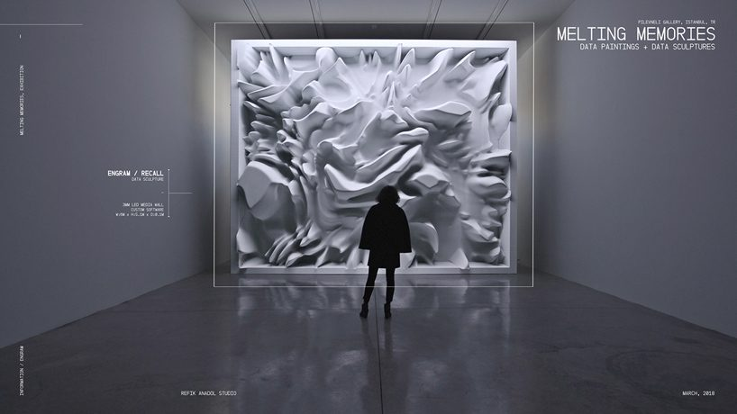
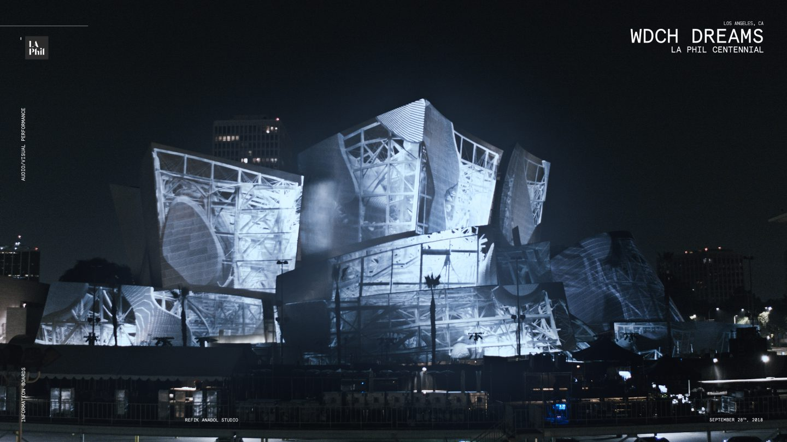
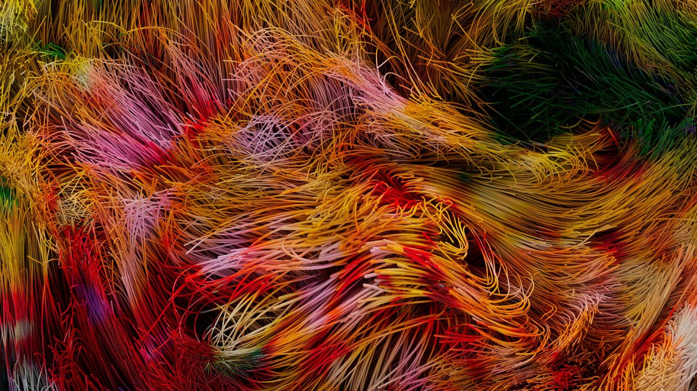
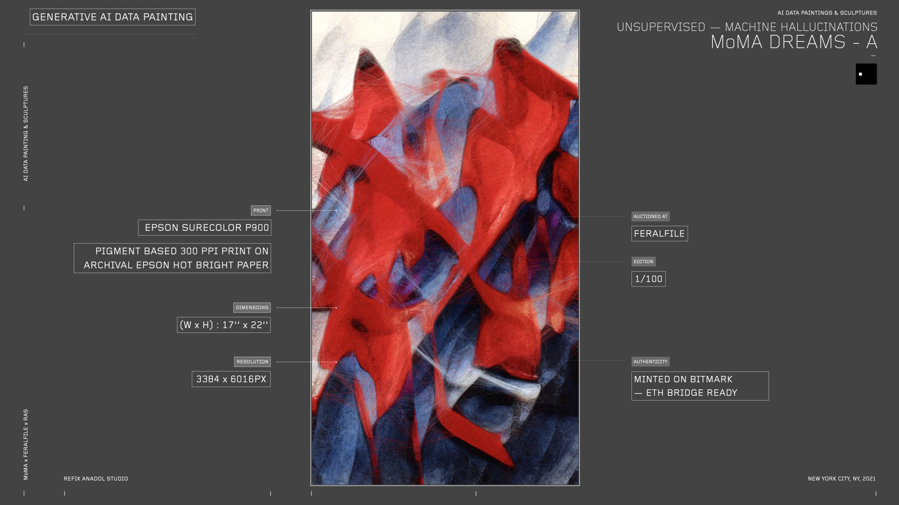
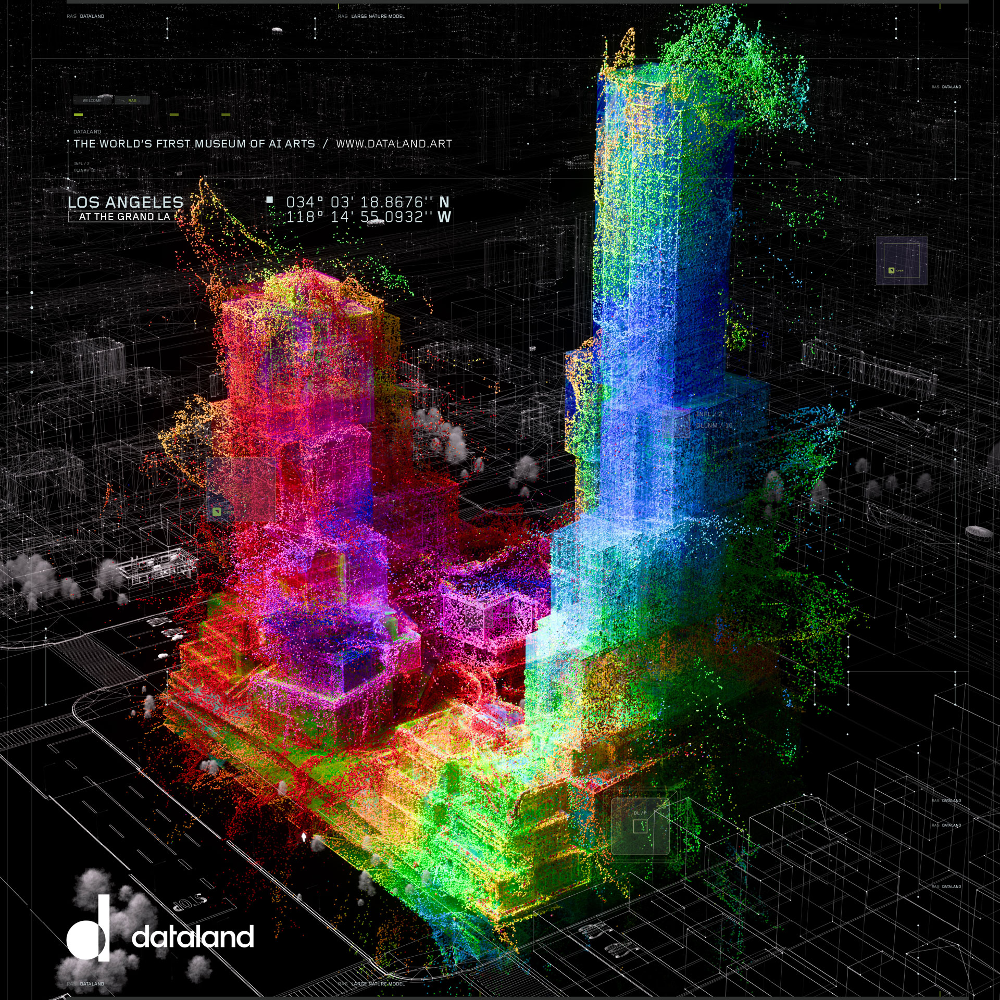

# Refik Anadol

**Tag tecnica/formato:** `ai-generativa` `data-visualization` `installazione` `projection-mapping`
**Tag tema:** `memoria-archivio` `economia-attenzione`
**Stato:** testo in parte generato con IA: le citazioni di Jerry Saltz e Travis Diehl vengono da fonti secondarie, da verificare sulla fonte primaria

## Biografia
Nato il 7 novembre 1985 a Istanbul, Turchia. Consegue un BA in Fotografia e Video (dipartimento di Visual Communication Design) alla Istanbul Bilgi University, e un MFA in Design Media Arts alla UCLA (2014), dove viene seguito da Casey Reas, Jennifer Steinkamp e Christian Moeller. Vive e lavora a Los Angeles, dove dirige e ha co-fondato Refik Anadol Studio (RAS), descritto come un team internazionale di designer, architetti, data scientist e ricercatori provenienti da circa dieci paesi. Insegna come lecturer/ricercatore ospite nel Dipartimento di Design Media Arts della UCLA, lo stesso in cui si è formato. Riconoscimenti: TIME 100 AI Impact Award; UCLA Edward A. Dickson Alumnus of the Year (2024); Lorenzo il Magnifico Lifetime Achievement Award for New Media Art; residenza artistica Google Artists and Machine Intelligence (2016, origine della serie *Machine Hallucinations*); Microsoft Research Best Vision Award; iF Gold Award; D&AD Pencil Award; German Design Award; Young Global Leader del World Economic Forum (2024); membro eletto dell'American Academy of Arts and Sciences. Nel 2026 apre a Los Angeles **Dataland**, descritto come "il primo museo al mondo di arte IA", ospitato nel complesso The Grand LA progettato da Frank Gehry.

## Poetica e ricerca
Anadol descrive la propria pratica come l'uso di apprendimento automatico su larga scala, addestrato su vasti insiemi di dati pubblici (archivi museali, dati meteorologici/climatici, dati cerebrali/EEG, immagini urbane e naturali, memorie personali e istituzionali), per generare "dipinti di dati", "sculture di dati" e "universi di dati" immersivi — descrivendo spesso il processo con la metafora di una macchina che "sogna" o "allucina". Ha definito il lavoro con Dataland "una collaborazione al 50% tra umani e macchine". Il MoMA ha acquisito *Unsupervised* (2022-23) nella propria collezione permanente, e l'opera ha attirato grandi folle entusiaste, con un pubblico che ne descrive la ricezione come coinvolgente e quasi meditativa.

Il lavoro di Anadol è però anche al centro di una controversia critica di alto profilo, importante da documentare con lo stesso rigore dell'apprezzamento istituzionale. Il critico Jerry Saltz (*New York Magazine*) ha definito *Unsupervised* "una gigantesca lampada di lava tecnologica", "uno screensaver da mezzo milione di dollari" e un "budino narcotico" che "fatica a trascendere il proprio materiale sorgente" — in uno scontro pubblico ampiamente ripreso dalla stampa. Secondo fonti secondarie, anche Travis Diehl sul *New York Times* avrebbe concluso che "*Unsupervised* è solo uno screensaver" (citazione di seconda mano, da verificare direttamente sulla fonte primaria). Eryk Salvaggio, ricercatore e critico di arte IA (newsletter *Cybernetic Forests*), ha scritto un saggio critico sostanziale, "Ideologies of Awe & AI Art at the MoMA", sostenendo che Anadol rappresenti una generazione di artisti che prende alla lettera le rivendicazioni dell'IA e la presenta come strumento di un "timore reverenziale" quasi spirituale, criticando anche il modo in cui una GAN addestrata sul patrimonio del MoMA finisca per mediare e ri-brandizzare l'istituzione stessa. *e-flux Criticism* ha pubblicato un saggio dedicato specificamente a *Unsupervised*. Critici e ricercatori di IA segnalano inoltre una tensione concettuale: dove i ricercatori trattano l'"allucinazione" come un difetto tecnico da correggere, Anadol ne fa un tratto estetico rivendicato, con obiezioni sulla disinvoltura con cui antropomorfizza gli output del machine learning parlando di "sogno" — una critica ricorrente osserva semplicemente che "una macchina non può sognare perché sognare richiede un soggetto vivente". Altre critiche, raccolte nella copertura di *Artnet* su Dataland, riguardano i legami commerciali dell'artista con grandi aziende tecnologiche (Nvidia, Google) e l'uso di archivi pubblici gratuiti (Smithsonian, Università di Oxford) per costruire modelli IA alla base di iniziative a scopo di lucro (il biglietto d'ingresso standard di Dataland è riportato a 49 dollari). In un'intervista a *Ocula*, lo stesso Anadol risponde alle critiche quantificandole ("22 critici su 24 hanno dato recensioni favorevoli... quantifico tutto! Lavoro con i dati") e difende la scelta di non mostrare mai direttamente il materiale sorgente del MoMA: "Abbiamo passato esattamente un anno a non creare un'altra imitazione di un Monet o di un van Gogh."

## Opere principali
### Melting Memories (2018)
**Descrizione:** scultura/dipinto di dati che esplora come il cervello richiami i ricordi, usando dati EEG. Anadol ha condotto esperimenti al Neuroscape Laboratory della UC San Francisco, analizzando i canali delle onde beta e theta associati all'attivazione della memoria a breve e lungo termine (in particolare episodica). Realizzata come parete LED personalizzata di 16x20 piedi affiancata da una superficie scultorea in schiuma rigida fresata a controllo numerico; mostrata alla galleria Pilevneli di Istanbul (2018).
**Lettura critica:** una delle opere più esplicitamente ancorate a un protocollo scientifico verificabile (i dati EEG raccolti in laboratorio), utile per discutere in classe la differenza tra dati scientifici reali e la loro resa estetica.

**Approfondimento:** [Designboom — Melting Memories](https://www.designboom.com/art/refik-anadol-melting-memories-neuroscience-04-25-2018/)

### WDCH Dreams (2018)
**Descrizione:** commissionata dalla Los Angeles Philharmonic per il proprio centenario: proiezioni 3D su larga scala mappate sull'esterno ondulato in acciaio della Walt Disney Concert Hall di Frank Gehry, tramite circa 42 proiettori (risoluzione 50K, audio a 8 canali). La fonte dei dati è l'archivio digitale della LA Phil — circa 45 terabyte: 587.763 file immagine, 1.880 file video, 1.483 file di metadati, 17.773 file audio (equivalenti a circa 40.000 ore di audio su 16.471 esecuzioni). Concettualmente inquadrata come un far "sognare" l'edificio stesso, ricombinando algoritmicamente le memorie d'archivio. Installazione pubblica gratuita, proiezioni ogni mezz'ora ogni sera (28 settembre-6 ottobre 2018).
**Lettura critica:** applica per la prima volta su scala pubblica e architettonica monumentale il metodo che diventerà la cifra distintiva dell'artista — trasformare un archivio istituzionale in spettacolo di luce, sollevando già allora la domanda se questo costituisca interpretazione critica dei dati o semplice spettacolarizzazione.

**Approfondimento:** [refikanadol.com — WDCH Dreams](https://refikanadol.com/works/wdch-dreams/)

### Machine Hallucinations, serie (dal 2016)
**Descrizione:** serie-ombrello iniziata con la residenza Google Artists and Machine Intelligence (AMI) del 2016, che usa modelli della famiglia GAN (DCGAN, PGAN, StyleGAN, poi sistemi di IA generativa più recenti) addestrati su milioni di fotografie pubblicamente reperibili di città, natura e spazio. Include *Machine Hallucinations: NYC* (universo di dati costruito da oltre 100 milioni di fotografie da social media di New York, mostrato in risoluzione 16K) e *Machine Hallucinations: Sphere* (2023), dove Anadol è il primo artista a usare l'intera Exosfera LED programmabile della Sphere di Las Vegas come tela, con una nuova tecnica di projection mapping sviluppata per la geometria curva della struttura.
**Lettura critica:** dimostra la scalabilità del metodo di Anadol dalla galleria (König Galerie) alla scala urbana totale (l'intera facciata della Sphere) — una progressione che alimenta tanto l'ammirazione istituzionale quanto le critiche sulla natura sempre più commerciale e "da spettacolo" del lavoro.

### Unsupervised (2022-2023, MoMA New York)
**Descrizione:** installazione su schermo alto 24 piedi al piano terra del MoMA, aperta il 19 novembre 2022. Anadol alimenta un modello di machine learning con metadati e immagini della collezione online pubblica del MoMA (oltre 138.000 opere), generando un'interpretazione astratta in continua evoluzione e mai ripetuta del canone del museo — senza mai mostrare, per scelta dichiarata dell'artista, immagini sorgente riconoscibili. Prorogata ben oltre la durata originale per la richiesta del pubblico, e infine acquisita nella collezione permanente del MoMA.
**Lettura critica:** l'opera insieme più celebrata e più contestata della carriera dell'artista — vedi il paragrafo sulla controversia critica sopra (Saltz, Diehl/NYT, Salvaggio, e-flux, Ben Davis/Artnet).

**Approfondimento:** [e-flux Criticism — saggio su Unsupervised](https://www.e-flux.com/criticism/527236/refik-anadol-s-unsupervised)

### Dataland (aperto nel 2026, Los Angeles)
**Descrizione:** museo permanente dello studio di Anadol, presentato come "il primo museo al mondo di arte IA", ospitato nel complesso The Grand LA (progettato da Frank Gehry), vicino a MOCA, The Broad e alla Walt Disney Concert Hall. Le prime mostre ruotano attorno al "Large Nature Model" (modello di IA generativa open-source addestrato su dati naturali), con un design olfattivo generato dall'IA addestrato su oltre 500.000 profumi come parte delle gallerie multisensoriali.
**Lettura critica:** secondo la copertura critica di *Artnet*, i detrattori segnalano i "rapporti stretti con grandi aziende tecnologiche come Nvidia e Google" e l'uso di archivi pubblici gratuiti (Smithsonian, Oxford) per costruire modelli alla base di un'iniziativa a scopo di lucro — la ricercatrice Deniz Johns viene citata: "Per me è come l'immagine perfetta dell'arte nel tardo capitalismo."

**Approfondimento:** [dataland.art](https://dataland.art/)

## Interviste e talk
- _Nessuna ancora: da aggiungere._

## Fonti
- [MoMA — pagina mostra ufficiale di Unsupervised](https://www.moma.org/calendar/exhibitions/5535)
- [Artforum — il MoMA acquisisce Unsupervised](https://www.artforum.com/news/moma-acquires-refik-anadols-unsupervised-517497/)
- [e-flux Criticism — saggio su Unsupervised](https://www.e-flux.com/criticism/527236/refik-anadol-s-unsupervised)
- [Artnet — scontro Saltz/Anadol](https://news.artnet.com/art-world-archives/refik-anadol-vs-jerry-saltz-2400275)
- [Artnet — recensione critica di Dataland](https://news.artnet.com/art-world/refik-anadol-dataland-review-2-2781630)
- [Cybernetic Forests (Eryk Salvaggio) — "Ideologies of Awe & AI Art at the MoMA"](https://cyberneticforests.substack.com/p/ideologies-of-awe-and-ai-art-at-the)
- [Ocula — "To Refik Anadol, Criticism Is Just More Data"](https://ocula.com/magazine/art-news/to-refik-anadol-criticism-is-just-more-data/)
- [Hyperallergic — su WDCH Dreams](https://hyperallergic.com/refik-anadol-walt-disney-concert-hall-la-phil/)
- [Designboom — su Melting Memories](https://www.designboom.com/art/refik-anadol-melting-memories-neuroscience-04-25-2018/)
- [NPR — copertura dell'apertura di Dataland](https://www.npr.org/2026/07/29/nx-s1-5894941/ai-art-dataland-refik-anadol)

## Crediti delle immagini
Immagine per ciascuna delle cinque opere, inclusa sotto la relativa descrizione in "Opere principali", da Designboom, refikanadol.com e dataland.art.
- [MoMA — pagina mostra ufficiale di Unsupervised](https://www.moma.org/calendar/exhibitions/5535)
- [Artforum — il MoMA acquisisce Unsupervised](https://www.artforum.com/news/moma-acquires-refik-anadols-unsupervised-517497/)
- [e-flux Criticism — saggio su Unsupervised](https://www.e-flux.com/criticism/527236/refik-anadol-s-unsupervised)
