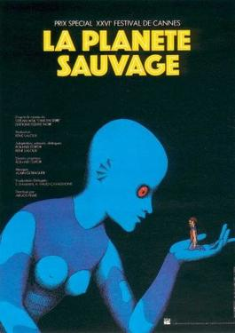
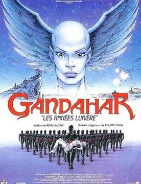

# René Laloux

**Tag tecnica/formato:** `animazione-2d`
**Tag tema:** `fantascienza-speculativa` `colonialismo-decolonialita`
**Stato:** scheda parziale, scritta a partire da fonti web (Wikipedia, siti di festival e gallerie); non ancora assegnata a un corso · immagini controllate (diritti degli autori)

## Biografia
Nato a Parigi il 13 luglio 1929, morto ad Angoulême nel marzo 2004. Studia pittura, lavora nella pubblicità e poi in un istituto psichiatrico, dove sperimenta l'animazione con i ricoverati. Lì realizza *Les Dents du singe* (1960), prodotto con lo studio di Paul Grimault.

## Poetica e ricerca
Il suo collaboratore principale è Roland Topor, con cui realizza *Les Temps morts*, *Les Escargots* e *La Planète sauvage*. Più tardi lavora con Jean Giraud (Mœbius) a *Les Maîtres du temps*.

## Opere principali

### Fantastic Planet (La Planète sauvage, 1973)
**Descrizione:** Film d'animazione di fantascienza surreale per adulti, tratto dal romanzo *Oms en série* (1957) di Stefan Wul e scritto da Laloux con Roland Topor, che ne cura anche la scenografia. Racconta di esseri umani trattati come animali dai giganti umanoidi che dominano il pianeta Ygam. Coproduzione franco-cecoslovacca, animato negli studi Jiří Trnka a Praga; produzione iniziata nel 1963. Gran Premio speciale della giuria a Cannes 1973.
**Lettura critica:** Allegoria della dominazione e dell'oppressione; inserito da *Rolling Stone* (2016) al 36° posto tra i migliori film d'animazione.

### Les Maîtres du temps (1982)
**Descrizione:** Lungometraggio realizzato con Jean Giraud (Mœbius).

⚠️ Nessuna immagine trovata.

### Gandahar (1987)
**Descrizione:** Ultimo lungometraggio, tratto dal romanzo *Les Hommes-machines contre Gandahar* (1969) di Jean-Pierre Andrevon. Negli Stati Uniti uscì in versione abbreviata e ridoppiata con il titolo *Light Years*.

## Fonti
- [Wikipedia — René Laloux](https://en.wikipedia.org/wiki/René_Laloux)
- [Wikipedia — Fantastic Planet](https://en.wikipedia.org/wiki/Fantastic_Planet)
- [Wikipedia — Gandahar](https://en.wikipedia.org/wiki/Gandahar_(film))

## Crediti delle immagini
Immagini controllate il 2026-11-01: provengono dalle pagine indicate (festival, gallerie, siti degli artisti, piattaforme) e restano di proprietà degli autori.
- Fantastic Planet (La planète sauvage) (1): [en.wikipedia.org](https://en.wikipedia.org/wiki/File%3AFantastic_Planet_film_poster.jpg) · Locandina, diritti degli autori; uso didattico
- Gandahar (Light Years) (1): [en.wikipedia.org](https://en.wikipedia.org/wiki/File%3AGandahar-poster.jpg) · Locandina, diritti degli autori; uso didattico
