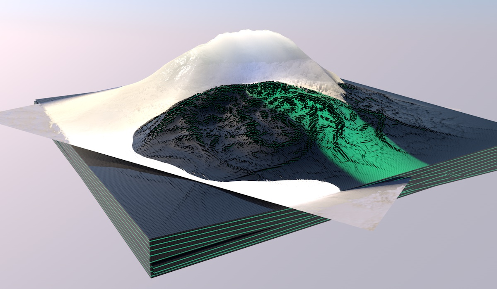
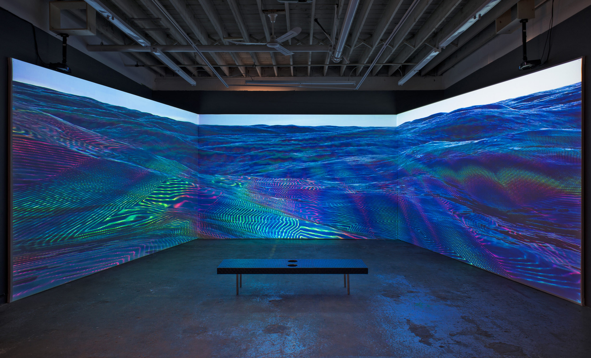

# Rick Silva

**Tag tecnica/formato:** `fotogrammetria-scansione` `procedurale-generativo` `video`
**Tag tema:** `ecologia-ambiente` `mondi-virtuali-simulazione`

## Biografia
Artista brasiliano-americano, con base a Eugene, Oregon.

## Poetica e ricerca
La ricerca di Silva esplora nozioni di paesaggio e natura selvaggia nel XXI secolo (e oltre), attraverso video, siti web e installazioni che indagano virtualità, futurologia ed ecologie speculative. Il suo lavoro adotta in modo critico e giocoso gli strumenti di default della modellazione 3D — preset di paesaggio, fotogrammetria, drone — per mostrare come il software non si limiti a rappresentare la natura, ma ne detti anche i modi di visione: un doppio movimento tra sperimentazione estetica e critica del "computer-vision" applicato all'estrazione di risorse.

## Opere principali

### The Silva Field Guide to Birds of a Parallel Future (2014)
**Descrizione:** 18 brevi animazioni 3D che mescolano birdwatching e ornitologia con teorie multiverso/quantistiche: specie di uccelli "glitch", oscillanti tra rappresentazione e astrazione.
**Lettura critica:** riformula la convenzione naturalistica della guida da campo per mettere in crisi l'idea di documentazione "oggettiva" della natura.

### Western Fronts: Cascade Siskiyou, Gold Butte, Grand Staircase-Escalante, Bears Ears (2022)
**Descrizione:** video sperimentale che combina riprese aeree da drone e fotogrammetria con animazione 3D, sulle minacce politiche ed ecologiche a quattro monumenti nazionali USA.
**Lettura critica:** il paesaggio scansionato si riduce a poligoni in scala di grigi — un'immagine di distopia prossima ventura, quella dell'estrazione di risorse assistita da computer vision.

### En Plein Air (2012-2013)
**Descrizione:** l'artista porta il laptop in luoghi remoti del Pacific Northwest e delle Montagne Rocciose, creando ogni opera in loco, in reazione diretta al terreno; ogni "schizzo" è marcato con data/ora/condizioni meteo.
**Lettura critica:** adozione sovversiva dei preset di generazione paesaggistica di default nei software 3D — mostra come il software abiliti ma anche imponga i modi in cui ricreiamo la natura sullo schermo.

### SIGNALS / CORES (con Nicolas Sassoon)
**Descrizione:** progetto collaborativo di video-installazioni 3D su paesaggi oceanici e geologici alterati, rocce scansionate in 3D.
**Lettura critica:** riflessione su contaminazione, mutazione ed ecologie future a partire da survey oceanografici e climatici.

**Approfondimento:** [s-i-g-n-a-l-s.com](https://s-i-g-n-a-l-s.com/)

## Immagini

Immagine per ciascuna delle quattro opere, inclusa sotto la relativa descrizione in "Opere principali", dal sito ufficiale dell'artista, Vimeo e s-i-g-n-a-l-s.com.
- [ricksilva.net](https://ricksilva.net/)
- [The Silva Field Guide to Birds of a Parallel Future](https://silvafieldguide.com/)
- [Western Fronts](https://westernfronts.com/)

## Fonti
- [ricksilva.net](https://ricksilva.net/)
- [The Silva Field Guide to Birds of a Parallel Future](https://silvafieldguide.com/)
- [Western Fronts](https://westernfronts.com/)
- [En Plein Air](https://enpleinair.org/)
- [SIGNALS (con Nicolas Sassoon)](https://s-i-g-n-a-l-s.com/videoworks)

---

## Appunti da organizzare
- Fonte: scheda REF originale su Drive (migrata e riorganizzata col nuovo template).
- Collaborazione ricorrente con **Nicolas Sassoon** (già presente come scheda a sé) su SIGNALS/CORES.
- Nessun link YouTube/Vimeo dedicato trovato nella scheda REF: i video delle opere sono ospitati direttamente nei siti di progetto già in Fonti (silvafieldguide.com, westernfronts.com, enpleinair.org, s-i-g-n-a-l-s.com) — da aprire direttamente per la visione/download, non essendoci un canale YouTube/Vimeo centralizzato individuato.
