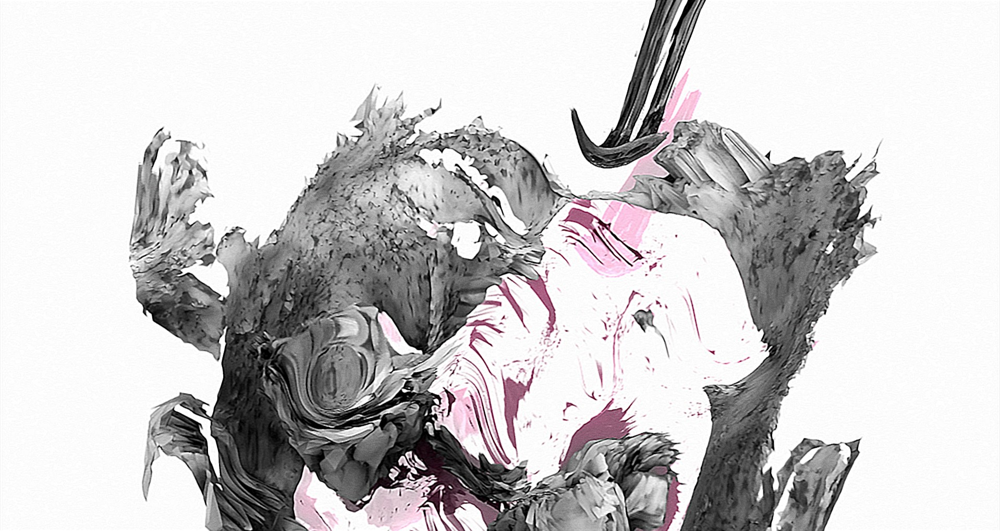
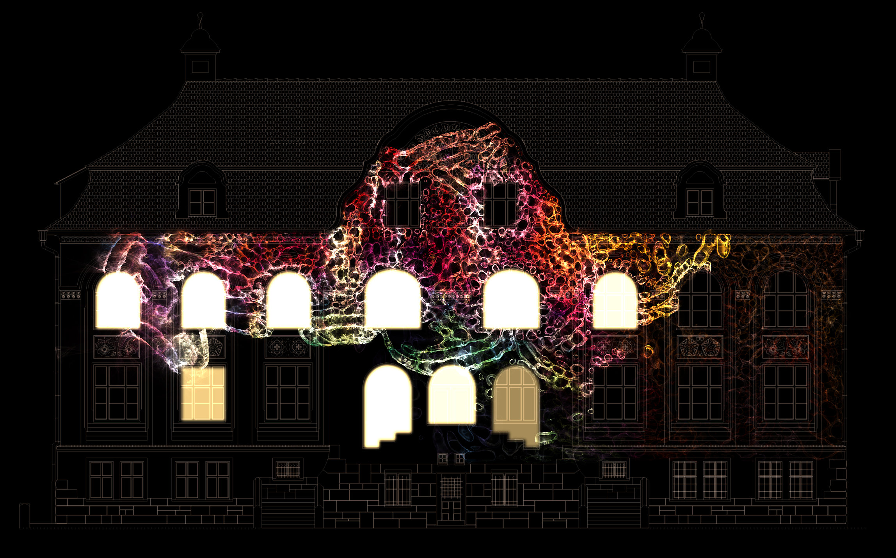

# Robert Seidel

**Tag tecnica/formato:** `projection-mapping` `procedurale-generativo` `modellazione-3d`
**Tag tema:** `corpo-identita` `storia-computer-grafica`
**Tag corso:** `AVM` `M3D`

## Biografia
Nato nel 1977 a Jena, Germania. Inizia gli studi in biologia, poi si trasferisce alla Bauhaus-Universität Weimar per completare la formazione in media design. Con base a Berlino, lavora tra film sperimentale, installazione, arte pubblica, performance, suono e curatela.

## Poetica e ricerca
Seidel spinge l'astrazione verso il sublime e l'organico, attingendo a metodi dell'analisi visiva scientifica (scansioni mediche, dati biometrici) e a estensioni digitali della pittura e della scultura. Il suo lavoro nasce spesso da fonti reali e personali — scansioni del proprio corpo, dati di risonanza magnetica — trasformate attraverso simulazione fisica e animazione 3D in immagini astratte cariche di intensità emotiva.

## Opere principali
### _grau (2004)
**Descrizione:** film sperimentale di 10:01 minuti (durata che richiama il sistema binario di Leibniz), basato su fonti reali della vita dell'artista: scansioni 3D della propria testa e mano, movimenti captati in motion capture, dati di risonanza magnetica del proprio cervello, fusi in animazione 3D e simulazione fisica per costruire un ritratto emotivo astratto di un incidente d'auto.
**Lettura critica:** considerato una pietra miliare nell'animazione digitale sperimentale — ridefinisce il filmmaking digitale fondendo dato biomedico, simulazione fisica e narrazione emotiva senza mai mostrare un'immagine figurativa diretta.

**Approfondimento:** [robertseidel.com — _grau](https://robertseidel.com/grau/)

### Phyletic Museum, Jena (proiezione architetturale)
**Descrizione:** trasformazione dell'intera facciata del Museo di Storia Naturale (Phyletisches Museum) di Jena in una "creatura vivente", tramite proiezione mappata sull'intero edificio, coreografia di luci e colonna sonora sincronizzata.
**Lettura critica:** porta la ricerca sull'organico e il biologico dalla scala del corpo individuale a quella dell'architettura pubblica.

**Approfondimento:** [robertseidel.com — Processes: Living Paintings](https://robertseidel.com/processes/)

## Interviste e talk
- _Nessuna ancora: da aggiungere._

## Fonti
- [robertseidel.com — sito ufficiale](https://robertseidel.com/)
- [robertseidel.com — _grau](https://robertseidel.com/grau/)
- [Light Cone — profilo artista](https://lightcone.org/en/filmmaker-1057-robert-seidel)
- [shortfilm.de — "Robert Seidel – Laboratory for the Sublime"](https://www.shortfilm.de/en/robert-seidel-labor-fuer-das-erhabene/)

## Crediti delle immagini
Immagine per ciascuna delle due opere, inclusa sotto la relativa descrizione in "Opere principali", dal sito ufficiale dell'artista.
- [robertseidel.com — sito ufficiale](https://robertseidel.com/)
- [robertseidel.com — _grau](https://robertseidel.com/grau/)
- [Light Cone — profilo artista](https://lightcone.org/en/filmmaker-1057-robert-seidel)
