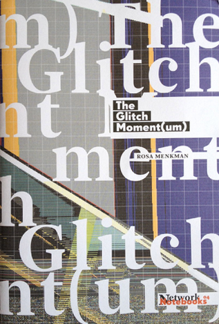
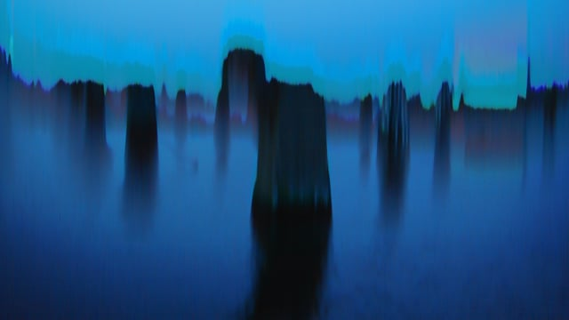
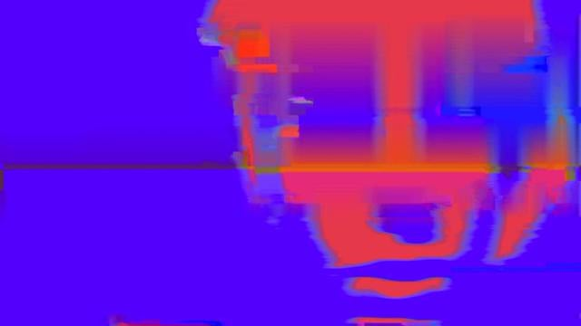
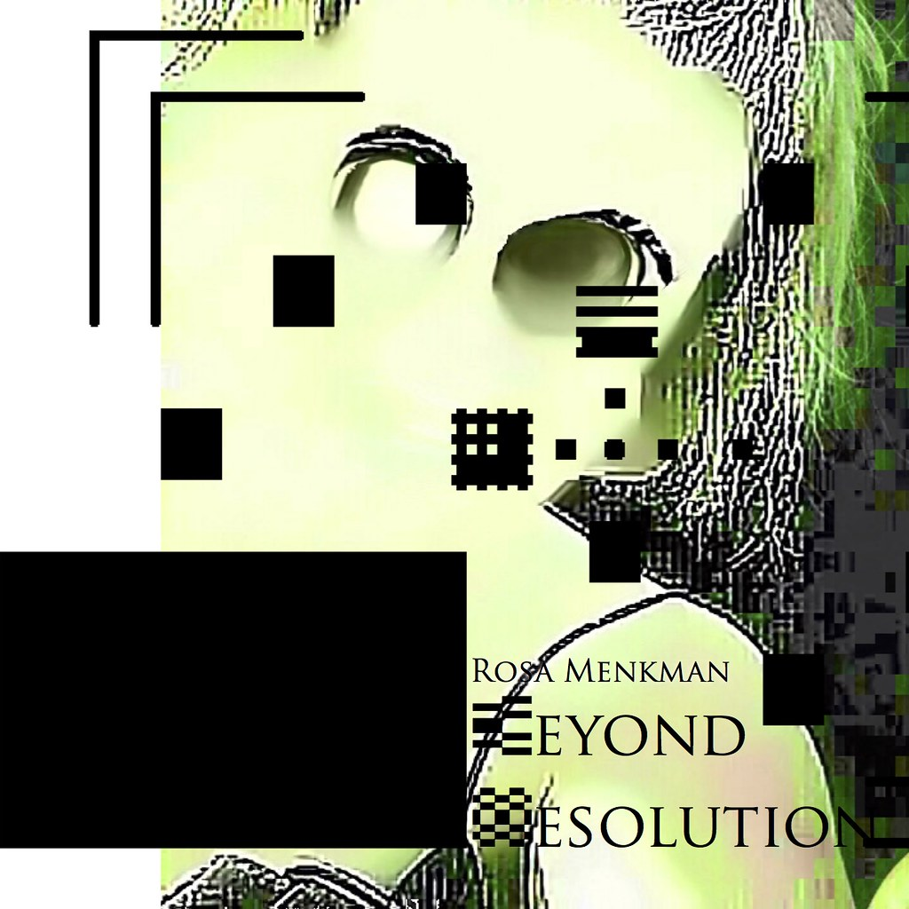

# Rosa Menkman

**Tag tecnica/formato:** `video` `net-art-sito-web` `data-visualization`
**Tag tema:** `economia-attenzione` `storia-computer-grafica`
**Tag corso:** `M3D`

## Biografia
Nata nel 1983 ad Arnhem, nei Paesi Bassi. Consegue due master all'Università di Amsterdam (MFA e Research MA); la tesi *"Jodi op de Pijnbank"* (2006, relatore Joost Bolten) analizza la modifica decostruttiva del videogioco Quake realizzata dal duo JODI, *untitled game* (1996-2001) — un lavoro di ricerca che confluirà direttamente nella sua successiva teoria del glitch. È stata professoressa a contratto di "Neue Medien & Visuelle Kommunikation" alla Kunsthochschule Kassel (2018-2020) e dal 2023 dirige l'Im/Possible Lab alla HEAD – Genève. Dal 2015 è fondatrice e direttrice di **i.R.D. — institute(s) for Resolution Disputes**, piattaforma di ricerca indipendente attraverso cui pubblica i propri lavori teorici. Nel 2019 vince il Collide International Barcelona Award (Arts at CERN), con una residenza di due mesi al CERN. Vive e lavora ad Amsterdam.

## Poetica e ricerca
Menkman è la teorica che ha dato fondamento accademico ai "glitch studies" come campo di studi distinto dalla semplice pratica del glitch art. Il suo *Glitch Studies Manifesto* (2010, poi pubblicato nel 2011 in *Video Vortex Reader II*, Institute of Network Cultures) critica l'ideologia della trasparenza tecnologica e della "perfezione" del mezzo: ogni medium porta con sé vincoli e modalità di fallimento intrinseche ("artefatti di rumore"), e la spinta verso una risoluzione impeccabile viene letta come un mito consumistico — mentre chi lavora deliberatamente con il glitch espone e critica quell'ideologia, invece di limitarsi a produrre errori decorativi. Il concetto viene approfondito in *A Vernacular of File Formats* (2010): fa passare una stessa immagine attraverso diversi algoritmi di compressione per dimostrare che ciascun formato possiede una propria "grammatica" caratteristica dell'errore — non un rumore neutro, ma un vocabolario specifico del codec. Questa linea di ricerca culmina nel libro *Beyond Resolution* (2020, autopubblicato con i.R.D.), dove la "risoluzione" — di un'immagine, di un segnale, di un formato — viene teorizzata come categoria mai neutra: standardizzare una risoluzione promuove efficienza, ordine e funzionalità, ma al tempo stesso oscura e preclude possibilità alternative, incorporando strutture di potere nel sostrato tecnico stesso. Menkman chiama queste strutture nascoste "le ombre bianche che governano gli esiti delle nostre tecnologie di elaborazione dell'immagine", usando la genealogia delle mire di calibrazione del colore come caso di studio dei bias incorporati nei sistemi di visione. Michael Betancourt, nel suo *Glitch Art in Theory and Practice* (Routledge, 2017), colloca esplicitamente il proprio impianto teorico in dialogo con quello di Menkman, entrambi punti di riferimento centrali del discorso critico sul glitch art. La rivista italiana Digicult ha dedicato al suo lavoro il saggio "The Punctum as Glitch in Contemporary Art: The Art of Rosa Menkman", mettendo in relazione il concetto di *punctum* di Roland Barthes con la sua pratica.

## Opere principali
### The Glitch Moment(um) (2011)
**Descrizione:** Network Notebook n. 4 dell'Institute of Network Cultures di Amsterdam; usa strumenti della teoria dell'informazione per costruire un vocabolario critico del glitch art come genere, sostenendo che il glitch oscilli costantemente tra lo statuto di "artefatto" e quello di "processo". Pubblicato in concomitanza con il festival GLI.TC/H, che Menkman co-organizza con Nick Briz, Evan Meaney e Jon Satrom (prima edizione Chicago 2010, seconda in tournée Chicago-Amsterdam-Birmingham 2011, terza Chicago 2012).
**Lettura critica:** testo fondativo del campo dei "glitch studies", ancora oggi tra i riferimenti più citati della letteratura accademica sull'estetica dell'errore digitale.

**Approfondimento:** [Institute of Network Cultures — The Glitch Moment(um)](https://networkcultures.org/blog/publication/no-04-the-glitch-momentum-rosa-menkman/)

### The Collapse of PAL (2010-2011)
**Descrizione:** performance audiovisiva in tre parti ("Eulogy, Obsequies, and Requiem for the blue plains of phosphor") che compone un elogio funebre per lo standard televisivo analogico PAL, combinando segnale PAL proveniente da un NES, image bending, datamoshing e artefatti di interlacciamento; la colonna sonora usa una Cracklebox, codice Morse e audio compresso in DV e volutamente corrotto.
**Lettura critica:** trasforma l'obsolescenza di uno standard tecnico in un lutto formale — l'errore diventa il linguaggio stesso con cui si racconta la fine di una tecnologia, non solo il suo sintomo.
**Video:** [The Collapse of PAL, documentazione integrale (Vimeo)](https://vimeo.com/12199201)

### Dear Mr. Compression (2010)
**Descrizione:** video che personifica "Mr. Compression" come destinatario silenzioso di un tentativo di comunicazione da parte dell'artista, che si corrompe progressivamente in artefatti di compressione man mano che l'opera procede.
**Lettura critica:** un'illustrazione diretta e didattica della tesi del "vernacolo dei formati file" — utile in aula per mostrare visivamente come ogni codec produca il proprio tipo specifico di errore.
**Video:** [Dear Mr. Compression, documentazione integrale (Vimeo)](https://vimeo.com/11147006)

### A Vernacular of File Formats (2009-2010)
**Descrizione:** libro d'artista e serie di immagini in cui una stessa fotografia-ritratto viene fatta passare attraverso molteplici codec di compressione, per esporre la grammatica di errore distintiva di ciascun formato.
**Lettura critica:** una delle prime opere a proporre il file compresso non come degrado neutro dell'immagine originale ma come oggetto esteticamente e politicamente significativo di per sé; una stampa della serie è stata battuta all'asta Sotheby's "Glitch: Beyond Binary" (2023), segno del riconoscimento istituzionale successivo del lavoro.

⚠️ Nessuna immagine trovata con attribuzione certa in questa sessione: la pagina Sotheby's del lotto restituisce solo immagini generiche di altri lotti, non identificabili con sicurezza come questa specifica opera.

### Beyond Resolution (2020)
**Descrizione:** libro autopubblicato tramite i.R.D. che raccoglie quattro anni di ricerca in forme miste (racconti brevi, un primer di ottica, testi in forma di manifesto), sviluppando la "risoluzione" come categoria politico-tecnica centrale del proprio lavoro.
**Lettura critica:** estende la critica del glitch dal singolo artefatto visivo all'intera infrastruttura di standardizzazione tecnica — la risoluzione come dispositivo che decide cosa un'immagine (o un sistema) può o non può mostrare.

**Approfondimento:** [beyondresolution.info](https://beyondresolution.info/BIO)

## Interviste e talk
- _Nessuna ancora: da aggiungere._

## Fonti
- [Blog ufficiale](http://rosa-menkman.blogspot.com/)
- [beyondresolution.info — piattaforma di ricerca i.R.D.](https://beyondresolution.info/BIO)
- [Institute of Network Cultures — The Glitch Moment(um), pubblicazione](https://networkcultures.org/blog/publication/no-04-the-glitch-momentum-rosa-menkman/)
- [Rhizome — Glitch Studies Manifesto](https://rhizome.org/editorial/2011/jul/28/glitch-studies-manifesto-rosa-menkman/)
- [Rhizome — profilo artista](https://rhizome.org/editorial/2011/oct/20/artist-profile-rosa-menkmen/)
- [Digicult — "The Punctum as Glitch in Contemporary Art: The Art of Rosa Menkman"](https://digicult.it/articles/the-punctum-as-glitch-in-contemporary-art/)
- [Arts at CERN — profilo artista](https://arts.cern/artist/rosa-menkman/)
- [NECSUS — recensione della mostra "Still Processing", NXT Museum](https://necsus-ejms.org/still-processing-an-image-at-nxt-museum/)
- [Monoskop — pagina archivio/bibliografia](https://monoskop.org/Rosa_Menkman)

## Crediti delle immagini
Immagine per quattro delle cinque opere, inclusa sotto la relativa descrizione in "Opere principali", da Institute of Network Cultures, Vimeo e dal blog ufficiale dell'artista.
- [Blog ufficiale](http://rosa-menkman.blogspot.com/)
- [beyondresolution.info — piattaforma di ricerca i.R.D.](https://beyondresolution.info/BIO)
- [Institute of Network Cultures — The Glitch Moment(um), pubblicazione](https://networkcultures.org/blog/publication/no-04-the-glitch-momentum-rosa-menkman/)
