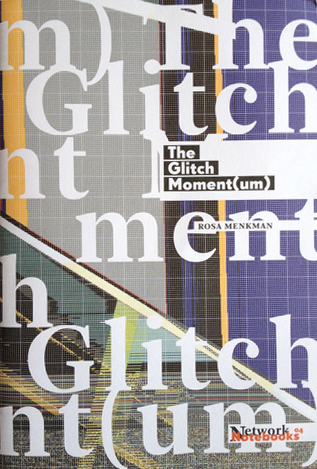
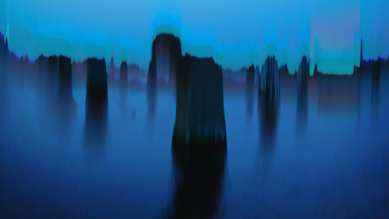
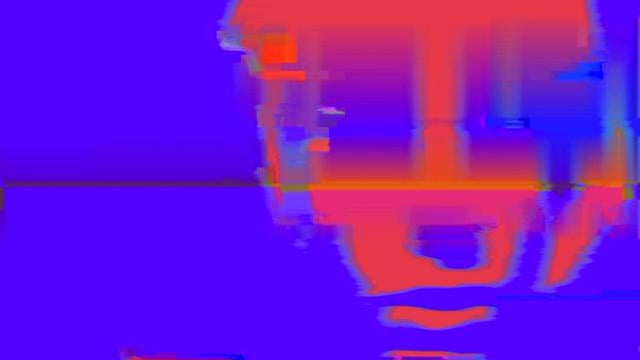
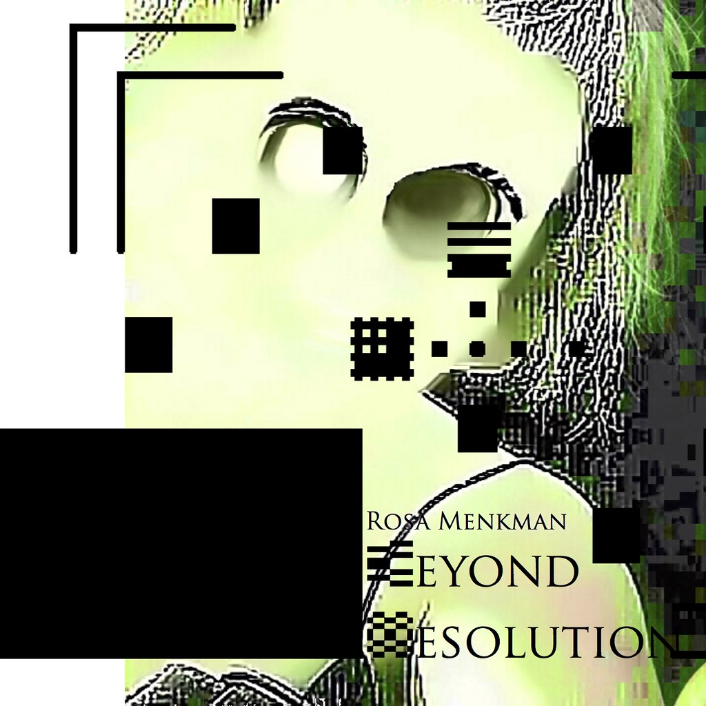

# Rosa Menkman

**Tag tecnica/formato:** `video` `net-art-sito-web` `data-visualization`
**Tag tema:** `economia-attenzione` `storia-computer-grafica`
**Tag corso:** `M3D`
**Stato:** scheda avanzata · da aggiungere: *DCT* (2015), *Whiteout* (2020), *Destitute Vision* (2025) e i lavori sugli «arcobaleni impossibili»

## Biografia
Nata ad Arnhem, nei Paesi Bassi, il 3 aprile 1983.[^1] Artista e ricercatrice, si definisce studiosa delle «risoluzioni».[^2] Dal 2010 al 2012 organizza con Jon Satrom, Nick Briz ed Evan Meaney il festival GLI.TC/H, nato a Chicago nel 2010 e proseguito nel 2011 tra Chicago, Amsterdam e Birmingham.[^3][^1] Nel 2015 apre alla Transfer Gallery di New York gli *institutions of Resolution Disputes* (i.R.D.), titolo che gioca tra la risoluzione delle controversie e la risoluzione dello schermo; l'opera *DCT*, esposta in quella mostra, vince nello stesso anno la Crypto Design Challenge del Museum of the Image di Breda.[^1] Dal 2018 al 2020 è professoressa supplente di Neue Medien & Visuelle Kommunikation alla Kunsthochschule Kassel; nel 2019 vince il Collide International Barcelona Award di Arts at CERN, con una residenza al CERN; dal 2023 dirige l'Im/Possible Lab alla HEAD di Ginevra.[^2][^4] Riceve dal Mondriaan Fund una borsa di base per il 2018-2021 e per il 2023-2027.[^2]

## Poetica e ricerca
Il lavoro di Menkman riguarda gli artefatti di rumore prodotti da incidenti nei media analogici e digitali: glitch, compressione, feedback. Secondo l'artista questi artefatti permettono di capire la logica, altrimenti nascosta, con cui si fissano gli standard e le risoluzioni.[^4] La sua protagonista è l'Angelo della Storia, la figura che Walter Benjamin nel 1940 ricava dall'*Angelus Novus* di Paul Klee (1920): nel racconto di Menkman l'angelo attraversa un paesaggio coperto di tecnologie obsolete e impostazioni predefinite, e osserva i compromessi tra funzionalità e perdita nell'elaborazione delle immagini.[^2]

In *The Glitch Moment(um)* (Institute of Network Cultures, 2011) definisce il glitch come una rottura, reale o simulata, di un flusso atteso di informazione o di senso, percepita come incidente. Il bersaglio è il mito della trasmissione perfetta, che da Claude Shannon in poi accompagna ogni nuovo mezzo: l'errore si incontra nella compressione, nel feedback e nel glitch in senso stretto. Quando un'interfaccia trasparente si rompe si vede chi la governava; ma la rottura tende poi a diventare stile, automatizzata da plug-in e filtri, come mostra la parabola del *datamosh*.[^5] Il *Glitch Studies Manifesto* è pubblicato nel 2011 in *Video Vortex Reader II* dell'Institute of Network Cultures.[^1] In *Beyond Resolution* (i.R.D., 2020) estende la critica alla risoluzione: la standardizzazione promuove efficienza, ordine e funzionalità, ma comporta compromessi e nasconde altri modi possibili di rappresentare.[^2] La ricerca sulle «immagini impossibili», nata dalla residenza al CERN, è raccolta nel reader *im/possible images* (i.R.D. e Lothringer 13, 2021-2022), che Menkman cura con Luzi Gross: a ogni scienziato chiede quale immagine farebbe se non avesse limiti di risoluzione, tempo o costo, e ne ricava l'idea che ogni scelta di render apra certe immagini e ne renda impossibili altre.[^5][^2]

## Opere principali
### The Glitch Moment(um) (2011)
**Descrizione:** *Network Notebook* n. 4 dell'Institute of Network Cultures di Amsterdam, 70 pagine. Usa strumenti della teoria dell'informazione per proporre il glitch art come genere dell'arte contemporanea e sostiene che il glitch oscilli tra artefatto e processo.[^1][^5] Contiene un manifesto in otto punti; il quinto prevede che ciò che oggi è un glitch diventi una moda, il settimo chiede di portare un mezzo allo stato critico per mostrarne la politica.[^5] È uscito mentre Menkman co-organizzava il festival GLI.TC/H.[^3]

**Approfondimento:** [Institute of Network Cultures — The Glitch Moment(um)](https://networkcultures.org/blog/publication/no-04-the-glitch-momentum-rosa-menkman/)

### The Collapse of PAL (2010-2011)
**Descrizione:** performance audiovisiva, poi video, nata nel 2010 per il programma della televisione danese *SOUND & TELEVISION*, curato da Kristopher Gansing e Linda Hilfling per celebrare la fine del segnale analogico PAL, spento in Danimarca nel 2009; la prima parte è stata eseguita il 25 maggio 2010 a Copenaghen.[^6][^7] Il sottotitolo è *Eulogy, Obsequies and Requiem for the planes of blue phosphor*. Per le immagini Menkman usa un NES, il *bending* delle immagini e una fotocamera rotta; per il suono una Cracklebox, il feedback, l'Eurosignal e video DV corrotti. Nel testo del video l'Angelo della Storia assiste alla morte del PAL, un'esecuzione silenziosa, e si accorge che il segnale digitale DVB scelto al suo posto è diverso ma ugualmente difettoso: il PAL sopravvive come traccia nelle tecnologie che lo sostituiscono.[^7] Una delle ultime frasi del video è che tutte le tecnologie hanno impronte di imperfezione.[^6] Presentata poi tra l'altro a transmediale e al Nova Festival in Brasile.[^1]
**Lettura critica:** Ekaterina Maslova, su *NECSUS* (2026), legge l'opera come il primo luogo in cui Menkman sviluppa i temi della perdita e dell'obsolescenza, e li collega all'intelligenza artificiale generativa: le prime versioni dei sistemi di generazione di immagini vengono abbandonate per le loro «imperfezioni», e la corsa all'ottimizzazione cancella la specificità estetica, tecnica e culturale di quegli errori.[^6] Sull'opera hanno scritto anche Domenico Quaranta (catalogo della mostra personale alla Fabio Paris Art Gallery, 2010) e Jussi Parikka (*What Is Media Archaeology?*, 2012).[^7]

**Video:** [The Collapse of PAL, documentazione integrale (Vimeo)](https://vimeo.com/12199201)

### Dear Mr. Compression (2010)
**Descrizione:** breve video sottotitolato «Corrupt tango», in cui si susseguono messaggi d'errore («Your codecs are not supported», «Your keyframes are missing», «Please respect the software») fino alla lettera finale a «Mr. Compression», firmata «the noxious angel of history».[^8]

**Video:** [Dear Mr. Compression, documentazione integrale (Vimeo)](https://vimeo.com/11147006)

### A Vernacular of File Formats (2010)
**Descrizione:** serie di immagini e libro d'artista in cui uno stesso ritratto viene fatto passare attraverso molti formati di compressione, per mostrare il tipo di errore caratteristico di ciascuno; pubblicato nel 2010 e tradotto in polacco, con il *Glitch Studies Manifesto*, nel volume *Glitch art is dead* (2016). Nel 2016 è stato acquisito dallo Stedelijk Museum di Amsterdam e dal Museum of the Image di Breda.[^1]

### Beyond Resolution (2020)
**Descrizione:** libro pubblicato dagli i.R.D. sulla politica dell'elaborazione delle immagini: la standardizzazione delle risoluzioni promuove efficienza, ordine e funzionalità, ma comporta compromessi che oscurano modi alternativi di rappresentare.[^2][^4]

**Approfondimento:** [beyondresolution.info](https://beyondresolution.info/BIO)

## Approfondimenti

### Parole dell'artista
- Il glitch come momento di conoscenza: con Ernst Gombrich, il piacere sta tra la noia e la confusione; il primo incontro con un glitch è uno shock, poi diventa conoscenza, perché la macchina si mostra. L'esempio è la schermata nera di CNN dell'11 settembre 2001, dove l'interruzione rivela chi governava il flusso.[^5]
- Dall'artefatto al filtro: l'artista Paul B. Davis scopre che un video di Kanye West usa la sua estetica, e il suo linguaggio critico diventa mainstream; il *circuit bending* richiede competenza, e perciò si scrivono programmi che lo simulano.[^5]

### Letture critiche e concetti
- **Ekaterina Maslova, *NECSUS* (2026).** Nella recensione della mostra *Still Processing* al Nxt Museum di Amsterdam (6 febbraio 2025 - 7 febbraio 2026), che dedica a Menkman quattro sale con sette opere degli ultimi quindici anni, colloca la sua ricerca tra archeologia dei media e teoria delle interfacce, accanto ad Alexander R. Galloway, per cui le interfacce sono zone ideologiche, e a Lev Manovich, che in «An Archaeology of a Computer Screen» descrive lo schermo come un mezzo che filtra ciò che si può vedere. Il contributo specifico di Menkman è trattare l'elaborazione delle immagini come un sistema di valutazione e di decisione in cui si incontrano potere, estetica e infrastruttura; i problemi di addestramento, bias e diritti, già presenti nei lavori degli anni Dieci, ritornano nell'intelligenza artificiale generativa.[^6]
- **Alan Warburton, *RGBFAQ* (2020), nel reader *im/possible images*.** Il video saggio, riportato integralmente nel reader curato da Menkman, ricostruisce la nascita comune di visione artificiale e computer grafica e il passaggio ai dati sintetici, con cui le macchine vengono addestrate su mondi finti.[^5]

## Interviste e talk
- [Rhizome — profilo dell'artista di Jason Huff (2011)](https://rhizome.org/editorial/2011/oct/20/artist-profile-rosa-menkmen/)

## Fonti
- [beyondresolution.info — sito dell'artista](https://beyondresolution.info/BIO)
- [Blog dell'artista](http://rosa-menkman.blogspot.com/)
- [Institute of Network Cultures — The Glitch Moment(um)](https://networkcultures.org/blog/publication/no-04-the-glitch-momentum-rosa-menkman/)
- [Rhizome — Glitch Studies Manifesto](https://rhizome.org/editorial/2011/jul/28/glitch-studies-manifesto-rosa-menkman/)
- [Arts at CERN — profilo dell'artista](https://arts.cern/artist/rosa-menkman/)
- [NECSUS — recensione della mostra «Still Processing», Nxt Museum](https://necsus-ejms.org/still-processing-an-image-at-nxt-museum/)
- [Digicult — «The Punctum as Glitch in Contemporary Art: The Art of Rosa Menkman»](https://digicult.it/articles/the-punctum-as-glitch-in-contemporary-art/)
- [Monoskop — pagina dell'artista](https://monoskop.org/Rosa_Menkman)

## Crediti delle immagini
Immagine per quattro delle cinque opere, inclusa sotto la relativa descrizione in "Opere principali", da Institute of Network Cultures, Vimeo e dal blog ufficiale dell'artista.
- [Blog ufficiale](http://rosa-menkman.blogspot.com/)
- [beyondresolution.info — piattaforma di ricerca i.R.D.](https://beyondresolution.info/BIO)
- [Institute of Network Cultures — The Glitch Moment(um), pubblicazione](https://networkcultures.org/blog/publication/no-04-the-glitch-momentum-rosa-menkman/)

[^1]: «Rosa Menkman», *Wikipedia* (inglese), consultata il 2026-11-08. [link](https://en.wikipedia.org/wiki/Rosa_Menkman)

[^2]: Rosa Menkman, «BIO», *beyond resolution*, sito dell'artista. [link](https://beyondresolution.info/BIO)

[^3]: Rosa Menkman, *The Glitch Moment(um)*, Network Notebooks 04, Institute of Network Cultures, Amsterdam, 2011, p. 9 (PDF 9).

[^4]: Arts at CERN, «Rosa Menkman», profilo dell'artista. [link](https://arts.cern/artist/rosa-menkman/)

[^5]: Rosa Menkman, *The Glitch Moment(um)*, 2011 (PDF 10-13, 30-31, 47-55), e Rosa Menkman e Luzi Gross (a cura di), *im/possible images*, Lothringer 13 Halle, 2021 (PDF 6-9, 163-180), letti sulle trascrizioni dell'archivio.

[^6]: Ekaterina Maslova, «Still processing an image at Nxt Museum», *NECSUS. European Journal of Media Studies*, primavera 2026. [link](https://necsus-ejms.org/still-processing-an-image-at-nxt-museum/)

[^7]: Rosa Menkman, «The Collapse of PAL», descrizione del video su Vimeo, 2010. [link](https://vimeo.com/12199201)

[^8]: Rosa Menkman, «Dear mister Compression», descrizione del video su Vimeo, 2010. [link](https://vimeo.com/11147006)
