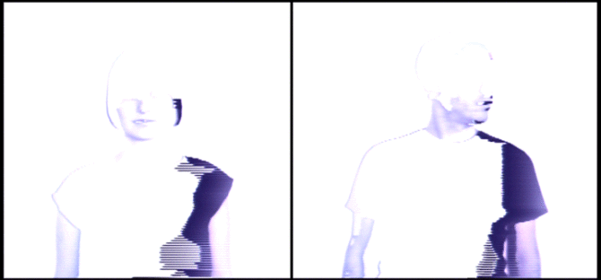
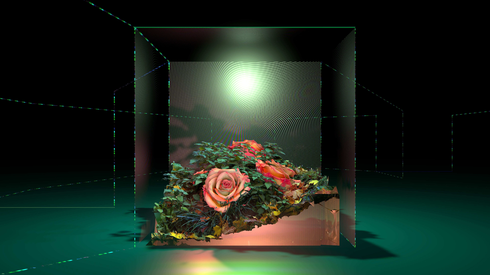
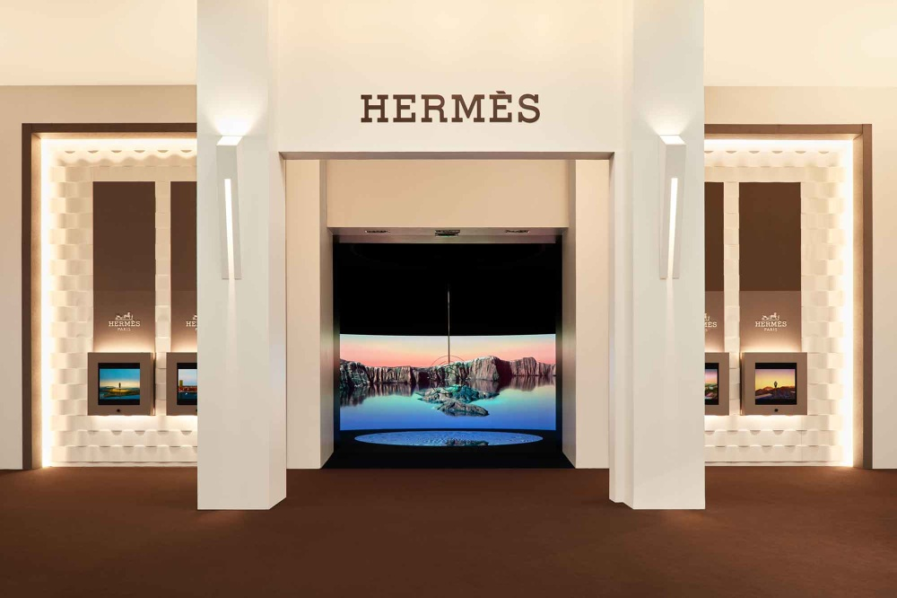
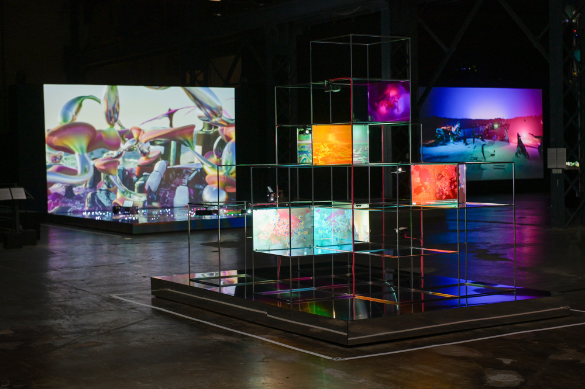
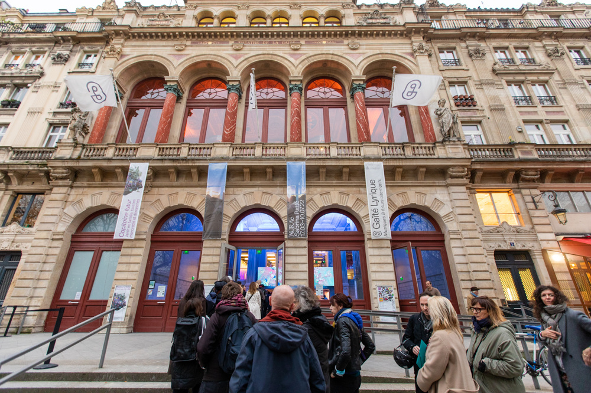
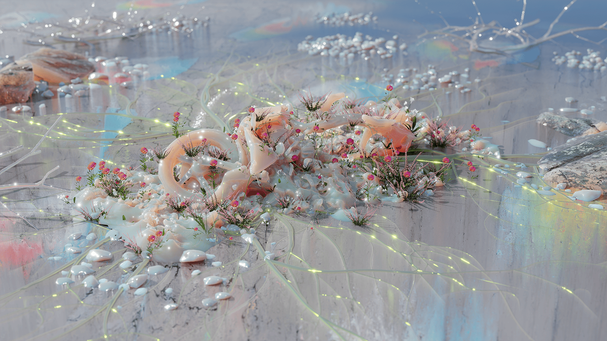

# Sabrina Ratté

**Tag tecnica/formato:** `video` `procedurale-generativo` `modellazione-3d` `live-visual-vjing`
**Tag tema:** `storia-computer-grafica` `mondi-virtuali-simulazione` `performance-audiovisiva` `visual-live-e-vjing`

## Biografia
Nata nel 1982 a Québec, Canada. Consegue BFA e MFA in produzione cinematografica alla Concordia University di Montréal, oltre a un master in cinema all'Université Paris 8. Vive e lavora tra Montréal e la Francia (Parigi/Marsiglia, a seconda del periodo). Riconoscimenti: medaglia d'oro alle VIII Giochi della Francofonia (2017, categoria arti visive); residenza alla Cité internationale des arts di Parigi; finalista/longlist al Sobey Art Award nel 2019 e nel 2020 — nel 2020, a causa della pandemia, la Sobey Art Foundation e la National Gallery of Canada hanno ristrutturato il premio distribuendo 25.000 dollari canadesi in parti uguali a tutti i 25 artisti in longlist, invece di nominare un solo vincitore: Ratté rientra quindi tra le artiste che hanno ricevuto questa distribuzione, non tra le "vincitrici" in senso tradizionale. Rappresentata dalla galleria Ellephant (Montréal) e da Galerie Charlot (Parigi).

⚠️ Non risulta alcuna rappresentanza presso la galleria bitforms di New York, talvolta citata in fonti secondarie non verificate.

## Poetica e ricerca
Ratté comincia a lavorare, parallelamente agli studi di produzione cinematografica, con le prime tecnologie analogiche dell'arte video (sintesi video, feedback visivo), integrando in seguito animazione 3D e strumenti digitali. In un'intervista alla CBC dichiara: "Ho sempre pensato al video come a un modo di dipingere con la luce elettronica." Verso il 2012 acquisisce un sintetizzatore video modulare LZX Industries — principale erede contemporaneo della tradizione di sintesi video analogica del Sandin Image Processor — a partire dal quale inizia a generare immagini direttamente con il sintetizzatore invece di registrare la "realtà" e comporla in seguito. In un'intervista al festival FIBER di Amsterdam (2018), viene descritta come un'artista che lavora "con tecnologie analogiche, come sintetizzatori video e feedback video, mescolate a tecniche di animazione 3D per creare spazi video ipnotici e mutevoli. Dall'architettura utopica alle texture pittoriche, indaga la linea ambigua tra il regno virtuale e quello fisico." Un primo profilo critico su Rhizome (2011) discute la sua citazione di Philip K. Dick (il saggio "How to Build a Universe That Doesn't Fall Apart Two Days Later" e il romanzo *Ubik*) come influenza sul proprio interesse per la destabilizzazione della realtà percepita. La Gaîté Lyrique di Parigi, per la retrospettiva *Aurae* (2023), la descrive come un'artista che fa "dell'elettricità la propria materia prima e del video la propria sostanza malleabile" per costruire "paesaggi carnali e architetture sognate situate tra il mondo fisico e quello virtuale." Dal 2010 forma anche il duo audiovisivo **Le Révélateur** con il musicista elettronico Roger Tellier-Craig (già di Fly Pan Am e Set Fire to Flames): esibizioni dal vivo che accoppiano la sua musica elettronica/modulare al trattamento video analogico e digitale in tempo reale di Ratté.

## Opere principali
### Le Révélateur, opere con Roger Tellier-Craig (dal 2010)
**Descrizione:** progetto audiovisivo nato nel 2008 come progetto solista del musicista Roger Tellier-Craig, ampliato nel 2010 a duo con l'ingresso di Ratté come artista video. Include i primi lavori *L'entre-Deux* (2010) e *Le Labyrinthe* (2010), e l'album *Visites Possibles and Sightings: Music for the videos of Sabrina Ratté* (2015, etichetta Where To Now?), con colonne sonore create appositamente per i suoi video *Visites Possibles* (realizzato per il collettivo online Computers Club) e la serie *Sightings* (realizzata per l'etichetta video Undervolt & Co).
**Lettura critica:** un raro caso di collaborazione musica-immagine strutturata come vera co-produzione, non come colonna sonora aggiunta a posteriori — la musica di Tellier-Craig è scritta appositamente per i video già esistenti di Ratté.

### Floralia (2021)
**Descrizione:** serie video in quattro parti (Floralia I-IV) con sound design di Andrea-Jane Cornell. Raffigura ecosistemi speculativi/estinti in un archivio virtuale, con riferimenti espliciti al saggio "Manifesto cyborg" di Donna Haraway e agli scrittori di fantascienza Ursula K. Le Guin e Greg Egan; esiste come serie di installazioni/proiezioni, grande murale e versione VR.
**Lettura critica:** l'opera in cui il riferimento teorico (Haraway) diventa esplicito e dichiarato, non solo implicito nell'estetica ibrida analogico/digitale.
**Video:** [Floralia I (YouTube)](https://www.youtube.com/watch?v=WDdVEkAtQao)

**Approfondimento:** [Ellephant Gallery — Sabrina Ratté](https://ellephant.org/artists/sabrina-ratte)

### Terraforma (2022)
**Descrizione:** installazione video/scultorea commissionata da Hermès Horloger per Watches & Wonders, Ginevra 2022. Dodici vetrine interattive con sculture stampate in 3D (prodotte tramite scansioni fotogrammetriche del corpo della stessa artista, alterate digitalmente) illuminate da proiezioni video HD; esplora tempo, ubiquità e dialogo tra virtuale e fisico.
**Lettura critica:** una rara commissione dal mondo del lusso/orologeria che applica il vocabolario ibrido analogico/digitale di Ratté a una scala espositiva completamente diversa da quella della galleria d'arte.

### Futurs Spéculaires (2023)
**Descrizione:** prima mostra personale istituzionale a Montréal, all'Arsenal Contemporary Art, organizzata con la galleria Ellephant (25 maggio-13 agosto 2023). Installazioni, video, opere interattive e una sala immersiva che esplorano natura/tecnologia, utopia/distopia e il virtuale come registro sempre più primario dell'esistenza.
**Lettura critica:** la mostra che consolida, su scala museale nella sua città natale, l'intero percorso dell'artista dagli esordi analogici alle installazioni ibride più recenti.

### Aurae (2023)
**Descrizione:** prima retrospettiva (non esaustiva) francese, La Gaîté Lyrique, Parigi (17 marzo-6 novembre 2023). Il titolo riprende uno dei primi video dell'artista e l'etimologia della parola "aura". Combina proiezioni video, animazione, stampe, fotogrammetria, scultura e dispositivi spaziali.
**Lettura critica:** la mostra più ampia dedicata finora al percorso dell'artista, che ne ripercorre l'evoluzione dal video sintetizzato analogico ai più recenti lavori scultorei e fotogrammetrici.

### Realia (2025)
**Descrizione:** prima mostra personale italiana, Milano Design Week/Porta Venezia Design District, MEET Digital Culture Center (7-13 aprile 2025). Esplora la convergenza tra tecnologia e biologia; include *Plane of Incidence I e II* (2024) — oggetti elettronici abbandonati digitalizzati e trasformati in nuove forme di vita tramite scansione 3D e Blender — e ripropone *Floralia* (2021).
**Lettura critica:** conferma l'espansione internazionale recente del lavoro dell'artista, con un accento crescente sulla trasformazione di scarti tecnologici reali in nuove forme organiche simulate.

**Approfondimento:** [Ellephant Gallery — Sabrina Ratté](https://ellephant.org/artists/sabrina-ratte)

## Interviste e talk
- [CBC Arts — intervista (2018)](https://www.cbc.ca/arts/exhibitionists/sabrina-ratte-i-have-always-thought-of-video-as-a-way-of-painting-with-electronic-light-1.4625541)
- [FIBER/Medium — "Sculpting The Electronic Signal", intervista (2018)](https://fiber.medium.com/sculpting-the-electronic-signal-a-short-interview-with-sabrina-ratt%C3%A9-ffd3ca59ecbb)

## Fonti
- [Ellephant Gallery — pagina artista](https://ellephant.org/artists/sabrina-ratte)
- [Galerie Charlot — pagina artista](https://www.galeriecharlot.com/en/75/Sabrina-Ratte)
- [MOMENTA Biennale de l'image — pagina artista](https://momentabiennale.com/en/artist/sabrina-ratte/)
- [Rhizome — profilo artista (2011)](https://rhizome.org/editorial/2011/dec/1/artist-profile-sabrina-ratte/)
- [La Gaîté Lyrique — Aurae](https://gaite-lyrique.net/grand-format/aurae-sabrina-ratte)
- [Arsenal Contemporary Art — Futurs Spéculaires](https://www.arsenalcontemporary.com/mtl/exhib/detail/sabrina-ratte-futurs-speculaires)
- [Fuorisalone.it — Realia](https://www.fuorisalone.it/en/2025/events/5810/REALIA-by-SABRINA-RATT%C3%89)
- [Fact Magazine — su Floralia](https://www.factmag.com/2021/01/22/sabrina-ratte-floralia/)
- [Concordia University — su Sobey Art Award 2020](https://www.concordia.ca/news/stories/2020/05/12/2-concordians-receive-25k-from-the-sobey-art-awards.html)

## Crediti delle immagini
Immagine per ciascuna delle sei opere, inclusa sotto la relativa descrizione in "Opere principali", dal sito ufficiale dell'artista e da Ellephant Gallery.
- [Ellephant Gallery — pagina artista](https://ellephant.org/artists/sabrina-ratte)
- [Galerie Charlot — pagina artista](https://www.galeriecharlot.com/en/75/Sabrina-Ratte)
- [MOMENTA Biennale de l'image — pagina artista](https://momentabiennale.com/en/artist/sabrina-ratte/)
