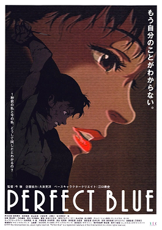

# Satoshi Kon

**Tag tecnica/formato:** `animazione-2d`
**Tag tema:** `corpo-identita` `mondi-virtuali-simulazione`
**Stato:** scheda parziale, scritta a partire da fonti web (Wikipedia, siti di festival e gallerie); non ancora assegnata a un corso · immagini controllate (diritti degli autori)

## Biografia
Nato a Sapporo, Hokkaido, il 12 ottobre 1963, morto il 24 agosto 2010 a 46 anni per un tumore al pancreas. Si diploma in Graphic Design alla Musashino Art University. Regista, animatore, sceneggiatore e autore di manga, è membro della Japanese Animation Creators Association (JAniCA).

## Poetica e ricerca
Il tema ricorrente dei suoi film, che Wikipedia indica già in *Perfect Blue* e ritrova in *Millennium Actress*, *Paranoia Agent* e *Paprika*, è la sfumatura del confine tra fantasia e realtà.

## Opere principali

### Perfect Blue (1997)
**Descrizione:** Film d'animazione giapponese, thriller psicologico, tratto liberamente dal romanzo *Perfect Blue: Complete Metamorphosis* di Yoshikazu Takeuchi, con sceneggiatura di Sadayuki Murai. Una cantante di un gruppo idol lascia la musica per recitare e diventa vittima di un fan ossessivo; mentre avvengono omicidi efferati, perde il contatto con la realtà.
**Lettura critica:** Considerato dalla critica un capolavoro dell'animazione e uno dei più grandi film d'animazione di sempre.

### Altri lavori principali
**Descrizione:** *Millennium Actress* (2001), *Tokyo Godfathers* (2003), la serie TV *Paranoia Agent* (2004), *Paprika* (2006).

## Fonti
- [Wikipedia — Satoshi Kon](https://en.wikipedia.org/wiki/Satoshi_Kon)
- [Wikipedia — Perfect Blue](https://en.wikipedia.org/wiki/Perfect_Blue)

## Crediti delle immagini
Immagini controllate il 2026-11-01: provengono dalle pagine indicate (festival, gallerie, siti degli artisti, piattaforme) e restano di proprietà degli autori.
- Perfect Blue (1): [en.wikipedia.org](https://en.wikipedia.org/wiki/File%3APerfectblueposter.png) · Locandina, diritti degli autori; uso didattico
