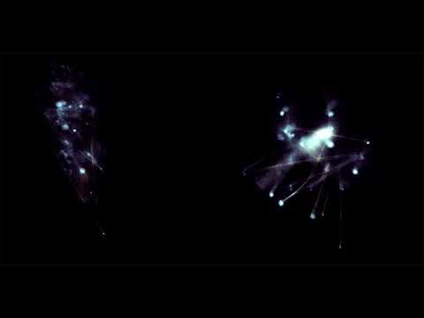

# Shelley Eshkar

**Tag tecnica/formato:** `motion-capture` `performance-dal-vivo` `procedurale-generativo`
**Tag tema:** `corpo-identita`

## Biografia
Artista digitale statunitense. Co-fondatrice, con Paul Kaiser (e in seguito con Marc Downie), del collettivo **OpenEndedGroup**, pioniere nell'uso artistico della motion capture applicata alla danza. Riceve grant dalla Foundation for Contemporary Arts.

## Poetica e ricerca
Eshkar lavora fin dalla fine degli anni '90 all'intersezione tra motion capture, danza e grafica generativa in tempo reale, in stretta collaborazione con coreografi e danzatori. Il lavoro con Kaiser riflette sul paradosso della cattura del movimento: i dati di motion capture registrano posizione e rotazione del corpo senza preservarne massa, muscolatura o pelle — un corpo ridotto a scheletro di dati, che l'opera trasforma poi in disegno, luce, network di nodi e linee.

## Opere principali

### Ghostcatching (1999, con Paul Kaiser; danza e voce di Bill T. Jones)
**Descrizione:** installazione digitale di 7 minuti che fonde danza, disegno e composizione computazionale: il movimento captato dal danzatore-coreografo Bill T. Jones viene trasformato in linee di disegno animate, senza mai mostrare un corpo "pieno" o realistico.
**Lettura critica:** una meditazione sull'atto di essere catturati e di liberarsi dalla cattura — il corpo diventa gesto grafico puro, presente e assente allo stesso tempo.

**Approfondimento:** [OpenEndedGroup — Ghostcatching](http://openendedgroup.com/artworks/gc.html)

### Loops (2001, con Paul Kaiser e Marc Downie; coreografia di Merce Cunningham)
**Descrizione:** ritratto digitale astratto del coreografo Merce Cunningham, derivato da una registrazione in motion capture di un suo assolo per mani e dita; le articolazioni captate diventano nodi in uno spazio 3D collegati da una rete di linee, renderizzata in tempo reale.
**Lettura critica:** porta la ricerca sulla motion capture oltre la semplice registrazione del movimento, verso un sistema generativo che rielabora il gesto coreografico in tempo reale.

**Approfondimento:** [OpenEndedGroup — Loops](http://openendedgroup.com/artworks/loops.html)

## Immagini

Immagine per ciascuna delle due opere, inclusa sotto la relativa descrizione in "Opere principali", da MASS MoCA e YouTube.
- [OpenEndedGroup — Ghostcatching](http://openendedgroup.com/artworks/gc.html)
- [MASS MoCA — Ghostcatching](https://massmoca.org/event/ghostcatching/)
- [Foundation for Contemporary Arts — Shelley Eshkar](https://www.foundationforcontemporaryarts.org/recipients/shelley-eshkar/)

## Fonti
- [OpenEndedGroup — Ghostcatching](http://openendedgroup.com/artworks/gc.html)
- [MASS MoCA — Ghostcatching](https://massmoca.org/event/ghostcatching/)
- [Foundation for Contemporary Arts — Shelley Eshkar](https://www.foundationforcontemporaryarts.org/recipients/shelley-eshkar/)

---

## Appunti da organizzare
- Citata in *Tecniche di animazione digitale (Biennio)*, con Paul Kaiser, per la traduzione in figura animata del movimento captato da sensori — parte della linea di ricerca su performance e immagine in movimento.
- Video da cercare: estratti di *Ghostcatching* e *Loops* circolano online ma non è chiaro se esista una versione integrale liberamente accessibile — da verificare.
