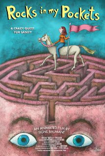

# Signe Baumane

**Tag tecnica/formato:** `animazione-2d`
**Tag tema:** `corpo-identita`
**Stato:** scheda parziale, scritta a partire da fonti web (Wikipedia, siti di festival e gallerie); non ancora assegnata a un corso · immagini controllate (diritti degli autori)

## Biografia
Animatrice, artista, illustratrice e scrittrice lettone, vive e lavora a New York. Membro dell'Academy of Motion Picture Arts and Sciences, nel 2005 è Fellow in Film della New York Foundation for the Arts. Ha insegnato animazione al Pratt Institute dal 2000 al 2002.

## Poetica e ricerca
Il suo lungometraggio è un'autobiografia animata: parte da fatti reali della sua famiglia per raccontare depressione e suicidio.

## Opere principali

### Rocks in My Pockets (Akmeņi manās kabatās, 2014)
**Descrizione:** Film d'animazione autobiografico, comico e psicologico per adulti, scritto, prodotto, diretto e animato da Baumane. Racconta cinque donne della sua famiglia, lei compresa, e le loro battaglie con la depressione e il suicidio. Creato in inglese, poi tradotto e prodotto in lettone. Selezionato come candidato lettone al miglior film straniero per i 87° Academy Awards, senza ricevere la nomination.

## Fonti
- [Wikipedia — Signe Baumane](https://en.wikipedia.org/wiki/Signe_Baumane)
- [Wikipedia — Rocks in My Pockets](https://en.wikipedia.org/wiki/Rocks_in_My_Pockets)

## Crediti delle immagini
Immagini controllate il 2026-11-01: provengono dalle pagine indicate (festival, gallerie, siti degli artisti, piattaforme) e restano di proprietà degli autori.
- Rocks in My Pockets (1): [en.wikipedia.org](https://en.wikipedia.org/wiki/File%3ARocks_in_My_Pockets.jpg) · Locandina, diritti degli autori; uso didattico
