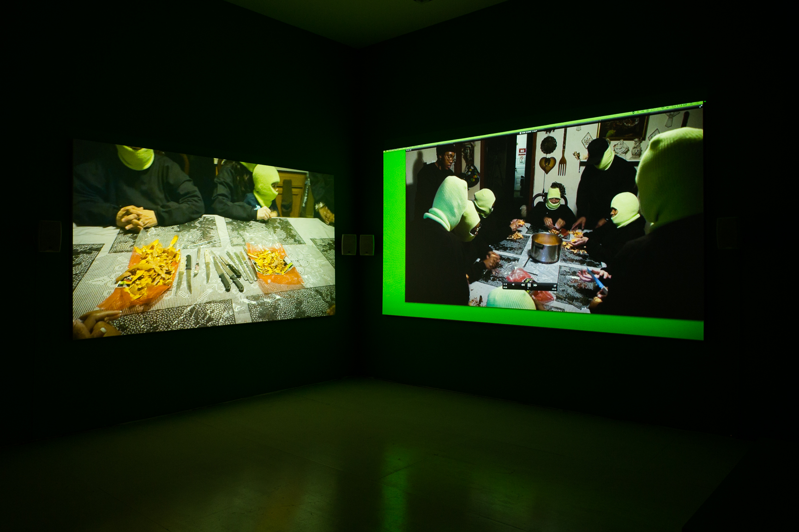
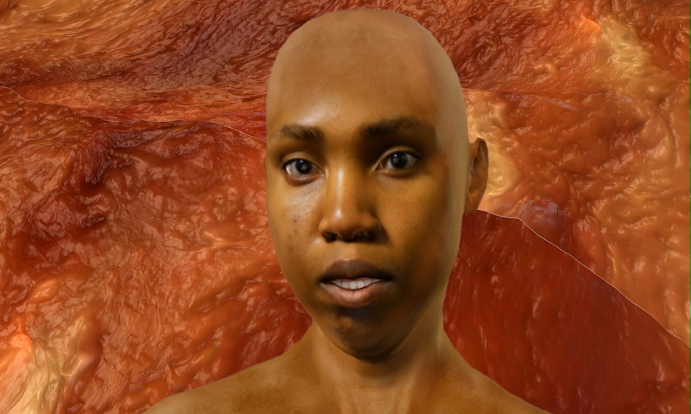
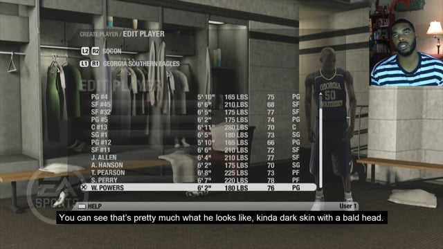
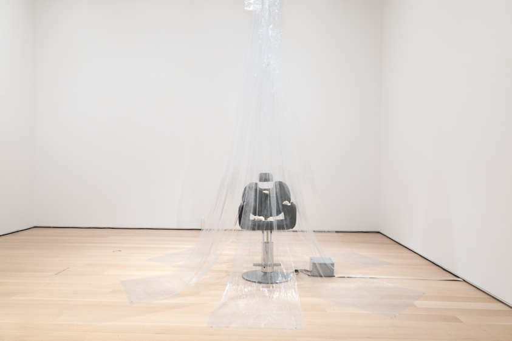

# Sondra Perry

**Tag tecnica/formato:** `video` `installazione` `modellazione-3d`
**Tag tema:** `corpo-identita` `sorveglianza-controllo`

## Biografia
Nata nel 1986 a Perth Amboy, New Jersey. Consegue un BFA al New York State College of Ceramics della Alfred University (2012) e un MFA alla Columbia University School of the Arts (2015). Insegna come docente a contratto alla Columbia (Advanced Video, corsi graduate e undergraduate) ed è tra i docenti/co-responsabili della disciplina Film/Video del programma MFA del Bard College; è inoltre collegata al Mount Royal School of Art (MFA multidisciplinare) del MICA. Riconoscimenti principali: Louis Comfort Tiffany Foundation Grant (2017); Gwendolyn Knight and Jacob Lawrence Prize (2017, con mostra personale al Seattle Art Museum e una borsa di 10.000 dollari); prima "Dream Commission" Rolls-Royce/Serpentine (2021); Herb Alpert Award in the Arts, sezione arti visive (2025, premio di 75.000 dollari e residenza al CalArts). Principali sedi di mostre personali: The Kitchen, New York (2016, prima mostra istituzionale personale); Squeaky Wheel Film & Media Art Center, Buffalo (2017); Serpentine Galleries, Londra (2018, prima mostra personale europea); Institute of Contemporary Art, Miami (2018); LUMA Westbau, Zurigo (2018); Museum of Contemporary Art Cleveland (2019); Bridget Donahue, New York (galleria che la rappresenta, mostre nel 2018 e 2023); Fondation Beyeler, Basilea (2022).

⚠️ Nota di correzione: non risulta una mostra personale al Whitney Museum of American Art — il Whitney possiede in collezione permanente l'opera *Graft and Ash for a Three Monitor Workstation* (2016), ma non ha ospitato una sua personale documentata.

## Poetica e ricerca
Perry usa schermo verde/blu (chroma-key), avatar 3D, asset e motori di videogiochi, software di animazione e CGI (in particolare il modificatore Ocean di Blender) per interrogare il modo in cui le tecnologie di produzione dell'immagine digitale sono state costruite attorno al corpo bianco come standard neutro di default, e come questo condizioni la rappresentabilità del corpo nero. La studiosa Soyoung Yoon, nel saggio "Beware the Light: Figure Versus Ground, White Versus Black (Blue), or: Sondra Perry's Blue Room and Technologies of Race" (*Millennium Film Journal*), sostiene che il blu del chroma-key funzioni come "l'opposto del colore dell'essere" — nessuna pelle umana esiste in quella tonalità, che diventa quindi uno spazio negativo su cui può essere proiettata qualunque narrazione. Un saggio critico su e-flux, dedicato alla sua mostra personale da Bridget Donahue, collega esplicitamente le installazioni in blu chroma-key di Perry a *Dark Matters: On the Surveillance of Blackness* (2015) di Simone Browne, individuandolo come riferimento diretto del suo pensiero su visibilità, sorveglianza e disumanizzazione. La studiosa Rizvana Bradley colloca il lavoro digitale di Perry dentro la teoria estetica nera nel libro *Anteaesthetics: Black Aesthesis and the Critique of Form* (Stanford University Press, 2023). Il catalogo *Sondra Perry: Typhoon Coming On* (Serpentine/Sternberg Press, a cura di Amira Gad), con testi di Elizabeth Alexander, Simone Browne, Hannah Black, Aria Dean, Nora Khan, Hito Steyerl, Soyoung Yoon e altri, resta l'antologia critica più ricca dedicata al suo lavoro. In un'intervista a *It's Nice That*, Perry dichiara di considerare "la blackness come qualcosa di tecnologico, in un certo senso" — una formulazione che riassume l'intero impianto della sua ricerca.

## Opere principali

### Lineage for a Multiple-Monitor Workstation: Number One (2015)
**Descrizione:** video a due canali, colore e sonoro, 25:24 minuti. Narrazione familiare semi-autobiografica (i parenti di Perry interpretano se stessi — seppelliscono una bandiera in giardino, sbucciano patate dolci, scene di più generazioni) proiettata su pareti adiacenti in chroma-green. Mostrata in "Greater New York" al MoMA PS1 (2015-16).
**Lettura critica:** una delle prime opere a introdurre il vocabolario del chroma-key come dispositivo narrativo, non solo tecnico, per raccontare la memoria familiare nera.

### Resident Evil, con Graft and Ash for a Three Monitor Workstation e Wet and Wavy Looks—Typhon coming on for a Three-Monitor Workstation (2016)
**Descrizione:** prima mostra istituzionale personale, The Kitchen, New York (novembre-dicembre 2016), con quasi tutte le pareti della galleria dipinte in Rosco Chroma Key Blue. Comprende la grande proiezione *Resident Evil* (il cui titolo cita il videogioco del 1996), costruita da riprese ravvicinate e distorte della pelle della stessa Perry; *Graft and Ash for a Three Monitor Workstation*, una cyclette collegata a tre monitor su cui un avatar digitale recita un monologo su lavoro e capitalismo (oggi nella collezione permanente del Whitney Museum); *Wet and Wavy Looks—Typhon coming on for a Three-Monitor Workstation*, un vogatore resistente all'acqua riempito di gel per capelli e collegato a tre monitor, il cui titolo cita direttamente il dipinto di J.M.W. Turner del 1840 sul massacro della nave Zong (oggi nella collezione del MoMA).
**Lettura critica:** l'ambiente interamente blu della mostra trasforma la galleria stessa in un enorme "schermo verde" concettuale — temi di brutalità poliziesca, violenza razzializzata e circolazione/distorsione digitale delle immagini di corpi neri attraversano tutte e tre le opere.

### IT'S IN THE GAME '17 (2017)
**Descrizione:** video incentrato sul fratello gemello di Perry, Sandy Perry, giocatore di basket di Division I alla Georgia State University, la cui immagine e le cui statistiche sono state concesse in licenza dalla NCAA a EA Sports per i propri videogiochi cestistici senza il suo consenso — l'opera affianca il vero avatar digitale del fratello a uno creato dalla stessa Perry, interrogando la vendita e lo sfruttamento delle identità digitalizzate di atleti neri. Mostrata da Bridget Donahue (2018) e successivamente nella collettiva "Difference Machines: Technology and Identity in Contemporary Art" al Buffalo AKG Art Museum (2021-22).
**Lettura critica:** rende concreto, con un caso biografico diretto e documentabile, il tema più ampio della proprietà e dello sfruttamento commerciale del corpo nero digitalizzato.
**Video:** [IT'S IN THE GAME '17, documentazione (Vimeo)](https://vimeo.com/239709507)

### Typhoon coming on (2018)
**Descrizione:** installazione video/sonora immersiva, prima mostra personale europea, Serpentine Galleries, Londra (marzo-maggio 2018), poi ICA Miami e LUMA Westbau Zurigo. L'animazione centrale rielabora il dipinto di J.M.W. Turner del 1840 *Slavers Throwing Overboard the Dead and Dying, Typhoon Coming On* ("La nave degli schiavi"), che raffigura il massacro della Zong del 1781, quando l'equipaggio gettò in mare 133 persone ridotte in schiavitù per incassare un'assicurazione. L'oceano animato — costruito con il modificatore Ocean di Blender — è reso nel colore viola "di errore" che i software di simulazione mostrano quando una simulazione va in crash.
**Lettura critica:** trasforma un errore tecnico del software (il colore di crash) in immagine storica e politica — l'oceano viola diventa insieme citazione pittorica, glitch tecnico e memoria del Middle Passage.

**Approfondimento:** [Serpentine Galleries — Typhoon coming on](https://www.serpentinegalleries.org/whats-on/sondra-perry-typhoon-coming-on/)

### Flesh Wall (2016-2020)
**Descrizione:** animazione di un'immagine fortemente processata e ingrandita della pelle della stessa Perry, ampliata alla scala di Times Square per il programma di arte pubblica "Midnight Moment" (Times Square Arts), proiettata su oltre 70 cartelloni digitali ogni notte a mezzanotte per tutto febbraio 2021.
**Lettura critica:** porta il gesto intimo dell'ingrandimento della propria pelle nel più grande schermo pubblicitario pubblico degli Stati Uniti — un cortocircuito diretto tra corpo privato e spettacolo commerciale di massa.

⚠️ Nessuna immagine trovata con attribuzione certa in questa sessione.

### couch and fern, GLITTER AND THE LION'S MANE (2020-2023)
**Descrizione:** installazione con un divano capovolto e uno schermo video incassato (riprese da un'auto in movimento), una poltrona da barbiere ricoperta di funghi criniera di leone, e un audio con una conversazione tra Perry e la psicoterapeuta Bola Shonubi sulla vita della nonna di Perry come mezzadra nel Sud degli Stati Uniti sotto le leggi Jim Crow, e sulla ricerca di quella terra da parte della stessa Perry. Mostrata nella personale "Sondra Perry: ██████████" da Bridget Donahue, New York (2023); acquisita dall'Art Institute of Chicago nel novembre 2024.
**Lettura critica:** l'opera più recente sposta il registro dal corpo e dalla pelle alla memoria di terra e generazione — invecchiamento, trauma generazionale nero e guarigione, con un impianto meno tecnologico in superficie ma continuo nella ricerca sulla memoria familiare avviata già in *Lineage*.

**Approfondimento:** [Art Institute of Chicago — couch and fern, GLITTER AND THE LION'S MANE](https://www.artic.edu/artworks/179315/couch-and-fern-glitter-and-the-lion-s-mane-2020-2021-2022-2023-1934-1-8-ga)

## Immagini

Immagine per cinque delle sei opere, inclusa sotto la relativa descrizione in "Opere principali", dal sito ufficiale dell'artista, Serpentine Galleries, Vimeo e Art Institute of Chicago. Nessuna immagine reperita per *Flesh Wall*.
- [sondraperry.com — sito ufficiale](https://sondraperry.com)
- [Whitney Museum — Graft and Ash for a Three Monitor Workstation, collezione](https://whitney.org/collection/works/59924)
- [MoMA — Resident Evil (2016), collezione](https://www.moma.org/collection/works/219405)

## Fonti
- [sondraperry.com — sito ufficiale](https://sondraperry.com)
- [Whitney Museum — Graft and Ash for a Three Monitor Workstation, collezione](https://whitney.org/collection/works/59924)
- [MoMA — Resident Evil (2016), collezione](https://www.moma.org/collection/works/219405)
- [MoMA — Wet and Wavy Looks, collezione](https://www.moma.org/collection/works/221822)
- [Serpentine Galleries — Typhoon coming on](https://www.serpentinegalleries.org/whats-on/sondra-perry-typhoon-coming-on/)
- [Bridget Donahue Gallery — pagina artista](https://www.bridgetdonahue.nyc/artists/perry-sondra/works/)
- [Electronic Arts Intermix — biografia](https://www.eai.org/artists/sondra-perry/biography)
- [Art Institute of Chicago — couch and fern, GLITTER AND THE LION'S MANE, collezione](https://www.artic.edu/artworks/179315/couch-and-fern-glitter-and-the-lion-s-mane-2020-2021-2022-2023-1934-1-8-ga)
- [Frieze — recensione di Typhoon coming on](https://www.frieze.com/article/sondra-perry-typhoon-coming-2018-review)
- [e-flux — critica sulla mostra da Bridget Donahue](https://www.e-flux.com/criticism/241047/sondra-perry)
- [BOMB Magazine — intervista su Resident Evil](https://bombmagazine.org/articles/2016/12/08/sondra-perry-s-em-resident-evil-em/)
- [Herb Alpert Award in the Arts — profilo vincitrice 2025](https://herbalpertawards.org/artist/2025/sondra-perry)

---

## Appunti da organizzare
- Citata in *Tecniche di modellazione digitale 3D*, insieme a Harun Farocki, Rebecca Allen, Pierre Huyghe, Clement Valla, Alan Warburton, Lawrence Lek, Ian Cheng, Morehshin Allahyari, Daniel Rourke, David O'Reilly, Jakob Kudsk Steensen, Theo Triantafyllidis, Forensic Architecture.
- ⚠️ Da correggere/non ripetere senza fonte diretta: un'eventuale "grande mostra personale al Whitney" — non risulta, solo un'opera in collezione permanente (vedi sopra). Non risulta inoltre un riferimento esplicito alle "Shirley card" Kodak nelle sue stesse dichiarazioni — la sua critica si concentra piuttosto sul chroma-key e sul bias del colore fotografico/filmico in generale (Soyoung Yoon, Simone Browne); se il programma del corso cita le Shirley card in relazione a lei, potrebbe trattarsi di un collegamento fatto da chi ha scritto il programma, non una citazione diretta dell'artista — da verificare.
- Luogo di residenza attuale non del tutto certo dalle fonti (tra Perth Amboy, NJ, e l'area di New York) — usare formulazione approssimativa.
- Video ulteriori da vedere in aula: [Serpentine Galleries, documentazione di Typhoon coming on (YouTube)](https://www.youtube.com/watch?v=Qunkb4piXGw); [Hammer Museum, artist talk (YouTube)](https://www.youtube.com/watch?v=JDOZdBGjuSM); canale Vimeo dell'artista con opere integrali: [vimeo.com/sondraperry](https://vimeo.com/sondraperry/videos).
